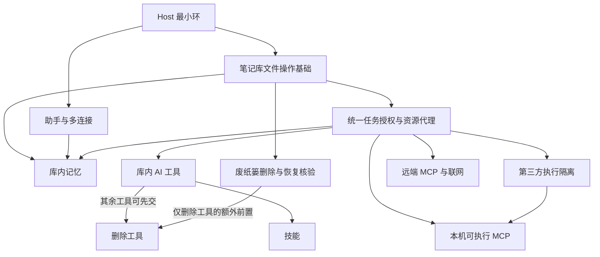

# 施工图

本文不是围栏。过期只改这里，不改产品性格。合同见 [已拍板决定](decisions.md)。强制点见 [架构](architecture.md)。工程题见 [施工对象](topics.md)。编码 Agent 从 [AGENTS.md](../AGENTS.md) 进。

单元格只有三种：

- **已交** — 一行指针。细节在代码和测试里。
- **当前** — 只展开下方那一节。
- **未开** — 禁止写代码。不要把实现写进围栏篇。

换阶段：改「当前阶段」标题、改矩阵里那一格、改 `AGENTS.md` 硬停。不要一次展开下一阶段。

## 当前阶段

**库内记忆。** 2026-10-03 v2 包 0–5 本机工程链路已收口：最终完整 1010 通过／2 既有平台跳过、文档／构建通过，功能窗口 306／0、固定视觉 110／0。受验提交 `d0e6796`；Windows、双平台 CI、原生输入法人工操作、真实模型质量及用户视觉确认分别待核，不自动结束阶段。旧体系退役，不兼容旧数据；[施工及债务表](#2026-10-03-账本上下文与记忆重构)。

2026-10-06 用户批准基线 `f8afb95` 的 [记忆完整性与债务收口](#2026-10-06-记忆完整性验收统一与旧债务收口)。评分／复核／发布统一、近期背景撤销闭环、库根明确恢复及两库连续验证，串行四包；M4 和已启用共同管线保持。真实复测最多 240 次，冻结后才调用；旧报告和 r9 历史结论保留。当前包 1–3 已独立复审，包 4 统一证据门小提交待复核，连续使用与最终整合门待续；本包新调用 0／240，整轮尚未验收。仅本地提交，不增依赖／页／IPC 通道／数据库／分支／worktree／专题文档，不推送／CI／master，平台人工待核项和下游硬停不变。
2026-10-04 用户批准的 [v4 补齐包](#2026-10-04-v4-可用性恢复与记忆质量施工)已完成本机工程修补及最终对照自查，代码受验 `6658044`；完整测试 1500 通过／2 既有平台跳过、构建与完整窗口 345／0。受限实验新增 12 次调用，两个模型均证据不足、已按格式／连接规则暂停；不改生产策略，不结束阶段。[最终工程与实验结论](#v4-最终工程与实验结论2026-10-05)分别登记工程、实验和正式质量。
2026-10-05 用户批准 [v5 本库工作接续记忆](#2026-10-05-v5-本库工作接续记忆施工)，三类新格式、整理评测路径、召回和管理已接线，最终受验提交与真实结果见该节。双模型两轮实测达门前保持开发版默认与正式质量提示，预算从旧余额 612 次划 240 次。历史 v4 结论和平台人工待核项继续有效。
2026-10-05 用户批准 [v6 自动记忆实用化与验收重整](#2026-10-05-v6-自动记忆实用化与验收重整)：包 0–4 已接线；包 5 经 revision 4（证据不足）与 revision 8（更正后条目 `paused` 装不进、合规 `fact`＋`supporting` 被误拒）两轮复验修产品后，以 **revision 9**（`d5aca453…`，执行提交 `02b3b87`）认证：deepseek-flash 两轮 **passed**（93.07／98.87，三道门全过、双标注 100% 且一致率 1.000、无「声称覆盖却装不进」行），MiniMax-M3 第一轮 failed（65.07）、按冻结规则不跑第二轮。据此**已切开发版默认**：生产整理固定共同管线（`MEMORY_PRODUCTION_STRATEGY='continuity'`，测试钉住），旧提议解析路径退出生产、仅留历史评测臂；质量成绩按设备级只读文件发布（本机记录：`passed`／deepseek-flash／`humanReviewed:false`），模型或主机不匹配时页面如实显示适用范围已变。**不等于记忆学习质量整体完成**：人工复核、Windows／双平台 CI／原生输入法／用户视觉仍待核，本机设备记忆模型仍是未达门的 MiniMax-M3。工程门：`pnpm test` **1639 通过／2 平台跳过**、`docs:check` 12 文件、`build` 通过、窗口按范围分别 354／0（默认）、94／0（多库）、112／0（v4）、54／0（记忆）。生产口径由常量加[接线守卫测试](architecture.md#2026-10-03-新记忆强制点)钉住（拆掉 `strategy` 即红）。详见[认证复验](#v6-认证复验revision-92026-10-06)。

2026-10-04 另获[记忆质量验证与债务修复局部授权](#2026-10-04-记忆质量验证与债务修复)：工程修复与固定真实评测已交，MiniMax-M3、deepseek-flash 均未通过学习质量门（该结论只适用于 2026-10-04 那一批固定评测；后续 v6 r9 结论见上），证据不足及平台人工项继续待核，不改变阶段或开放下游能力。
本轮另获[侧栏分区局部授权](#本轮侧栏分区局部授权)：普通目录树与直接资源分区、附件目录浏览、本机浏览偏好、侧栏宽度调节与完整收起及既有人的操作入口整理，附件内 Markdown 沿用既有打开与安全操作。当前阶段与矩阵状态不变；该授权不扩展非 Markdown 打开、附件导入、删除、AI 写工具或新设置页，功能本机已交、当前 Windows 与人工证据另列，不自动记为全平台已验。

### 本轮侧栏分区（局部授权）

用户已批准的产品规则见[侧栏目录与资源](decisions.md#侧栏目录与资源)，呈现见[前端协议](frontend.md#顶栏与侧栏)。本节开放现有侧栏、库内元数据列举及设备级浏览偏好的必要接线；渲染进程不碰盘，库根、路径、对象身份和权限仍走既有受信任服务。附件分类与导航只使用列表元数据，不借此读取资源内容。

| 已定范围 | 本轮施工与验收要求 |
|----------|--------------------|
| 上方普通目录、下方直接资源 | 附件夹及整个子树不入目录树；普通目录子文件不入树；下方不递归铺后代。含普通目录与同名附件夹的夹具核对分类，权限名单与隐藏路径仍不可见。 |
| 附件开关与浏览 | 默认隐藏，眼睛图标与资源路径同行，带可访问名称及切换状态；显示时标附件及所属笔记；进附件／子目录及返回只改下方，上方保持；附件内 Markdown 沿用已有打开与安全操作，附件夹无独立改名／移动入口。 |
| tab 与目录独立 | 切 tab、搜索／反链打开保留目录和资源位置，不设定位当前笔记按钮。 |
| 浏览状态与分隔 | 按设备按库保存选中、展开、比例、附件开关和资源位置，滚动只在会话保留；核对失效位置、换库隔离和损坏偏好的安全回退。默认 40/60，各区独立滚动，拖动与键盘调节均可用。 |
| 宽度调节与完整收起 | 192–360px，默认 224px、内容窗 ≤820px 时 208px；同窗同阅读偏好保护默认展开时正文行宽，先缩每侧留白至最低 24px，再限制上限（1200px 约 320px、800px 约 256px）。收窄不覆盖首选值，空间恢复自动恢复。右侧 8px 覆盖命中区不占布局；pointer capture、松开保存、Esc 取消、丢捕获安全结束；垂直 separator 支持左右 8px、Shift 32px、Home／End、双击默认，保留编辑器选区。收起完整隐藏、无空壳边框分隔柄，栏内焦点先回顶部按钮，展开保留浏览比例滚动。旧偏好兼容，坏宽度只退字段，不新增 IPC、依赖或设置页。新增范围本机验证见下方 10 月 2 日记录，Windows 与用户视觉证据待核。 |
| 搜索与人的既有入口 | 保留搜索按钮及快捷键；目录区新建文件夹始终针对所选普通目录，普通资源区新建笔记，附件浏览只隐藏资源区新建笔记；目录／笔记改名移动仍使用既有预览、安全提交与恢复路径。 |

**2026-10-01 本机交付与证据**（分区 `dcb765e`、元数据 `403a38d`）：侧栏分区已有实现，未改变当前阶段。用户在施工中进一步确认：移除定位当前笔记按钮，附件开关用资源路径同行的眼睛图标，无文字、不单独占行。

| 检查面 | 本轮结果与证据边界 |
|--------|--------------------|
| 分类及操作边界 | 主进程通过原生路径解析返回 `TreeEntry.attachmentOf`，覆盖实际文件系统的大小写别名；附件子树不进入目录区，附件夹没有独立结构菜单。Markdown 保留既有安全操作路径。 |
| 库隔离与恢复状态 | `VaultState.navigationKey` 是经库根存活核验的规范路径哈希，只供设备本地展示偏好使用。定向覆盖同名异库、根路径别名、旧／损坏偏好、失效目录回退、读取失败保留及应用迁移回执。 |
| 本机自动化 | `pnpm docs:check` 通过；`pnpm test`：66 文件、762 通过／2 跳过；`pnpm build` 通过；构建后 `pnpm ui:check`：154 条无失败。 |
| 构建窗口样张 | macOS 上固定库日夜 `1200×800`／`800×560`：55 条无失败，含真实分隔拖动及键盘极限、两区滚动、收起后切 tab 再展开保留位置、页面重新加载恢复偏好、附件进入／返回和路径同行眼睛图标。CDP 样张位于本次交付的 `/tmp/rgent-sidebar-final-visual`，不代称原生控件点击或完整应用重启实测。 |
| 待核项 | 用户视觉确认、当前提交对应的 Windows 构建窗口与双平台 CI 尚未取得；本轮仅提交不推送，不借旧 CI 作为本轮证据。其它前端冻结项及废纸篓安全门保持原状态。 |

视觉复跑曾出现正文留白与设置关闭焦点的三项失败；保留原断言、增加焦点诊断并让目录测试先将目标滚入可视区后，最终 55 项通过，未改正文或设置生产代码。不将一次重试通过当作已消除所有视觉时序波动。

自查已补齐三处边界：附件归属不在渲染层按大小写猜测；空／隐藏列表不覆盖会话滚动，展开再恢复；分隔可用高度扣除内边距和提示区，实际比例与可访问值一致。浏览偏好不写库文件、不改变权限，也不成为任务授权凭据。


### 10 月 2 日侧栏宽度与完整收起

历史代码提交 `f1dd700`；以下为该提交的本机结果。

- 本轮仅开放渲染层侧栏调宽和浏览偏好字段，保持「助手与多连接」阶段；未新增 IPC、依赖或设置页。
- 本机定向测试 2 文件、24 项通过，类型检查、`pnpm docs:check`、`pnpm build` 通过；构建后功能 `pnpm ui:check` 176 项无失败，固定展示库检查 72 项无失败。按本轮范围未跑全量单元测试。
- 真实矩形验证：1200px 内容窗从 224px 调到 320px，正文保持 628px；800px 从 208px 调到 256px，正文保持 320px；两侧实际留白均不低于 24px，反链和工作区无横向溢出。宽窗可达 360px，缩窗暂时钳制后恢复首选值；有占宽滚动条时另预留其宽度，定向用例覆盖 15px 情形。
- 指针拖动、松开提交、Esc 回退、键盘步进及上下限、双击默认、重新加载恢复宽度、非空正文选区及原文字节不变均有窗口证据。收起后侧栏和分隔柄为零占位，焦点回顶部展开按钮，底栏设置仍在原位。
- 自查及独立复核发现并修复「仅滚动后立即收起」会恢复旧快照的问题：隐藏前同步捕获两区位置；定向用例先红后绿，真实窗口用例不借切 tab 或导航保存快照。丢指针捕获、零尺寸、饱和拖动和拖回原位均不覆盖首选宽度。
- 本机已查看日夜 1200×800、800×560、1600×900、收起、只读账本及减少动态效果样张。功能截图在 `/tmp/rgent-width-window-final`，同内容截图在 `/tmp/rgent-width-visual-final`。页面重载不代称完整应用重启；CDP 截图不代称原生控件人工点击。
- 本轮仅本地提交、不推送；对应 Windows 窗口、双平台 CI 和用户视觉确认仍待核，不借旧 CI 代称通过，也不结束其它视觉冻结项。

### 10 月 2 日中文组合输入修复

历史代码提交 `314ebef`；以下为该提交及其定向窗口结果。

- 用户在 macOS 系统拼音、普通正文中报告 `nihao` 只留下 `n`。旧构建的真实浏览器组合事件复现：原文保真用的撤销 effect 映射了未使用的范围末端，合并第二次输入时抛 `RangeError`，导致 DOM 预编辑与文档状态脱节；普通快速英文输入也受影响。
- `view/source.ts` 只映射替换落点，普通字符交由编辑器自身撤销，含换行的删除仍保留原文字节回放。没有禁用撤销、整篇归一化或更换编辑器／依赖。
- 同轮自查发现 AI 块后的首字母重复及选词回车误准备授权；断段改在建立预编辑范围前进行，取消只撤回仍空、同篇的自动断段。任务回车／Esc 同时检查事件组合标志、IME 键码及编辑器组合状态，不抢选词或候选取消。
- 本机原文、身份锁与口令定向测试 3 文件、37 项通过，类型检查和构建通过；先红后绿覆盖连续字母／拼音、选词、混合换行选区替换、外部更新、撤销重做、AI 边界准备／取消和切篇后的迟到清理。独立复核另以只读探针核对选区和外部前后缀更新后的字节恢复，未改测试或生产接口。
- 构建窗口组合事件检查使用临时库，逐步发送 `n → ni → nih → niha → nihao` 再选词，核对完整全文与落盘字节；覆盖普通段落、空段、BOM／CRLF、标题、列表、AI 后落点、自动保存、撤销重做及取消，并纳入默认 `ui:check`。可用 `RGENT_UI_IME_ONLY=1 pnpm ui:check` 定向复现，不作为生产开关。
- 第一轮带截图的构建窗口 258 项中输入相关均通过；唯一失败是既有侧栏首轮拖动即时宽度断言（仍显示 224px），随后的提交拖动、恢复和输入用例通过。保留该失败及原断言，无截图复跑 257 项全部通过，含 AI 边界真实取消及组合状态下候选 Esc 不取消 Host。未改侧栏生产代码，不以重试代称时序问题已经消除。组合样张在 `/tmp/rgent-ime-final`，集成样张在 `/tmp/rgent-ime-integration`。
- 当前阶段仍是「助手与多连接」，没有新增设置、IPC 或能力。本轮只提交不推送；macOS 系统拼音候选窗的人工按键／选词、Windows 原生输入法及对应双平台 CI 仍待核，CDP 组合输入不代称系统候选窗人工验收。

### 10 月 2 日 tab 与侧栏字号微调

历史代码提交 `83c700b`；尺寸默认继续保留，完整窗口失败在本轮另行诊断。

- 按用户要求将 tab 常态／最大宽度从 220px 缩减 20% 至 176px；保留 112px 压缩下限、栏内滚动与紧随末项的新建按钮。目录、文档与附件等资源名称字号缩小 1px，不改变正文或设置字体。
- `pnpm docs:check`、构建通过。构建窗口实测常态 tab 为 176px、资源名称为 12.76px；拥挤 tab 从 125px 压缩至 112px 后栏内滚动。已查看日夜及窄窗样张；固定展示库 `RGENT_UI_VISUAL_ONLY=1 pnpm ui:check` 72 项全部通过，截图在 `/tmp/rgent-compact-visual`。
- 默认窗口集成检查中，本轮尺寸及压缩断言通过；随后模型选择、Host 和生命周期交互出现 20 项失败，停止连锁检查，完整日志保留在 `/tmp/rgent-compact-chrome.log`。其原因未在本次样式微调中查清，不记整套集成通过，也不以展示库通过代替它。本轮未跑全量单元测试；Windows、对应 CI 与用户视觉确认仍待核，仅本地提交、不推送。

## 依赖顺序

无日期。下面列出施工路标；真正不可跳过的前置关系见分支图和交接表，不能把所有能力误读成逐项串行，也不能据此同时开放多个阶段。

```text
笔记壳能启动
  → 管线与画布
  → 账本缝与人搜
  → 门禁
  → 身份标记（含账本只读回顾）
  → 界面改造（前端协议落地）
  → Host 最小环（最小模型配置 + 密钥存储 + 运行上限设置入口 + 流式未采纳 + 取消，无工具）
  → 笔记库文件操作基础（人先用，保存、结构操作与中断恢复）
  → 统一任务授权与资源代理（读写范围、发送确认、撤销、文件与数据出口）
  → 库内 AI 工具（逐件开放，清单见 decisions.md §工具）
  → 助手与多连接（设备习惯、连接隔离、默认模型与单场覆盖）
  → 账本与上下文基础（独立账本、迁移、预算及摘要）
  → 库内记忆（材料来源核验、自动整理与召回、撤销及遗忘）
  → 技能
  → 远端 MCP 与联网（受控 HTTPS，先只读查询和资料获取）
  → 第三方执行隔离（可执行组件的双平台资源边界）
  → 本机可执行 MCP（逐候选验证，不提供通用命令执行）
  → 废纸篓删除与恢复核验（独立安全门，不阻塞无删除的能力）
  → 专项模型分工（只随摘要、视觉理解、联网搜索等真实能力开放）
  → 最终视觉与压测校准
```

后续关键交接存在分支，以下仅画前置关系，不代表运行时已经接线：



施工路标不作为连续施工命令。Host 已兑现 [Agent 上下文与历史](topics.md#v0-上下文与历史) 的预算和临时摘要；供应商凭据、多模型与助手习惯已有实现，库内记忆合同与前置本机门已通过，接口按当前分包施工；[沙箱授权](decisions.md#沙箱与单场任务授权合同与开放边界) 已先落实 Host 的单场范围和模型接收方，其他出口与第三方隔离仍未开。废纸篓是独立分支，只阻止删除能力；远端只读 MCP 优先于本机可执行 MCP，前者须过本地出口与数据授权门，后者另过执行隔离门。第三方隔离研究可以提前，不据此启动服务器。自动整理记忆已于 2026-10-02 批准；多轮、子代理与多代理仍未拍板。

### 跨能力交接

下表的「阶段」须在上方施工路标列出；分支图展示关键强制前置，具体开放门以本表和硬约束共同核对，不能把删除分支读成所有工具的前置。合同在 [已拍板决定](decisions.md)，未决工程题在 [施工对象](topics.md)；交付物经代码与验收证明后才可供下游使用。未来设置页随所属能力开放，最后的视觉校准独立进行，不把所有设置功能推迟到最后。

| 阶段 | 前置能力 | 交付给下游 | 开放门与验收证据 |
|------|----------|------------|------------------|
| Host 最小环 | 身份标记、门禁、模型密钥 | 无工具任务、配置与运行上限快照、账本任务章 | 已交：受控流服务、冲突与取消定向测试；厂商现场调用不能由假服务代证。 |
| 笔记库文件操作基础 | Host 取消和保存、固定库根 IO | 人的结构操作、对象身份、权限迁移与中断恢复 | 已交：对应 `a05648f` 双平台测试、构建窗口及本次定向复核；残余竞态如实保留，删除不在本格完成定义。 |
| 统一任务授权与资源代理 | 人的文件操作基础验收、Host 任务及库会话、权限与凭据边界 | 可撤销的单场读写范围、选定模型接收方核对、逐用途发送确认及资源核验 | 已交现有 Host 授权：默认读取发起篇／本篇账本，扩展须人确认；范围、来源、模型接收方、撤销、并行及在途收尾，详见 [门一](topics.md#两道开放门与定向验收)。 |
| 库内 AI 工具 | 对应人的文件操作验收、统一任务授权与资源代理 | 逐件开放的受控读写及可核对结果 | 已交（本轮范围）：读库／搜库先限定范围再匹配、分页与预算、逐发送来源重核、账本过程与来源记账、新推理设备短期保存；写类工具仍未开，删除另等独立安全门，不借修引用改其他篇正文。 |
| 助手与多连接 | Host 配置与任务快照、设备密钥存储 | 每供应商一份凭据与多模型、手动读取模型、助手系统提示快照；助手页设备默认、底栏本篇单场临时选择 | 本机已交：默认／临时选择及交互收口见本轮对照表。密钥不串用、预览最终接收方、启动固定、失败不回退；当前设置错误反馈债务见本轮质量包，对应平台证据另列。 |
| 库内记忆 | 前置窗口功能门、文件身份与权限迁移、Host 上下文预算、受控数据出口及模型快照 | 库隔离存储、材料来源核验、独立使用／整理授权、自动整理与召回及遗忘 | 当前阶段：v2 包 0–5 与 v4 本机工程已交；v5 新格式、受限整理、召回和管理接线；v6 已按「单一受验模型两轮通过三道门」切开发版默认（共同管线，旧提议解析路径退出生产），单模型认证结果与未达门模型分别登记。人工复核与平台证据仍待核。新库默认关闭，记忆许可不扩大工具读取范围，后台权限不复用已结束的前台授权。 |
| 技能 | Host 工具环、库内受控文件 | 经人加载的库内说明文 | 未开：半成品不加载，模型不能上架或改写技能。 |
| 第三方执行隔离 | 统一资源代理、任务撤销／预算、平台机制与签名方案 | 可验证的最小文件／网络／进程权限和资源上限 | 未开：机制依据及两平台构建后恶意组件实测；失效不得普通启动补位。候选 API、限额和适配未锁，详见 [门二](topics.md#两道开放门与定向验收)。 |
| 远端 MCP 与联网 | 统一授权、受控出口、联网总闸与连接凭据 | 经逐项审定的只读外部能力与低信任结果 | 未开：先远端 HTTPS 查询／资料获取，不下载服务器或挂库；逐项核发送确认、目标认证、数据／凭据隔离、取消和部分失败，两平台本地出口均须证明。内置搜索／抓页独立验收，不声称约束远端内部。 |
| 本机可执行 MCP | 统一授权、第三方执行隔离、候选程序审定 | 有最小资源权限的本机能力 | 未开：逐候选核双平台文件／网络／凭据／进程／资源边界；失效不普通启动补位，不开放任意命令。 |
| 废纸篓删除与恢复核验 | 文件操作基础、原生候选的双平台安全证明 | 人的逐次删除、系统原位恢复核验；随后才供删除工具使用 | 未开：固定库根内实际对象一致、系统保留原名／原目录、部分失败及恢复原权限均须实测；已有候选失败，不提供生产入口或永久删除替代。 |
| 专项模型分工 | 对应摘要、视觉理解或联网搜索能力已开放 | 仅对应能力的模型选择和可信用量数据 | 未开：逐项验证协议及来源统计，不预设小／大／视觉模型控件。 |
| 最终视觉与压测校准 | 各已开页面和长文固定样例 | 统一外观、可访问性与性能证据 | 未开：最终统一外观、长文延迟与压测证据。当前界面的用户确认已在「界面改造」登记，不等于本阶段的校准。 |

硬约束：

- 门禁早于 AgentHost。
- 身份标记早于 Host 最小环。
- 界面改造早于 Host 最小环：底栏任务位、联网状态位、冲突双预览与浮层焦点是 Host 要往里填的前置。
- Host 最小环早于笔记库文件操作基础；已验收的基础早于统一任务授权与资源代理，后者早于对应 AI 文件工具。删除独立验收，不阻塞无删除的工具或其他已过各自门禁的能力，也不能借此注册删除工具。对象身份与权限迁移早于库内记忆，受控记忆读取早于把记忆加入任务上下文。
- 多连接先证明凭据隔离和任务快照，再逐种开放新协议。专项模型分工只随真实的摘要、视觉理解或联网能力开放。
- 搜库工具晚于最小环；方法不与人搜子串绑定。
- `partition.body` 早于一切索引（已满足）。
- 可执行第三方无论性能如何，接线前都必须通过执行隔离；远端 MCP 优先接只读服务，仍逐候选证明双平台本地出口。只迁进程、列白名单或 CI 成功不能代证，无法证明则不接；远端内部不在本机隔离承诺内。
- 任务范围授予后仍逐次核验；默认只读发起篇和本篇账本，读库范围、结构来源／目标与对外发送用途分别确认，扩展由人批准，删除另逐次确认。配置快照不冻结权限，记忆、技能或 MCP 结果不能扩大授权。
- 沙箱门不替代 renderer 隔离、文件身份／修订与恢复门；当前原生废纸篓失败结论、残余竞态和各画面的确认范围保持原记录。
- 账本缝已经先于身份标记落地。不要写成「块模型早于账本」。

### 沙箱规划入库与冲突裁定

本轮仅修文档及文档检查器；没有新增产品运行时入口、工具、执行进程或设置页。当前阶段不变，两项沙箱建设均标「未开」。产品结论在 [沙箱合同](decisions.md#沙箱与单场任务授权合同与开放边界)，工程职责、候选和验收在 [施工对象](topics.md#沙箱与任务授权)，[架构](architecture.md#沙箱边界的现状) 仅校准实际状态。

| 旧表述或缺口 | 本轮裁定及理由 |
|--------------|----------------|
| 其他可参考笔记可改名／移动，未写本场授权 | 加上人的单场来源／目标范围。范围内可连续执行，但不放宽三档权限、其他篇正文边界或删除确认；库级可参考不足以表达任务意图。 |
| MCP 靠白名单和应用代转；子进程 socket 被描述为应用无法约束 | 白名单是审定步骤，还须资源代理及双平台出口证明。可执行组件直接出口受 OS 隔离约束；无法证明就关闭，避免把已知绕行出口视为允许的残余。 |
| 原生代码唯一例外限库 IO | 扩为最小原生安全边界例外，允许未来隔离在 TS 无法提供 OS 强制点时使用平台适配；机制与双平台验证先行，业务仍用 TS，不授权通用执行或新业务运行时。 |
| Host／索引迁出主进程只由性能决定 | 可信 Host 与索引的性能迁移仍是工程选型；可执行第三方隔离成为独立的安全前置，即使性能正常也不能省掉。 |
| 联网关闸时“只查本地”“最小环无联网”容易包含模型 API 和图片 | 明确关闸限制 Agent 搜索／抓页及 MCP；模型文本、图片展示分别授权。当前最小环确有模型请求，不能被记录为完全离线。 |
| 工具接线直接排在人的生命周期之后；安全说明存在旧实现用语 | 当时插入统一任务授权与资源代理、第三方执行前置，并保留整阶段删除门。后续经用户讨论确认，删除改为独立未开能力，详见下节；既有媒体／取消等证据记录不改变。 |

控件布局、授权令牌格式、平台 API／依赖、签名方案与数值限额仍未锁，不因裁定写成已实现。没有新增独立专题或 ADR。

自查补充：依赖关系改用分支图与交接表表达，内置联网不被误绑到第三方执行隔离；合法保存／移动可核验地续接身份但不能扩权。补齐调用主体校验、第三方工具参数映射、重试与子孙进程共享预算，以及撤销后的在途请求和安全收尾边界；已发送数据不能承诺追回。这些是既定安全原则的工程细化，不开放新能力或更改当前阶段。

文档验证中发现既有检查器把行内代码中的三反引号误认成围栏，导致新章节锚点被吞；本轮仅修围栏识别，并补 CRLF 行内示例／真实代码块的两条回归用例及夹具所需的现有链接文件。文档检查与八条检查器定向用例通过，不运行无关的产品全量测试；这不提供沙箱运行时或双平台安全验收证据。

### 三项讨论后的规划调整

经用户逐项确认，本次只同步文档、阶段名称与检查器用例，不开新功能，不补记运行时通过证据：

| 原规则 | 确认后的规则及影响 |
|--------|--------------------|
| 删除门未过，整个文件生命周期不能结束 | 当前改为「笔记库文件操作基础」，仍须收口自己的安全与恢复缺口；废纸篓删除／恢复核验独立未开，原安全标准和失败反例保留。删除不是其他能力的统一前置，完整生命周期也不能提前报交付。 |
| 可参考笔记均可检索，相关片段默认可联网 | 默认只读发起篇与本篇账本，跨篇读取由人授权；核对选定模型接收方。受本地上下文影响的搜索／MCP 请求须另展示内容、目的地、用途并确认；派生文本和记忆不豁免。 |
| 主要以 stdio 服务器描述 MCP，库内与外部工具混为总数七件 | 首批远端 HTTPS 只读 MCP，执行隔离成立后再逐项接本机服务器。七件是库内文件工具的规划清单，外部能力另审定，删除不与其余工具捆绑交付。 |

当时已发现但该次文档修订未修的代码问题仍须定向复核，尤其是原文／换行保真、机器标记与账本分区、权限预览一致性、IPC 调用主体、图片 DNS 与 AI 输出触发请求的边界。现有 CI 绿灯不使这些反例自动销账；当时基础阶段仍是「当前」，后续修复与独立证据见「笔记库文件操作基础（已交）」；不把本段历史待办当成今日未施工状态。

本次本机 `pnpm docs:check` 与文档检查器八条定向用例通过，阶段名称、当前矩阵行、路标交接及相对链接已核对。仅更新文档和对应阶段用例，未运行产品全量测试，也不新增运行时、双平台或远端 CI 通过记录。

## 对象 × 阶段

对象按代码地盘切。

| 对象 | 代码地盘 | 阶段状态 | 已有能力与待核门禁 |
|------|----------|----------|--------------------|
| 壳与信任 | `src/main/index.ts`、`src/preload`、`src/shared/ipc.ts`、`src/shared/flush.ts` | **已交** | `test/shared/flush.test.ts`；preload 为 `index.cjs`。 |
| 库与文件 | `src/main/vault.ts`、`secure-fs.ts`、`notes-fs.ts`、`vault-lifecycle.ts`、`native/**` | **已交** | 保存、新建／改名／移动／引用修复／中断恢复及消失另存基础已验；残余竞态与废纸篓独立门保留。 |
| 废纸篓删除与恢复核验 | 尚无生产实现；`test/native/trash_*` 仅为探针 | **未开** | 候选失败、删除入口关闭；不因基础阶段改名或外部系统删除而视为已交。 |
| 正文与画布 | `src/markdown/**`、`src/renderer/src/view/**` | **已交** | 一条管线 + viewport widget；`test/markdown/pipeline.test.ts`。 |
| 账本缝 | `src/markdown/partition.ts`、主进程独立账本服务、`src/renderer/src/tabs.ts` | **已交** | 画布与保存只走正文；独立账本由 `LedgerStore` 写入，旧尾部由 `partitionSource`／`composeSource` 保真迁移，不作为生产追加路径。 |
| 检索 | `src/main/vault-index.ts`、`src/renderer/src/search.ts`、`backlinks.ts` | **已交** | 人搜惰性全量 + 子串保持；模型两项只读工具已使用固定授权集合，不使用人的全库搜索后过滤。 |
| 门禁 | `src/main/permissions.ts`、IPC、树 | **已交** | 三档名单、树徽章与右键改档；`test/main/permissions.test.ts`。 |
| 身份标记 | `src/markdown/identity*.ts`、`src/markdown/syntax/identity.ts`、`src/renderer/src/view/*` | **已交** | 标记进管线、未采纳块受锁、账本只读；`test/renderer/identity-guard.test.ts`。 |
| 界面改造 | `src/renderer/**`、`src/renderer/src/styles.css` | **已交** | 功能已交；用户已于 2026-09-30 核对两平台样张并确认可接受，前端冻结解除。未逐张复核的画面按未复核记录；图片与外链细节留待按需回访，不据本次确认声称全量视觉验收通过。 |
| 一场 `/` | `src/main/**` 的 `AgentHost`、模型配置、IPC 与画布 | **已交** | 无工具最小环及两项只读工具已交；MiniMax 的具体现场范围见工具记录，其他厂商未据此通过。 |
| 任务授权与资源代理 | Host、库会话、IPC 与安全 IO | **已交** | 现有 Host 固定范围、一次性预览、模型接收方及撤销已验；通用网络与第三方执行仍未开。 |
| 库内 AI 工具 | 单场授权与对应人用文件基础 | **已交** | 本轮范围（读库／搜库、受控单步工具环、来源与过程记账、真机厂商调用）已交付并留证；写类工具不在本轮范围，删除另等独立安全门。 |
| 第三方执行隔离 | 尚未；平台机制与最小适配待验证 | **未开** | 双平台机制及恶意组件实测是接入门；普通子进程不是完成证据。 |
| 技能 | 尚未 | **未开** | 无页面施工许可。 |
| 远端 MCP 与联网 | 尚未 | **未开** | 先只读 HTTPS，受控出口、数据确认及逐候选双平台门已规划，没有接线许可。 |
| 本机可执行 MCP | 尚未 | **未开** | 另须第三方执行隔离及候选验收，不以普通子进程补位。 |
| 设置 | `src/renderer/src/settings.ts`、本机偏好与 IPC | **已交** | 既有设置及阅读偏好已有功能；库内记忆增加第五页，2026-10-04 追加第六页「笔记库」整合授权，本轮证据见文末局部施工。各画面视觉证据分别记录，其它未来页面未开。 |
| 助手与多连接 | `src/main/model-config.ts`、Host 凭据与 IPC、`src/renderer/src/settings.ts`、授权浮层 | **已交** | 每供应商一份凭据、多模型、手动读取与助手习惯已有实现；本轮助手页默认／底栏临时选择及质量收口按对照表验收。 |
| 账本与上下文基础 | 主进程账本服务、原文迁移、Host 与窗口 | **已交** | v2 `d7fffb4`、`c0bde8f` 本机功能门；包 5 `d0e6796` 已完成本机窗口集成，对应 Windows 与人工证据仍待核，不以历史绿灯证明新实现。 |

| 库内记忆 | 主进程单文件存储、独立许可与管理 | **当前** | v2 包 5 集成收口；旧体系退役，真实模型及平台证据另列。 |

矩阵里的“已交”指功能与安全边界，不表示外观已经跟上 [前端协议](frontend.md)。前端冻结已按用户 2026-09-30 的样张确认解除，但那只覆盖其核对过的画面；逐张未复核的差距仍按未复核记录，不能由本轮自动销账。

## 账本与上下文基础

2026-10-03 包 1、2 本机功能门已通过（`d7fffb4`、`c0bde8f`），后由包 5 `d0e6796` 完成本机窗口集成；对应平台证据仍待核。正文不加 noteId；原始历史由主进程独立服务保存；迁移先持久保真副本，再核验移除尾部，不能因重构丢稿。包 2 的摘要和维护以账本保存门为前置。

## 库内记忆

以下表格保留 **2026-10-02 的旧版施工授权**，不是当前运行合同或交付证据。用户当时批准替代人工记忆方案，以 `9a3c165` 为基线；前置本机功能门通过后切入库内记忆。该旧体系已被下方 [2026-10-03 v2 重构](#2026-10-03-账本上下文与记忆重构)退役。现行规则见 [产品合同](decisions.md#库内记忆)，当前工程及证据见 [施工对象](topics.md#库内记忆工程边界)和 v2 对照表；Windows、原生输入法与用户视觉确认分别待核，不通过阶段切换销账。

| 施工包 | 前置 | 本包交付 | 验收与交接 |
|--------|------|----------|------------|
| 前置失败与合同替换 | 保留现有失败和断言 | 定位侧栏拖动、设置关闭／滚动独立首因；替换人工唯一／逐场选择规划 | 具体红绿反例和完整功能窗口；偶尔通过不代称根因已修 |
| 存储、配置与来源 | 前置门通过并切阶段 | 固定隐藏记录、设备模型角色和库许可、材料身份、生命周期日志清除前迁移 | 坏记录不覆盖、来源无关编辑不失效、迁移中断幂等、跨库与附件隔离 |
| 召回、撤销与历史依赖 | 可核验存储和来源 | 核心／按需预算、独立使用授权、发送前复核、账本新依赖版本 | 不扩大读库范围，权限变更／遗忘后历史副本不能流出 |
| 后台整理与遗忘 | 已保存任务材料包及独立整理授权 | 有限队列、结构化建议、版本冲突拒绝、幂等回执、无正文遗忘记录 | 不阻塞下一场，不复活旧授权，迟到结果不覆盖人的更正 |
| 管理与集成 | 上述受控服务可用 | 第五页、符号开关、来源与编辑、补充记住、失败与重试 | 日夜宽窄窗口、受控服务完整链路、自查及本地提交；厂商质量、Windows、用户视觉分别留证 |

所有模型设置在设置面板；`/` 不加入记忆模型选择、逐条记忆选择或设置步骤。主进程与 preload 接线后按计划串行跑 docs:check、test、build、构建窗口。只提交不推送，不新增依赖、分支、工作树或专题文档。其它未开能力保持硬停。

### 2026-10-03 账本上下文与记忆重构

合同见[四层账本](decisions.md#账本)、[上下文](decisions.md#喂给模型)与[新记忆](decisions.md#库内记忆)。本轮不回滚旧提交整体，不迁移旧记忆数据；既有来源保护、材料分类、队列、保稿、取消和凭据隔离经验证后留用。下面状态只指 v2，不覆盖后面的历史证据。

| 包 | 进入门 | 运行路径与退役债务 | 2026-10-03 证据状态 |
|---|---|---|---|
| 0 退役 | 当前获准 | 停旧整理／召回，独立配置，移除 pin／旧格式／裸码／记忆阻断普通任务 | `27fd3d1`；2026-10-03 定向 7 文件／173 项通过，完整 987 通过／2 跳过，类型／文档／构建通过；窗口尚未运行 |
| 1 账本 | 包 0 定向门 | 生产账本服务、归属、检查点、保真迁移、对账、另存、生命周期；原尾部运行分支已在包 5 删除；旧原文解析只用于迁移 | `d7fffb4`；2026-10-03 定向 142 项、类型／构建通过；窗口待核 |
| 2 上下文 | 账本保存门 | 分页／统计／同路径压缩清理、两级摘要、生成方、预算；生产路径使用 token | `c0bde8f`；2026-10-03 完整 1010 通过／2 跳过、构建通过；对应窗口／平台待核 |
| 3 存储授权 | 基础本机门／平台缺口登记 | 单 Markdown、来源迁移、按项读核验；退役永久 pin／全文件读侧撤销 | `6966ef3`；2026-10-03 定向 71 项、类型／构建通过 |
| 4 自动运行 | 存储及撤销反例 | 有限整理、逐提议与更正组、容量暂缓重核、水位、遗忘、固定快照查询；无旧重试正文副本 | `0de396e`；2026-10-03 最终定向 10 文件／72 项、类型／文档／构建通过；模型质量及窗口待核 |
| 5 集成 | 服务定向门 | 五页、轻反馈、诊断恢复、窗口链路；清旧 IPC／类型／断言／并存路径 | `d0e6796`；2026-10-03 最终完整 81 文件／1010 通过／2 平台跳过、文档／构建通过；功能窗口 306／0、固定视觉 110／0；初始和失败记录保留如下 |

包 5 首轮窗口失败原记录：`/tmp/rgent-v2-package5-ui.log`，270 项／7 失败。独立首因之一为服务持有库消失前的关闭句柄，定向 `vault` 用例复现 `VAULT_CLOSED` 后改为核验后的当前句柄；另一个为独立账本移除尾部后，末尾回答没有可写空段，`host-source` 反例复现后补分隔。后续创建及恢复超时为同轮连锁失败，保留原记录，不以负载假设或多次重跑择绿。

包 5 初始管理／故障／Host 定向 11 文件 89 项、完整 1002 通过／2 跳过及构建曾通过，只适用于首轮窗口前的实现。之后完整检查出现连接 ID 的旧精确断言及修正时的内部／公开类型混用，失败日志保留；最终新断言核对主进程连接字段，1009 通过／2 跳过。该结果仍未覆盖后面的清理回顾与预算自查修复，最终适用结果见下方 1010 项收口。

2026-10-03 包 5 自查记录（修复受验提交 `d0e6796`）：第二轮窗口 305 项／1 失败（`/tmp/rgent-v2-package5-final-ui.log`），独立账本取消状态仍被旧正文尾部断言漏判；改为核对结构化任务状态、口令及正文标记。新增清理回顾反例的窗口 306 项／2 失败（`/tmp/rgent-v2-package5-review-red-ui.log`）：一项为取消检查仍期待已被口令转换移除的 `/`，另一项实际复现历史已清理但展开节点仍显示原文。明确正文标记并在维护成功后刷新分页、拒绝迟到旧页；额外上下文反例复现摘要预留挤掉完整近期任务，修复后相关 3 文件 34 项通过。原失败记录保留，最终收口另记。

2026-10-03 包 5 最终收口（受验提交 `d0e6796`）：串行文档、完整测试、构建、功能窗口通过；完整 **1010 通过／2 跳过**，功能 **306／0**，固定同内容视觉 **110／0**。两项跳过仍为 Windows 路径／数据流用例。1000 条固定记忆、100 个词面查询达到首八条覆盖率至少 85%、无关返回不高于 5% 的基准；这是词面检索证据，不证明困难语义查询或模型学习质量。受控回环服务证实“保存 → 整理 → 下一场使用 → 遗忘 → 派生历史不再流出”，不冒充真实供应商质量。

最终及失败日志、15 张实际截图保存于[本轮证据目录](/Users/skahanium/.codex/visualizations/2026/09/25/01a0d62c-72ef-7e91-8196-679d57407688/rgent-v2-2026-10-03)。[完整窗口日志](/Users/skahanium/.codex/visualizations/2026/09/25/01a0d62c-72ef-7e91-8196-679d57407688/rgent-v2-2026-10-03/rgent-v2-package5-close-ui.log)、[视觉日志](/Users/skahanium/.codex/visualizations/2026/09/25/01a0d62c-72ef-7e91-8196-679d57407688/rgent-v2-2026-10-03/rgent-v2-package5-close-visual.log)。记忆设置及展开来源的日夜 1200×800、800×560、1600×900 十二张样张已本机逐张查看，分页／账本和遗忘反馈另留三张。用户视觉确认仍未取得。

本轮工程债务清理与对照自查完成；Windows 维护竞态、对应双平台 CI、macOS／Windows 原生输入法人工操作、每个真实记忆模型 120 个虚构案例 × 三次的学习质量门继续待核。未推送、不触发 CI，不将合成输入或受控响应替代这些证据，不宣称整个阶段验收完成。

2026-10-03 追加对照自查（基于 `0b79a03`，受验日期 2026-10-03）：

- 递归依赖核验反例复现：等待来源核验期间，上游条目修改后，下游仍被返回为有效。现在核对实际依赖闭包的最终版本；无关条目修改的对照仍有效，不恢复整文件读侧撤销。另一个反例复现条目在等待期间到复核期仍返回有效，现返回待复核。
- 发送材料反例复现：自动召回只带正文及来源路径，丢失已保存的适用范围与归属。自动召回、工具查询和整理使用的旧记忆现在带范围、类别、归属与更新时间，并计入原有序列化预算；没有扩大材料范围或模型权限。
- 施工图与工程篇区分 2026-10-02 旧授权、各包当时结果和 v2 最新本机交付，保留原数字、失败及平台待核项。
- 修复后定向 5 文件／58 项通过；串行文档、完整类型及测试 **81 文件／1014 通过／2 平台跳过**、构建通过，构建后功能窗口 **305／0**。本次未设置截图目录；与上次 306 项相比，只少截图分支中的“800×560 设置面板完整留在窗口内”，没有删改断言。本轮未改窗口布局，既有 `d0e6796` 同内容视觉 110／0 的适用提交保持不变，不冒充本次新视觉采证。

追加红例、定向、完整、构建和窗口日志保存在同一[证据目录](/Users/skahanium/.codex/visualizations/2026/09/25/01a0d62c-72ef-7e91-8196-679d57407688/rgent-v2-2026-10-03)，文件前缀 `rgent-v2-extra-review-`。真实模型、Windows／CI、原生输入法与用户视觉确认仍待核；本次只提交本地。

阶段按包推进，不借改名销账。架构仅登记已接线强制点，topics／frontend 登记规划和必要界面协议；正文原文、撤销、身份锁、IME、历史来源与任务材料均纳入回归。收口串行 docs:check、test、build、ui:check；真实模型与人工证据未取得明示待核。单篇拷出不带历史、推理短期化及设备摘要含改写内容的代价按合同登记。

### 2026-10-04 记忆页排布与易读文案

受验实现提交 **`9a7b043`**；本轮只优化记忆页呈现、文案及编辑体验，主进程仅修改既有预览说明字符串，不改变授权、IPC、preload、存储格式或自动学习规则。局部授权和窗口协议见 [前端协议](frontend.md#2026-10-04-记忆页排布与易读文案局部授权)。当前阶段仍为库内记忆。

- 单页按本库状态、已记住内容、模型设置、最近整理记录、高级维护排列；后三区按需展开。内容提供三类筛选、两行摘要、展开查看、明确编辑与取消。模型两个区域分别保存，600px 内容宽度下并排；刷新为可访问图标。危险操作保留既有一次性预览，确认按钮明确动作及后果。
- 对照自查修复：切页保留草稿与展开状态；模型选项刷新先保留原选择，避免移动选项后丢失草稿；旧刷新结果不能覆盖较新的状态事件；遗忘可取消；保存后焦点留在对应记忆；本库模型旁提供共同保存入口，重复点击不重复提交，失败保留输入。对应反例先失败、修复后通过。
- 最终定向 **5 文件／60 项通过**，类型检查、文档检查、构建通过，构建后真实窗口 **327 项／0 失败**，整轮无未捕获异常。窗口覆盖日夜 1200×800、800×560、1600×900，空状态、多条虚构记忆、长名称与范围、模型设置、来源展开、维护确认、滚动、键盘和中性焦点。本轮严格限定上述呈现与文案范围，按获准门禁未额外运行全量单元测试。
- 失败证据分别保留：首轮 **304／5** 的首因是新增夹具误用提交接口，导致后续设置未关闭的连锁失败；修正接口但保留原断言。后续 **327／1** 先纠正草稿反馈节点选择器，继而真实复现模型选项刷新丢失选择，定向反例复现后修复。中途 **326／0**、**327／0** 仅证明各自当时实现；最终证据独立对应 `9a7b043`，没有放宽断言或选取重跑绿灯。

最终与红例／中途日志、同内容日夜样张保存在[本轮证据目录](/Users/skahanium/.codex/visualizations/2026/09/25/01a0d62c-72ef-7e91-8196-679d57407688/memory-page-2026-10-04)。[最终窗口日志](/Users/skahanium/.codex/visualizations/2026/09/25/01a0d62c-72ef-7e91-8196-679d57407688/memory-page-2026-10-04/rgent-memory-page-window.log)、[定向日志](/Users/skahanium/.codex/visualizations/2026/09/25/01a0d62c-72ef-7e91-8196-679d57407688/memory-page-2026-10-04/rgent-memory-page-final-target.log)、[日间列表](/Users/skahanium/.codex/visualizations/2026/09/25/01a0d62c-72ef-7e91-8196-679d57407688/memory-page-2026-10-04/memory-list-day-1200.png)、[夜间列表](/Users/skahanium/.codex/visualizations/2026/09/25/01a0d62c-72ef-7e91-8196-679d57407688/memory-page-2026-10-04/memory-list-night-1200.png)。本机逐图核对了空状态、列表、模型及维护样张；自动截图不代表用户确认。

仅本地提交，未推送、不触发 CI。本轮 Windows 与用户视觉确认仍待核；此前原生输入法人工操作、真实模型学习质量、双平台维护与 CI 的缺口继续保留，不因本页窗口通过而销账，不宣称整个记忆阶段验收完成。

### 2026-10-02 记忆前置检查（尚未放行）

基线 `9a3c165`，本次只增加测试诊断并更新已批准合同，没有修改生产运行时。原失败不销账；本机通过结果不代称独立首因已修。

| 问题 | 当前处理 | 定向／窗口证据 | 平台与放行结论 |
|------|----------|----------------|----------------|
| 侧栏第一次拖动仍为 224px | 增加释放捕获调用栈，覆盖 shell 显式刷新这一原观测遗漏 | 本次实际拖至 264px，Esc 回 224px；未重现旧失败，无红绿修复证据 | 本机观察通过，首因待核，不单独放行 |
| 设置外部关闭、滚动及超时 | 保留原断言与失败日志，核对固定展示库流程 | 固定日夜宽窄窗口 110／0；日志 `/tmp/rgent-prerequisite-visual.log` | 不代称旧失败原因已解决；Windows 与用户确认待核 |
| 混合换行拼音组合提前结束 | 首轮完整流程 283／6；`niha` 时 composing=false，后续重复拼音。新增组合、输入、焦点及事务轨迹，失败输出 | `/tmp/rgent-prerequisite-observe.log` 保留失败；独立 IME 81／0，带观测完整流程 283／0（`/tmp/rgent-prerequisite-full-trace.log`） | 尚无复现首因及生产修复；人工系统拼音与 Windows 均待核，前置门不通过 |

`RGENT_UI_IME_TRACE=1` 仅控制测试日志，不改变生产行为或原断言。本次文档检查通过，检查器 15 条定向用例通过；阶段改名使旧反例夹具不再命中，已更新其行名匹配而保留拒绝断言。`node --check scripts/verify-ui.mjs` 与 `git diff --check` 通过；没有修改主进程、preload 或生产界面，不重复运行产品全量单元测试。诊断没有调整等待时间、减弱断言或替换输入步骤；观察使本次未复现不作为根因结论。下一刀先捕获具体失败的组合事件／编辑事务／焦点轨迹，确认独立首因后补反例并修复，再核原功能门；不靠反复运行选择绿灯提前切阶段。

### 2026-10-02 记忆前置收口

前置代码相对 `f873992` 仅调整 `scripts/verify-ui.mjs`，产品窗口选项、原文编辑及全部原断言不变。一次性验收子进程隔离桌面原生键鼠，CDP 明确网页焦点并保持后台帧；补齐拖动鼠标移入／按下序列及 CodeMirror 布局后归顶，协议错误、诊断就绪与握手均显式有限失败。

| 机制／检查 | 证据 | 结论边界 |
|------------|------|----------|
| 原生抢焦提前提交拼音 | `rgent-focus-window-red.log` 81／6 → `rgent-focus-window-isolated.log` 81／0；轨迹有 blur／compositionend，无外部 setText | 合成输入协议缺陷已复现修正；人工候选窗仍待核 |
| 隐藏窗口关闭事件与帧暂停 | `rgent-native-visual-red.log` 110／2 → `rgent-native-visual-green.log` 110／0 | 设置已关闭但节点滞留的机制成立；不是产品透明顶栏问题 |
| 指针与样张滚动 | 外来鼠标序列导致 capture 丢失；完整 pointer 序列及布局后归顶保留原捕获／留白断言 | 强行另窗遮挡时合法取消不算产品缺陷；历史缺轨迹不能逐次断言同因 |
| 最终可见构建窗口 | `/tmp/rgent-prerequisite-complete-full.log` 283／0；`/tmp/rgent-prerequisite-complete-visual.log` 110／0，均退出 0 | 本机功能门通过；非人工输入法／Windows／用户视觉确认 |

失败及诊断日志保留，不以受控切片代称完整门。仅验收脚本变化运行 `node --check`、文档检查及相关文档检查器用例；不重复无关产品全量单元测试。后续记忆主进程／preload 接线收口仍须计划要求的完整门。尚未推送，没有本轮远端 CI。

### 2026-10-02 记忆存储、配置与来源分包

本包提交 `e06108c`，独立 spec／quality 复审通过；仅本地提交，未推送。下一包为 Host 召回、撤销与历史依赖，不重做已通过的存储基础。

固定隐藏记录、设备模型配置 v3、来源凭证和生命周期迁移钩子已实现。定向命令 `pnpm exec vitest run test/main/memory-store.test.ts test/main/model-config.test.ts test/main/vault-lifecycle-service.test.ts test/main/vault.test.ts`：4 文件 123 条通过；类型检查及 diff 检查通过。覆盖多行／多块人工来源、无关账本存在、失效后原文恢复、权限核验竞态、同字节替换、保存身份续接、迁移中断及遗忘旧依据。

独立审查另发现同段 AI 原句混入可漏继承、后续块身份改变未暂停两项缺口，已分别补红例并让创建、验证及成功保存续接共用分类核验；复审修复后同一 4 文件 130 条、类型检查及 diff 检查通过。只精确核对可证明原句／原段，不用相似度猜出处。

此包只交内部存储原语，尚无记忆 Host 发送、后台整理、生产 IPC 或管理页。完整集成门留到后包；Windows、真实模型质量、人工输入法及用户视觉继续待核。存储 pin 提交失败、无可信 pin 的外部记忆文件明确关闭使用，不自动认领；恢复身份不能证明时，人可遗忘受影响记忆后安全重试，不设强制完成。

### 2026-10-02 记忆召回与历史依赖分包

本包提交 `4480953`，独立 spec／quality 复审通过；仅本地提交，未推送。下一包为独立后台整理、提案核验、幂等回执及遗忘清理。

主进程已将独立记忆使用许可、核心／按需召回、开关版本与来源持续核验接入 Host。严格来源 v2、历史摘要及本篇可证明的采纳原答继承记忆依赖；遗忘、停用及失效不能借这些副本继续入模。实际发送材料有界跟踪，回答与账本成功复读后独立交接；后台消费者及管理页面留后包。

定向验收覆盖 memory-use、host-material、ledger-provenance、上下文／来源、只读工具、Host／授权／对象和存储／生命周期：13 文件 219 条通过；类型与 diff 检查通过。独立审查复现两项缺口：普通回答标题被误作账本字段边界，造成采纳副本漏继承；并发补存造成同任务重复材料交接。已改用三条消费链共用的严格字段解析、歧义历史显式省略及按任务合并补存；修复定向 229 条通过。根自查另复现流片守卫全量核验无关来源的性能缺口，按实际条目 ID 批核并保留记录 CAS 后，相同 13 文件最终 231 条、类型及 diff 检查通过；复审另复现按 ID 批核时未持久暂停递归失败的上游；同次 CAS 暂停实际观察失效项后，存储／使用两文件 47 条通过，原字节恢复仍拒绝旧版本。独立 spec／quality 最终复审通过，三项缺口已闭合。最终集成门留后包，不用定向结果代称完整记忆链路或跨平台已验。

### 2026-10-02 独立后台整理分包

本包本地提交 `8778b49`，独立 spec／quality 最终复审通过；未推送。

主进程内部接线已有实现，独立审查复现捕获后入队前身份续接及遗忘结果副本两个缺口；已补真实边界反例；受控身份续接已闭合，遗忘的 capture→enqueue 在途窗口另补主进程材料凭证和入队屏障，独立最终复审通过。第五页及生产 IPC 留下一包。`MemoryConsolidationService` 在任务启动固定独立许可、模型及上限，实际 Host 回答与账本均核验保存后才触发。缺少记忆模型不影响回答保存；交接、排队、运行与提交状态分别报告。

本机受影响范围 8 文件 181 条通过；最后重复要求最近性及来源回声收口，整理／存储 2 文件 82 条通过，类型与 diff 检查通过。覆盖后台未完仍能启动下一场、实际 Host 补存、重启后的显式单项重试、队列／期限、晚到人工修改与遗忘、权限收紧、无关保存续接，以及口令被回答复述时的严格字段来源核验。模型分类仅为保守工程准入，不把假流测试写成真实供应商整理质量已验。独立审查两项缺口的反例先红后绿：受控保存继承链与唯一材料在入队持锁续接，外部同字节替换仍拒；无结果来源关联的待重试材料遗忘时保守整份清除，回执为 `MEMORY_MATERIAL_FORGOTTEN`，原笔记账本不改。此轮整理／存储 86 条、类型与 diff 检查通过；独立复审另以单条探针复现捕获后遗忘、入队重新带回结果的问题，该轮通过不覆盖此缺口，捕获在首个等待点前读取受 pin 核验的遗忘指纹，主进程 WeakMap 凭证绑定会话及材料哈希；入队在原队列内比较遗忘指纹，不把来源或布尔证明交给渲染层。捕获内／后的遗忘反例先红后绿，最终两文件 88 条、类型与 diff 检查通过；有效旧磁盘回执不改 schema，原样重验。独立 spec／quality 最终复审通过，原两项 Important 及在途子窗口均已闭合。

### 2026-10-03 管理与完整链路（本机门通过）

第五页及类型化管理接口已有接线，初次必要定向 7 文件 109 条、类型检查和构建通过；独立复审及最终整轮本机门见下方收口记录。受控兼容流服务的定向构建窗口 18 项无失败：配置与开启、回答／账本落盘后后台提交、下一场实际核心入模及记忆依赖、无关编辑续接、遗忘后旧历史不再流出。该服务只证明工程链路，不作为真实整理质量、用户视觉或 Windows 证据。

完整测试首次受沙箱回环监听限制失败，允许本地服务后复现一条旧会话回执断言未更新；保持严格会话断言修正后，73 文件 981 条通过、2 条平台用例跳过。独立管理审查另复现重试预算披露与执行竞态、旧库恢复迟到状态串库；这次测试通过不覆盖两项缺口，统一修复反例先红后绿，3 文件最终 69 条、类型及脚本检查通过，独立 spec／quality 复审通过；预览失败保稿及后台刷新保留未变预览一并闭合。修复后的完整 docs:check、73 文件 990 条通过（2 条平台用例跳过）及构建通过，完整构建窗口首次 301 项／1 失败；首因是旧恢复夹具只识别来源 v1，合法 v2 任务章被漏计。严格补齐旧章／v1／v2 支持，未知版本及多余字段仍拒，任务、正文、状态和幂等断言不变；同一完整门最终 301／0。同内容日夜视觉 110／0，记忆页 1200×800、800×560、1600×900 六张实际截图已本机检查。条目文本框的主题一致性另交整轮自查，用户视觉确认未取得。

整轮独立审查以 `9a3c165 → 9eac08e` 为范围，另复现初次整理连接签名仅含公开标签、同版本暂停／迁移后界面元数据不更新两个接缝；账本记住入口按普通 h2 顺序定位及 textarea 主题一并纳入自查。此前完整门不覆盖这些反例，统一修复与补充独立复审记录如下，不标记整个阶段已完成。

统一修复首轮定向 5 文件 64 条通过，完整测试 73 文件 1003 条通过／2 条平台跳过、构建通过；完整窗口 304／1（`/tmp/rgent-memory-close-ui.log`）。唯一新失败为夜间文本框样张仍处日间：前序功能夹具留下 CDP 日间媒体覆盖，原生主题修改未改变被覆盖的媒体查询；不能以这张图证明夜间已验。独立复审另用正式写章探针复现 v1／v2 来源记录插在任务标记与标题间，使新按钮定位漏挂；原无来源定位用例不足以覆盖正式账本。该次失败保留，两项已在同一修复包补齐，不重审整分支或放松旧断言。

最终修复本地提交 `49032c7`：初次授权绑定完整实际记忆模型配置且秘密仍只在主进程；同版本状态／来源原位刷新，保留草稿、焦点和展开；两类记忆文本框复用设置主题；账本按钮绑定实际语法树标题的原文偏移，并严格兼容来源行。正式写章 legacy／v1／v2 × LF／CRLF 六组合反例先红后绿，补修两文件 29 条通过；独立复审重跑实际写章探针六组合均为 ranges 2／buttons 2，点击 task ID 正确，四项发现全部闭合，无剩余 Critical／Important／Minor。主题夹具清理媒体覆盖后核实际 `matchMedia` 与渲染主题，不通过改根属性模拟切换。

最终版本按顺序执行 `pnpm docs:check`、`pnpm test`、`pnpm build`、构建后的 `pnpm ui:check`：文档通过；73 文件 **1007 通过／2 平台跳过**；构建通过；完整窗口 **304／0**。随后固定同内容视觉 **110／0**，1200×800、800×560、1600×900 日夜六张设置图及两张已展开条目／来源图已逐张本机查看，边界、内部滚动、主题与控件一致性成立。日志分别为 `/tmp/rgent-memory-close-docs.log`、`/tmp/rgent-memory-close-test-final.log`、`/tmp/rgent-memory-close-build-final.log`、`/tmp/rgent-memory-close-ui-final.log`、`/tmp/rgent-memory-close-visual-final.log`；日间／夜间来源样张与窄窗记忆页的样张路径为 `/tmp/rgent-memory-close-window-shots-final/memory-entry-and-source-day.png`、`/tmp/rgent-memory-close-window-shots-final/memory-entry-and-source-night.png`、`/tmp/rgent-memory-close-visual-shots-final/reference-night-settings-memory-narrow.png`（临时目录已由宿主清理，路径仅作记录）。本机两条跳过为 Windows 短路径别名及冒号数据流用例，不代称 Windows 已验证。

本轮只提交本地，未推送、未触发 CI。对应提交的 Windows／双平台 CI、真实模型整理质量、macOS 系统拼音与 Windows 原生输入法人工操作、用户视觉确认继续分别待核；受控响应和 CDP 窗口不替代这些证据，当前阶段仍为库内记忆。

### 记忆交付对照（本机已核，其它门待核）

| 决定与强制点 | 实现／提交 | 反例与证据 | 状态 |
|----------------|------------|------------|------|
| 库隔离、坏记录不覆盖、材料身份续接 | 存储／来源 `e06108c` | 原生读取与 CAS、外部替换、权限、无关编辑及日志迁移定向 | 本机分包通过；跨平台待核 |
| 自动召回不扩工具范围、历史依赖不洗掉 | Host／来源 `4480953` | 核心预算、递归暂停、歧义账本、幂等补存 | 本机分包及完整门通过；跨平台待核 |
| 双保存后独立整理、有限预算、遗忘防复活 | 后台 `8778b49` | 捕获前后遗忘、入队屏障、结果副本清除与人工改动竞态 | 本机分包通过；真实模型质量待核 |
| 五页管理、独立保存、符号开关及人工补充 | typed IPC／窗口 `9eac08e` | 当前会话与一次性预览、受控链路 18／0、管理定向 109 条 | 独立复审通过；本机完整门通过 |
| 确认的预算与实际许可一致、恢复结果不串库 | 管理审查修复 `9eac08e` | 已复现旧预算／新许可与旧恢复迟到反例 | 反例及独立复审通过 |
| 完整记忆模型绑定、同版本刷新、账本按钮及主题 | 整轮自查修复 `49032c7` | 同主机路径／密钥／容量、暂停迁移保稿、正式来源章六组合与实际日夜控件 | 反例、独立复审及最终本机门通过 |
| 日夜宽窄窗口与输入法 | 最终截图及人工记录 | 自动窗口不代称用户视觉或原生输入法 | 六张设置及两张来源截图本机已核；人工／Windows 待核 |

### 记忆规划替换裁定

| 旧口径 | 2026-10-02 新合同与原因 |
|--------|-------------------------|
| 人工确认唯一入库，每场逐条选择 | 自动整理获准且开启记忆的任务，自动召回有效核心／相关项；人工记住为补充 |
| 来源必须在本场参考范围 | 独立用途的记忆使用许可允许发送已核验记忆，源全文和工具范围不随之开放 |
| 前台结束撤销一切后续工作 | 前台权限结束；已保存材料另获有限、可撤销的后台整理授权 |
| 自动提取、专项模型未开 | 仅本轮记忆整理及独立记忆模型角色批准，不开放其它模型分工 |
| 删除只是移除一个条目 | 删除移除正文并阻止旧依据及派生副本复活，原笔记和账本不改 |

## 统一任务授权与资源代理（已交）

先交现有无工具 Host 的单场授权，再开放两项只读工具。预览绑定调用方、库会话、发起对象、参考对象、命令与模型配置；提交重验且一次性消费。默认发起篇正文及本篇账本，目录固定展开为 Markdown 对象集合，禁止触碰不可授权，必须遵循只读。

开放范围仅为授权预览、口令旁浮层和 Host 读取／模型发送／发起篇独立写回的共同校验。取消与结束撤销后续调用，可信保稿收尾仍受最新权限、对象与修订门禁；图片许可不扩大为任务网络许可。

完成门：伪造／过期／串场／重放拒绝，接收方或来源改变须重新确认，输入法不误发送，取消后不再调用，既有保稿成立。下方记录对应验收，随后已另改围栏开放读库／搜库。

本包本机验收：`pnpm test`（58 文件、588 通过／2 平台条件跳过）、`docs:check`、`pnpm build` 与构建后窗口（127 项）通过。独立复审先复现单篇库第二次 Enter 落到取消、来源失效未主动中止请求两项问题，修后焦点／provider signal／迭代器关闭及原失败原因、已有文本保留的反例通过，复审无重要未解决项。授权包当时已补纯来源记录及历史筛选测试，尚未接模型工具；实际工具接线与验收另列下节。修复提交 `caba23e` 的 [CI 36696307589](https://github.com/skahanium/Rgent/actions/runs/36696307589) macOS、Windows 两腿成功，含完整测试、构建及功能窗口；文档安装和 CRLF 夹具首次失败已修复后重验。本机最后小修另以定向 33 项、重新构建及标准窗口 126 项核对。授权包独立验收后开放下方两项只读工具；Windows 原生控件人工点击、厂商现场密钥调用及用户视觉确认继续独立待核。

## 助手与多连接（已交）

供应商与模型、助手习惯按先后已有实现。2026-10-02 新决定：模型页只配置供应商及清单，助手页独立保存设备默认，底栏临时选择本篇下一场模型；「读取模型」仍是人的手动只读动作，不是任务授权。本节区分当前规则与各日期历史证据。

### 本轮交付对照

2026-10-02 收口以 `83c700b` 为施工基线；本轮未获推送许可，CI 列保持待核，不借旧 CI 代证。状态只用「通过／失败／待核／未运行／不适用」。提交列只写实际提交 ID 或「待提交」，尚未发生的验收不写通过。模型错误文案不在本轮修复范围，见[待修登记](topics.md#模型设置错误文案待修登记)。窗口失败不得归因为已确定的宿主负载。

| 施工包 | 提交 | 定向验证 | 本机集成 | Windows／CI | 人工确认 |
|--------|------|----------|----------|-------------|----------|
| 最近三天基线（当前尺寸、侧栏与 IME） | `83c700b`、`314ebef`、`f1dd700` | 通过 | 失败 | 待核 | 待核 |
| 文档校准及检查规则 | `ccd0e35` | 通过 | 不适用 | 待核 | 不适用 |
| 附件授权与多行说明 | `5468a1b` | 通过 | 通过 | 待核 | 待核 |
| 助手默认与单场临时模型 | `a3d9514` | 通过 | 通过 | 待核 | 待核 |
| 新建落点、中性焦点与有限字号 | `6958a71` | 通过 | 通过 | 待核 | 待核 |
| 窗口失败诊断与集成收口 | `51ac399` | 通过 | 通过 | 待核 | 待核 |
| 补充自查：助手初读与窗口观测 | `194a4b5` | 通过 | 失败 | 待核 | 待核 |

每项提交后补核验日期、命令／用例和结果；失败先记录独立原因及连锁范围，平台人工输入法不以 CDP 代验。默认模型与助手习惯分别保存；界面字号复用外观文件并与主题、正文偏好合并原子保存。

#### 2026-10-02 本机验证与自查

- **分包可构建：** `5468a1b` 对应暂存源码导出副本的类型检查、6 文件 109 条定向用例及构建通过；`a3d9514` 对应副本的类型检查、4 文件 45 条定向用例及构建通过。副本是临时源码目录，不含 `.git`，没有创建分支或 worktree。文档检查器 15 条覆盖当前阶段／矩阵、交接引用与证据字段。
- **完整产品门禁：** `6958a71` 的产品源码经过串行 `pnpm docs:check`、`pnpm test`、`pnpm build`、构建后 `pnpm ui:check`：67 文件、834 通过／2 平台条件跳过，功能窗口 280 项／0 失败。记录分别为 `/tmp/rgent-alignment-test-verified.log`、`/tmp/rgent-alignment-build-verified.log`、`/tmp/rgent-alignment-ui-verified.log`。本机受控模型响应不代称厂商现场通过。
- **样张与字号：** 窗口脚本 `51ac399` 随后补小字号工作区与默认模型区域的采证；产品源码没有再改。`RGENT_UI_VISUAL_ONLY=1 pnpm ui:check` 最终 110 项／0 失败，包含九种字号预览组合、保存后大／小字号、取消恢复、日夜主题及 1200×800、800×560、1840×1000。日志 `/tmp/rgent-alignment-visual-final.log`；[日间助手默认区域](/Users/skahanium/.codex/visualizations/2026/09/25/01a0d62c-72ef-7e91-8196-679d57407688/rgent-alignment/reference-day-settings-assistant-default.png)、[夜间界面文字样张](/Users/skahanium/.codex/visualizations/2026/09/25/01a0d62c-72ef-7e91-8196-679d57407688/rgent-alignment/reference-night-settings-text-small.png)。自动采证及本机查看不等于用户视觉确认。
- **自查修正：** 模型配置在异步来源复核后再次核验，避免沿旧预览消费新接收方；新建及迟到回执核对库会话；助手多行输入保留原稿，迟到保存结果不能覆盖保存后新输入；附件 live 核验只检查获准对象的祖先及同级归属，不在每个增量递归扫描整库。原生核验前后检查不是外部文件系统的原子隔离证明。
- **本轮反例：** 首次完整测试的授权调用次数断言及原样说明计数字段断言已按实际语义修正，保留 `/tmp/rgent-alignment-test.log`、`/tmp/rgent-alignment-test-green.log`。首次功能窗口 275 项／4 失败的独立首因是授权浮层忽略 `keyCode 229`，随后取消与运行／全文断言发生连锁失败；单独反例 `/tmp/rgent-ime-confirm-red.log` 复现误发送，修复后独立组合事件用例及完整门禁通过，原 `/tmp/rgent-alignment-ui.log` 保留。
- **旧失败未销账：** 旧 `/tmp/rgent-compact-chrome.log` 的首个底栏候选失败，在 `83c700b` 的一次受控切片中未重现（原断言不变，只加配置、焦点、浮层与异常观测，163 项／0 失败；`/tmp/rgent-baseline83c700b-observed.log`）。这仅证明该切片本次通过，不能证明旧整轮通过或认定宿主负载是根因；旧失败原因仍待核。
- **剩余证据：** 本轮没有推送或触发 CI；Windows 双平台门禁、原生控件人工操作、macOS 系统拼音及 Windows 原生输入法人工证据均待核。用户视觉确认仍待核，A6 五类文案仍只登记。当前「助手与多连接」阶段不自动结束，其余未开能力不变。

#### 2026-10-02 用户要求的补充复审

- **修复 `194a4b5`：** 助手页初次读取习惯的迟到回执，会覆盖已输入的多行草稿或「恢复默认」选择。先用延迟读取反例复现，再按字段保存编辑意图：初读只填未编辑字段；加载期间及初读失败后拒绝保存，避免以未经核验的默认值覆盖旧偏好。保存回执、关闭和切页的既有保护继续有效。
- **验证范围：** 新增编辑、恢复默认、读取失败三条回归；类型检查、5 文件 64 条定向用例、`docs:check`、`pnpm build` 通过（`/tmp/rgent-selfcheck-targeted.log`、`/tmp/rgent-selfcheck-build.log`）。独立只读复审另核附件／授权及库会话两份测试，79 条通过；没有新增主进程或 preload 改动，不重复产品全量测试。
- **当前功能窗口未通过：** 构建后 `pnpm ui:check` 共 283 项／1 失败；助手、模型、字号等检查通过，唯一失败是侧栏首次拖动时即时宽度仍为 224px，而断言要求 264px（`/tmp/rgent-selfcheck-ui.log`）。保留原断言，为指针命中、捕获、移动、窗口 resize 与根样式变更增加观测；只跑侧栏原流程的一次受控切片 22 项／0 失败（`/tmp/rgent-selfcheck-sidebar-observed.log`），未重现失败，不认定根因已解决。
- **额外采证失败也保留：** 一次视觉观测运行在设置外部点击关闭处先失败，其后设置滚动与保存出现失败，最后因 `Runtime.evaluate` 超时中断（95 项／10 失败；`/tmp/rgent-selfcheck-drag-observed.log`）。该次未指定截图目录，没有产出新样张；不能以之前 110 项通过替代此次结果，也不能据此将助手初读修复判断为原因。窗口焦点、布局与异步阶段仍需带观测定位，不靠重复整轮挑选绿灯。
- **交付状态：** 本次额外修复已提交本地；完整窗口验收仍有未核失败，因此不声称最新整轮通过或结束阶段。先前各提交的通过证据保持其原范围；Windows、原生输入法人工操作、用户视觉确认及推送许可状态不变。

### 用户已定的决定（10 月 1 日及 10 月 2 日校准）

| 决定 | 内容 |
| --- | --- |
| 顺序 | 当时先供应商与模型后助手习惯，两块均已有实现；本轮按对照表收口 |
| 版式 | 两级子页：模型根页列供应商 → 供应商子页（端点／密钥／模型清单／读取模型）；页面放不下就往子页放 |
| 模型与连接 | 一条连接挂多个模型；**同一供应商只允许一份凭据**（首版做成同厂商多连接，经用户否掉后收紧） |
| 模型选择位置 | 助手页保存设备默认；底栏原生下拉按供应商分组，仅为当前篇下一场临时选择，不增加提示文字 |
| 授权浮层 | 不变：仍呈现发起篇、参考范围与本场实际接收方；模型选择不在浮层里 |
| 读取模型 | 本阶段做；人在设置页手动触发，主进程发一次只读请求，不缓存、不写账本 |
| 上下文容量 | 端点没给就要求人填并写明原因；不设默认值、不猜 |

### 对象模型与迁移

```ts
连接{id, provider, baseURL, encryptedKey?}
模型{id, connectionId, modelId, contextTokens}
配置{version: 2, connections[], models[], defaultModelId: string | null, limits}
```

`model-config.json` v1（`selected` + `profiles[provider]`）在首读时于内存迁移：有密钥或填过地址的 provider 折成一条配置（密文原样搬运），其 profile 折成一个模型，`selected` 映射为 `defaultModelId`，`limits` 原样；下一次写操作才落盘。新设备默认 null，后续配置供应商／添加模型不隐式设默认；已有 v2 默认和 v1 迁移选择保留。**每个供应商至多一条配置**：存储层拒绝同厂商第二条，`saveProvider` 只做 upsert。上限：每供应商模型 ≤ 100、同一供应商内 `modelId` 不得重复。损坏仍报 `BAD_MODEL_CONFIG` 且不覆盖原文件。删配置或删模型会把指向它们的 `defaultModelId` 置空——**不静默换模型**。

### 设置页「模型」（两级子页）

```text
模型 / 配置供应商与模型。密钥只保存在此设备；助手页保存设备默认，底栏临时选择下一场。
供应商
  DeepSeek            密钥已保存 · 2 个模型
  api.deepseek.com
  MiniMax             密钥已保存 · 1 个模型
  api.minimaxi.com
  自定义兼容接口        未配置
  尚未填写接口地址
每个供应商只保留一份配置。密钥只保存在此设备，界面只显示保存状态。

（点进某一行 → 供应商子页）
← 供应商
MiniMax
接口主机 api.minimaxi.com；密钥已保存。
  接口地址 [https://api.minimaxi.com/v1 ▾]   密钥／替换密钥 [        ]
                          [保存配置] [删除密钥] [清除该供应商配置（两段确认）]
  [读取模型] 只读取该端点的模型清单；不会发送笔记内容
模型 · 1
  MiniMax-M2.7   上下文 [  204800 ] [移除]
  模型 ID [        ] 上下文 [       ] [添加模型]
```

视觉只用现有 token：供应商行两行信息（名字与状态在首行、端点在次行，`--font-mono`）、卡片用 `--surface-overlay` + `--border-subtle` + `--radius-md`、子页返回是页内小控件、主操作用实心按钮、破坏性操作用两段确认而不是新浮层。日间与夜间样张都随 `ui:check` 生成。

### 「读取模型」规格

人点按钮才发一次请求（HTTPS 或本机回环、不跟随重定向、超时 10 秒、响应体上限 256KB），只对当前供应商、用该供应商自己的密钥，由**主进程**发出；只取模型 ID 与端点自报的上下文容量；结果在页内展开为候选，勾选并补齐容量后才写入。没有密钥时按钮禁用并说明原因。不写账本、不进单场授权、不缓存、不后台轮询。已核对端点：[DeepSeek `/models`](https://api-docs.deepseek.com/api/list-models/) 返回 `context_window`，[MiniMax `/v1/models`](https://platform.minimax.io/docs/api-reference/models/openai/list-models.md) 只返回 `id`／`created`／`owned_by`，因此必须覆盖"端点未给容量 → 要求人填"。

### 助手习惯（第 2 块，已交）

按[合同](decisions.md#助手与连接当前阶段)开**一个**可自定义助手：称呼、语气与补充说明按设备保存、所有笔记库共用，只拼进系统提示，不赋予越过笔记权限或后台扫库的能力。多助手与身份切换仍不开。

**用户已定**（10 月 1 日）：三项字段（称呼 + 语气三选 + 补充说明）；账本只记一行摘要；称呼只影响模型回答、界面文案不变；新增独立「助手」页（导航四项）。

**存储**：`assistant.json`（设备级），与 `theme.json` 同一纪律——缺失或损坏用默认、读取不覆盖原文件、显式保存才落盘；类型与校验在 `src/shared/assistant.ts`，主进程与渲染层共用。上限：称呼 ≤ 40 字、补充说明 ≤ 500 字，称呼单行，补充说明允许正常换行；拒绝其余禁止控制字符，输入保留原样、保存时处理首尾空白。

**注入**：任务启动时取一次快照，拼在系统提示末尾（与模型、运行上限同样在启动时固定）：

```text
…既有规则不变…
助手习惯（人设定的称呼与语气；不改变本场范围、工具与权限）：
- 称呼用户为「写作者」。
- 语气：简洁。
- 补充说明：先给结论，再补不超过三句的理由。
```

全默认时不生成任何段落，未设置习惯的任务逐字不变；习惯不进工具、不进范围、不进账本正文。

**设置页「助手」**：称呼输入、语气下拉（平实／简洁／详尽）、补充说明多行（带"已用 N / 500 字"），加「保存」与「恢复默认」；保存前不生效，恢复默认只改草稿、仍需保存；页面写明"所有笔记库共用、不改变笔记权限与工具范围"。

**账本**：任务章记一行 `助手习惯：已应用（称呼=写作者；语气=简洁）`，只记摘要不铺全文；该行不依赖 provenance，没有授权记录的最小环也能核对。

**验收证据**：`test/shared/assistant.test.ts` 4 条（校验、默认即无习惯、摘要、提示段落）；`test/main/assistant-preference.test.ts` 3 条（默认不建文件、往返、损坏不改原文件、非法拒写）；`test/main/agent-host.test.ts` 新增 2 条（系统提示确实带上习惯、账本出现摘要；未设置时逐字不变）；`test/renderer/settings.test.ts` 新增 1 条（三控件、上限属性、显式保存、恢复默认仍需保存）。本机 `pnpm test` 64 文件／745 通过／2 跳过，`docs:check`、`build` 通过；`ui:check` 功能 **150/0**（含"助手页三控件""保存后只改设备级偏好""Host 环路的账本含习惯摘要"），样张 **28/0** 并新增 `reference-{day,night}-settings-assistant{,-narrow}.png`。

### 底栏模型模块

底栏高度 38px，设置入口固定在最左，命中槽位保持 36×36；当前齿轮为 20px（此前 23px 的记录为历史样张）。中间模块复用原生下拉，按供应商列已存密钥的模型，保留节点和焦点。当前合同按 [模型](decisions.md#模型) 区分助手页设备默认和底栏本篇临时选择；设置变更不追溯在途任务，临时选择变化使授权预览失效后重新确认。所有底栏和客户端控件按中性焦点规则，不使用紫色包围线。

### 交付与验收

1. 围栏同步：合同「一个供应商一份凭据」、前端协议两级子页与底栏模块、施工图阶段节。
2. 数据模型 v2 + v1→v2 迁移 + 单元测试。
3. IPC 与凭据链路（按 `defaultModelId` 解析）+「读取模型」模块 + 单元测试。
4. 设置页两级子页；构建后实拍日间／夜间、子页与空态。
5. 底栏模型模块 + `renderStatusbar` 稳定性重构 + 单元与窗口检查。
6. 全量验收：见下方证据。

**过程记录**：首版把模型页做成"连接卡片 + 添加连接"，并允许同一供应商多条连接；用户否掉（同厂商两份配置不可接受、页面放不下就用子页）后收紧为一个供应商一份凭据，并改成两级子页。当时围栏与代码回收为该规则；2026-10-02 审查发现入口、矩阵与工程篇仍有旧叙述，本轮集中校准，不把当时的回收声明当作全篇一致性证据。

### 本阶段不做

OAuth、Coding Plan、本机模型（Ollama 等）、角色模型位（小工具／大工具／视觉辅助）、搜索引擎与抓页、用量统计、协议选择（Anthropic 兼容需另接适配）、多助手与记忆、技能、MCP、联网。以上均不因参考产品截图开放。

### 历史验收证据（2026-10-01，对应当时提交）

- 存储与迁移：`test/main/model-config.test.ts` 8 条——三家固定顺序与预置、**同厂商第二条配置被拒绝**（存储文件与 API 两条路径）、密钥隔离与密文不外泄、加密不可用／解密失败失败关闭、非法地址与上限失败不改配置、v1→v2 迁移（含首读不写盘、`selected`→默认模型）、默认模型缺失或被删后**不静默回退**、每供应商模型上限。
- 读取模型：`test/main/model-list.test.ts` 8 条——只取 id 与端点自报容量、去重与截断、401→`KEY_REJECTED`、404→`MODEL_LIST_UNSUPPORTED`、超时、超 256KB、拒绝重定向、非 HTTPS 拒绝、本机回环放行。
- 界面：`test/renderer/settings.test.ts` 15 条（含供应商根页与子页、保存一份凭据、两段确认、容量就地编辑、读取模型候选两态、无「设为当前模型」、损坏配置文案）；`test/renderer/statusbar.test.ts` 7 条（分组、缺密钥标注、未配置态引导、切换回调、**重绘保持同一个下拉节点与焦点**）。
- 窗口与样张：`pnpm ui:check` 功能 **148/0**（含"底栏模型模块列出已配置模型""切换即写为新任务所用模型""状态重绘后仍是同一个控件"）；`RGENT_UI_VISUAL_ONLY=1` **28/0**，模型页出根页与供应商子页两张样张（日／夜、含窄窗）。
- 真机链路（本机受控端点）：读取模型的请求确实发出并带着**该供应商自己的密钥**（`GET /v1/models` + `Bearer`），3 条返回去重成 2 个候选，缺容量的那条让「添加所选」保持禁用。
- 底栏本轮调整（用户 10 月 1 日现场反馈）：高度 30px → 38px；设置入口从侧栏底部移到**底栏最左**、只留图标并把图标从 16px 放大到 18px；模型下拉与底栏控件聚焦时只把描边**中性加深一档**（`--text-muted`，不用强调色），实拍确认**不再出现紫色光环**（`:focus` 与 `:focus-visible` 都要压：程序化聚焦不触发后者）；候选**只列已存密钥的供应商及其模型**，未配置或缺密钥的一律不出现（`modelModuleGroups` 抽成纯函数并有单测：只剩无密钥供应商时返回空分组）。
- 底栏图标修复的验收：窗口检查「底栏最左的设置入口在边栏收起与展开时都在位」实测 `size 36x36 / glyph 23 / glyphs 1 / moved 0 / barHeight 38 / label 空 / first true`；2 倍实拍确认齿轮可辨（4–6 倍放大核对齿与中心孔）；两次连续 `ui:check` **154/0**。
- 命名浮层修复的验收：`test/renderer/dialogs.test.ts` 4 条（空名称取消直接退出、空名称确认留在浮层并给自家消息、回车等于确认、名称去空白）；功能 `pnpm ui:check` **154/0**，新增四条窗口检查覆盖同一路径（取消可退出、空确认给提示、提示后仍可取消、回车确认新建）。
- 本机门禁：`pnpm test` 65 文件／750 通过／2 跳过；`docs:check`、`build` 通过；功能 `pnpm ui:check` **154/0**，样张 **28/0**。
- 抖动观察（如实记录）：本轮连续跑了七次功能窗口检查，结果依次为 150/0、失败 4、失败 29、150/0、失败 3、失败 28、150/0。失败集合每次都不同，跨度从不相关的多个小节（光标恢复、Markdown 编辑、另存、生命周期恢复、Host 授权准备），并包含"五篇长文……响应"这类时间预算项（某一轮里出现过 17 秒的滚动耗时）。同一台机器上同时有 6 个 VS Code、5 个 Cursor 与 DSH 在运行，宿主负载仅为当时假设，未确定根因；不同失败也可能涉及夹具、焦点和异步隔离。上表保留三次全绿运行事实，同时保留四次失败；本轮需定位首个独立失败，不能靠择取绿灯结束诊断。CI run `36807183722`：plan／docs／verify（macos-latest）／verify（windows-latest）／CI gate 全部 success。

## 库内 AI 工具（已交）

本轮仅交读库与搜库，默认仅发起篇仍使用无工具档；选择额外参考对象时采用设备本地档快照。目录固定展开，其他篇账本、附件、隐藏文件和非 Markdown 不可读取。人的全库搜索与索引保持原行为。

Host 接管单步模型事件、工具名与参数校验、顺序执行、模型步骤／工具次数／时长预算和取消。SDK 不配置自动工具执行；错误不切供应商、不静默扩大上下文。工具结果只进入受控模型消息，回答仍以未采纳块写回发起篇。

返回与发送前重核来源；已使用参考改变、替换或权限收紧，停止后续调用并保留文本和原因。新任务章在 v1 格式内记录带版本来源依赖，旧章不改；历史章及其派生未采纳回答不能绕过外篇权限，损坏新记录不得视为无依赖。

完成门：范围外零返回、范围内结果不被范围外挤掉、分页与省略明确、分片与非法工具协议、共享预算、来源变化及取消、保稿与另存、三篇笔记真实窗口链路；对应提交双平台结果另登记。两项只读工具现已交，其余工具未开，不宣称七件工具或完整 Agent 沙箱已交。

### 问题、修复与验收证据

| 问题或交付项 | 强制点及修复 | 定向证据 | 平台与交付门 |
| --- | --- | --- | --- |
| 范围外读取、人搜结果挤占 | 主进程只载入固定获准对象，再用共享纯匹配器；不调用人的全库索引 | scoped 工具：范围、隐藏／账本排除、分页、Unicode 与输出预算 | 本机及下方对应提交双平台 CI 通过 |
| 历史章及未采纳正文绕过外篇权限 | 带版本来源记录、历史筛选与派生正文筛选；缺失／损坏的新记录拒入模 | 历史来源及摘要；未授权历史、片段依赖与发送子集 | 本机通过；旧章原字节兼容 |
| 模型自行执行、隐式多步或参数滥用 | 无 execute 的单步适配；Host 顺序执行与共享限额 | 受控真实 SSE 分片搜索→读取→回答；非法／未知调用、推理隐藏和限额 | 本机受控响应通过；MiniMax 现场调用范围见下方记录，其他厂商未现场验收 |
| 挂起调用、取消与自身保存通知竞态 | 任务 signal 穿过每个等待；watcher／checkpoint 双向串行，保存回执后复核；保稿收尾不恢复模型许可 | 挂起 provider／工具／watcher、库失效、取消排队 checkpoint、补存状态及拒绝摘要 | 本机及下方对应提交双平台 CI 通过 |
| 授权窗口焦点与再次确认 | 初始聚焦不滚走接收方，提交禁用控件前保留内部焦点；CDP 真实点击逐次更新清单 | 浮层定向 6 项；实际窄窗先发现并修复问题，不以 DOM 存在代证 | 修复后构建窗口 144 项通过；首次失败保留记录 |

本轮最终本机验收（9 月 30 日）：`pnpm docs:check`、文档检查器定向 9 项、`pnpm test`（60 文件，627 通过／2 平台条件跳过）、`pnpm build`、构建后 `pnpm ui:check`（144 项，零失败）通过。受控兼容流服务走通三篇固定范围的“搜索→读取→回答”，在 `1200×800`／`800×560` 核对授权清单、主机、焦点、陈旧范围再次确认、实际工具状态和同篇账本来源；原文字节、并行、停止、消失另存和中断恢复回归也通过。实际截图已检查但仍待用户视觉确认；厂商现场调用没有密钥，不能以假服务代称通过。

代码按 `a648003`（固定范围工具及来源）与 `232f167`（Host 单步环、取消及窗口接线）分别提交并推送。`232f1676f7a225c78046a97f05d1868fa57eb363` 的 [CI 36706626945](https://github.com/skahanium/Rgent/actions/runs/36706626945) 已核为成功：macOS 60 文件、627 通过／2 条件跳过；Windows 60 文件、625 通过／4 条件跳过；两腿构建、原生装载及功能窗口各 144 项通过，固定视觉采证分别 28／32 项通过。废纸篓探针在此轮按分类跳过，不作删除门通过证据。构建后实际窗口与自动截图证明本轮链路，不替代 Windows 原生控件人工操作、真实厂商调用或用户视觉确认。

窗口首轮暴露程序点击未建立焦点；真实点击复验再发现禁用复选框使陈旧确认焦点移出浮层，已按反例修复并重新构建。旧并行脚本文案等待和恢复仅接受取消的断言也已校准为实际任务归属及明确门禁原因；没有放宽任意失败。最终完整窗口重验通过，首次失败不记作产品验收证据。

独立审查已覆盖工具包及本轮基础→授权→工具的合同与接线，必要定向验证共 9 文件、85 项，未发现未解决的重要问题；最终证据已分别登记本机与对应提交 CI。前端冻结、Windows 原生控制件人工操作、用户视觉确认及废纸篓失败门仍单独保留。

### 收口修复与验收证据（9 月 30 日晚）

授权与只读工具收官后，复审发现的缺陷单独修复并另列证据；不沿用上面 `232f167` 的窗口结论。

| 问题或交付项 | 强制点及修复 | 定向证据 | 平台与交付门 |
| --- | --- | --- | --- |
| 模型回答以未闭合或未分隔的 HTML 块结尾时，账本锚点被并进同一块，写盘被拒、生成内容卡在待保存 | `renderedAnswer` 给尾部 HTML 块补分隔空行，`locatedPrompt` 同步扩展答案范围，流式 checkpoint 保持逐字节稳定；人写盘仍由 `assertLedgerPreserved` 拒绝 | `host-source` 有账本／无账本／CRLF 三种形状；`agent-host` 端到端（改造前报 `LEDGER_BOUNDARY_INVALID`） | 本机通过；双平台 CI 见下 |
| 未落盘生成内容只能靠关窗流程处理，且一篇失败挡住其他篇 | `retryPending` 逐项失败隔离并按篇过滤；人在该篇成功保存后自动补存一次 | `agent-host` 两篇 pending 隔离 | 本机通过 |
| 失败只显示内部错误码：状态栏缺文案，授权浮层更是直接回显原始码 | 文案集中到 `host-errors.ts`（54 个码逐条给出中文说明，清单按源码机械核对，并在文件里写明哪些码不该登记）；状态栏、授权浮层的准备／发送失败与换库提示共用同一翻译，结构操作失败复用生命周期翻译器 | `host-errors` 逐码断言＋不重复断言；浮层新增“机器码必须被翻译”用例 | 本机通过 |
| 库失效时 `reset()` 清掉在飞重建的注册，新重建被注销后查询可能读到未装好的索引（静默空结果） | `VaultIndex` 同一时刻只保留一个在飞重建，注册位只有仍持有它的那次重建能清；`reset()` 只置脏位、不清注册位 | `vault-index` 竞态用例（改造前第三个查询返回空索引） | 本机通过 |
| 授权与工具的 fail-closed 分支缺证据 | 预览过期、`ownerValid` 失效、`safePath` 五种路径、附件引用、257 篇范围上限、`SOURCE_BUSY`、legacy 记录 tripwire、人搜含禁区、真授权＋真工具的 Host 环各自补定向用例 | `task-authorization` 19 项、`vault-index`、`ledger-provenance`、`host-context`、`agent-tool-loop` | 本机通过 |
| 界面验收脚本一次失败会吞掉后半场与总账；Windows 上临时目录句柄未释放会把整轮判成失败 | 各阶段包裹失败隔离、长文采样按篇拆分、浮层判空、Electron 关渲染节流；启动或收尾异常也打印总账；临时目录删除重试后仍失败只告警（它不是验收项） | `pnpm ui:check` 连续三次 144 项零失败、`RGENT_UI_VISUAL_ONLY=1` 28 项零失败；此前一次失败只输出到 95 条且无汇总；Windows 腿出现过 `rmSync` EPERM 把 32 项全绿的结果改成失败 | 本机通过；双平台 CI 见下 |

本机验收（9 月 30 日晚）：`pnpm docs:check`、文档检查器 10 项、`pnpm test`（61 文件，711 通过／2 平台条件跳过）、`pnpm build`、构建后 `pnpm ui:check`（144 项）连续两次零失败。该脚本在构建后的**第一次**运行出现过假失败（长文响应、点击类、授权准备），紧接着连续三次运行均 144 项零失败；基线与本分支都出现过。机制未证明（首次加载新产物或机器负载均可能），阶段隔离后至少不再吞掉总账；结论以连续通过的那几次和双平台 CI 为准。

分支 `fix/tool-stage-hardening` 的 PR [CI 36727088963](https://github.com/skahanium/Rgent/actions/runs/36727088963)（提交 `4ec51e3`）已核：macOS 61 文件、690 通过／2 条件跳过，功能窗口 144 项与固定样张 28 项零失败；Windows 首次尝试在 `test/main/path-race.test.ts` 两个原生换链用例上各 5 秒超时（该文件当次 27.4s，上一轮 Windows 腿同一文件为 2.3s），重跑该腿通过（2.5s、61 文件、688 通过／4 条件跳过），`CI gate` 最终 success。首次失败如实保留，未改动那两个用例。同分支 push 命中「同一提交已有开放 PR」的去重路径：只跑分类与汇总，`docs`／`verify`／`trash` 全 skipped 且 `CI gate` success——该路径首次现场运行，此前只记录为未运行场景。

自查补漏后的提交 `7b5cf3e` 的 PR [CI 36731908663](https://github.com/skahanium/Rgent/actions/runs/36731908663)：`docs`、macOS 与 Windows 两腿、`CI gate` 全 success，废纸篓按分类 skipped。其后的 `01247f0` 一轮 Windows 腿在**功能窗口 144 项零失败**之后，因验收脚本删临时目录报 EPERM 把 `VISUAL_ONLY` 的 32 项全绿改判成失败——已改为重试后仅告警，见上表。

最终提交 `c2fa091` 的 PR [CI 36734156052](https://github.com/skahanium/Rgent/actions/runs/36734156052) 已核：`docs`、macOS（711 通过／2 条件跳过、功能窗口 144 项、固定样张 28 项零失败）、Windows（709 通过／4 条件跳过、功能窗口 144 项、固定样张 32 项零失败）、`CI gate` 全 success，废纸篓按分类 skipped。中间提交 `a4774e8` 的运行被同分支新推送按并发规则取消（`verify` 两腿 cancelled、`CI gate` failure）：汇总门没有把取消当通过，这条 fail-closed 行为也因此现场验到；该次不作为验收证据。

### 真实厂商现场调用（9 月 30 日）

用用户自己的 MiniMax Token Plan 密钥（`sk-cp-…`，只存应用设置页，未进仓库、未进本记录）在本机跑通三条用例。走的是构建后的真实应用与真实 IPC 通道，不是受控假服务；公开配置：`provider=minimax`、`modelId=MiniMax-M3`、`contextTokens=204800`。

| 用例 | 结果 |
| --- | --- |
| 单篇、无额外参考 | `completed`；账本「工具摘要：无工具」「授权范围：单篇.md」「实际读取来源：仅发起篇」 |
| 三篇范围、工具环 | `completed`；「工具摘要：读库：ok (2)」、授权范围三篇、「实际读取来源」与「模型消息引用来源」均为 参考甲／参考乙；回答准确引用两篇参考的细节，而这些内容只能经工具取得；范围外 `外界.md` 未被读取、未进任何模型消息 |
| 中途停止 | `cancelled`；中止原因 `user`；已产生文本保留；此前两次读库调用已记账 |

调用中发现两点，都未擅自改代码：

1. **MiniMax 预置基址只覆盖国际站点**。本 key 在预置的 `https://api.minimax.io/v1` 得到 `HTTP 401 invalid api key (2049)`；改指国内 `https://api.minimaxi.com/v1` 后 `HTTP 200`。密钥本身完整（长度 125、前缀 `sk-cp-`；核对方式为回环代理只记录长度与哈希前缀，未记录内容）。**最终交互**：已知端点只作**接口地址字段的候选**（`datalist`），同一控件对所有供应商生效，字段是唯一真源；[合同](decisions.md) §模型只记数据事实（两个已知端点、密钥与端点绑定），[前端协议](frontend.md) 记规则而不记控件。
    过程如实记录：第一版做成了 MiniMax 专属的两个站点按钮，并把该控件写进了前端协议。用户指出三处问题——为单一厂商开特例、与接口地址栏重复表达同一件事（且手改地址后按钮状态会骗人）、无法推广到下一家厂商——随后改为候选式并撤回围栏里的控件描述。
    验证：`test/renderer/settings.test.ts` 的回归用例断言候选值、密钥与端点绑定的说明挂在候选上、手填候选之外的地址也原样保存、切供应商后候选跟着换，并断言界面里不存在这些厂商特例类名；构建后实拍 DeepSeek 与 MiniMax 两态（`接口地址` 聚焦时显示原生下拉箭头，无第二个控件）。
    验收证据（10 月 1 日）：本机 `pnpm test` 61 文件／716 通过／2 跳过、`pnpm docs:check`、`pnpm build`、功能 `pnpm ui:check` 144 项零失败、固定样张 28 项零失败；实拍覆盖 DeepSeek 与 MiniMax 两态，`接口地址` 聚焦时显示原生下拉箭头（datalist 弹层不在 CDP 截图内，属预期），因此未触发备用方案。CI run `36800158977`：plan／docs／verify（macos-latest）／verify（windows-latest）／CI gate 全部 success；纯文档提交 run `36800199117` success。
2. **M3 把思维链以内联 `<think>…</think>` 放进 `content`**。**已按用户裁定实现**：思维链不进正文；账本可呈现思维链，以及工具调用、失败、检索／抓取、重试的过程（[合同](decisions.md) §记录即正文与 §单场授权、[前端协议](frontend.md) 已同步）。实现见下方「推理与过程只进账本」。

### 推理与过程只进账本

`model-stream.ts` 把内联 `<think>…</think>` 与供应商单独的 `reasoning` 通道都拆成独立事件（跨分片的半个标签留在缓冲里等下一片），正文通道只收 `text`；`agent-host.ts` 分开累积「推理」并按发生顺序记「过程」（模型步、工具调用与结果、检索词、收尾），`host-source.ts` 只把它们写进账本新增的「过程」「推理」两节，推理超过 8000 字符截断。工具返回的正文仍不入账本。

- 定向用例：`model-stream` 断言内联思考跨分片切开、公开文本通道拿不到推理、推理仍计入输出上限；`host-source` 断言账本两节成文且正文不含推理、超长截断；`agent-host` 端到端断言正文无推理、账本有「过程」「推理」。
- 真机复验（MiniMax-M3，国内端点，构建后应用真实 IPC）：正文不再出现 `<think>`；账本出现 `第 1 步：请求工具`、`工具 搜库「青柠计划」：已执行`、`工具 读库：已执行`、`第 2 步：文本`、`收尾：completed` 与「### 推理」原文。
- 现场观察：首轮单篇用例出现过一次 `MODEL_REQUEST_FAILED`（厂商侧偶发，重跑通过）；账本与「过程」都如实记下中止原因，模型请求按设计不自动重试。

已知未测：授权范围上限（256 篇）下，每次工具调用与模型步都要重核全部来源，尚无延迟预算或实测；提升上限前先测。

本节 14 个提交经 PR [#6](https://github.com/skahanium/Rgent/pull/6) 合入 `branch-v0.1.0`。合并用的是 rebase 方式，主线提交号被重写、内容逐字节相同（tree 同为 `d2c769c`）；上文按 PR head 侧的提交号引用，映射如下：`4ec51e3→7c2c93b`、`a4774e8→c7d00a5`、`7b5cf3e→0390a9f`、`c2fa091→2bc900d`，主线 tip 为 `ef06d6f`。CI run 链接按 run id 打开，不受重写影响；这些 PR head 侧提交在 PR [#6](https://github.com/skahanium/Rgent/pull/6) 的提交列表里仍可查看（本次合并后已删除该临时分支）。

合入后的 `branch-v0.1.0` 自身证据：push [CI 36740163198](https://github.com/skahanium/Rgent/actions/runs/36740163198)（提交 `ef06d6f`）已核，macOS 711 通过／2 条件跳过＋功能窗口 144 项＋固定样张 28 项，Windows 709 通过／4 条件跳过＋功能窗口 144 项＋固定样张 32 项，`docs` 与 `CI gate` 均 success，废纸篓按分类 skipped。

Windows 原生控制件人工操作、真实厂商密钥调用及废纸篓失败门状态不变，不因本节销账；用户视觉确认已另在「界面改造」登记。

## 笔记库文件操作基础（已交）

本阶段把人的保存、Host 已有写回与库内结构操作接到同一条可复核的路径。入口是文件树的人用新建、改名和移动；删除／系统恢复核验不在本阶段交付，独立门见上方交接表。改阶段名明确了交付范围，基础随后按上方对应提交证据独立验收；不宣称完整文件生命周期已交。

### 碰这些

- 本轮安全收口另开放：原文与编辑坐标适配、账本锚点与模型保留标记、权限一致快照、读取与写回对象版本、消失／替换状态及明确另存、统一 IPC 调用方和现有图片出口校验。先补定向反例，再修实现；不借此建设通用授权代理或重开视觉。
- 消失笔记另存保留窗口正文、最后核验的账本，并把 Host 未落盘的完整回答追加到新笔记账本。新目标须未占用，发布后复读核验才解除相应未保存状态；不复制附件或改写相对引用，预览明确提示。
- 自查补口：正文编辑吞入账本锚点时拒绝保存／另存；Host 首次追加也须证明账本仍独立。整库消失或根对象变化保留干净及脏 tab、账本快照和会话，关闭旧句柄，提供「重新核验」；恢复原库后逐篇复核，不能因选库状态直接清稿。图片 IPv6 除 `ipaddr` 分类外仅接受普通 `2000::/3` 全球单播并排除 `2001::/23` 特殊用途及 `3fff::/20` 文档地址；本地翻译、旧 site-local、未分配及非普通特殊地址不支持。分类依据为 [IANA IPv6 特殊用途表](https://www.iana.org/assignments/iana-ipv6-special-registry)。本轮新增证据待下方验收记录核实，不沿用前一提交绿灯。
- 未采纳 AI 正文与全部账本的外链图片逐张点击加载；人的／已采纳正文 HTTPS 图片保留自动加载，HTTP 始终点击。主进程核来源与真正连接的公网地址，不能只查表面 URL 或信任渲染层自报身份。

- 人写盘、Host 写回与结构变更共用主进程库内队列。结构提交开始先阻止新任务，允许既有写回与人的草稿保存排空；随后封住受影响路径的新写入并重核预览。失败时恢复写入入口。
- 文件树可以在已有目录新建笔记／文件夹，改名和移动笔记／文件夹。笔记与同名附件目录一起预览和移动；显式权限规则随对象迁移。引用修复仅在人工预览确认后逐篇按修订值提交，失败列出未修复项。
- 库根隐藏 `.rgent-lifecycle` 只记录对象身份、路径、修订和操作状态，不存笔记正文；中断后按对象身份恢复。每次原生移动返回后重新核对目标身份、类型与内容哈希，复核通过前不能迁权限或清恢复记录。无法核验时 AI 失败关闭，不能把记录清空装作成功。
- 恢复状态在工作区可查看，浮层列出已移动、待移动及无法核验对象；重试核对当前会话、记录修订、完整目录成员、内容和权限。迟到结果不能污染换库后的工作区，合法旧记录保持兼容，损坏记录显错并保留。
- 核对人在 Finder／资源管理器删除或移走文件后的状态：旧 tab 和 Host 不得自动保存重建消失对象，相关来源与权限不能继续按旧身份供 AI 使用。同名重建或外部恢复只有核验成立才可重新获得对应访问；本阶段不提供应用删除或系统恢复核验入口，不推断自动恢复原权限。

### 不碰这些

- 不开放 AI 文件工具、Host 联网、技能、MCP 或其他设置页；前端冻结清单不借文件树操作销账。
- 不以路径预检、一次移动返回或单平台测试宣称系统废纸篓安全；不提供永久删除替代。
- 不实现生产删除 IPC 或把探针接到文件树；未通过的废纸篓安全标准仍在独立能力上强制执行。

### 完成定义与剩余门禁

- 草稿、Host、外部修改与结构操作的交错在定向测试和真实窗口中不丢稿；失败时保持可核对的恢复记录。原生移动的目标身份和字节复核必须成立。
- 原文／换行保真、权限预览与提交一致性及外部消失后的防重建、来源失效有定向证据；不能仅凭既有全量测试通过断言新发现的问题已修。中断恢复不清除含糊状态或借同名替身恢复权限。
- `pnpm docs:check`、`pnpm test`、`pnpm build`、构建后的 `pnpm ui:check` 通过；macOS、Windows CI 及两平台真实窗口均需核对。
- 基础完成定义已经对应提交验收，本次按用户批准切入下游授权阶段；不是完整文件生命周期交付。废纸篓删除与恢复核验保持独立「未开」，两平台候选失败不作通过，不阻塞其他已独立验收的能力。

### 历史基础、恢复与 CI 记录（2026-09-29 至 09-30）

以下「本轮」「当前」指各记录发生时的阶段；不代表今天的施工许可或最新提交验收。

### 9 月 29 日进度校准（历史状态）

- **Host 最小环已交功能**：`0e0ca28`、`666f1b0` 已实现配置、密钥加密、无工具流式写回、停止与账本回顾；其后阶段不因此开放工具或联网。
- **设置已交三页功能**：「界面／模型／运行」和阅读偏好可用；视觉当时仍冻结，待用户对实际画面确认（9 月 30 日部分工作区与授权画面已确认，设置样张未逐张复核，见下方「界面改造」）。对应设置的本机验证、既有双平台 CI 与原生窗口记录见下方「界面改造」交付记录，不算本阶段的验收。
- **人的文件生命周期在施工**：`50822fa`、`cfdecb4`、`36a6168` 已包含新建、改名、移动、引用修复与中断恢复路径；人的操作和 Host 写回有协调。系统废纸篓删除入口仍关闭，本阶段不得标「已交」。
- **证据边界**：本机检查、双平台 CI、构建后真实窗口、用户视觉确认是四种不同证据。本次校准的起点上，`36a6168` 与 `439c925` 只在本地分支、比 `origin/branch-v0.1.0` 多两个提交；推送和对应 CI 成功前，不把它们记为远端已验。Windows 原生移动、废纸篓原位恢复及并发换路径安全门尚未取得完成证据。

### 9 月 30 日安全与恢复收口

- 先前的本地提交已推送；提交 `0367ad7` 的 [CI 36648239921](https://github.com/skahanium/Rgent/actions/runs/36648239921) macOS、Windows 两腿成功，包含原生模块装载／路径测试、全量测试及构建后的两种自动化窗口检查。这是既有移动操作的自动化证据；本轮结果另列下方，不混用。
- 本轮补库会话绑定、完整子树复核、可查看的中断状态及绑定记录修订值的安全重试；错误或成员变化保留记录和 AI 失败关闭，不能强制销账。
- 新结构提交与本库无关运行任务互斥；已有恢复记录只允许未相关的 Host 待保存内容留在内存，恢复后按原门禁补存，受影响内容未保存仍阻止。失败／成功重试的焦点、状态入口隐藏后的返回位置和迟到读盘响应均须定向核对。
- [原生废纸篓探针](../scripts/probe-trash.mjs)只处理专用临时库，不编入生产模块。macOS 本机与 CI 七场均完成采证；[NSWorkspace.recycle](https://developer.apple.com/documentation/appkit/nsworkspace/recycle%28_%3Acompletionhandler%3A%29?language=objc) 的路径 URL 在预检后替换文件／父目录／链接时回收替身，文件引用 URL 能追随移到库外的原对象。两种候选均未证明「核验对象、实际对象及固定库根一致」。
- Windows 的 [IFileOperation](https://learn.microsoft.com/en-us/windows/win32/api/shobjidl_core/nn-shobjidl_core-ifileoperation)十四场已在 CI 执行；文件／父目录／junction 在排队后或 `PreDeleteItem` 成功核验后被替换，实际回收对象仍可成为替身。父目录的拒绝删除共享句柄不阻止子文件替换；文件自身拒绝删除共享则使回收失败，不能把锁住对象等同可用安全回收。普通、同名及逐项失败的回执均已核对；只按精确回执取回自己的对象，所有自建文件的身份和哈希均核对后才清理夹具。**两平台候选安全门均未通过**；取回夹具不代表系统“放回原处”或原名、原目录元数据已验收。
- 恢复兼容使用原 v1 记录；ASCII 大小写别名须有唯一记录对象、目标身份和字节、原父路径与完整权限映射证据。歧义、非 ASCII 别名缺乏证据或损坏记录均保留，不自动推断迁移。
- 本机本轮 `docs:check`、`pnpm test`（47 文件，387 通过／2 条件跳过）、`pnpm build`、构建后 `ui:check`（98 项）通过；另跑固定展示笔记及原生 macOS 截图检查（32 项），未重复改视觉。
- 本轮提交 `12f2e1e` 的 [CI 36658675837](https://github.com/skahanium/Rgent/actions/runs/36658675837) macOS、Windows 两腿成功，含构建、原生模块装载／路径测试、全量测试、两种构建窗口检查及独立探针。早先 Windows 探针的编译脚本引号和短路径比较错误已修正；最终报告核对了全部七／十四场及夹具回收，不把先前未执行的场景记为已验。
- 人工已核对两平台的恢复进度窄窗和损坏记录画面、macOS 日夜原生窗口截图及 Windows CI 的日夜原生控制区截图；焦点和键盘行为另由真实窗口断言覆盖。Windows 原生控制件点击、两平台系统“放回原处”及原权限回放尚无人工完成证据。前端冻结与用户视觉确认状态不变。
- 当时删除生产入口和 IPC 保持关闭，整个生命周期阶段按旧边界保持「当前」。下方三项讨论已调整阶段拆分，候选失败结论仍成立。跨卷、网络盘、文件提供者等未证明场景不支持；不以绿灯或探针清理成功替代对象身份、库根约束和原位恢复证明。


### 文件基础与既有出口收口（本轮）

此轮实现上述必要基础接口，不切入任务授权代理，不解除前端冻结，不开放废纸篓或第三方能力。以下证据对应代码提交 `9ce6ab1`；不沿用旧 CI 代证。

| 问题 | 修复强制点 | 定向证据 | 平台与窗口证据 |
|------|------------|----------|----------------|
| 混合换行、编辑与原文位置错位；机器分区伪标记 | 原文 StateField／历史 effect、原文范围映射、单树分区和流式标记转义 | `editor-source`、`pipeline`、`identity-edit`、`host-source`；含 BOM／CRLF／CR／未闭合标记 | 本机与对应双平台 CI 原文／构建窗口链路通过 |
| 权限预览跨两次读取、附件归属与修复范围失真 | 一次权限快照、有效规则投影、完整计划比较、AST 目标子范围 | `vault-lifecycle-service`、`vault-lifecycle`、`path-race` | macOS 与 Windows 对应提交原生／权限定向通过；已知最终改名窗口保留 |
| 同路径替身接走草稿或 Host；消失内容无明确出口 | 同读对象版本、会话和成功保存回执后继；缺失状态／另存预览、独占发布与复读、逐任务确认 | `vault`、`save-copy`、`agent-host-binding`、`host-object` | 两平台固定库完整链路通过，含消失不重建及另存原文字节 |
| 仅部分 IPC 检查 sender | 当前窗口＋当前主 frame＋精确应用入口统一包装 | `ipc-sender`、`ipc-guard` | 错误调用方定向及两平台实际 preload 调用通过 |
| AI／账本自动外发、DNS 检查后另行解析 | 主进程源码证明、逐图点击、来源绑定续接、所有候选公网／固定连接地址、逐跳核验 | `image-source`、`remote-image`、`remote-image-transport`、`remote-image-widget`、`read-only-markdown` | 受控响应已过；不依赖公网，不代称第三方沙箱已交 |

本轮本机 `pnpm docs:check`、`pnpm test`（54 文件、540 通过／2 条件跳过）、`pnpm build` 和构建后 `pnpm ui:check`（113 项）通过。窗口初次回归发现旧文件树刷新会关闭消失的干净 tab，已修为保留并复核；另修恢复期间仅允许日志范围内干净 tab 通过草稿排空，脏稿及无关缺失稿仍阻止提交。固定展示笔记及原生 macOS 日夜窗口截图检查另有 32 项通过；窗口控制区与设置已人工查看。新增来源查看导致行内图片占位换成两行的回归已收紧至 24px，完整地址仍可展开查看。代码提交 `9ce6ab1` 的 [CI 36676587998](https://github.com/skahanium/Rgent/actions/runs/36676587998) macOS、Windows 两腿 success，包含构建、原生装载／测试、完整功能窗口及固定展示窗口。此前 `7b8d28f` 两腿均只在图片提示高度的展示检查失败，已修后重验，不抹去首次失败证据。Windows 构建后窗口由实际 Electron／CDP 流程验证；原生控制件人工点击仍未核实。已人工对照最终两平台的保稿／另存预览／恢复窄窗截图，以及本机 macOS、CI Windows 日夜原生控制区截图。Windows runner 桌面为 `1024×768`，宽布局和控件行为另由 CDP 量测；截图不能代称原生控件人工点击。前端用户视觉确认保持冻结。

明确保留的边界：原生最后身份复核到系统改名仍有外部并发窗口；另存的父目录核验不是原子预览对象 CAS，若发布后父身份变化则明确失败、保留已创建文件及原稿，不解除待保存内容。Host 的最后来源／权限复核至模型 socket 发出也不是 OS 原子授权；发现失效停止后续读写及请求，不能追回已合法发送的字节。定向反例与事后复核用于避免错误续接及静默报成功，不写成已证明所有竞态已阻断。

另存保持原正文、最后核验的账本，并以原任务 ID 保存未落盘完整回答／状态／中止原因；不复制附件、不修相对引用、不重启任务。新建后的 readback 失败时保留原窗口稿和 Host 未保存状态。坏记录仍保留，不提供强制完成或删除回退。

#### 交付后自查修复

| 实际反例 | 修复 | 新证据 |
|----------|------|--------|
| 未闭合围栏／注释、未分隔 HTML 块吞入已有或首次新增账本 | 保存、另存与 Host 追加核对独立账本及原账本前缀；拒写不清稿、不补改原文，给出修正提示 | `save-copy`、`host-source`；真实窗口拒写后撤销恢复、磁盘账本未变 |
| 整库移走清快照／干净 tab；同名替身入口污染目录缓存；恢复早于轮询使监听失效 | 库根存活检查覆盖树、索引、权限、读写、结构、附件及 Host；统一停监听和关缓存，保留会话／稿件，原库恢复后逐篇核验并重建监听 | `vault`、`watch`；真实窗口保稿、旧句柄拒读、恢复重核验，已查看 `vault-missing-retained` 截图 |
| `ipaddr` 将本地翻译及旧 site-local 等 IPv6 判为 unicast | 图片只接受普通全球单播 IPv6，补特殊前缀过滤，所有 DNS 候选均须成立 | `remote-image` 受控混合候选零请求；无真实 NAT64 网络现场验证 |

本机最终 `pnpm test` 为 54 文件、563 通过／2 平台条件跳过；`docs:check`、构建和构建后真实窗口 117 项通过。先复现反例，再修复；独立只读复审发现的库根入口和监听恢复遗漏均补齐并再次复核。修复提交 `a05648f` 的 [CI 36681293949](https://github.com/skahanium/Rgent/actions/runs/36681293949) macOS、Windows 两腿成功，包含构建、原生装载／测试、完整功能窗口与固定展示窗口；不沿用 `9ce6ab1` 的通过证据。阶段仍为当前，Windows 原生控制件人工点击和用户视觉确认状态未变。

### CI 按变更分层

`Verify` 改为文档轻检查、代码双平台门禁、按需视觉采证及独立探针；具体触发、去重、取消与阶段完整验收规则统一见[施工守则](handbook.md#ci-分层)。工作流与分类器自身变更仍触发双平台代码和视觉门，后续纯进度记录不重复编译产品；不改变当前阶段或任何产品安全门。

本机分类与汇总 17 条定向用例、文档检查器 8 条用例、`docs:check`、actionlint 及差异空白检查通过。本次未改产品代码，不在本机重复全量产品测试。工作流提交 `a804321` 的 [CI 36684477502](https://github.com/skahanium/Rgent/actions/runs/36684477502) 已实际运行：文档、macOS／Windows 代码及视觉门、`CI gate` 均成功；无关废纸篓探针跳过。此前代码提交 `a05648f` 的基础验收证据保持独立。当时默认分支 `master` 尚未合入本次工作流；该缺口已在 9 月 30 日收口：`master` 纯快进到与本工作流同一提交后，手动 `full` 现场运行 [CI 36742424920](https://github.com/skahanium/Rgent/actions/runs/36742424920)（文档、双平台代码与功能窗口、双平台废纸篓探针采证、`CI gate` 全 success），「同一提交已有开放 PR」的去重路径也随本次合并现场验到。分类／汇总规则另有 17 条定向用例。

本轮授权包首次 CI 的 Linux 文档作业在依赖安装时触发 `binding.gyp` 隐式原生构建，尚未执行检查器用例即失败；已将该作业安装改为 `--ignore-scripts`，macOS／Windows 产品门仍按原构建路径执行。此项不是新增 Linux 产品支持，后续对应 CI 结果单独核实。

Windows 首轮产品测试仅因阶段检查器夹具使用 LF 字面替换而未构造缺节反例失败；已改为保留原行尾的逐行替换，并同时用 LF／CRLF 检验。另补自身受控写回回执在来源读盘期间更新的反例，复核从新回执重试，不把合法写回误判为外部替换。两次初始失败记录保留，修复提交的双平台门另核。

### 本轮进入条件核验

基线 `921cd6f` 无未提交代码。基础代码仍为 `a05648f`，其后仅文档及 CI 分层变更；对应双平台 CI 和构建窗口记录见上表。已通过 GitHub API 复核 `a05648f` 对应 CI `36681293949` 两平台均 success。本次另跑原文、账本、安全另存、Host 对象绑定、IPC 调用方、图片固定连接及生命周期七个定向文件，84 项通过；`docs:check` 通过。不重复整轮基础建设。Windows 原生控制件人工点击、用户视觉确认及废纸篓失败门分别保留，不借阶段切换销账。


## 已落地现状

代码事实，不是合同。人搜当前是惰性全量 + 子串；最多 100 条、排序与片段规则未写成合同数字。

- **人搜：** 惰性全量重建，下一次查询才重扫。标题与正文子串匹配（小写）。测试：`test/main/vault-index.test.ts`、`test/renderer/search.test.ts`。
- **反链：** 同源索引，吃编译结果里的 `[[全路径]]`。只在打开/切换笔记时刷新，不挂按键，也不挂每次自动写盘。
- **索引脏标记：** `ready()` 同时看 `dirty` 与在建的重建：重建开始时清 `dirty`，期间再脏就再扫一轮，同一 tick 的第二个查询会等在建那次而不是读上一代。
- **换库：** `attach` 时 `index.reset()`，避免新库看到旧库反链。
- **目录变化：** 固定库根句柄的元数据轮询（1 秒）。这是 v0 选择，大库压测后可调整频率与执行位置，不改变不跟随链接的边界。一次扫描看到超过 20 处变化时只发一个「树变了」信号，不逐篇通知外部改动；这类批量改动（git checkout、网盘同步）下的冲突仍会在保存时以 `CONFLICT` 弹窗让人选磁盘或窗口稿，不会静默盖掉。
- **存储元数据：** 存盘是「同目录临时文件 + 原子改名」，因此会显式保住原权限位（`fchmod`，不受 umask 影响）；扩展属性、ACL 与属主不保留。Host 已用同一安全写盘路径更新正文和账本；附件插入仍未开放。

## Host 最小环（已交）

已交发起笔记内一场无工具的模型文本任务。用户先在既有悬浮设置中配模型和有限运行上限，再于空段用 `/` 提交；人的草稿先保存，主进程复核权限、组有预算的上下文，以 `streamText` 把回答流式送回发起篇并以独立模型写入路径保存，结束时同文件账本追加一章。口令与未采纳回答保留在正文，切／关 tab 不改任务归属。本阶段只复用其取消、保存与账本收尾能力，不开放工具。

### 边界与顺序

1. 先完成「模型」「运行」设置页及类型化 IPC：预置 DeepSeek、MiniMax 和自定义兼容接口；非秘密配置与有限上限原子保存在应用数据目录，供应商密钥由主进程 `safeStorage` 加密，读取只返回保存状态。不可加密、解密失败或保存失败均显错且不退明文。预置地址与模型初值在施工时核对厂商官方文档；自定义地址仅 HTTPS 或回环 HTTP，带密钥请求不跟随重定向。
2. 在主进程建立 Host：任务绑定库、笔记、落点和启动时的配置快照；每篇最多一场，不同篇可并行。每次模型请求前重新读发起篇与有效权限；`invalid`、禁止触碰、必须遵循均拒绝本篇 `/`。按 [上下文规则](topics.md#v0-上下文与历史) 保留口令和落点、预算压缩旧账本，摘要有来源且只供本任务使用；摘要调用计入总时长和模型步骤。
3. 在同篇串行写入队列中使用独立于人的 `noteWrite` 的模型入口；按修订值合并可证明互不重叠的人机改动，重叠或无法确认时交现有双预览。模型输出转义机器锚点与身份标记；流式文字定期持久化，每个顶层 AI 块按既有身份格式标记。账本按任务 ID 去重，记录口令、回答、状态、时间和中止原因。任务运行时只锁本场口令与 AI 块，其余正文可编辑。
4. 底栏给出来源篇、状态及停止入口；多任务时可逐项查看和停止。Esc 只取消当前篇任务，切／关 tab 不取消，关窗或换库先取消相关任务并保存已产生内容，再走原有退出流程。重开原篇可查看任务结果，设置改动不追溯已运行任务。

### 完成定义

- 本地受控兼容流服务走通配置、请求、增量显示、停止、账本回顾；无真实密钥进入测试。错误样例覆盖密钥不可用、坏配置、远端 HTTP、重定向、无密钥、模型错误、超时。
- 固定笔记覆盖长正文与长账本、临时摘要遗漏、恶意历史文字和权限中途变化；原文来源可核对，不能继续泄出禁区或补造旧话。
- 覆盖异篇并行、同篇第二场拒绝、切／关 tab、继续编辑、自动保存及外部修改竞态、关窗取消和保存失败；任何路径都不静默覆盖稿件，不追加重复账本章。
- 定向测试后运行 `pnpm docs:check`、`pnpm test`、`pnpm build`、构建后的 `pnpm ui:check`；核对 macOS、Windows CI 与真实窗口。无现场密钥时只证明受控兼容端点链路，不宣称 DeepSeek 或 MiniMax 现场调用已通过。

### 不碰

写工具、搜库工具、技能、MCP、Agent 联网总闸与搜索抓页、其它设置页、图谱、额外主题；不复用人的 `noteWrite` 给模型，不改变人搜全量语料、门禁失败关闭或 Markdown 原文合同。前端冻结清单留待用户恢复视觉验收时处理。

## 界面改造（已交，部分画面用户确认）

以下保留界面阶段的施工与验收记录，里面的「本阶段」均指当时的界面阶段，**不是当前阶段的施工授权**。用户已核对两平台样张并解除前端冻结；已交功能与测试仍不代表逐张视觉复核。

**用户视觉确认（2026-09-30）**：用户核对两平台样张后判定可接受，前端冻结据此解除。范围是当次交其过目的画面：macOS 工作区日夜基准样张、`/` 口令旁授权浮层（`800×560` 窄窗）、Windows 日间原生桌面截图（含系统标题栏控制区）。产物出自默认分支上的手动 `full` 运行 [CI 36742424920](https://github.com/skahanium/Rgent/actions/runs/36742424920)：`ui-shots-macos-latest` 47 张、`ui-shots-windows-latest` 51 张（Windows 另有 4 张 `native-windows-*` 拍到原生控制区）。**其余画面（设置三页、搜索、窄窗与长文、失败与恢复态）未逐张复核**，因此不声称全量视觉验收通过；若日后出现具体画面异议，按 [前端协议](frontend.md) 单独修，不重开整体视觉。Windows 原生控制件**点击**仍待核；真实 MiniMax 调用已在前文工具阶段记录，其余厂商没有据此现场通过。待回访时需以真实长文核对排版质感、边界、字体、符号及控件，并再次核对外链图片大小、图片与后文分段和紧接标题的层级。本轮不能把这些项目记作已验收，也不借机重做视觉。

设置收口的本机 `docs:check`、`pnpm test`、`pnpm build`、构建后 `ui:check` 与同内容日夜视觉样例已有通过记录；此前 macOS、Windows CI 两腿也通过，两平台构建后的日夜原生窗口截图已核对。Windows CI 桌面为 `1024×768`，完整宽窄布局另由窗口测试核对。**用户尚未确认实际画面**，不写「设置视觉验收完成」；2026-09-29 校准时尚未推送的两个后续提交不在当时这些 CI 结果内；该历史数量不是当前本地领先数。

按 [前端协议](frontend.md) 落地呈现：语义 token 与日夜两套值、字体分工、顶栏 tab、左树、画布呈现、右侧标题索引、底栏、悬浮搜索、浮层原语、冲突双预览、可访问性。协议约束**呈现方式**；笔记、AI、权限、搜索、保存的行为仍以 [已拍板决定](decisions.md) 为准。

历史开放记录（当前规则见前端协议）：**设置「界面」页**的日间／夜间／跟随系统选择及本机持久化。当时入口在侧栏底部，已于 2026-10-01 改为底栏最左图标；账本入口移至画布右上角，同 tab 只读显示。当前收口允许笔记中 HTTP/HTTPS 图片的受控展示请求：专用主进程图片通道与 preload 接口，不开放 Agent 联网或通用抓页。

### 入口

上一格已交齐：身份标记的读写与画布区分、账本只读回顾都在；`pnpm test`、两平台 CI 绿。本阶段从 token 层开始，其余都吃它。

### 碰这些 / 禁止碰这些

碰：`src/renderer/src/**`、`src/markdown/presentation.ts`、窗口外观与受控图片展示所需的 `src/main/**`、本机主题偏好文件，以及主题／图片 IPC 的 `src/preload/**` 与 `src/shared/ipc.ts`，对应定向测试。图片通道只返回经验证的图片资源，不向渲染进程开放通用网络请求。

禁止碰：除「界面」页主题选择以外的设置子页、图谱、额外主题、篇内查找的界面（⌘F 只保留键位）、一场 `/`、`AgentHost`、模型与密钥、技能、MCP、Agent 联网搜索／抓页、笔记与权限 IPC、`native/**`。门禁与身份标记已经交付，本阶段不得放宽它们。

### 完成定义

- `pnpm test`、`pnpm docs:check`、`pnpm build` 全过，两平台 CI 绿。
- 界面验收（`pnpm ui:check`）在 CI 的 macOS 与 Windows 两腿都跑通；窗口尺寸与 `1200×800` 布局分开验（runner 的虚拟显示器会夹窗口）。
- **对比度自动检查**：正文、标题、次要文字、强调底上的字 ≥ 4.5:1；控件边界与焦点指示 ≥ 3:1；日间与夜间两套都过（测试直接解析 `styles.css` 的 token，不靠肉眼）。
- 在 `800×560` 与 `1200×800`、日间与夜间、长文、多 tab、长文件名下，右反链与正文都不无声消失；标题索引、tab、搜索、冲突决策都能只用键盘走完。
- 冲突决策给出**并排两份可读预览**（同样的前后文，各自强调变化处），写明各自会舍弃什么，破坏性选项不是默认。
- **显示层不改内容**：提问 `>` 前缀与回答缩进只由装饰产生，`composeSource` 往返逐字节不变，落盘文件与开这一刀之前一致。
- 浮层同时最多一个；焦点进入浮层、关闭回到触发点；模态期间焦点不落到底层。
- 减少动态效果生效：媒体查询下所有过渡为零，布局不因切主题、切 tab、输入而跳动。
- 设置入口固定在底栏最左（图标，无文字，32×32 命中区）且边栏收起与展开都在位；
- 底栏设置入口的图标（用户 10 月 1 日追问「怎么会有两个图标」「小到看不出是齿轮」）：① 图标被放了两次——模板时代遗留的 `settingsOpen.prepend(icon('settings'))` 与创建处的 `append` 叠加，DOM 里真的有两个 `<svg>`；② 只剩一个后，16–18px 的十齿齿轮在底栏尺寸下糊成一个点。修法：删掉重复的 prepend；按钮 32→36×36、图标 18→23px；并把 `settings` 那颗十齿细齿轮**重画成与设置面板「界面」同一套八齿大孔画法**（描边 1.3），因为十齿齿轮在 20px 上下无论怎么调都会糊成一团——这一条是首版没改对、被用户第二次指出后才修好的。窗口检查钉住「只有一个 svg、图标 ≥ 23px、按钮 36×36」，免得再退回小图标。
- 命名浮层（新建笔记／新建文件夹／改名）：**取消不再触发原生校验**。此前 `form.noValidate` 未设、输入框带 `required`，且两个按钮都是 `submit`，于是空名称点「取消」会被浏览器拦下并弹「请填写此字段」，浮层关不掉；顺带修掉同一结构造成的第二个问题——回车会落到树序第一个 `submit`（取消）上，等于"回车=取消"。现在只有一个 `submit`（确认），取消是 `button type="button"`，空值由浮层自己给 `role="alert"` 的消息，回车即确认。三档主题在本机持久化，跟随系统可响应变化，首帧窗口外观与内容一致；账本在画布右上角且不新增 tab，关闭后恢复正文位置。
- `1200×800` 保留画布左右留白，宽窗口正文可增至 `48rem` 左右；普通段落在阅读与编辑时同样两端对齐，标题、代码、表格与结构性列表不被误归类。目录短线组位于画布可视区纵向中段，各条独立提示，不出现整组背景矩形。
- HTTPS 图片可自动通过受控通道显示，HTTP 图片点击前不请求；查询参数与无扩展名地址可用。重定向降级、非图片、超限、离线均有紧凑可读的失败状态；图片资源不扩大渲染进程的通用网络出口，正文与只读账本共用呈现。

### 交付记录（已交）

- **语义 token 与主题（此前交付）**：角色先命名、组件只引用角色，值只写在 `src/renderer/src/styles.css` 的 `:root` 与 `[data-theme='night']` 两段；旧名（`--bg`/`--paper`/`--ink`…）留了一层 `var()` 别名。此前只跟随系统；本轮新增三档偏好，切主题仍不得产生编辑器事务。CM6 主题走 token，`darkTheme` 与装饰用的 `themeFacet` 装在 Compartment 里，切主题只重配置，Mermaid SVG 随之重渲染。
- **对比度门**：`test/renderer/tokens.test.ts` 直接解析 `styles.css` 的 token 段算 WCAG 比值，正文/标题/次要文字/强调底上的字 ≥ 4.5:1、控件边界与焦点指示 ≥ 3:1，日夜两套都过。这门在实现时抓出两处真实取值错误：日间离线灰点在侧栏上只有 2.43:1；夜间把 accent 调亮当文字色之后，同一个变量又被当按钮底色，白字只有 2.71:1——拆出 `--accent-solid`（实底按钮）与 `--accent-primary`（文字/指示）才成立。
- **壳**：顶栏就是 tab 条（去掉 `Rgent` 文字标识），tab 带文件图标、标题、未保存点、关闭按钮与新建按钮，一组 tab 只留一个焦点站、左右方向键切换；左树用行内的 `aria-expanded` 按钮替代 `details/summary`，文件夹展开和收起时平时都显示文件夹图标、悬停或聚焦时同一位置换成折叠箭头，笔记／PDF／图片／其它文件各有类型图标，当前项用「页边索引」细线；底栏显示行列、字数与库名。搜索入口按协议挪到左栏，保留圆角轮廓、显示平台快捷键、不放放大镜。
- **标题索引**：只取 h1–h3，短横线右对齐、一级最长三级最短，间距按早期过疏稿的 40%；平时只留短横线，悬停或键盘聚焦出完整标题；点一下滚过去并把光标也放过去。「当前阅读位置」的判据是**光标在可视范围内时以光标为准，否则以视口起点为准**——只看视口会指错（点完一节，视口顶部常停在这一节的末尾）。
- **浮层**：新增 `src/renderer/src/overlay.ts`（原生 `<dialog>` + 模块级栈 + Esc + 关闭后焦点回触发点），搜索、冲突决策、选库共用；选库不可 Esc 关闭。
- **画布呈现**：多行提问只在首行由 CSS `::before` 产生一枚 `>`，回答缩进一个字宽（当前 `calc(1em + 6px)` 抵消 CM6 的 6px padding），两者都不写进文件；正文衬线、标题无衬线；chip 收成「状态标签 + 采纳/丢弃直露 + 更多」，口令块只留删标记。
- **冲突双预览**：`diff.ts` 行级对齐、变化行字符细化，长段折叠；`conflict.ts` 在 800×560 仍保持左右两栏，两个动作在对应预览下方，继续编辑单独放在下方并作为默认焦点。外部通知只触发复核，不直接采用负载快照；`note-reconcile.ts` 串行处理并在展示和选择后重新核对磁盘修订值，写盘冲突重新展示，不预先改 tab 修订值或账本。只读预览，仍只有 `noteWrite` 一条写盘通道。
- **验收脚本**：`scripts/verify-ui.mjs` + `pnpm ui:check`，**已进 CI**——在 macOS 与 Windows 两腿都跑（run `36325455121` 两腿各 44 项全过）。跨平台 Electron 路径、临时 CDP 端口、启动错误输出和一次性库清理已接；检查含日夜、800×560 正文与反链、文件夹图标、标题字体、搜索焦点往返与真实结果、账本隔离、多行提问首行前缀、CRLF 编辑保存不改其他字节、Markdown 扩展实际渲染、恶意 HTML、冲突左右双栏与默认焦点。CI runner 的虚拟显示器较小，系统会把窗口夹到 1024 上下，所以验收把「窗口尺寸」与「1200×800 布局」拆开验：尺寸只卡下限 800×560，布局用设备度量模拟（反链宽、正文宽、顶栏单层、索引在场），与 runner 屏幕无关。六张截图（日/夜工作区、窄窗、搜索、搜索结果、阅读态）作为 artifact 上传，供对照四张参考图。五篇约 19 KB 的固定长文实测打开约 26–32 ms、输入约 15–23 ms、滚动约 2–20 ms（本机结果，不外推到其他设备）。
- **Markdown 阅读呈现收口**：`src/markdown/presentation.ts` 从已有 mdast 管线导出原文位置与显示计划，编辑器用 CM6 装饰呈现标题、强调、列表、引用、代码、前置属性、安全 HTML 与既有表格、图片、公式、callout、wikilink、Mermaid；光标进入块后露出原文，解析失败显示当前源码。账本复用同一解析和只读呈现，锚点之后仍不进正文、标题索引或搜索。HTML 经 DOMPurify 限定为基础排版标签，Mermaid SVG 渲染后再净化。块级 widget 不用会破坏 CM6 坐标映射的垂直 margin；属性摘要等 widget 点入时显式回到对应源码。按笔记保留 CRLF 换行，切新笔记回到篇首，切旧 tab 恢复光标并使其可见。
- **顺带修的既有缺陷**：切笔记时上一篇的行列被映射进新篇（停在「第 7 行」），现在整篇替换把光标带回篇首；冲突原来用全局 `conflictOpen` 标志直接丢弃后来的通知，改成串行队列（一次只问一个、后来的排队），退出期间也不会再叠弹窗。

### 历史视觉冻结清单及当前剩余项

- **图片块与后文分段回归**：真实笔记含两种此前漏验的写法：图片独占源码行但不留空行，以及行首图片标记后同一行接正文或 `##` 标题。阅读投影现在用原 mdast 解析器拆出图片与后文，保留原文位置和文件字节；图片按块级部件呈现，后文段落和标题各得自己的样式与索引。本机固定样例和实际 HTTPS 大图的窗口验收已通过；真实画面仍待用户核对。
- **本轮长文与外链图片收口**：本机定向、`pnpm test`、`pnpm docs:check`、`pnpm build` 已通过；构建后的 macOS 窗口功能验收 53 项、同内容视觉样例 15 项通过，另以公开 HTTPS SVG 图片实际解码显示跑通 16 项现场样例。`1200×800` 留白与 `1600×900` 的 `48rem` 上限、普通段落两端对齐、目录独立短线、HTTP 点击前占位均已量测。CI run `36441963568` 的 macOS、Windows 两腿已通过构建、测试及两种真实窗口验收，截图 artifact 已核对；Windows runner 的 `1024×768` 原生桌面截图会裁掉右缘与底栏，完整宽布局另由 CDP 截图与位置断言核对。**实际画面仍须交用户对照确认**，冻结不代表通过。
- **视觉与窗口验收**：本轮已补「界面」页主题选项及工作区入口；固定演示库的日夜工作区、搜索和设置截图已接入 `ui:check` 的视觉样例模式，本机功能验收 53 项、视觉样例 12 项已通过。run `36422815656` 的 macOS、Windows 两腿均通过；两平台 CDP 截图及 Windows 日夜原生桌面截图已核对，macOS 构建后的原生交通灯与 tab 中线也已在完整窗口核对。Windows CI 桌面仅 `1024×768`，原生截图右侧与底部被屏幕边界裁掉；宽窄布局另由 CDP 检查覆盖。首帧无闪色尚无逐帧证据，实际画面还须交用户对照确认；其余未开放的设置子页保持未开。
- **联网状态点仍未接线，任务状态已交**：联网属未开 MCP／联网阶段，底栏右侧如实显示离线；Host 的来源、状态、停止与多任务浮层已经接入。协议里那条「可点击、联网时蓝色光晕」等接线那一刀再落实。
- **篇内查找只保留了 ⌘F 键位**：界面未锁，`@codemirror/search` 也没引；按协议不抢这个键，但这一刀不做界面。
- **额外主题**未做；本轮只交付日间／夜间／跟随系统。
- **多 tab 的溢出已补压缩**：2026-10-01／10-02 收口为常态最大 176px、最小 112px，随后栏内滚动；「更窄窗口」的新布局按协议另行讨论。
- 冲突预览的折叠是**固定上限**（默认 6 个变化簇、上下各 2 行上下文），不是按窗口高度自适应；值在 `diff.ts` 里可调。
- **DOM 测试引的是 `jsdom` 而不是原计划的 `happy-dom`**：`jsdom@30` 与 `dompurify@3.4` 已进依赖，callout / table / wikilink / safe-html / read-only 五个测试用文件级 `// @vitest-environment jsdom`，因此**已经受 `pnpm test` 覆盖**；窗口级的规则（焦点往返、Esc、浮层栈）仍由 `pnpm ui:check` 在真实窗口里验。要再加静态 DOM 覆盖面时从这个环境起步。
- **窗口底色**：本轮把主进程启动底色和 Windows 窗口控制覆盖层改为跟随系统日夜主题；macOS 用隐藏标题栏保留原生交通灯。改动只涉及窗口外观，没有新增 IPC 或改保存退出流程。主进程读不到 CSS token，所以那两个色值是**第二份拷贝**，与 `--surface-nav` 同值；见 [架构强制点](architecture.md) 的「颜色只有一个来源」。
- **阶段门**：本轮改动（`9d440d8`）的 macOS 与 Windows CI 已核实——run `36324513226` 两腿 success；界面验收进 CI 后又核实了一次（run `36325455121`，两腿各 44 项全过），**Windows 构建后的真实窗口由此由机器看住**，不再靠人。剩下只有对比参考图的视觉确认等你过目：两平台的截图在 CI artifact（`ui-shots-macos-latest`、`ui-shots-windows-latest`）。

## 身份标记（已交）

身份标记的落盘写法已在 [已拍板决定](decisions.md) §记录即正文 拍板：被标记块**前一行**一枚整行 HTML 注释，无闭合，`<!-- rgent:ai:v1 -->` / `<!-- rgent:prompt:v1 -->`，可带属性。本阶段按它实现。

标记只在**顶层块之间**认。容器内部的注释不认，照旧留在正文里看得见——索引只收顶层块，认了就会变成「管线标了、锁定与画布却管不着」的半实现。

不碰：`AgentHost`、一场 `/`、模型、工具、技能、MCP、联网、设置像素。门禁已经交付，本阶段不得放宽它。

### 完成定义

- 带标记的正文经 `compile` 后：标记不进块清单，被标块身份正确，多枚标记各标各自下面那块，标记在段落中间时按「劈成两段」的既有事实处理（写入侧靠一个断言挡住自己生成这种文件）。
- 口令块与 AI 块在画布上是两种样子；机器语法看不见，只留一枚 chip，而那枚 chip 能删掉标记。
- 未采纳块内无法通过键盘或粘贴改字；采纳后立即可改。最容易做偏的一处：**不许**用整篇只读冒充它。
- 搬家只落在段落之间，不改身份，标记跟着块走。
- `pnpm test` 全过，两平台 CI 全绿。窗口真起一次，用带标记的手写笔记核对以上交互。

### 交付记录（已交）

- 读标记：整行注释在管线里被消费、不进块清单，被标块带身份进 `DocIndex`；标记自己的范围进 `index.markers`。测试 `test/markdown/identity.test.ts`。
- 画布区分：机器语法看不见，留一枚 chip；未采纳的 AI 块与口令各一种行样式。删标记 / 丢弃 / 上移 / 下移四个动作都在 chip 上，动作的文本变更在计划层一次算完（`test/markdown/view-plan.test.ts`、`test/markdown/identity-edit.test.ts`）。
- 这枚已交 chip 是身份标记阶段的功能入口；最终操作层级已按 [前端协议](frontend.md) 在「界面改造」那一格收成“采纳、丢弃直露，其余进更多”。不要把本阶段的临时控件形态反写成产品合同。
- 未采纳块不能改字：纯判定 + `transactionFilter`，只拦用户输入与删除（`test/markdown/identity-lock.test.ts`）。
- 搬家：v0 用 chip 上的上移 / 下移，标记跟着它标的块走；指针拖拽手感留给交互像素那一刀。
- 写盘不变形：标记跟正文落在同一个文件，`composeSource` 往返逐字节不变。
- 账本只读回顾：入口在笔记标题旁，只读面板，关掉就走，不占右侧反链。

窗口里用 CDP 派发真实鼠标与键盘逐条走过：未采纳块里敲字被挡住、采纳后同一处立刻能改、丢弃删掉整块、上移把 chip 与正文一起搬走；含表格 / callout / 块级公式的笔记能正常打开。

顺带修掉一个既有严重缺陷：装饰原先由 `ViewPlugin` 提供，而 CM6 禁止插件产生块装饰，含表格 / callout / mermaid / 块级公式的笔记一打开就抛异常、又被 `openNote` 的 `catch` 吞掉——表现成「点不开且毫无提示」。装饰改由 `StateField` 提供（见 [架构强制点](architecture.md)）。

当时的已知残余：账本回顾先只能显示手写原文；当前 Host 最小环已接按任务写入。四五个动作仍只有 chip 这一条入口，没有键盘快捷键。`planWidgets` 按整篇规划（StateField 拿不到视口），当时实测 57 KB / 1000 个标记时每次约 0.4 ms，大库压测时要重新看这一处。

评审复核后又补的四条（都在同一阶段内收口）：

- **Windows 提交锚回库根**：原先改名用裸文件名 + `RootDirectory = nullptr`，在全共享模式下父目录被外部搬出库外时提交会落到库外。现在提交前从库根重走父目录并比对身份，目标名解析在核验过的父句柄上；搬出即失败。回归测试改成**两平台同一条**。
- **锁定改成默认拦下**：只认 `input` / `delete` 会被 Alt-上下移行、拖动搬字、Ctrl-T 换位绕过（实测 Ctrl-T 能改掉 AI 块里的字）。现在默认拦下所有改文档的事务，只放行带 `rgent` 前缀的自家动作。
- **删块带走标记**：手删整个未采纳块时标记行一起删，否则它会就近标到下一段人写的字上、把那段锁住。
- **撤销历史按笔记隔离**：`setText` 换了 `history` 并标 `addToHistory: false`；原本切 tab 后按撤销会把上一篇的文本填进当前篇（实测）。

再评一轮又补的一条，是同一个根因的另一面：

- **在锁定块下方打字不再锁住自己的字**。Markdown 里相邻两行同段，所以「AI 回答」下面直接换行写感想，重编译后那一段身份仍是 ai——用户刚打的字被并进锁定块，继续打字被拦，还多一个会删掉它的「丢弃」。实测：块范围 `[21,29)`，在偏移 30 插入「我写的。」，同一段变成 `[21,42)` 且身份 ai。现在在那个位置（正好是「块所在行的行尾 + 1」）插入前先补一个断段符并同步右移光标；光标那一步曾经算错（把「补了几个断段符」当成「位移后的位置」），是状态级测试抓出来的。窗口里逐字敲 6 个字验证：字序正确、AI 块原文未变、落盘正确。

执法层（事务过滤器 + CM6 状态）现在有了状态级测试 `test/renderer/identity-guard.test.ts`，不需要 DOM——绕过与光标错位原本都藏在这条零覆盖的缝里。

## 门禁（已交）

门禁把三档权限做成库内可执行的名单，并让人在树上改档；同时收口阻塞门禁安全性的笔记 IO、冲突写盘、退出失败路径与两平台一致的原生文件边界。不为模型开工具，不改人搜语料。

### 入口

上一阶段已交齐：

- `pnpm test` 绿。
- 能选库、开笔记、自动写盘、退出 flush。
- 编译管线、人搜、反链。
- 画布只有正文；写盘 `composeSource`。
- 隐藏路径经 `noteWrite` 会被拒绝（`src/main/notes-fs.ts`）。

### 碰这些 / 禁止碰这些

碰：

- 新建 `src/main/permissions.ts`：读写真名单、`tierFor`。隐藏文件走自己的 IO，**不要**走 `writeNote`。
- 新建 `test/main/permissions.test.ts`。
- `src/shared/ipc.ts`：加人用的读写通道；`TreeEntry` 可带徽章档。
- `src/preload/index.ts`、`src/main/index.ts`：登记通道，载荷做类型检查（与现有 `asString` 同一纪律）。
- `src/main/vault.ts`：打开库时加载名单；改档后刷新树。
- `src/renderer/src/tree.ts`、`src/renderer/src/shell.ts`：禁止 / 必须遵循打标；**只对文件夹**右键设档。默认可参考不挂徽章。接线走 `permissions:set`，不要让渲染进程写盘。
- `notes-fs.ts`、`watch.ts`、`vault.ts`、编辑器保存：拒绝跟随笔记文件及父目录符号链接；树可把链接显示为普通文件。临时文件写满后在同一库文件系统内原子替换，失败保留原文并清理临时文件。两平台都在**目标父目录**内建临时文件，来源与目标都从固定库根相对解析且全路径不跟链，改名后同步父目录。`noteRead` 返回全文与内容修订值；人的 `noteWrite` 带预期修订值，主进程串行提交同篇，冲突返回明确结果，沿用选磁盘或窗口稿的交互。
- `native/**`、`src/main/secure-fs.ts`：库根固定为目录句柄，逐级相对打开并拒绝符号链接 / Windows 重解析点；所有句柄用最宽松共享模式（边界靠句柄相对解析成立，不靠拒绝别人的改名）。树、笔记、名单、索引、媒体和目录变化扫描统一走此边界。缺模块或安全状态不明时失败，不回退路径式读取。原生模块仅在主进程加载；构建后必须在 Electron 中实测装载。
- `scripts/check-docs.mjs` 与 GitHub CI：检查相对链接和当前阶段一致性；macOS、Windows 用锁文件安装，**先构建再做测试**，保证构建与原生装载检查在两腿都会执行。
- 退出保存失败：提供继续编辑、重试和明确放弃未保存修改并退出的路径；`Cmd+Q` 与关窗都走同一决策，不得靠强制退出。构建后增加跨平台的 preload CommonJS 语法检查；实际窗口启动仍需单独验证。

禁止：

- `AgentHost`、一场 `/`、技能、MCP、抓页、设置像素。
- 身份标记、账本只读回顾。
- 改 `VaultIndex` 建索引时按权限删笔记。
- 复用 `noteWrite` 写名单。
- 复用人的 `noteWrite` 给未来模型；模型只能用单独授权入口，可共用底层安全写入原语。
- 把条目格式写进 `decisions.md` 装成已定。

必须对上的围栏：[已拍板决定](decisions.md) §权限（含笔记→同名附件夹跟档）、原则门「只锁 AI」、§检索「人搜含禁止触碰」。强制点见 [架构](architecture.md)「隐藏路径人写盘写不了」。

### 当时选定（不是围栏）

以下是当前阶段的工程选型。换格式等于一次迁移，先改本节再改代码。

- 文件：库根 `.rgent-permissions`（路径已是架构选定值）。
- 编码 UTF-8。正文是一份 JSON 对象：键为库内 POSIX 相对路径，值为 `reference` | `follow` | `forbidden`。未出现的键不当条目存。
- `follow` = 必须遵循，`forbidden` = 禁止触碰，`reference` = 可参考。界面文案用中文三档。
- `tierFor`：精确匹配文件路径；目录条目匹配「等于该路径」或「以 `路径/` 开头」。目录 `工作/秘密` 覆盖 `工作/秘密/…`，不覆盖同级笔记 `工作/秘密.md`。笔记 `X.md` 上的档视为覆盖同名夹 `X/` 及其子路径（围栏）。多条命中时，匹配路径更长的赢；长度相同时，直接写出的目录条目胜过从 `X.md` 推导的同名夹档。都没有则 `reference`。
- 徽章：`TreeEntry` 可选 `tier?: 'follow' | 'forbidden'`。可参考不写这个字段。样子能区分两档即可，不要在本阶段发明主题。
- IPC 选定名：`permissions:get`、`permissions:set`。`set` 只服务人的右键。`get` 返回给渲染进程画徽章和菜单，不把全文塞进以后的模型上下文。
- 名单文件不存在才视为空名单。已有名单若损坏、条目无效或无法读取，`get` 返回 `invalid(error)`；人读、写、搜继续，未来所有 AI 出口拒绝。树界面提示修复，不自动清空或覆盖。`set` 只在 `ready` 时接受主进程核验的真实文件夹路径与三档值，并原子写盘。
- `tierFor` 保持纯函数。未来 Host 在每次组模型上下文和执行工具之前重新读取有效名单；名单外部改动立刻影响下一次出口判定，不依赖启动缓存。模型检索在查询期过滤，人搜语料保持全量。
- Windows 路径大小写、Unicode 规范形式和并发换链不能把同一实际路径判成较低保护档。无法确认路径与名单条目对应时，未来 AI 出口失败关闭；本阶段仍须补相应验收，不能靠简单转小写代替文件系统核验。
- 权限加载以目录句柄解析条目，记录实际路径组成并复核身份；同一对象的大小写、Unicode 或短文件名别名落到同一规则。条目失效、别名冲突或检查间身份变化时，`invalid` / AI 失败关闭。目录变化目前以固定根句柄做元数据扫描；这是 v0 实现，后续大库压测可调整频率与执行位置，不改变不跟随链接的边界。
- 库内边界以用户选定并固定的库目录对象为根；外部进程整体搬走此根、控制文件系统驱动或内核不属于本阶段承诺。普通路径替换、符号链接、Windows 重解析点必须拒绝。
- macOS 不可把“父目录句柄仍指向原对象”当作“仍在库内”：子目录可被外部进程搬走。从固定库根打开时使用 `O_NOFOLLOW_ANY | O_RESOLVE_BENEATH`；最终写入从固定库根使用 `RENAME_NOFOLLOW_ANY | RENAME_RESOLVE_BENEATH` 解析完整相对目标，库根临时文件使来源也固定。受控搬出子目录的回归测试必须证明库外原文未被改写。
- 树上本阶段只对文件夹设档（围栏原文）。名单允许出现文件路径（更长覆盖更短），单篇界面等到设置总表。

为什么现在这样：树右键已够人改档，设置总表可以等收口。JSON 对象不用新解析器。英文枚举给代码，中文给画面。

### 完成定义

`pnpm test` 绿，并且至少覆盖：

- 空名单或文件不存在 → 一律可参考。
- 对文件夹设禁止触碰 → 其子路径跟档；更长路径覆盖。
- 对笔记设档 → 同名附件夹跟档；夹上更长条目优先。笔记不因夹被设档而自动改档。
- 人搜仍能命中禁止触碰笔记的标题或正文句子。
- `noteWrite('.rgent-permissions', …)` 失败。
- 主进程 API 能创建、改写该文件。
- 损坏、无效或不可读的已有名单返回 `invalid`，保留原文件、提示修复；不妨碍人读、写、搜，未来 AI 出口一律关闭。
- 名单外部改动后的重新加载；路径覆盖和同名附件夹。
- 符号链接越库、写入失败保留原文、并发写与外部修改冲突。
- 并发换链时笔记、名单、索引、媒体不得从库外读，替换不得改写库外文件；Windows 真实存在的大小写、Unicode、短文件名别名不得绕过禁区。无法安全判定则 AI 失败关闭。
- 两平台同一口径：替换已存在文件成功且内容正确；经符号链接 / Windows junction 的笔记读写报 `UNSAFE_PATH`（Windows 建文件符号链接需特权，所以用目录 junction 覆盖同一条映射）。
- 保存失败时关窗与 `Cmd+Q` 均能让人继续编辑、重试，或明确放弃修改并退出；渲染进程不应答或计时器触发后才崩时同样有出路，不得停在无法退出的状态。
- 相对文档链接和当前阶段检查；macOS、Windows CI 测试、构建，以及构建后 `out/main/index.js` 存在、`node --check out/preload/index.cjs` 通过、原生模块能被 Electron 装载。CI 必须先构建再做测试，保证构建与原生装载检查在两腿都会执行；语法检查与装载探针不能代替窗口启动。
- 树上禁止 / 必须遵循打标，可参考不打。
- 文件夹右键改档后能再读回来。
- 干净工作树上 `pnpm dev` 能起窗口并读到笔记。

改壳或 preload 时：`pnpm build` 后窗口能起来。

### 收尾记录（已交）

权限名单、IPC、树徽章、原生文件边界与两平台共享模式已接线；`modelTierFor` 仍只在测试中调用，没有实际模型出口。`X/` 与 `X.md`、平局规则、隐藏路径、IPC 通道结构与载荷校验都有断言；保存失败弹窗的三条路径（重试 / 继续编辑 / 放弃）与关窗、`Cmd+Q` 都在本机实际走过，渲染进程不应答或计时器触发后才崩时也有出路。受控链接换入及搬出子目录时不改写库外原文的 macOS 定向测试通过；`pnpm test`、`pnpm build`、`pnpm dev` 都能起窗口并读到笔记。

Windows 侧已交付：共享模式、重解析点错误映射与原子替换都过 CI，两腿都跑到构建、`out/main/index.js` 存在性、`out/preload/index.cjs` 语法检查、原生模块在 Electron 中装载与全部测试。并发替换的保证口径已按实际可达强度写进围栏（见 [已拍板决定](decisions.md) §库、文件、窗口）：不写出库外，且到修订值核对点为止的外部改动能被发现并报冲突；核对点之后的替换属已知残余，交给人选磁盘或窗口稿。

当时的已知残余：崩溃或强杀会留下 `.rgent-*.tmp`，要等「删」那一刀给原生层加 unlink 入口再清理；目录变化仍是 1 秒一次的同步元数据扫描，大库压测后可调整频率或执行位置。`modelTierFor` 的模型出口已在当前 Host 最小环接线。

后续界面阶段已收口的评审点：冲突通知统一排队并重新读盘，应用快照前复核 revision；`scripts/check-docs.mjs` 已检查相对链接、锚点和阶段串。门禁阶段的其它已知残余见上文，不据此开放 Host。

### 交给下一阶段

身份标记和日后的 AgentHost 只应依赖：

```ts
export type PermissionTier = 'reference' | 'follow' | 'forbidden'

export type PermissionEntry = {
  relPath: string
  tier: PermissionTier
}

export function tierFor(relPath: string, entries: readonly PermissionEntry[]): PermissionTier
```

`VaultSession` 的 `permissions()` 每次重新读名单；未来模型出口取得 `ready` 才调用 `tierFor`，`invalid` 必须拒绝。模型检索做查询期过滤，不要另建一份抹掉禁区的索引。身份标记格式见 [已拍板决定](decisions.md) §记录即正文。

工具阶段补一条：`modelTierFor` 对**尚不存在的路径**会失败（它按句柄解析，解析不到就抛）。所以要判定「新建 / 改名 / 挪的目标是否落在禁区」时，按**规范化后的父目录**查档，且父目录必须存在、必须是目录、必须不是链接。

Host 的运行上限、任务跨 tab 路由、固定验收样例和工具边界见 [施工对象](topics.md#agent-核心框架)；无工具最小环已交，当前只接读库／搜库；其余工具仍未开工。

相关：[文档地图](README.md) · [已拍板决定](decisions.md) · [架构](architecture.md) · [施工对象](topics.md) · [施工守则](handbook.md)

2026-10-03 包 1 接线记录（受验提交 `d7fffb4`）：独立账本、对象归属、精确尾部迁移、长记录分页、另存恢复关系、图片记录核验已接线。定向 10 文件 142 用例通过；窗口完整验收随集成收口，未取得 Windows、原生输入法或视觉确认。

2026-10-03 包 2 接线记录（当时受验日期；现对应提交 `c0bde8f`）：生产独立账本路径采用近期完整后缀和统一 token 分配；两级设备摘要缓存带程序生成依赖及生成方，四次增量后重建。压缩采用同路径 codec 包装并核验净节省；清理预览绑定版本，保留部分失败。新推理仅进设备有界临时区。Windows 维护竞态证据及完整窗口收口仍待核，不宣称双平台维护已交。

2026-10-03 v2 基础进入门：受验提交 `c0bde8f`，本机完整测试 1010 通过／2 既有跳过与构建通过；窗口收口待包 5。包 3 只开放单文件存储及来源授权，不恢复旧 JSON 入口或旧 pin。

2026-10-03 包 3 接线（当时受验日期；现对应提交 `6966ef3`）：新版单文件存储、独立配置、来源与使用授权、库内队列和结构回执迁移已接线。定向 6 文件 70 用例及新版服务／存储反例通过；窗口、Windows、真实模型质量仍待核。该门允许进入包 4 有限后台，不等于记忆完成。

2026-10-03 包 4 进入门：受验提交 `6966ef3`，类型、定向 7 文件 71 用例和构建通过。现局部开放有限自动整理、召回、遗忘与学习水位；不开其它模型角色、AI 文件工具或网络出口。

2026-10-03 包 4 接线（当时受验日期；现对应提交 `0de396e`）：获准任务启动固定整理模型与许可，回答和结构化账本复读成功后入队；每库串行、应用并发 2、待处理 16，输出及修复有界，模型无工具。独立提议与相关更正组分别核验，人的新版本阻止晚到内容。任务回执变化不冒充材料更改，写入仍用整文件 CAS。遗忘清除已知正文与派生链，并保守清空设备摘要缓存；学习水位与条目共同原子替换。查询只在同接收方已经完成只读工具往返、既有本场工具档及一次性预览披露后开放，最多 4 次且共享原工具额度。定向 36 项、类型／文档／构建通过；模型语义质量、管理窗口、Windows 维护证据仍待核。

## 单窗口多库管理

2026-10-04 用户批准本轮局部授权，基线 `2ef9a32`；当前阶段仍为库内记忆，既有平台及人工待核不销账。产品规则见[合同](decisions.md#单窗口多库管理)，呈现见[前端协议](frontend.md#单窗口多库管理)。

| 包 | 范围 | 当前证据 |
|---|---|---|
| 1 | 文档授权、设备库目录、只读根预检与坏目录诊断 | 提交 `8b754b6` 目录基础与独立复核通过；当时定向 21 项、类型与文档检查通过；受验日期 2026-10-04 |
| 2 | 单实例、串行切换、保稿与会话隔离 | 提交 `18c9cf5` 已接线；迟到回执、初始化归属、启动中任务及异步调用边界的反例闭合，独立规格／质量复核通过；受验日期 2026-10-04 |
| 3 | 工作区持久恢复、底栏入口与管理浮层 | 提交 `18c9cf5` 已接线；管理浮层 30 项定向及独立规格／质量复核通过，当时专项构建窗口 35 项通过；受验日期 2026-10-04 |
| 4 | 反例、自查、构建窗口与交付证据 | 提交 `6c5b3c8` 最终本机完整测试 91 文件、1121 通过／2 既有跳过，文档／构建通过，专项窗口 49 项、完整窗口 327 项通过；全分支规格与代码质量复审通过，本机实现及自查已交；受验日期 2026-10-04 |

按包定向测试，主进程／preload／壳收口执行完整测试、文档、构建及构建窗口检查。Windows、对应双平台 CI、原生输入法与用户视觉确认分别记录。只本地提交、不推送。

本轮专项窗口命令为 `RGENT_UI_MULTI_VAULT_ONLY=1 pnpm ui:check`，使用临时 A／B 库验证取消选择、切换前保存、失败保稿、同名正文与图片隔离、库目录管理、实际进程重启和根替换不回退。日夜 `1200×800`、`800×560`、`1840×1000` 样张已生成并目检；原生选择器在临时测试进程中受控，不代称人的实际操作或 Windows 证据。

完整窗口首轮为 326 项、1 失败：旧断言要求重载后默认收起，与本轮恢复已保存工作区的合同冲突。保留原失败记录；新断言先核对已保存的展开状态和活动篇，再检查重载后宽度、展开状态及活动篇，原字节与正文保护检查仍保留。修订后完整窗口 327 项、0 失败；没有通过重复重跑挑选绿灯。异步边界反例均检查后续读写或取消是否发生，不能仅以最终回传 `VAULT_CHANGED` 证明隔离。

2026-10-04 初次收口提交 `18c9cf5` 的证据为完整测试 91 文件、1118 通过／2 跳过，专项窗口 35 项、完整窗口 327 项通过。其后独立全分支审查通过慢回执复现两项重要问题：恢复中的部分工作区覆盖原记录、暂失根取消选择清掉原会话。首次修复后的复审又复现切库释放事件先于新库回执时短暂解冻并丢失输入；不能用早先绿灯代称这些问题已关闭。

最终修复提交 `6c5b3c8` 将启动、目录初始化、全部 tab 恢复及释放事件到新库回执的交接统一保护；定时、关闭和 pagehide 保存不能写回空或部分工作区，旧恢复不能释放新门。暂失根管理回执保留真实会话，原根恢复后既有重新核验入口可用；真正切库仍拒绝旧请求。真实鼠标、原生菜单事件和编辑器输入反例先失败后通过，独立复审确认两项问题及交接缺口关闭。最终串行文档／完整测试／构建／专项窗口／完整窗口结果见上表；同内容日夜三个尺寸的六张样张已更新并目检。原生选择器与输入由临时测试进程和 CDP 控制，Windows、对应 CI、原生输入法人工操作及用户视觉确认继续待核。

### 2026-10-04 笔记库管理纳入设置

基线 `766241f`，用户批准设置第六页与旧浮层退役；当前阶段仍为库内记忆。规则见[产品合同](decisions.md#单窗口多库管理)与[前端协议](frontend.md#2026-10-04-笔记库设置页局部授权)。普通设置默认界面，菜单与启动管理入口统一库页，底栏库名只读。

2026-10-04 本机实现、方案对照自查及独立整轮规格／质量复审已交，受验代码提交 `9a5ee40`：库页嵌入既有设置，当前卡与其它库单一列表、行内命名、固定／定位／移除登记及诊断复用原接口。忙时禁止导航和用户关闭；准备阶段保留面板，新库已提交并进入完整恢复门后才关闭。原独立浮层、管理模式及专属样式已退役，没有新增 IPC、依赖或存储格式。

2026-10-06 **本机实测事故：重启后已登记库全部打不开**。现象：开机后启动停在选库，文案说"上次使用的笔记库无法打开，可能已移动、无法访问或被同路径的其他目录替换"；设置「笔记库」里已登记的 `Iris-test` 点「切换」无反应，只显示"库的位置或身份发生变化，请重新定位后再打开"，而唯一能修的「重新定位」对正在使用的库被拒（`ACTIVE_VAULT_RELOCATE`）——界面给了动词再拒绝执行，形成死路。根因：根身份是 `设备号:inode`，目录 inode 未变（`154521101`）但卷设备号被重启改了（`16777232` → `16777229`），身份比较因此把同一个库判成"被替换"；库本身、账本、记忆、工作区都完整（mtime 均为 10-04，profile 里只有当天发布的成绩文件被写过）。**先做数据恢复**：把 `vault-catalog.json` 与 `vault-workspaces.json` 里记的设备号改成当前值（各留 `.bak-16777232` 备份），改后两处身份与磁盘一致，应用可正常打开原库。**再做代码修复**：①"设备号变、inode 不变"改判为卷重新挂载，人在库列表点「切换」即确认，改记新设备号并把工作区登记一并换绑，保住 tab 与阅读位置；inode 也变仍是 `VAULT_REPLACED` 硬拒。②启动与库页文案按"被替换／换了位置／目录不可访问"分开说，不再共用一句。③选择库页两个按钮补动作行与间隔（原先直接 append 进卡片、彼此贴着）。④V4／MEMORY 两处评测夹具的整理回执改到共同管线契约（旧式 `{proposals:[…]}` 已不是合法回执），V4 的"整理失败可重试"夹具改成按产品规则让自动重试也失败，才能形成真正可重试的失败态。
证据：`pnpm test` **1637 通过／2 平台跳过**、`docs:check` 12 文件、`build` 通过；窗口专项 `ui:check` **354／0**、`RGENT_UI_MULTI_VAULT_ONLY=1` **94／0**（新增 4 条：卷重挂载停在选库并说明、两个按钮有间隔、确认切换后打开并恢复工作区、确认后身份改记新设备号且工作区一并换绑；原有"上次库被替换时停在选库、不回退其他库"仍通过）、`RGENT_UI_V4_ONLY=1` **112／0**、`RGENT_UI_MEMORY_ONLY=1` **54／0**。目录层新增 2 条反例：同 inode 换设备号可确认且工作区不丢、inode 也变仍拒绝。身份语义见[产品合同](decisions.md#单窗口多库管理)，仍待 Windows 与用户视觉确认。

| 验证 | 本轮最终证据（2026-10-04） |
|---|---|
| 定向与类型 | 呈现及设置 3 文件 81 项通过；冲突修复后相关 3 文件 80 项通过；类型检查通过 |
| 串行收口 | 文档 12 文件检查通过；完整测试 91 文件、1134 通过／2 既有跳过；构建通过 |
| 构建窗口 | 多库专项 62 项、完整窗口 327 项，均 0 失败 |
| 实际画面 | 日夜 `1200×800`、`800×560`、`1840×1000` 多库页及单库、名称编辑、移除确认、保存失败、正文冲突共 16 张截图，已目检；用户确认待核 |

独立复审发现切库 flush 遇正文冲突会通过共享浮层替换销毁设置。保留实际反例：同一旧构建多库 62 项、2 失败；修复后 62 项全过。现库页忙时返回既有继续编辑分支，保留窗口稿、磁盘稿、名称草稿、位置展开和焦点，页内说明先关闭设置处理冲突；普通保存仍提供双预览。初次新夹具的转义语法错误另留原日志，不作为产品缺口证据。首次呈现门的 1133 项测试、59 项专项及 327 项完整窗口只证明冲突反例补齐前的代码，不能替代本轮最终证据。

本轮窗口入口更新保留原保稿、同名正文与图片隔离、慢恢复、释放事件到新库回执交接、暂失根及根替换反例。新增六页路由、只读库名、忙中原生入口／Esc、取消焦点、真实正文冲突等检查；没有降低原断言。样张与原始日志在本机 `/tmp/rgent-vault-settings/`；原生选择器在临时测试进程受控，输入由 CDP 操作，不代称原生输入法人工实测。旧管理浮层交付数字与记录仅证明历史提交，保留原日期与范围。Windows、对应 CI、原生输入法人工操作与用户视觉确认继续待核，仅本地提交、不推送；当前阶段不变。

## 2026-10-04 记忆质量验证与债务修复

基线 `406d31d`；当前阶段仍为库内记忆。用户批准先同步[质量合同](decisions.md#2026-10-04-记忆质量验证与债务修复局部授权)与[工程边界](topics.md#2026-10-04-记忆质量与债务工程边界)，再固定虚构资料、先补反例并修证实缺口。本节为施工与证据登记，不把历史通过迁移为本轮通过。

| 包／债务 | 范围及完成门 | 本轮证据 |
|-----------|--------------|----------|
| 当前文档漂移 | 独立账本、旧尾部保真迁移、设备两级摘要缓存、推理短期区及助手／记忆交接校准；历史记录保留 | 文档已同步；`pnpm docs:check` 通过（12 文件），只证明文档与阶段校验 |
| 固定质量资料 | 十组各 12 例，每组最后四例保留，共 40；标签与三次评估口径先固定 | `ed5e9a4` 固定虚构夹具和标签；正式运行冻结于 `0cd68ff`，保留集不参与提示调试 |
| 真实整理质量 | MiniMax-M3、deepseek-flash 各 120×3；零容忍与正例总体 95%／每组 90%，逐模型逐组报告 | 2026-10-04：冻结运行 `0cd68ff` 各完成 360 次尝试，离线评分 `8bad8ee`，两者均未通过；完整结果、故障分母及剩余限制见下方最终评测记录 |
| 本机召回质量 | 固定标注 1000 条／100 查询，Recall@8 ≥85%、无关 ≤5%，保留困难查询与计算分母 | `6d2e095`：90 个有答案查询平均 Recall@8 为 88.75%；全部返回项中明确无关 1.389%；10 个无答案查询零返回。词面 80 查询为 99.844%，纯语义 10 查询为 0%，不宣称语义检索成熟 |
| 开发验证入口 | 独立 Electron 命令，只读 safeStorage、仅虚构材料；全部真实调用 ≤1440，含试跑／修复／复验；普通测试／构建／CI 零模型调用 | `ed5e9a4` 至 `8bad8ee`：命令及评分已接线；2026-10-04 累计 816／1440 次调用，含试跑 120 与正式新增 696；24 条同冻结运行试跑连同失败复用。全部尝试保留，真实配置只按用户指令修改 MiniMax 国内地址 |
| 来源／候选／格式修复 | 只修证实缺口；先定向失败反例再修生产路径，保留失败与修复后证据 | `6d2e095` 共享中文双字／三字组及英文词项，相关旧知识参与更正；`8482f88`、`0cd68ff` 校准来源分类、含糊更正和临时材料，保留程序拒绝伪造来源及越权动作；定向候选 29 项、整理 14 项通过 |
| 设置反馈 | 五类错误映射及批量添加结果／草稿；同页控件、无新增 IPC，依[前端协议](frontend.md#2026-10-04-模型设置反馈局部授权) | `6d2e095` 与 `b2a1bb2`：五类易读错误、分项批次结果、容量与勾选草稿、离页成功回执全局刷新；`4feb8b3` 修长名称 Grid 宽度及窗口异步关闭夹具，原断言保留 |
| 平台与人工 | Windows／对应 CI、原生输入法、用户视觉分别核验 | 本轮待核，不销历史待核项 |

只本地提交，不推送、不触发 CI；不新增依赖、分支、worktree、专题文档或产品能力。真实模型测试与工程测试分别记录版本、失败、修复、调用累计和未完成范围；不扩大授权或降低门槛。学习质量未通过，不因工程门通过而称本包质量收口。


### 本包工程复核与阶段证据（2026-10-04）

- 基线 `406d31d`，生产整理提示及正式材料链路冻结受验 `0cd68ff`；评分器纯离线复核版本 `09a655f`，二者分别记录，不用评分源码的新指纹改写已经产生的模型运行指纹。
- `09a655f` 本机完整测试 95 文件、1182 通过／2 既有平台跳过，类型及构建通过；构建窗口 346 项无失败。此为工程证据，真实学习质量尚在逐例审阅，不据此进入下一阶段。
- 复审发现逐次分数被合并掩盖、离页成功配置未全局刷新，已在 `b2a1bb2` 用反例修复；进一步把评价证据完整性与服务成功分开：正例故障保留分母，负例无有效输出不伪装正确拒绝。评分与真实生产材料格式失败的受控反例 17 项通过，不计入真实学习成绩。
- 首次完整窗口 346 项中 5 项失败，保留原日志；原因是候选容器 Grid 最小内容宽度及设置关闭的异步测试阶段。定向复现 24 项／5 失败，修复后 24 项无失败。根自查随后发现夜间样张实际浅色：前段遗留 light 媒体模拟，后段主题等待返回失败未判失败。`5cabc44` 仅修验收脚本、解除模拟并校验实际主题，红反例 24 项／2 夜间失败，修复后 24 项无失败；完整窗口再验 346 项无失败。真实日夜宽窄四张样张已目检，原误标样张仍保留；Windows 与用户视觉确认待核。
- 用户于 2026-10-04 明确纠正 MiniMax-M3 默认国内接口：`6d35a97` 改为 `https://api.minimax.cn/v1`，国际接口作为可选地址。已登记连接同样更新，密钥、模型列表和记忆配置未改变；此前 `api.minimax.io` 的 401 调用仍计入预算并保留，不改写历史接收方。
- 五轮试跑均为非保留集，调用累计 120；修复不放宽权限或来源核验。正式结果不挑选轮次，每个模型 120 例三次分别报告；原始正文输出、已保存材料、实际入库、下一场 Host 发送及账本依赖留存。跟随回答与遗忘重放使用受控响应，只证明生产链路，不冒充另一次真实模型质量。
- 本轮没有增加依赖、设置页、IPC、存储格式、分支或工作树；未推送。Windows／对应双平台 CI、系统输入法人工操作与用户视觉确认仍分别待核。

### 最终真实评测与剩余债务（2026-10-04）

受验运行 `0cd68ffa677232cc9ab267add2c8e3bbf2472edd`，离线评分及证据反向检查 `8bad8ee`。固定 720 条尝试均完成，逐例编码 Agent 语义审阅均完成；154 条缺少充分评价证据，不能冒充正确拒绝，用户人工语义确认未取得。每个模型每组最后四例的保留集不参与提示词调试。实际调用 816／1440，保留全部故障与试跑；没有追加额度或重跑挑选绿灯。

| 模型／接口 | 尝试覆盖 | 固定原子信息保留（含故障分母） | 其中正向三组 | 评价证据不足 | 服务／格式失败 | 硬约束违规次数 | 结论 |
|-------------|----------|---------------------------------|--------------|--------------|----------------|----------------|------|
| MiniMax-M3／api.minimax.cn | 360／360 | 177／348，50.862% | 114／135，84.444% | 87 | 185 | 6 | 未通过 |
| deepseek-flash／api.deepseek.com | 360／360 | 124／348，35.632% | 7／135，5.185% | 67 | 208 | 3 | 未通过 |

正向三组是明确长期要求、已确认事实、明确更正；以上比例包含网络和格式故障，不是纯模型准确率，不能据此排名模型。分组、三次独立门与原子遗漏详见报告；三次均未通过。MiniMax 三次各 59／116；DeepSeek 三次分别 49／116、36／116、39／116，不用合并成绩掩盖某次失败。

- 网络失败：MiniMax 176、DeepSeek 204 次 `ENOTFOUND`，根因未证明；后来主机解析恢复不销原失败。MiniMax 另有期限 2、格式／引用 7；DeepSeek 另有格式 4。无有效输出的负例继续待核，正例故障保留分母。
- 实际反例：MiniMax `correction-06` 三次新三标准与旧五标准同时 active；`duplicate-06` 三次中英文同义约定增加重复 active。DeepSeek `ambiguous-06` 第一次、`ambiguous-11` 第二次新增同议题未确认 active；`scope-01` 第三次同一信息两类重复。还存在复合要求遗漏、严格来源 ID 输出不兼容和独立可靠事实漏记。不能以网络故障解释掉这些已有有效输出的错误。
- 已知边界：词面候选修复不等于跨语言／语义更正成熟；保留类别诊断不擅加新的全局否决规则，实际错误采用、重复及既定零容忍规则不变。未观察到的安全问题不代称 720 次全部安全通过。
- 闭环证据：实际下一场 Host 记忆内容与账本依赖匹配 MiniMax 191、DeepSeek 190 次，使用许可均被遗忘撤销；有效原依据受控重放被拒分别 113、83 次。其余包括不发调用、原材料不含目标种子的引用拒绝和一次期限失败，不构成同等重学阻断证据。跟随回答与重放是受控响应，不计真实模型学习成绩。
- 离线评分自查：`8bad8ee` 保留未知 retained 为待核，反例先失败、修复后评分支持 14 项与类型检查通过；原始模型输出、固定预期及门槛未变。完整源码与受验运行的指纹分别记录，不用当前评分源码追改历史调用。
- 剩余债务：跨语言候选／语义去重、复合信息完整保留、含糊同议题更新、严格引用与模型输出预算兼容、独立事实遗漏；网络首因与缺失质量证据继续待核。余额 624 次不能完成新的双模型 720 队列，不另开预算，不宣称本包学习质量已收口，也不开放下一阶段。

本机完整原始材料及易读报告保存在 `/Users/skahanium/.codex/visualizations/2026/09/25/01a0d62c-72ef-7e91-8196-679d57407688/rgent-memory-quality-2026-10-04/`：`评测与债务收口报告.md`、`quality-reviewed-summary.json`、`quality-evidence-audit.json`、`semantic-review-corrections.json`，以及不可改写的 `attempt-*.json` 和追加审阅的 `result-*.json`。审计确认原始字段与 attempt 匹配、用户地址修正后正常配置未改变、预算与派发次数均为 816；报告不含密钥或推理正文。Windows、对应 CI、原生输入法与用户视觉确认继续待核。

### 最终工程门与对照自查（2026-10-04）

| 证据范围 | 受验提交／日期 | 结果及限制 |
|----------|----------------|------------|
| 完整测试、类型、构建 | `8bad8ee`，2026-10-04 | 95 文件、1183 通过／2 既有平台跳过；类型与构建通过。首次沙箱运行 1173 通过、10 个本机监听反例因 `listen EPERM 127.0.0.1` 失败，保留原日志；允许本机测试服务后按原断言通过，不是挑选产品失败重跑 |
| 最后视觉自查 | `c9b5c6a`，2026-10-04 | 截图发现容量提示被挤成竖排，可读性反例 24 项／4 失败；修复仅 CSS 不收缩单行提示，定向 24／0。临时切片首次尚未等目标笔记便点击，0 断言失败；改为等待目标，保留失败。未改变生产整理、来源、预算或评分 |
| 最新完整窗口 | `c9b5c6a`，2026-10-04 | 构建后 346 项、失败 0；含日夜主题、宽窄、模型批次草稿、焦点、实际受控记忆闭环。模型反馈四张日夜宽窄样张与 35 张记忆闭环样张已生成，并目检代表样张；受控窗口不证明真实学习质量或原生输入法人工操作 |
| 文档与最终证据审计 | 2026-10-04 | 12 文件检查通过；固定 720 尝试、原始字段保真、配置未变、816 派发与预算均复核。逐例审阅为编码 Agent，不冒充用户确认；学习质量仍未通过 |

本轮自查核对合同、生产路径、反例、冻结运行、逐次报告与提交；修正评分未知值、真实主题误标、容量说明可读性和文档现状漂移，没有删除失败或降低门槛。完整工程日志含首次沙箱失败、误标主题及临时切片失败，归档在上述根目录的 `engineering-logs/`；最终模型样张在 `model-feedback-final/`，受控记忆窗口样张在 `memory-loop-window/`。只本地提交、未推送；工程门通过不结束库内记忆阶段。

## 2026-10-04 v4 可用性恢复与记忆质量施工

基线 `ce5ee73`，用户批准日期 2026-10-04；当前阶段库内记忆，只有本地提交。无新增依赖、设置页、IPC 通道、分支、worktree 或专题文档，不推送、不触发 CI，不同步 master。合同与协议先登记，架构强制点随已接线代码更新。

| 包 | 缺口与反例／完成门 | 状态与受验证据 |
|---|---|---|
| A | 打开不写盘，坏账本可读正文，磁盘尾部保护，可信材料三态，共享归档保护与诊断 | 本机工程已交；`8b5ed9c` 定向及独立复审通过，`6658044` 追加未迁移回顾诊断／初读状态和原文保真，最终完整门见下方结论；平台人工另列 |
| B | registry 登记与 owner 证据分工；整库恢复显式授权、附件／权限必检、多文件中断及暂停退出 | 本机工程已交；`e04a02f` 实际队列权限及绑定最后复核、`435c6a2` 恢复后真实补存具名修复，独立复审与 V4 实窗通过；不把人授权关联称物理同一证明 |
| A+ | search_memory 单篇注册、四次限额／全局安全额度、结果来源状态与账本依赖，退休失败出口 | 本机工程已交；`3c39531` 目标／帧临界区和注册边界复审通过，`7b8dee1` 拒绝易读呈现，实际单篇检索／限额／撤销及退休窗口通过 |
| C | 部分摘要复用、实际发送副本／依赖、统一预算；100／1000／10000 历史性能先测后索引 | 本机工程已交；`ba385f2` 祖先与编码审计复审通过，`435c6a2` 回顾呈现补齐，V4 实际发送与复用通过；性能与深链限制见原测量，不新增磁盘索引 |
| E | 工作区保存失败阻止切换、提交期延后关闭、完整恢复门、草稿／迟到回执 | 本机工程已交；`bf9d71e` 查询代际、`435c6a2` 恢复／忙态 Escape、`c7d3919` 提示遮挡具名闭合，MULTI 86／0及窄窗追加28／0；系统／平台范围见结论 |
| D | 满容量可遗忘的编码空间证明、pendingTarget 派生、材料身份与水位回收、生命周期 | 本机工程已交；`31e8623` 临界区原文／权限及可撤反馈、`435c6a2` 256 回执边界，复审／容量／实际满文件遗忘窗口通过；材料仍可受保留项阻塞，不承诺无限回收 |
| Q | 虚构开发集双策略对照，逐模型停损与证据；不切生产策略、不运行正式评测 | `742e5bc` 工具复审通过，冻结于 `6658044`；新增12次（MiniMax9、DeepSeek3），8个arm均留原输出及标注。DeepSeek格式故障、后续连接诊断失败使本轮暂停；两模型均证据不足，正式学习质量未通过 |


窗口准备与限定复核（2026-10-05；初版 `dcee30d`、原生 producer 追加 `a4d82a1`、本修波基线 `eed0071`）：

- 初版接线不等于实际验收。`1acd6dd..a4d82a1` 固定差异独立复核 **Spec／Quality 均 FAIL，5 项 Important**（`/tmp/rgent-v4-window-review.md`）：权限拒写在真实保存前即可通过；缺 preparing 原生关闭保稿及 ready 后真实关闭；整理模型 503 不证明 Host 材料交接失败；满容量遗忘没有比较隐藏原始账本；复制恢复没有可区分的旧许可／临时模型／学习开关及侧栏前态。旧 `dcee30d`／`a4d82a1` 的上述缺口与未运行记录保留，不以新准备代码回写 PASS。
- 同一唯一 writer 统一补现有 `verify-ui.mjs`：拒写持续至原 `noteWrite` 真失败回执及 dirty 保稿；真实 preparing 关闭取消切换、拒写后选择继续编辑，再恢复权限保存；多库专项收尾在真实 committed 恢复门内登记关闭，目标 ready 后一次 flush／一次 `window.closed`，经 `app.quit` 正常退出后续接同 profile 重启。既有两次 30 秒 watchdog、R1／R2／R3 和原断言保留，没有伪造恢复 id 或替换生产协调器。
- 材料故障只在虚构临时篇真实完成账本保存后，通过已有 native inspector 条件断点暂移该原对象；Host 真读取失败时原对象移回，再交原 `onTaskMaterialResult` 消费者真实核验版本、失败页回执、重新披露及重试。503 仍为独立整理模型失败夹具；若未知版本或断点没有实际命中会失败，不猜可重试版本。满容量遗忘直接比较 `.rgent/ledgers` 整子树文件集合、任务／legacy／owner 原字节及身份／mtime，并保留笔记附件和 registry 对照；只有独立记忆／整理回执允许变化。
- 复制前在 localhost 接收方实际消费任务授权、留一个未用授权 id、开启且完成一次真实整理，另设置不同于设备默认的临时模型；恢复后重放旧 id（含当前正确篇对象／会话）须拒绝。旧 catalogID 使用展开 280px 与普通子目录浏览，重新定位实际续接；移除重登记的新 ID 须无旧 tabs、收起、根浏览，实际展开默认 224px 并从当前根读正文。
- 本修波只做脚本及内嵌表达式语法、diff 与必要文档检查；语法自查发现新增 B 夹具的两处 `page.eval` 换行少一层转义，已修正，首次失败保留 `/tmp/rgent-v4-window-fix-embedded-syntax-first-failure.log`。原初版 Ledger MAX 修补及 53 项定向证据沿原报告，未重复测试或改生产账本代码。新脚本全部为**已接待实际验证**；新窗口条数、截图与首次运行首因尚未取得。
- 最终门仍由总任务串行执行 docs→完整测试→build→`RGENT_UI_V4_ONLY=1`→`RGENT_UI_MULTI_VAULT_ONLY=1`→原完整功能窗口；仅本地提交，无 push／CI／paid、新依赖／页面／IPC／分支／worktree／专题文档，不读改正常 profile 或真实库。Windows 原生拒写、对应 CI、输入法人工、用户视觉及正式质量全部仍待核，当前阶段不变。


窗口准备修波限定再审（2026-10-05，固定 `eed0071..0ff55fe`）：Spec／Quality 静态通过，新问题 0，报告 `/tmp/rgent-v4-window-fix-rereview.md`。五项区别前态与原消费者接线已核对，实际窗口仍待验，295 个内嵌语法检查不作窗口证据。

最终工程门首轮（2026-10-05，代码 `0ff55fe`）：文档 12 文件通过（`/tmp/rgent-v4-final-docs.log`）；完整 `pnpm test` 为 97 文件中 96 通过／1 失败，1492 通过／2 失败／2 既有平台跳过，40.00 秒（`/tmp/rgent-v4-final-test.log`）。两失败仅在 `save-copy.test.ts` 仍向新保存接口回传合成尾部；根任务对照 A 的正文单独提交合同，改为只传正文，保留未完成 Markdown 拒绝吸收旧尾部及完整 CRLF 原文断言，不改变生产写入或放宽保护。必要定向该文件 20／0（`/tmp/rgent-v4-final-save-copy-fix.log`），不能与首轮数字相加冒充完整通过。完整门、构建、实际窗口及真实实验继续接续，既有失败原文保留。

真实窗口统一修补（2026-10-05，基线 `d70c70b`）：首次 V4 为 23 条／4 失败；随后串行失败日志保留，最新构建后的完整 V4 为 **112／0**（`/tmp/rgent-v4-actual-fixed-eleventh-ui.log`）。正文恢复的较新 lifecycle 回执未触发补存、忙态焦点退到 body 时原生 Escape 直接关闭设置、账本回顾未展示已保存的模型步骤与摘要轨迹，均具名先红后最小修复；protected 回执恰好 256 的 `slice(-0)` 边界亦先红后绿，仍保留全部 interrupted、上限不变。夹具修正真实 BOM 后插入落点、拒写稿真实保存及恢复 hold 前提、单个人写 block 的合法区间、四处显式新增测试模型和 renderer 实际刷新；摘要按实际 JSON 编码及前台请求/步骤核对，未知格式按公开结构化诊断核对。原字节、双 dirty 草稿、旧授权及全部后续产品断言保留，后台整理请求不混算成前台模型步骤。必要定向恢复 37／0、设置与恢复 130／0、回执边界相关 6／0，以及新增账本呈现后相关 4 文件 128／0分别保留各自范围；最终类型与构建通过。详细报告 `/tmp/rgent-v4-window-actual-fix-report.md`。本波未运行全量测试、多库专项或原完整窗口，留总任务统一串行门与新差异独立限审；付费调用新增 0、阶段及平台/人工/质量待核项不变。

截图追加核验与易读文案（2026-10-05，`435c6a2` 后）：root在固定435完成完整1498通过／2既有平台跳过、build与限定独立Spec／Quality通过。原带截图V4在C三个功能断言通过后出现Runtime.evaluate超时，69／1（`/tmp/rgent-v4-final-v4-ui-after-fixes.log`），**未复现、原因未定**；没有原现场状态证据，不归因RAF、遮挡或产品卡死。仅/tmp逐方法诊断、受控隐藏及遮挡各112／0；隐藏时心跳和RAF正常，仅截图等恢复，不反推旧超时。截图helper、超时和生产窗口设置保持。已知记忆检索限额拒绝仅在显示层使用既有中文原因与未执行次数，完整Host拒绝段核name/数字，trace只映射真实末尾；人的查询、成功摘要、其他工具及原审计JSON不改。具名RED后相关3文件40／0、最终类型／构建通过。准确边界最终原脚本带截图V4 **112／0**（`/tmp/rgent-v4-final-v4-ui-readable-bounded-shots.log`），40张日夜宽窄图位于`/tmp/rgent-v4-window-shots-final`，包含实际summary-ledger四图；新差异独立限审及root剩余门留总任务。原超时仍单列，人工、平台、视觉确认与学习质量不代称已验。

最终多库窗口夹具修补（2026-10-05，基线 `7b8dee1`）：原首轮28／2及后续48／3、77／1日志保留；真实回执证明恢复hold先截住库页初始化查询、名称保存因保留旧catalog修订遭CAS拒绝，后续慢目标也是初始化hold前提，preparing拒写稿仍受NOTE_UNREADABLE核验保护，最后等待残余旧显示名。仅脚本修正真实入页初始化后hold、按现有冲突提示离页重进、恢复权限后真实重新核验及原菜单保存、按已保存完整长名称等待；未改生产或自动覆盖名称草稿。原恢复门/旧回执、两次完整30秒watchdog、原生ready/单flush/进程退出与同profile重启检查全部保留，preparing稿另以完整原字节相等核对。完整MULTI逻辑门86／0（`/tmp/rgent-v4-multi-fixed-third.log`），同内容带图门亦86／0（`/tmp/rgent-v4-multi-fixed-final-shots.log`），20张实际日夜宽窄/编辑/移除/失败/冲突/单库与恢复重试图位于`/tmp/rgent-v4-multivault-shots-final`；两门分别证明各自运行，不相加或代称人工视觉确认。详细报告 `/tmp/rgent-v4-final-multi-fix-report.md`。纯脚本无生产RED，未重复完整test/build/V4或付费调用；原完整UI、限定再审与Q由总任务接续，阶段及平台/人工/质量待核项保持。

恢复提示遮挡追加（2026-10-05，`ed49bb9` 后）：root目检原20图发现窄窗恢复提示下半行被空页覆盖。实际DOM证明banner y54..120、absolute空页从y94开始；800窗口文字内点及1200按钮底部内点命中empty。初始含圆角采样RED28／4与避开圆角后有效RED28／4分别保留（`/tmp/rgent-v4-workspace-banner-red.log`、`...-red-exact.log`）。仅恢复banner加relative及局部z-index:1，未改尺寸、空页布局、全局层级或恢复授权逻辑；现有窗口新增逐行全文/按钮bbox及真实命中防覆盖断言。build后仅/tmp缩小现有MULTI至恢复查询结束，日夜1200/800实际28／0（`/tmp/rgent-v4-workspace-banner-green.log`），新四图位于`/tmp/rgent-v4-workspace-banner-shots-fixed`；原两次86／0仍仅证明原受验范围。本次不重跑完整native30秒/MULTI/V4/full或全量test，纯CSS不重复类型；阶段、人工和平台待核保持，根任务继续限定再审及原完整UI。

原完整窗口两失败追加（2026-10-05，`c7d3919` 后）：原完整UI345／2（`/tmp/rgent-v4-final-ui.log`）保留；实际/tmp诊断证实旧账本需现有显式迁移后才能回顾，raw打开磁盘应保留完整正文+旧尾部。仅夹具修补后的完整345／0（`/tmp/rgent-v4-final-ui-fixed.log`）保留原构建范围：原h2/strong/只读/正文及实际索引无账本、回顾前后完整字节断言保留，迁移前原文件不改、迁移后正文及归档原尾部精确核对；raw初次与保存/撤销/重做/身份移动强化整文件Buffer保真。另实际回顾空页误报暂无记录具名renderer先红，修初读转接既有ledgerStatus与未迁移的明确文案；未知ledger错误constructor等原型成员先红，再仅hasOwn守已知映射。必要定向renderer23／0、shared6／0；新壳门docs/test/build/完整UI正在串行收口，不用旧345或1498证据代称新代码已验。完整报告`/tmp/rgent-v4-final-original-ui-fix-report.md`，阶段/平台/人工/正式质量待核保持。

包 A 复审修复（2026-10-04，基线 `5f8cf77`）：必要迁移在实际库队列内核验有效 TaskGrant、来源权限前后快照、对象与整文件修订，最后同步复核授权有效性，并在旧归档写入后、正文原子替换前再次核验 grant 与权限原字节；grant 的读取依赖不回入该队列。Host 只续接已核验会话、迁移前后对象与修订的成功迁移回执，普通读取不能改 origin proof。任务与人的批次迁移共用迁移提交登记，原子替换前检查绑定容量，替换后立即同步登记 successors／verified／lastWrites，旧 tab 可继续保存。材料三态同时核对 `materials.json` 单元及独立 task 序号、owner 归属与上界；异常拒绝新序号分配，清空／推进在队列实际提交前重核，均不归零。新任务 2 MiB 上限不套到完整旧原文；大历史性能仍由 C 测量，不提前增加索引。记忆页显示既有退休失败和材料登记分类诊断，配置异常不能遮住材料异常；退休重试出口仍待 A+。

修复证据：可信迁移、批次绑定、临界区撤权、材料损坏／伪零及控制操作排队反例均有先失败记录；最终定向命令为 `pnpm exec vitest run test/main/agent-host.test.ts test/main/task-authorization.test.ts test/main/vault.test.ts test/main/ledger-store.test.ts test/main/working-memory-service.test.ts test/renderer/memory-ui.test.ts test/shared/memory-errors.test.ts`，181／0，日志 `/tmp/rgent-v4-A-fix-final-targeted.log`；类型及文档检查另记 `/tmp/rgent-v4-A-fix-type.log`、`/tmp/rgent-v4-A-fix-docs.log`。本轮未运行全量、构建窗口或模型调用，Windows 与人工证据保持待核。其后 `8b5ed9c` 最终 Spec／Quality 复核通过；追加早退诊断 45 项及类型检查独立于上述 181 项，不能合并声称新全量。


包 B 本机接线与自查（批准日期 2026-10-04；收口记录日期 2026-10-05；代码受验 `bdf0ea2`）：

- 正常 registry 仍为归属权威。查看、历史上下文和授权摘要键均只读；正常未登记篇返回无历史，孤立 owner、缺失描述、矛盾登记及未知账本成员保留诊断。重建仅恢复原描述，不换对象；重复 noteId／路径／任务锚点拒绝合并，不选择“较新”数据。
- 普通 owner→registry 发布与整库恢复共用 `.rgent-lifecycle` 的严格操作联合。普通发布记录两份控制文件预期版本、当前正文对象／修订、根和权限及逐步回执；整库记录完整成员、对象、原始字节摘要与权限。owner 已成／registry 未成、registry 已成／回执未成均按实际文件续接；缺 owner、外部冲突或权限变化保留日志并停止。
- 现有 `ledgerRepair` 通道承载主进程 frame／session 绑定的预览、取消、确认与续跑令牌。整库恢复明确是人的新关联授权，不是物理同一性证明；同根替换篇拒绝，旧 root／附件证明不足只恢复历史。附件摘要直接取原始字节；任务锚点描述上限 256，超量明确标记截断且只恢复历史，不限制正文或任务数。
- 合格记忆来源复用现有 `verifySource`，额外严格唯一对应，逐条核验分类、当前权限、来源依赖及递归记忆依赖的版本／到期状态。按条目与来源隔离核验结果；跨条目同 ID 的合格项不会覆盖不合格项。日志仅保存关联元数据补丁，不复制正文或记忆文本；不合格来源保持暂停。许可、临时模型、旧任务和本库开关不复活。
- 恢复每批最多四项控制文件；重启只显示进度，不自动续跑。每批与完成前重读对象、完整树和权限，预览前后也比较完整快照。批间可暂停、退出设置或切库，原记录不清空；正文可读，任务、结构操作及整理写入受门禁保护。原笔记库页提供预览、确认、取消和继续一批，账本诊断导向同页，迟到回执不回填已离开的页面。
- workspace 与侧栏展示按设备登记 id 续接，访问仍核验当前 root／path；旧 workspace 只按旧 path＋root 匹配迁移。旧展示键仅由旧已核验登记提供，同路径重新登记的新 id 不接旧偏好。相关新错误 `LEDGER_RECOVERY_AMBIGUOUS` 已登记共享文案与反向门，未知错误只给有界中文提示。

必要定向证据：16 文件 498 通过／2 既有平台跳过，命令与输出 `/tmp/rgent-v4-B-targeted-final.log`；随后同 ID 来源隔离对照 1 文件 15／0（`/tmp/rgent-v4-B-source-id-final.log`）、界面与错误文案 3 文件 157／0（`/tmp/rgent-v4-B-ui-errors-final.log`）分别记录，不能相加冒充一次新全量。最终代码类型复核 `/tmp/rgent-v4-B-types-final-current.log` 通过；文档检查 12 文件通过（`/tmp/rgent-v4-B-docs-final.log`）。主要红灯日志为 `/tmp/rgent-v4-B-red1.log`、`/tmp/rgent-v4-B-red-lifecycle.log`、`/tmp/rgent-v4-B-red-memory.log`、`/tmp/rgent-v4-B-red-publication.log`、`/tmp/rgent-v4-B-red-review.log`、`/tmp/rgent-v4-B-red-journal.log`、`/tmp/rgent-v4-B-red-binary.log`、`/tmp/rgent-v4-B-red-anchors.log`、`/tmp/rgent-v4-B-red-prefs-proof.log`、`/tmp/rgent-v4-B-red-materials.log`、`/tmp/rgent-v4-B-red-orphan.log`。测试最初有新增 fixture 导入与类型错误，修正后才取上述受验证据。

本包没有运行完整测试、构建窗口、付费模型或 CI，没有推送。没有新增窗口脚本断言；整轮须补实际构建窗口的“坏登记仍读正文→设置同页预览／取消→确认→批次暂停离库→重开续跑→合格来源恢复／不合格暂停”及稳定偏好重定位断言；DOM 测试不代称窗口证据。Windows、原生输入法人工操作、用户视觉与既有阶段待核项不变。包 B 独立 Spec／Quality 复核及最终门仍由串行总任务接续，不因本机接线自动开放下一包。

包 B 独立复核后的修补（2026-10-05，基线 `fff8f53`，受验代码 `eacd3cb`）：

- **Important 1**：带登记 id 的 workspace 按 id 唯一；仅无 id 的旧行按 path＋root 唯一。同一物理库移除再登记的新 id 不继承旧工作区，首次保存后同版本读回、第二次保存均成功。旧无 id 行只有匹配旧登记及其已核验展示迁移证明才可接续；新登记与随后重定位不认领残留旧行。保留旧行，不吞解析错误、不删除整个工作区文件。
- **Important 2**：普通保存在库队列中检查未完成账本意图，发布或整库恢复 pending 时拒绝正文替换；坏日志也失败关闭。恢复入口复用现有 structure gate 和 lifecycle flush 通道：预览冻结输入后真实排空保存；确认只等待在途保存并拒绝新增脏稿，要求重新预览；续跑只护稿等待、不把它报告成已保存。随后封住全库正文写入并排空主队列，到意图建立／本批完成才释放。输入保护不阻止正文阅读或批间退出设置，普通 flush 与预览排空按操作令牌区分，旧会话回执不释放新门。
- 意外发布中断时，已成功正文保存仍给真实身份回执；后续自动保存被拦下，两篇窗口稿可留在内存。显式续跑失败保留草稿、日志和已核验进度；成功后恢复正常保存，再可安全切库。无草稿的批次暂停可直接离库。没有第二份正文存储、强制完成或清坏日志入口；完整切库／关窗协议仍留包 E。
- **Minor 与反馈**：未登记空账本显示“尚未登记”，已核验空账本才报告已核验。新草稿使确认失效后，设置页退出旧令牌并给重新预览入口；失败续跑重新读取实际进度修订。完整恢复成功清除本次归属发布诊断，其他维护诊断保留。

反例红灯分别是 `/tmp/rgent-v4-B-fix-red-core.log`（5 失败／84 通过）、`/tmp/rgent-v4-B-fix-red-coordination.log`（6／38）、`/tmp/rgent-v4-B-fix-red-lane.log`（2／3）、`/tmp/rgent-v4-B-fix-red-edge.log`（3／78）、`/tmp/rgent-v4-B-fix-red-feedback.log`（2／97）。收敛前必要相关集合为 14 文件 287／0（`/tmp/rgent-v4-B-fix-targeted-final.log`），类型通过；随后 catalog 自查仅移除非必要的登记／移除时迁移写入，最终代码另验 catalog 29／0（`/tmp/rgent-v4-B-fix-catalog-selfcheck.log`）与类型（`/tmp/rgent-v4-B-fix-types-selfcheck.log`），不将此前 287 项写成新代码全量。

追加实际窗口专项 `RGENT_UI_LEDGER_RECOVERY_ONLY=1 pnpm ui:check`：临时库有效 owner 已成／registry 待成意图、实际自动保存拒写、双草稿保留、现有恢复 IPC 续跑及恢复后落盘。脚本只做 `node --check scripts/verify-ui.mjs`，**本包尚未 build 或运行窗口专项**；最终 build 后由总任务执行。此前初版“未加窗口断言”仅说明初版状态。正文可读、设置预览／取消、批次暂停离库／重开、来源状态与偏好重定位仍需整轮窗口核对。必要定向只证明所列协议；Windows、原生输入法、用户视觉及学习质量仍待核，不开放 A+ 或结束阶段。

包 B 二次复核 Host pending 修补（2026-10-05，基线 `358b7dc`）：

- 独立复核指出生产 ledgerRepair 对 inactive pending 的两处忙态检查与 journal 拒绝补存互锁。现由同一 `VaultStructureGate.recover`／Host 恢复门协调：同步拒绝新 retry/start，等待已有 retry／launch 收敛，重核活动任务与会话；仅 resume 允许 pending，preview／commit 继续保护旧输出关联。
- 真实 VaultSession、AgentHost、TaskGrant 与受控 stream 反例覆盖 owner 已成／registry 未成、补存被 journal 拒绝、失败续跑保留日志／完整输出、成功后补存。恢复完整成功后两门释放并复核当前对象实例／root／session，再沿用 finishWrite 重试；补存失败不回滚恢复或冒称回答已保存。会话／对象／权限变化在首次账本 prepare 前拒写，旧 grant 仍撤销，派发与授权各一次。启动尚未完成、已有补存与恢复互斥、等待中会话变更、释放时会话被替代均有反例。
- 最终核心红灯 `/tmp/rgent-v4-B-host-red-final.log` 为 6 失败／63 跳过，保存闭环红灯 `/tmp/rgent-v4-B-host-red-resume-save.log` 为 2 失败／68 跳过。首轮夹具误把公开 lifecycle kind 当原始 publication kind，随后前置核验使旧暂停点不可达，均修正后才取上述无超时红灯；初始失败日志保留，不算产品新问题。
- 必要相关集合命令为 `pnpm exec vitest run test/main/agent-host.test.ts test/main/vault.test.ts test/main/vault-mutation-queue.test.ts test/main/task-authorization.test.ts test/main/agent-authorization.test.ts test/main/memory-ipc.test.ts test/main/ipc-sender.test.ts test/shared/ipc-guard.test.ts test/shared/ipc-channel.test.ts`，9 文件 170／0（`/tmp/rgent-v4-B-host-targeted-final.log`）。类型、文档和窗口脚本语法检查另记 `/tmp/rgent-v4-B-host-types-final.log`、`/tmp/rgent-v4-B-host-docs-final.log`、`/tmp/rgent-v4-B-host-script-final.log`；只证明各自范围。
- 既有 `RGENT_UI_LEDGER_RECOVERY_ONLY=1 pnpm ui:check` 增加真实 Host／本地受控 HTTP 流反例，以一次性库 POSIX 目录权限注入 registry 发布失败，检查活动任务拒绝、pending 保留、失败续跑和恢复后自动补存及一次派发。只做脚本语法检查，尚未 build 或跑窗口；该权限注入不覆盖 Windows，Windows 专属注入仍待补核。完整测试、构建与窗口由总任务串行接续；没有付费调用、push 或 CI，不开放 A+，阶段和既有人工待核不变。

包 B 恢复反馈补核（2026-10-05，基线 `94e981b`）：独立复审代理在完成最后报告前遇到账户额度限制，不记为通过。其已指出的具名问题由总任务复现：成功恢复之后的待保存回答补存再次中断，库页却以旧回执合成 ready；另有当前状态读取失败仍显示完成。两条反例在 `/tmp/rgent-v4-B-feedback-red.log` 真实失败。修补后库页读取当前 lifecycle 状态，保留新意图的续跑入口；状态不可读则诊断，不使用旧成功回执覆盖。定向 `pnpm exec vitest run test/renderer/vault-manager.test.ts` 为 39／0（`/tmp/rgent-v4-B-feedback-green.log`），类型检查通过（`/tmp/rgent-v4-B-feedback-types.log`）。旧暂停进度夹具改为返回实际 pending 状态，原断言保留；构建窗口及最终独立复核尚未通过，不开放 A+。

包 B 最后写入边界修补（2026-10-05，基线 `62d60a9`，受验代码 `e04a02f`）：

- 具名复审指出最后 Host 权限预检与 prepare 实际执行间仍有排队空档。保留原 Host 预检，流式 checkpoint 与完成／补存共同传入根、会话、有效对象及整文件修订；生产 index、虚构评测 Host 端口和真实集成夹具均明确转发第四内部参数，缺绑定拒绝。评测直接保存也传现有笔记绑定，不携带正文副本。
- 实际 `VaultSession.ledgerPrepare` 库队列内复用完整 `modelTierFor`，包括同对象硬链接／别名权限保护；流式保存核验实际 grant，授权依赖只读核验不回入库队列。全部等待后同步复核 grant、会话／根／生命周期、权限原字节、对象连续性及正文修订，再同步调用原 `LedgerStore.prepare`。已撤销 grant 不用于结束任务补存，仍按当前保存权限和原绑定拒写；未新建 grant、重发模型或改变恢复 journal。
- 真实 Host／VaultSession／TaskGrant 反例：最后 tier 已读到 reference，人的禁止触碰／必须遵循修改先排入同一队列，之后 prepare 执行，旧代码写 owner／registry／任务回答；有效红灯 `/tmp/rgent-v4-B-queued-red-final.log` 为 2 失败／2 通过／71 跳过。同对象别名红灯 `/tmp/rgent-v4-B-queued-red-hardlink.log` 为 1 失败／75 跳过。追加 grant 等待后权限／坏名单／撤销／对象／正文修订／会话及实际 checkpoint 两例，以仅恢复旧 prepare 方法的基线对照取得 8 失败／76 跳过（`/tmp/rgent-v4-B-queued-red-extra-baseline.log`）；无 grant 的完成保存等待期间外部改权限对照为 1 失败／84 跳过（`/tmp/rgent-v4-B-queued-red-finalization.log`）。拒写时控制文件与回答未发布、完整输出仍 pending、授权和派发各一次；原恢复成功补存、晚到结果及未受影响保存断言保留。
- 中间定向 8 文件 221／0（`/tmp/rgent-v4-B-queued-targeted-first.log`）与边界分支 15／0（含 1 条既有 migration queued，`/tmp/rgent-v4-B-queued-green-all-boundaries.log`）分别记录。最终代码必要集合为 `pnpm exec vitest run test/main/agent-host.test.ts test/main/vault.test.ts test/main/ledger-store.test.ts test/main/task-authorization.test.ts test/main/agent-authorization.test.ts test/main/agent-tool-loop.test.ts test/main/host-material.test.ts test/main/vault-mutation-queue.test.ts test/main/working-memory-service.test.ts test/main/working-memory-session.test.ts test/main/working-memory-consolidation.test.ts test/main/vault-switch-binding.test.ts test/scripts/memory-quality-runner.test.ts`，13 文件 261／0（`/tmp/rgent-v4-B-queued-targeted-current.log`）；受控 runner 最后独立 4／0（`/tmp/rgent-v4-B-queued-runner-final.log`）。类型通过（`/tmp/rgent-v4-B-queued-types-final-fixed.log`）。早期 spy 复用历史与 session 回执的夹具错误、追加 hardlink 误插旧测试导致的类型错误保留原日志，不计产品新失败；类型错误修正后才复跑最终集合。

本次仅定向、类型及文档核验，文档检查 `/tmp/rgent-v4-B-queued-docs-final.log`；未运行完整测试、build、窗口、真实模型、push 或 CI。实际窗口仍由总任务统一构建后串行验证，不以本次内存／磁盘夹具代称 Electron 窗口证据；独立复审未通过前不开放 A+。Windows、原生输入法、用户视觉与真实学习质量待核项保持，当前阶段与模型预算未改。

事实校正：生产 structured context 允许空／部分摘要，撤回“生产自旋”判定；精确缓存复用仍需修。原正式运行未用保留集调提示，但评分晚于运行及旧保留集已被审阅须留档。压缩／清理授权已在合同记忆节，缺口是预览和保护。历史评分与失败不得改写。

实验授权：最多 480 实际调用，从已用 816／1440 的余额 624 扣；60 开发例（每组6）×2模型×2策略×最多2调用，首6关键例筛查最多48包含在480。MiniMax-M3／deepseek-flash 分别报告，不用旧保留集、不追加额度、不运行新正式评测。冻结案例、策略、提示、分类、评分和指纹后调用；无凭据连接诊断不稳则暂停。筛查零容忍即停，正例无改善且应用下降即停，无法判定报证据不足。完整对照逐模型：零容忍／任一正向组低于90%／总体未达95%且提升不到10百分点／正例应用下降超过5百分点，任一则停止策略；服务故障留分母。试验通过只表示值得继续，不发布生产默认；新的正式评测与独立保留集须另行授权。

最终先定向后串行 docs:check、完整 test、build、构建 ui:check。另记窗口、容量、恢复和性能证据。Windows、对应双平台 CI、原生输入法人工操作、用户视觉与正式学习质量分别待核，不结束阶段。

包 B 最后独立复核（2026-10-05，受验 `e04a02f`，证据文档 `38e80fa`）：具名审查固定 `62d60a9..38e80fa`，Spec／Quality 均通过；实际 Host checkpoint／补存、生产与评测端口四参转发、队列内完整别名权限及最后同步绑定检查已闭合。审查未重复运行验证，未更改代码；报告 `/tmp/rgent-v4-B-queued-rereview.md`。A+ 工程施工门开放，B 真实窗口与整轮完整门仍待后续统一构建，全部平台／人工／质量待核项保持。


包 A+ 本机接线与自查（2026-10-05，基线 `2bb4520`，代码受验 `1ecc6fa`）：

- 预览在配置工具档之前核验记忆使用许可、有效非空快照及接收方本会话真实工具往返回执（含凭据摘要）；registry 冻结工具档和记忆签名，consume 在来源核验前后重核，Host 创建使用快照再核验。单篇只注册 `search_memory`，原 sources 不增加；外篇工具仍按原清单限定。协议未验证或空库使用本机召回，预算不升级。
- 合法参数、唯一有效 call ID 且已注册才计记忆执行，最多四次；第五次在全局额度允许时返回拒绝，不调用检索。全局尝试、响应字节与模型步数仍限制任务。固定快照搜索相关的全部获准条目，包括未自动装入的长期约定，有界八条／2048 token；当前来源失效的未使用条目被过滤，实际返回或发送依赖改变则停止真实后续。返回归属、来源位置与本次核验状态，不承诺事实永久有效。
- 账本 trace 和 tools 均记录“检索记忆”的执行／拒绝／失败、条目版本和有界结果摘要，memoryDeps 续接实际发送依赖。保留包 B 生产与评测 ledger prepare 四参绑定，未回退到无绑定。
- 退休失败诊断沿用记忆页高级维护与已有 preview／commit：只对已识别的旧版对象提供一次性清除预览，绑定 owner、session、根身份、对象和整文件修订，在实际库队列临界区重核并 CAS；未知格式、替换对象、修订变化、会话迟到均保留原字节。原笔记／账本和设备设置保留，不保留旧记忆副本、不复活旧执行，不自动改变开关。共享错误码与易读文案接线，无新 IPC、页、依赖或存储实体。

证据与失败保留：

- 首轮 `memory-use / task-authorization / agent-host` 红灯 11 失败／78 通过，日志 `/tmp/rgent-v4-Aplus-search-red.log`；其中 Host 夹具缺少 session、全集任意失效都撤销的预期过宽，已纠正，不将它们当产品缺陷。修正夹具后用原 HEAD Host 重验，实际注册／执行限额／全局尝试反例 3 失败／27 通过，日志 `/tmp/rgent-v4-Aplus-host-red.log`；最小修补后同三文件 90／0。
- 退休 typed action、对象／修订／会话、队列重核及已识别才显示入口，红灯 4 失败／120 通过，日志 `/tmp/rgent-v4-Aplus-retire-red.log`；首轮绿灯夹具在 attach 后未等初始化，目标被原自动退休处理，保留该失败；等既有队列收口后 4 文件 126／0。ledger 持久摘要反例红 1 失败／30 通过、易读工具名反例红 1 失败／31 通过，分别见 `/tmp/rgent-v4-Aplus-ledger-red.log`、`/tmp/rgent-v4-Aplus-label-red.log`；其后搜索与账本相关 5 文件 125／0。
- 必要相关集合：`pnpm exec vitest run test/main/agent-host.test.ts test/main/agent-host-binding.test.ts test/main/memory-use.test.ts test/main/task-authorization.test.ts test/main/scoped-agent-tools.test.ts test/main/host-source.test.ts test/main/vault.test.ts test/main/memory-retirement.test.ts test/main/memory-ipc.test.ts test/main/memory-management.test.ts test/main/working-memory-service.test.ts test/renderer/memory-ui.test.ts test/renderer/authorization-popover.test.ts test/shared/memory-errors.test.ts`，14 文件 315／0，日志 `/tmp/rgent-v4-Aplus-final-targeted.log`；`pnpm exec tsc --noEmit` 无错误，`pnpm docs:check` 12 文件通过，日志 `/tmp/rgent-v4-Aplus-final-types.log`、`/tmp/rgent-v4-Aplus-final-docs.log`。来源证明期间的变更夹具先发生在结果快照前，允许过滤失效条目，预期拒绝过宽；改为核验回执产生后变更，核对下一次派发确实为零，不扩大 required 集合。
- 本机 SSE：`pnpm exec vitest run test/main/model-stream.test.ts test/main/memory-management.test.ts` 首轮沙箱禁止 `127.0.0.1` 监听，10 失败／3 通过，原日志 `/tmp/rgent-v4-Aplus-integration-green.log`；允许本机受控监听后同命令 2 文件 13／0，日志 `/tmp/rgent-v4-Aplus-integration-green-unsandboxed.log`。既有三篇真实 SSE 工具往返之后，同一 Host 的单篇派发只含记忆工具；凭据变化不复用旧协议回执。无真实模型调用。
- 自查加强已命名的长期约定溢出反例，确认自动召回未装入该条而工具仍能找到；首次固定填充夹具未实际耗满，调整为按现有估算填满后，`pnpm exec vitest run test/main/memory-use.test.ts` 20／0，日志 `/tmp/rgent-v4-Aplus-core-overflow-final.log`。这次仅加强测试，不改变已受验生产代码，不与 315／0 相加。

本包只运行上述必要定向、类型、文档及 diff 核验；未 build、未运行完整测试或 Electron 窗口，未新增窗口专项脚本，未调用付费模型、push 或 CI。实际授权预览、单篇／外篇记忆工具、账本易读结果和退休预览的构建窗口证据由总任务统一接续；Windows、原生输入法、用户视觉和学习质量保持待核。独立复审仍待根任务固定 diff 后执行，不提前开放 C／E／D／Q 或结束当前阶段。


包 A+ 独立复审修补（2026-10-05，基线 `54bee5b`，代码受验 `3c39531`）：初版独立 Spec／Quality 均未通过，报告 `/tmp/rgent-v4-Aplus-review-report.md` 的 3 项 Important 如实保留。本次只修对应接线，不用原 315／0 销掉复审问题，也不开放 C。

- 退休重试的原批准对象／修订传入实际 helper，最终读后、原生 CAS 前核验同一绑定，不把第二次读到的新合法旧文件当审批目标。具名反例在第一次 `readSnapshot` 返回原快照后同步换入另一合法 v1 JSON，分别覆盖改字节和同字节新对象；初版均成功并清除替换目标。修补后第二次读检查拒绝，替换次数为零，合法新字节保留。自查追加已批准目标消失的具名反例：带绑定时返回冲突，普通 attach 无旧文件仍允许继续；正常识别、未知格式及已有权限／会话路径保持。
- 新退休 commit 从生产入口捕获原事件，复用既有可信 frame 校验回调，仅该路径要求 callback，沿现有内部接口进入实际库队列及最终替换前同步检查。反例先建立有效预览和 owner，再以真实库队列等待，等待期间使 owner 失效而库 session 不变；初版给成功，修补后拒绝且原文件保留。生产转发具名反例先失败，修补后实际传入的 callback 在信任失效时拒绝；既有 sender 测试覆盖帧导航／销毁／替换。不泛化其它维护或引入新授权系统。
- Host 的库来源 metadata 条件改为 `libraryToolsEnabled`；记忆专用 actual outgoing 保留普通正文、只含记忆 schema，不含无法执行的库工具读取要求。外篇真实 outgoing 仍给原获准来源清单及库／记忆工具，范围外来源不进入清单。schema 和 metadata 预算继续按真实 outgoing 计量，冻结的档位不变。

本次红绿证据：`pnpm exec vitest run test/main/vault.test.ts test/main/memory-management.test.ts test/main/agent-host.test.ts`，4 失败／127 通过（`/tmp/rgent-v4-Aplus-fix-red.log`），均为目标缺陷而非夹具错误；生产 callback 的 `pnpm exec vitest run test/main/vault-switch-main.test.ts` 为 1 失败／18 通过（`/tmp/rgent-v4-Aplus-fix-production-owner-red.log`）。最小修补四文件 150／0（`/tmp/rgent-v4-Aplus-fix-green1.log`）。helper 的已批准目标缺失反例为 1 失败／2 通过（`/tmp/rgent-v4-Aplus-fix-missing-red.log`），随后修补该具体早退路径。

最终必要定向：`pnpm exec vitest run test/main/agent-host.test.ts test/main/vault.test.ts test/main/memory-ipc.test.ts test/main/memory-retirement.test.ts test/main/memory-management.test.ts test/main/vault-switch-main.test.ts test/main/ipc-sender.test.ts test/renderer/memory-ui.test.ts`，8 文件 205／0（`/tmp/rgent-v4-Aplus-fix-final-targeted2.log`）；`pnpm exec tsc --noEmit` 无错误、`pnpm docs:check` 12 文件通过（`/tmp/rgent-v4-Aplus-fix-final-types2.log`、`/tmp/rgent-v4-Aplus-fix-final-docs2.log`）。自查缺失路径前的同集合 204／0单独保留，不与205或旧315相加；本次未复跑无新风险的旧完整315集合。证据文档更新另做 docs:check，报告 `/tmp/rgent-v4-Aplus-fix-report.md`。

仅本地提交，无新依赖／IPC／页／分支／worktree／专题文档，无 push、CI、build、完整测试、实际窗口或付费调用。独立再审仍待根任务；实际产品窗口及 Windows、输入法人工、用户视觉、真实学习质量待核保持。C／E／D／Q 未提前施工，当前阶段不变。

包 A+ 独立再审（2026-10-05，固定范围 `54bee5b..2c07216`，生产代码受验 `3c39531`）：Spec／Quality 均通过。原批准目标传至 helper 最终复读与 CAS；expected 目标消失拒绝，普通 attach 无文件仍允许。原调用帧检查从现有 IPC 捕获至真实队列及替换前，单篇 memory-only 实际 outgoing 不再附加库读取要求。三项 Important 已闭合；报告 `/tmp/rgent-v4-Aplus-fix-rereview.md`。据此仅开放 C 的串行工程施工，不销掉实际 Electron 窗口、整轮完整门、Windows／CI、输入法人工、用户视觉或学习质量待核，也不结束阶段。


包 C 本机接线与自查（2026-10-05，基线 `1491477`）：

- 生产路径显式传入结构化 `chapters`；空／部分摘要原来即可结束，不登记为旧路径自旋修复。`SummaryResolution` 明确复用、部分、省略、无新增覆盖与失败；有效部分缓存即可复用，未覆盖历史按预算省略。最多两级、块及祖先依赖失效、单篇含元数据 32 KiB 与设备 128 MiB 缓存上限保持。每次实际消息与所注册 schema 重算序列化预算，省略说明按数量有界表达，不用完整省略 ID 清单挤掉回答；摘要、合并及修复仍共用步骤并预留至少一次回答。
- 每次派发在调用模型之前保留 `sentSummaries` 的正文、生成方、覆盖 ID、原文 hash 与原 provenance；重复工具回合分列，合并／增量／格式修复用到的摘要也计入。已发送记录不在收尾截断，checkpoint 与最终任务记录继承原依赖，估算与供应商 usage 分列。单任务仍限 2 MiB：JSON 编码回答 896 KiB、元数据预留 896 KiB、摘要审计 252 KiB、记录封装 4 KiB；原有 1 MiB 原始响应总额仍独立有效。控制字符或反斜线放大编码时保存合法可见前缀并明确 `MODEL_OUTPUT_LIMIT`，不增加调用或换模型。
- 遗忘按两类证据守门：已使用记忆版本仍走原 provenance；原任务没有 memoryDeps 时，按 `taskId/prompt` 及实际发送 body 片段与既有材料 UUID 的重叠映射核对，递归追踪已发送摘要覆盖。查询只读取既有控制登记／覆盖任务，不调用会分配单位的 `materialUnit`，不扫额外笔记正文。遗忘约束经水位回收后，对水位之前的派生材料保守省略，并在 trace 说明原因；原始历史、原回答与未遗忘有效记忆保持可回顾，水位后的独立有效材料仍可用于派生摘要。账本中的派生回答也标记实际摘要来源并在下一次入模前核验，不借副本洗掉来源。gzip 往返保留副本，清理随任务移除；清理与遗忘分开。
- 只读回顾对无法核验的正文返回缺口，不自动回填、不猜测人已丢弃、不改记录状态。界面沿用回顾入口，缺口文案同时解释清理与正文核验；旧推理原文回顾保持，不新增查看器。
- 先测历史再裁定性能方案：真实原生 `LedgerStore.page`／`contexts`，虚构合法夹具写入不计读测量。`contexts` 改为一次集合读取，不循环每页全量扫描；16 MiB 按编码字节计的内存解码复用必须核对当前原文件全文，外变重解码、坏成员保留诊断，owner／registry 权威不变。未增加磁盘索引；每页仍读全部记录，并非物理分页完成。

| 虚构任务数 | 首页 ms（前／后） | 后续三页 ms（前／后） | contexts ms（前／后） | contexts 记录物理读／解码（前→后） | 首页主进程响应 ms（前／后） |
|---|---|---|---|---|---|
| 100 | 9.54／9.29 | 7.84,6.20,6.84／7.03,5.48,6.20 | 28.74／3.15 | 500／500→100／0 | 9.56／9.32 |
| 1000 | 35.50／37.72 | 33.30,35.70,36.34／29.47,29.25,31.88 | 1634.13／27.74 | 50000／50000→1000／0 | 36.14／38.43 |
| 10000 | 335.37／358.91 | 337.28,337.60,344.64／307.57,301.92,299.41 | 173486.26／298.11 | 5000000／5000000→10000／0 | 335.49／359.01 |

后续每页前后均物理读 100／1000／10000 条，逻辑解码由同数降至零；冷读仍同数，首次成本未改善。表中 contexts 是前三页后的热调用。全测量前后 heap 变化／RSS（MiB）分别为 100：12.51／109.27→12.73／99.97；1000：47.45／191.47→12.20／110.69；10000：19.19／312.61→36.48／202.73。未强制 GC，不能以堆差声称内存硬峰值；16 MiB 是编码占用账，不是 JS 堆上界。原始数字 `/tmp/rgent-v4-C-perf-before-complete.jsonl`、`/tmp/rgent-v4-C-perf-final.jsonl`；临时性能探针已经移出普通测试集合。10000 条首读／热页约 0.3 秒同步成本仍是限制，未宣称主进程交互性能完整通过。

本包定向命令：`pnpm exec vitest run test/main/working-memory-service.test.ts test/main/agent-host.test.ts test/main/agent-tool-loop.test.ts test/main/host-context.test.ts test/main/ledger-store.test.ts test/main/summary-cache.test.ts test/main/memory-use.test.ts test/main/ledger-provenance.test.ts test/main/host-source.test.ts`，9 文件 223／0，日志 `/tmp/rgent-v4-C-targeted-final-current.log`；`pnpm exec tsc --noEmit` 通过，日志 `/tmp/rgent-v4-C-types-final-current.log`。主要 red 日志：`/tmp/rgent-v4-C-red-host.log`（39 通过／2 失败）、`/tmp/rgent-v4-C-red-ledger.log`（37／2）、`/tmp/rgent-v4-C-red-serialization.log`（42／1）、`/tmp/rgent-v4-C-red-forgotten-material.log`（15／1）、`/tmp/rgent-v4-C-red-forgotten-body.log`（16／1）、`/tmp/rgent-v4-C-red-derived-ledger.log`（43／1）；补充 `/tmp/rgent-v4-C-red-partial-reuse.log`（原 `1491477` Host、1 失败／44 未选，实际额外摘要调用 2 次；新实现 0 次）、`/tmp/rgent-v4-C-red-no-permit.log`（44／1）与 `/tmp/rgent-v4-C-red-missing-material-map.log`（16／1），遗忘派生门独立于记忆使用开关及 permit 创建；坏或伪空材料映射不能冒充无依赖。编码、重复派发、遗忘约束及外变均有具名反例。A+ 已有“拒绝”文案与旧工具断言不一致的首次失败单独保留 `/tmp/rgent-v4-C-audit-edges.log`（27／1），只同步断言，保留错误码／次数；初轮实现语法／测试类型错误已修正，不作为有效 red 证据。完整报告 `/tmp/rgent-v4-C-report.md`。

未跑付费模型、完整测试、构建或实际窗口，没有推送或触发 CI；实际窗口及整轮完整门由总任务串行续接。Windows、原生输入法、用户视觉、记忆学习质量及阶段待核项不变，不以本包工程门开放下一包或结束阶段。


包 C 独立审查修补（2026-10-05，原受验 `1491477..6630f3b`）：Spec ❌／Quality Needs fixes，Critical 0、Important 3，报告 `/tmp/rgent-v4-C-review-report.md` 原文保留。完整 ledger fragment 派生祖先漏检、缓存 generator 校验与真实账本不一致、材料完整 JSON 超限均建立有效 red 后修补；不能用首次本机绿灯代替独立审查通过。

- `summaryMaterials` 沿实际 ledger 片段、带原 taskId 的 body AI／采纳副本及已发送摘要递归；核对原字段范围／hash、当前对象归属、原 body hash 与身份。普通应用原子保存走 Vault 已核验 successor 续接，未知对象替换不能只凭路径通过。最多 100000 个去重任务，祖先 sequence 必须更旧；缺记录、已清理、循环、歧义或材料证据截断关闭派生门，原 page/get 仍可回顾。无 marker 的采纳副本只在其已知来源篇读取上下文一次证明唯一原答，不扫其他篇全库。当前任务自己的 command 材料按本任务口令复核，不作为祖先循环；真实 Host 保存后的材料仍有正例。遗忘门在无 forgotten／watermark 时也核材料证据，普通无记忆库且有合法依据仍允许摘要；原历史和有效记忆保留。
- generator 采用缓存 load／put、真实 sentSummary、Host 发送前同一严格 schema（含 connection 与精确字段）；坏设备缓存按空派生重建或省略，不再先发送后真实 ledger prepare 失败。完整 material 对象的 wrapper／数组／逗号及 truncated 状态统一纳入 pending／commit 字节限额，越界沿既有 truncated 语义省掉片段；调用模型前与真实账本使用同一 material 校验，原 finite answer/audit 配额和 B 四参队列 proof／A+ 注册分离保持。
- red：`pnpm exec vitest run test/main/host-material.test.ts test/main/summary-cache.test.ts test/main/working-memory-service.test.ts` 25 通过／5 失败（`/tmp/rgent-v4-C-fix-red-three.log`）；真实 Host→Vault 两种坏 generator 2 失败／1 通过／45 未选（`...-fix-red-vault.log`）；真实 Vault 临界材料 1 失败／19 未选（`...-fix-red-material-vault.log`），实际 prepare 为 `LEDGER_RECORD_INVALID`。补充原 `6630f3b` ledger 的水位／祖先核验 9 失败／60 未选（`...-fix-red-ancestry-watermark.log`）；合法采纳副本及本任务口令的过度拒绝、无遗忘约束的坏祖先短路也单列修补日志，完整说明见 C 报告。
- 最终必要命令 `pnpm exec vitest run test/main/agent-host.test.ts test/main/host-material.test.ts test/main/ledger-store.test.ts test/main/summary-cache.test.ts test/main/working-memory-service.test.ts`，5 文件 133／0（`/tmp/rgent-v4-C-fix-green-final.log`）；`pnpm exec tsc --noEmit` 与 `pnpm docs:check` 通过，日志 `...-fix-types-final.log`、`...-fix-docs-final.log`。原页／contexts 性能数据适用原夹具，未重跑无风险性能／全量／build／UI／付费模型；新增祖先复核的重材料成本未测，不把原数字代称新 Host 端到端门。只本地提交，待再次独立复审；E、实际窗口、完整总门及既有平台／人工／质量待核均保持。

包 C 修补独立再审（2026-10-05，固定范围 `6630f3b..ba385f2`）：Spec／Quality 均通过，原三项 Important 闭合，新问题 0。真实 ledger／带任务身份 body 三代祖先与水位、普通保存续接及采纳副本正例、严格缓存生成方 schema、完整材料 JSON 与真实 Vault 保存边界均核对；报告 `/tmp/rgent-v4-C-rereview-report.md`。据此只开放 E 串行工程施工；深链／重材料性能、实际窗口、整轮完整门、Windows／CI、原生输入法人工、用户视觉及正式学习质量仍待核，旧性能数字不代称新 Host 端到端门。


包 E 本机接线与对照自查（2026-10-05，基线 `5a18d18`）：

- `VaultSwitch` 扩展既有协调器，持有准备、提交、工作区恢复阶段与一个延后关闭请求。真实 `BrowserWindow.close` 先交它处理；准备期关闭取消切换意图，收敛当前保稿后走原关闭协议；提交／恢复期不并发 flush。异步准备每步返回后复核失效代际，30 秒未收敛返回超时保护，迟到 freeze／保存请求核对当前 session 与 operation。目标、对象、队列及 Host pending 校验保持，B 的恢复与 journal 不被清空。
- 新库回执带恢复 id；既有 `vaultTransition` 增加严格回执动作，原主 frame＋id＋当前 session 全部匹配才释放，ready 与 diagnosed 分开。渲染完整恢复目录及全部 tab，10 秒超时使旧读失效并保留原位置记录，画布提供诊断与重试；主进程 30 秒确认未到仍持门，通过原生选择重试、取消关闭保留窗口或明确放弃未保存修改并退出应用，旧对话框决定不能作用新门。故障不伪造 restoredSession，也不持久化正文稿、任务或许可。
- `saveWorkspace` 明确布尔结果，false／抛错与正文保存结果一起交回主进程，不吞异常后继续切换成功。无库保存为真实 no-op，恢复未完整确认不能把部分位置写回。设置输入、展开、焦点与窗口稿保留；真实正文冲突沿既有双稿核验和忙态继续编辑分支。
- 有效行为 red：真实 shell 工作区写入 false 仍回 `{ok:true}`（`/tmp/rgent-v4-E-red-shell.log`，1 失败）；原协调器 commit 回执后 busy=false（`...-red-handoff.log`，1 失败／9 未选）；旧 freeze 释放后重锁 root（`...-red-late-guards.log` 中具名 shell 反例）。以原 `5a18d18` 主进程代码回放，真实 native close 钩子在准备等待时并发发一次 flush（`...-red-native-baseline-clean.log`，1 失败／2 未选）；该钩子测试使用模拟 Electron API 与真实临时 Vault／Catalog，不是系统窗口人工操作。新根诊断失去实际 session 造成 root 保持 inert 的反例在 `...-shell-edges-first.log`，随后修复。复用相同 routing id 的新主 frame 接受旧回执（`...-red-frame-identity.log`，1 失败／3 未选）后改为精确 frame 对象绑定，原生重试用新 id 绑定当前 frame；准备超时无具体保稿／重试文案（`...-red-timeout-copy.log`，1 失败／39 未选）亦已补齐。API 缺失、测试夹具缺 backlinks／noteInspect、类型错误与假时钟注册先后问题分别保留，不能用作产品有效 red。
- 最终必要命令：`pnpm exec vitest run test/main/vault-close.test.ts test/main/vault-switch.test.ts test/main/vault-switch-main.test.ts test/main/vault-catalog.test.ts test/main/ipc-sender.test.ts test/shared/flush.test.ts test/shared/ipc-guard.test.ts test/shared/ipc-channel.test.ts test/renderer/vault-close.test.ts test/renderer/vault-manager.test.ts test/renderer/settings.test.ts`，11 文件 204／0（`/tmp/rgent-v4-E-targeted-final-current.log`）；`pnpm exec tsc --noEmit`（`...-types-final-current.log`）通过。文档检查另记 `...-docs-final.log`，完整报告 `/tmp/rgent-v4-E-report.md`。测试覆盖工作区 false／抛错、原生准备关闭、提交重复关闭、确认丢失重试、慢 tab／超时诊断、迟到旧完成、新根诊断、设置展开／焦点保留与两份正文冲突。

本包只本地提交；没有全量、构建、真实 Electron 窗口、模型、推送或 CI。原生外观／实际鼠标关窗、Windows、输入法人工、用户视觉及学习质量继续待核，定向不代称整轮门。独立 Spec／Quality 复审由串行总任务接续，D／Q 尚未开，不结束库内记忆阶段。

包 E 独立复审修补（2026-10-05，初版 `f71261c`，待再审）：

- 复审发现手动恢复按钮在查询前未取得保护门，旧查询可在新库／同会话新编辑后重置草稿；原生 R1／R2 同时未返回查询时共用旧读取代际，旧成功或失败可抢先应用或覆盖新提示。原 findings 与初版 204 项证据保留，不能以初版通过销掉复审缺口。
- 手动按钮与原生恢复事件复用同一查询入口，触发时立即保护交互并绑定原 session、独立查询代际、当前 restoreId 和状态读取代际。10 秒查询超时保留窗口稿、原位置与明确重试提示；新恢复 id／权威状态立即淘汰旧 query、catch 与 finally，旧查询不能应用状态或释放新门。同会话查询不重放提交标记；原生查询失败不伪造恢复确认，主进程既有有限重试／明确退出路径保持。
- 修补前真实按钮及事件入口 red：`pnpm exec vitest run test/renderer/vault-close.test.ts -t 'manual restore|newer native restore'`，5 失败／7 未选，日志 `/tmp/rgent-v4-E-fix-red-query.log`。修后 `pnpm exec vitest run test/renderer/vault-close.test.ts`，1 文件 15／0，日志 `/tmp/rgent-v4-E-fix-green-final.log`；含当前查询正常恢复、失败保稿后按钮再试、会话不符诊断、超时保稿与原生新 id 重试，以及迟到成功／失败隔离。`pnpm exec tsc --noEmit`、`pnpm docs:check` 通过，日志 `/tmp/rgent-v4-E-fix-types-final.log`、`/tmp/rgent-v4-E-fix-docs-final.log`。首轮类型窄化失败不计有效 green。
- 本次生产仅修改 renderer shell；main／shared、B、A+ 与 C 无变化，没有重复旧 204 项或全量／构建／UI／付费调用。DOM 证据不能代称实际 Electron 窗口，平台与人工待核项保持，D 未开。

包 E 限定再审修补（2026-10-05，基线 `7099099`，待再审）：再审发现真实 `retryRestore` 先发带 id 的 handoff、紧接同操作无 id 的 changed；首修误注销当前查询，同恢复阶段重复关闭更新亦受影响。新增测试接真实 `VaultSwitch` producer 与 DOM shell，修前正确状态返回仍无 ACK，2 失败／15 未选（`/tmp/rgent-v4-E-rereview-red-order.log`）。消费端改为在更新 transitionId 前核查询发起时绑定的 session／operation，只在新 preparing、新操作或新会话时淘汰；同 restoring 阶段的 changed／closePending 更新保留当前 id，新的 R1／R2 查询代际仍独立。`pnpm exec vitest run test/renderer/vault-close.test.ts` 修后 1 文件 20／0（`...-rereview-green-final.log`），含实际 producer 成对事件、重复两次关闭，以及新 preparing／operation／session 的淘汰正例；`pnpm exec tsc --noEmit`、`pnpm docs:check` 通过（`...-rereview-types-final.log`、`...-rereview-docs-final.log`）。main/shared 未改，无旧 204／全量／构建／UI／付费重复；producer＋DOM 证据仍不是实际系统窗口，D 未开。

包 E 最后限定再审（2026-10-05，`7099099..bf9d71e`）：Spec／Quality 通过，Critical／Important／Minor 均为 0，报告 `/tmp/rgent-v4-E-second-rereview-report.md`。真实 VaultSwitch retryRestore 的 handoff→changed 和重复关闭通知保留当前查询，新的准备／操作／会话及迟到旧查询仍隔离；正确 ACK 后须主进程 release 才解锁。只开放 D 串行工程门；实际 Electron 窗口、系统关闭、强杀 journal、整轮完整门及平台／人工／正式学习质量继续待核，模型调用仍为 0。


包 D 本机实现（2026-10-05，基线 `77d0298`，待独立复审）：移除 256 KiB 控制硬墙，整文件 2 MiB 不变。普通写精算当前编码和所有当前条目逐次遗忘上界，包含最长合法 ID、继承依据、safe integer 数值及额外 16 KiB；旧满正文／满控制文件可遗忘与真减量，普通写容量不足时保存 rejected 原因。pendingTarget 和 memoryDeps 多层闭包删除内容／来源／相关回执。数值修订预留遗忘次数，旧 MAX_SAFE_INTEGER 仅允许核验遗忘／减量的数值饱和，hash＋对象 CAS 仍变化；普通恢复 patch 不绕普通门。复核期 review 与来源暂停真实提交，已到 obsolete／disputed／deferred 的内容只在新获准依据下进入语义复核。

材料沿已有登记加可选原字节 hash，受控唯一原文续接原 ID／分配号，实改获得新身份。旧 owner 当前正文不是旧无 hash 单元的出生证明；不明旧单元保留并关闭旧链学习，真实受控新内容有登记出口。扩大选区包含可核验旧子单位，完整继承最多 16 个 basisGroups 和最早年龄；actual unit.sequence 保持单调分配，超限拒绝不截断。水位约束合并独立于材料 GC：仍在正文的原文、未知身份、有效／争议／进行中／中断恢复引用保留，只有明确不存在且无引用、对象／权限可核验才回收。保留项可阻止达到登记上限后的新增，不声称无限回收。坏材料文件不阻断人的正常正文写入，不覆盖 raw；新学习／水位仍拒绝，已有记忆按独立来源／许可核验。

真实 Host 的 onTaskMaterialResult 失败接到原 consolidation 与 memoryChanged/get；只有当前已授权整理意图才报告。版本可重新核验则持久 rejected、受控披露重试；不可核验则最多 64 个仅当前会话 unavailable／null 版本、不可重试。自查真实 Vault 重绑期间迟到 handoff catch 的旧失败原会写入新会话，已 red 后修补当前会话及队列内重核；关闭／晚到／无整理意图不复活回执。普通前台回答保存不因整理反馈失败而失效。

- 有效 red 日志：容量与 pendingTarget `/tmp/rgent-v4-D-store-red.log`，分类／review／交接 `/tmp/rgent-v4-D-service-red.log`，语义复核 `/tmp/rgent-v4-D-semantic-red.log`，真实 Host 失败 `/tmp/rgent-v4-D-real-host-red.log`，容量 rejected `/tmp/rgent-v4-D-capacity-receipt-red.log`，移动摘要／旧无 hash 学习 `/tmp/rgent-v4-D-moved-summary-red.log`、`...-legacy-learning-red.log`，GC 原文保留／扩大选区／旧 owner 历史 `/tmp/rgent-v4-D-final-identity-red.log`（3 失败），实际换会话迟到 handoff `/tmp/rgent-v4-D-handoff-late-red-final.log`（1 失败）。初始过大夹具、反例超时、重复 `-t` 命令和旧 service 读取新会话的夹具错误分别保留，不当产品有效 red。
- 必要相关集合 12 文件 329／0（`/tmp/rgent-v4-D-targeted-final.log`），适用最后迟到 handoff 修补之前；随后同域 3 文件 32／0（`...-handoff-final-green.log`）。最终同 12 文件使用 `-t '^(?!forgets 1000 longest legal identities)'` 排除已经证明且未改变的慢遗忘反例，329 通过／1 主动未选（`...-targeted-current.log`），不是平台跳过或全量；最长 ID 串行 1000 遗忘已单独通过，29.70 秒累计，文件 1,951,986→776,052 字节。一次 1000 条依赖闭包遗忘最后为 26.63 毫秒（前次同范围 15.49 毫秒，独立测量）、1,902,175→61,292 字节。真编码证明及各边界完整命令在 `/tmp/rgent-v4-D-report.md`；不是千条逐次遗忘的批次权限。
- body／ledger 千条分别核启动、召回、发送前已选 8 条复核、管理。真实快照读字节／文件读取与来源解码数字 `/tmp/rgent-v4-D-cost-numbers.jsonl`，最后探针 `...-performance-final.log`；指定 record 的程序 prompt 字段取代每来源 contexts 全历史扫描，原 command 移入 answer 后 entries／恢复／C 摘要都拒绝，原历史和无关回执正例保留。原 ledger 全历史基线测量外层 120 秒截尾、子测试超时，最后子进程 138.88 秒退出；阶段捕获召回 44.10 秒／1,001,000 个 ledger 读取、发送已选 8 条 0.84 秒／8008 个、管理 48.36 秒／1,002,000 个，不能称基线通过，未再次放大测量。指定记录后仍有同步管理成本、逐条原文件／权限及递归核验；不使用来源缓存或新增索引。

类型、文档和最后文案定向分别记录 `...-types-final.log`、`...-docs-final.log`、`...-copy-final.log`。本包没有运行全量、build、实际窗口、真实模型、push 或 CI；付费调用 0，Q 未开。Windows、双平台 CI、系统关闭／强杀、原生输入法人工、用户视觉和正式学习质量仍待总任务统一门，不因本机定向通过结束阶段。


包 D 独立复审统一修补（2026-10-05，基线 `84cf7fd`，待限定再审）：初版独立 Spec／Quality 未通过，I1／I2 两项 Important 与 M1／M2 两项 Minor 如实保留（`/tmp/rgent-v4-D-review-report.md`）。此次仍唯一串行 writer，不开放 Q。

- 晚到 body fragment 将原 text／hash／object／classification 传入现有材料登记，实际库队列先核当前权限与真实别名门，再在同一快照唯一定位原文、取得旧身份／完整父依据及最早年龄；返回实际范围，发布前复核正文 raw＋对象及权限 raw。forgotten／watermark／包含依据不被旧偏移重新分配年龄绕过，合法移位与真正新独立内容保留。真实目录权限及硬链接别名在登记前生效时拒绝，正文读取为 0，材料状态仍 empty；当前真实别名门抛错，不宣称 null 可达。
- 新 materialFailed 与 handoff 复用既有 handoffs／controller／截止时间，失败工作接入 cancel／idle；每个等待后、真实 store.receipt 队列内及会话 unavailable／通知前核 enabled、signature、session 与取消状态。performHandoff.catch 保留同一取消证明。持久失败容量不足的仅会话结果按真实 MEMORY_FILE_LIMIT 分类，未知版本仍 null／不可重试；当前失败和普通保存正例保持。
- 原报告“释放容量不自动晋升 deferred”错误已更正：纯容量 deferred 仍沿旧来源、依赖、reviewAt 和容量自动重核；不同新材料进入非 active 语义候选是另一入口，没有删除旧自动行为。OUTPUT_TOKEN_LIMIT／OUTPUT_LIMIT／QUEUE_FULL 恢复真实输出／字节提议数／16 pending 队列说明，只有 FILE_LIMIT 说明遗忘预留与数值余量。合法终态不能持久 review 时本次召回安全过滤、原 raw 保留，不能扩称所有合法状态必持久降级。
- 有效初版 red 3 文件 15 失败／66 未选（`/tmp/rgent-v4-D-fix-red.log`），最小 green 同范围 15／0（`...-fix-green1.log`）；真实输出、队列及终态 2 文件 4／0（`...-fix-output-terminal-green.log`）。目录权限实际队列 red 1 失败、正文读 13 次（`...-fix-permission-red-final.log`）；最后原文身份、目录权限及实际先落盘硬链接 7／0（`...-fix-permission-alias-green-final.log`）。初版文件权限 setter／未 await 及硬链接夹具入队错序、随后临时库清理失败单列保留，不能作产品有效 red；没有因此改权限基础架构。
- 最终必要命令：`pnpm exec vitest run test/main/working-memory-service.test.ts test/main/working-memory-consolidation.test.ts test/main/memory-use.test.ts test/main/ledger-store.test.ts test/main/vault.test.ts test/main/memory-ipc.test.ts test/main/working-memory-session.test.ts test/shared/memory-errors.test.ts -t '^(?!measures 1000)'`，8 文件 252 通过／2 主动未选（`...-fix-targeted-final2.log`）；未选是旧 body／ledger 千条性能，不是平台 skip。`pnpm exec tsc --noEmit` 无错误（`...-fix-types-final2.log`），最终文档／diff 见 `...-fix-docs-final.log`、`...-fix-diff-final.log`。完整追加报告 `/tmp/rgent-v4-D-report.md`；此前 329、容量与性能数字保留原适用范围，不与本次相加；新增登记复核成本未重测。

本次未改容量编码／终态／恢复 patch 规则，未重跑千条慢例、原 329、性能、全量、build、实际 UI 或付费调用。无新增格式／依赖／IPC／页／分支／worktree／专题文档，仅本地提交、不推送／CI。D 仍待固定 diff 再审，Q 未开；当前阶段、全部平台人工与真实质量待核保持。

包 D 最后限定独立再审（2026-10-05，`84cf7fd..31e8623`）：Spec／Quality 通过，Critical／Important／Minor 均为 0，报告 `/tmp/rgent-v4-D-fix-rereview.md`。迟到 fragment 的真实原文、身份、最早年龄及父依据绑定，实际 mutations 队列当前目录／硬链接权限，以及 materialFailed／handoff 的同一取消证明和 idle 均关闭原发现。合法终态仅能安全过滤而不保证持久状态迁移的限制保留。独立审查未重复测试；最终定向 252 通过／2 主动性能未选、类型和文档是施工证据，未称新增登记性能或实际窗口通过。Q 仅开放评测工具施工，真实调用须工具复审、冻结及连接诊断；生产策略、阶段和全部平台／人工／正式质量待核项不变。


包 Q 开发实验工具（2026-10-05；基线 `7d29a10`，工具受控工程证据，真实调用尚未启动）：

- `memory:check --experiment-v4` 是显式开发入口。固定十组前六例共 60，原末四例保留集不参与；六个筛查身份属于这 60 例，不额外重跑。live 一次仅运行一个模型的一例、两种策略；上一对未充分标注或服务／格式比较不足阻止下一例，实验零容忍标注永久封住该模型本轮派发；完整筛查未完成不能运行剩余开发例。
- 生产仍一次提议加可选一次格式修复，未修改生产源码／配置。评测策略包装器的第二步语义核对只接原生产 sources／memory 与第一提议；输出复用原解析、独立提议／关联组核验与真实提交。首次格式坏只做一次格式修复，记录 `format-repaired-unreviewed` 并拒绝自动应用，无第三次调用。两次发送共用原 120 秒信号、工具 0、32 KiB 输入／输出及 4096 输出 token；第二次发送前复用实际 savedMaterial、verifySource、candidateCurrent 重核，真实原文实改反例只派发一次。
- 初始旧知识以独立虚构正文、完整真实账本回执和既有人的 manual 预览／commit 建立；不直接 store 被测答案。各案例／策略临时库独立，来源对象／版本、实际活动条目、材料、原始正文输出、使用量与时延留存；受控后续 Host 和遗忘重放单列，不能计为付费语义学习成绩。遗忘重放必须有有效实际 sourceIds、原依据 canLearn 拒绝和无恢复活动条目，不能只凭任意格式拒绝宣称阻断。
- 冻结 manifest 包含案例身份、策略与完整提示、生产候选源码 hash、评分源码与规则、运行提交、配置摘要及模型接收方。评分规则先冻结，再允许同冻结运行的人工语义 annotation；编码 Agent 审阅不代称用户人工确认。正向 standing／fact／correction 与全部必留单元分别汇总，任意有必留组 90% 门不降低；端到端保留故障分母，双方充分输出交集另报诊断分数。新增／更正的非空候选实际活动提交算自动应用，错误活动提交也计入并判违规；重复／未变／冲突单列 no-op／拒绝与信息保留。完整 60 例结论最多 `worth-continuing`，不能称正式质量通过或切换默认。
- 旧全局预算 `.cache/memory-quality/2026-10-04/state.json` 仍保持原 manifest `0679115a3fb49aaa8bd3e4c4127b8722ae84d884b368150d0f5730947729bf9c`，历史 816／1440；本轮前缀合计最多 480、每模型最多 240，失败在派发前计费。换报告目录不重置额度；已终态完成／中断不重派，已计费却缺终态结果保守暂停。原始 attempt、annotation 与 summary 追加保存，报告故障不归零或覆盖先前失败。旧正式执行 `0cd68ff`、评分 `8bad8ee` 的后置事实保留。
- 付费前先对两核准主机做无凭据 DNS／TLS 诊断，失败暂停，不改地址、不回退端点。只有明确 live 才只读 safeStorage 凭据，不读真实笔记或记忆许可，不保存普通配置，不序列化推理、密钥或厂商异常正文；普通测试、构建与 CI 不调用模型。

必要定向 `pnpm exec vitest run test/scripts/memory-quality-runner.test.ts test/scripts/memory-quality-support.test.ts test/scripts/memory-quality-cases.test.ts`：3 文件 37／0（`/tmp/rgent-v4-Q-targeted-final.log`），类型 `/tmp/rgent-v4-Q-types-final.log` 通过，`node --check scripts/check-memory.mjs` 通过。先红后绿记录包括预算／冻结、策略／初始记忆、续跑、发送前来源重核、正向及诊断评分、筛查门、遗忘证明和结果分账；保留在 `/tmp/rgent-v4-Q-red-*.log`。无网络 Electron 入口首轮沙箱退出 1、未见 READY（`/tmp/rgent-v4-Q-dry.log`）；允许独立 Electron 启动后 READY、network false 并退出 0（`/tmp/rgent-v4-Q-dry-unsandboxed.log`）。这两条属于启动工程证据，不是学习失败或真实质量通过。

本包未运行全量、产品构建／窗口、联网诊断或真实模型调用，未推送／触发 CI；全分支复审、完整测试、构建窗口与冻结后的逐例真实筛查由总任务串行接续。当前阶段与既有 Windows、双平台 CI、原生输入法及用户视觉待核不变。


包 Q 独立复审统一修补（2026-10-05；基线 `ea2f8c1`，限定再审待核）：

- **Important I1**：只在临时评测 service 实例装饰 `sourceForPrompt`／`sourceForFragment` 和 `verifySource`，捕获真实生产返回的完整非秘密 WorkingSource。派发时逐实际 payload ID／文本／分类／kind／路径核对映射，不拿重建 UUID 代替；第二步来源重核也沿原实际 ID 证明。付费整理终态、来源核验与派发时间边界、来源对象／修订／hash／材料年龄／依据、完整 SavedTaskMaterial／origin 都在受控后续闭环前留存；临时库删除后仍可重算 materialVersion。empty、semantic reject、provider 失败保留同样证明。后续受控 followup／forget 抛错通过评价结果副本带回已付费材料及来源，原付费分类保留，`controlledFailure` 另列，不把闭环故障代称付费模型失败。
- **Important I2**：实际 receipt outcome／reason 决定终态类别。valid／safe-empty 只接 applied 无原因；明确 semantic reject 只接 rejected／MEMORY_CONFIRMATION_REQUIRED，真正 candidate reject 只接 applied 或 rejected／MEMORY_OUTPUT_INVALID。生产来源／依赖／权限／会话／材料／提交故障改为 insufficient-evidence；原输出与调用保留，端到端仍计零分母，不能借人工 true 标注进入充分输出诊断或派发下一 pair。真实只读 canLearn 核验进一步区分 store.apply 折叠为 OUTPUT_INVALID 的材料拒绝与候选格式拒绝。annotation 准入逐项核实际输入映射、完整材料 hash、核验成功、派发终态及允许原因，缺证或不相容终态拒绝；评分本身也不会按 true 标注给 insufficient 行保留分。

必要命令 `pnpm exec vitest run test/scripts/memory-quality-runner.test.ts test/scripts/memory-quality-support.test.ts`：2 文件 **41／0**（`/tmp/rgent-v4-Q-fix-targeted-final.log`）；类型 `/tmp/rgent-v4-Q-fix-types-final.log` 通过，文档检查 `/tmp/rgent-v4-Q-fix-docs-final.log` 12 文件通过，`node --check scripts/check-memory.mjs` 与 diff 检查通过。red 记录 `fix-red-I1`／`fix-red-I2`／`fix-red-terminal`／`fix-red-binding`／`fix-red-failed-evidence`／`fix-red-learning-reason` 保留，首次类型夹具错误及中间 green 记录不冒称最终门。没有重跑 cases、无关全量、产品 build／UI、无网络 Electron 启动、联网诊断或真实模型；累计仍 816／1440、本轮付费 0。独立限定 Spec／Quality 再审、root 窗口整合与完整门先行，随后才冻结／逐 pair live；平台、人工及阶段待核不变。

包 Q 工具限定独立再审（2026-10-05，`ea2f8c1..742e5bc`）：Spec／Quality 通过，Critical／Important／Minor 均为 0（`/tmp/rgent-v4-Q-fix-rereview.md`）。实际发送 ID 的完整来源与材料证明、实际回执／材料门分类、充分证据准入及付费后受控失败分账关闭原 I1／I2；独立审查没有重复测试或调用模型。先完成实际窗口与最终串行工程门，再冻结和真实实验；生产策略、480 额度和所有平台／人工／正式质量待核保持。

### v4 最终工程与实验结论（2026-10-05）

**工程结果：本机授权范围已交，并完成一轮方案对照自查及具名修补。实验结果：证据不足，按冻结规则暂停。正式学习质量仍未通过。** 代码受验 `6658044`；以下分别登记范围，不合并测试数字、不改写上述历史失败与进入门。当前阶段仍是库内记忆。

#### 决定、强制点与修复证据

| 决定／债务 | 已接线的运行强制点 | 反例、提交与证据 |
| --- | --- | --- |
| 阅读不授予写权限、坏账本不遮正文 | `VaultSession.readOpened` 只读诊断；`write` 在库队列复读整文件并保留磁盘尾部，`assertLedgerPreserved` 守字节；原文分区／源码映射只编辑正文 | A 的权限、修订、BOM／混合换行、撤销与组合输入反例；`8b5ed9c`、`6658044`；最后实际旧尾部开读、显式迁移、回顾与 raw 保存／撤销／重做完整 Buffer 核对 |
| 登记重建不等于对象重绑、整库关联须人授权 | `LedgerStore` registry／owner／publication 生命周期，`VaultSession` 附件子树与权限、原文唯一性复核；实际 Host prepare 队列临界区再次核 grant／根／对象／修订 | B 的中断／复制／重复归属／别名权限及晚到回执反例，`e04a02f`；`435c6a2` 修恢复后的真实自动补存；V4 窗口检查旧授权／临时模型／开关不复活 |
| 记忆检索不扩大读篇范围、退休失败可退出 | `TaskAuthorization` 冻结档位；Host 分开注册记忆／库工具，四次执行及第五次有界拒绝；退休预览证明传至实际 CAS | A+ 注册、参数、全局额度、来源改变、队列帧失效和目标替换反例，`3c39531`；`7b8dee1` 仅映射完整已知拒绝段，真实工具与退休窗口通过 |
| 派生摘要不能洗掉来源或遗忘 | `summaryMaterials` 递归材料祖先，`SummaryCache` 与 sentSummary 共用 schema；Host 发送前按实际编码预留账本及回答预算，部分有效缓存可复用 | C 三代依赖／伪空映射／生成方／2 MiB 超限／部分复用反例，`ba385f2`；`435c6a2` 增加实际审计回顾；C 真实请求次数及发送内容窗口通过 |
| 切换保存失败不丢稿、关闭不另起并发 flush | `VaultSwitch` preparing／committing／restoring，严格 frame／restoreId／session ACK；shell 查询代际和恢复门，工作区保存结果参与 flush | `bf9d71e`、`435c6a2`、`c7d3919`；MULTI 实际两次30秒 watchdog、旧回执、ready 单次 flush、进程关闭和同 profile 重启；窄窗提示真实遮挡 RED→修复 |
| 满容量仍保留遗忘出口、材料身份不猜 | `WorkingMemoryStore.ordinaryFits` 真编码预留；`forget` 沿 pendingTarget 与依赖闭包；实际原文／权限在材料登记队列临界区核验，交接失败反馈可撤 | `31e8623`；千条容量证明及原文移位／实改／旧无 hash／权限别名反例；`435c6a2` 256 protected 回执边界。V4 实际满文件遗忘并比对原笔记与完整账本树不变 |
| 试验不得偷偷改变生产策略或评分 | 既有 Electron 开发入口只读 safeStorage，冻结 HEAD／配置／数据／提示／评分／阈值；实际来源与终态证据决定评分资格；每对审阅后才派下一对 | `742e5bc` 限审通过，最终 `6658044` 冻结；12次调用、8个arm原输出／不可覆盖标注／实际用量及停止诊断归档；无第三调用、隐藏重试或正式重评 |

最后自查还修复了三项实际呈现／边界问题：恢复提示被空页覆盖（`c7d3919`）、旧尾部尚未迁移却说暂无记录（初读状态接线，`6658044`）、未知账本码命中对象原型（仅自有错误映射，`6658044`）。均保留具名 RED、最小修补和对应绿灯；没有通过删除原文保护、恢复门或 IME 断言取绿。旧测试错误地要求开篇自动迁移的前提被校正，新增迁移前后精确原字节证明，纯夹具修正与产品修复分别记录。

#### 最终本机验证与归档

| 范围 | 受验提交／日期 | 最新结果与适用限制 |
| --- | --- | --- |
| 完整测试及类型 | `6658044`，2026-10-05 | 97 文件、1500 通过／2 既有平台跳过，34.51秒；`/tmp/rgent-v4-original-ui-test-localhost.log`。首次沙箱1500项中10个本机监听因 EPERM 失败，原日志保留；允许本机受控监听后原断言通过，没有删除测试 |
| 文档与构建 | `6658044`，2026-10-05 | 文档12文件、构建退出0；`/tmp/rgent-v4-original-ui-docs.log`、`/tmp/rgent-v4-original-ui-build.log`。最终收口只改文档，再跑文档检查，不重复全量测试／构建 |
| 原完整功能窗口 | `6658044`，2026-10-05 | 345／0，无未捕获异常；`/tmp/rgent-v4-final-ui-current-shell.log`。旧345／2、原诊断3／1及纯夹具旧构建345／0保留，不能冒充本次新壳结果 |
| V4 专项与截图 | `7b8dee1`，2026-10-05 | 112／0、40张日夜宽窄图；`/tmp/rgent-v4-final-v4-ui-readable-bounded-shots.log`。之后微差异另有原完整门及限定审查，不虚构全专项在每个新提交重跑 |
| MULTI 与恢复提示 | `ed49bb9`、`c7d3919`，2026-10-05 | MULTI 86／0及20张图；窄窗恢复提示具名 RED28／4→28／0及4张图。后者不重复全专项或两次30秒；原28／2、48／3、77／1失败与夹具原因保留 |
| 独立复核与根任务自查 | 固定 `ce5ee73..d70c70b`及后续修补至`6658044`，2026-10-05 | 首次全范围 C0／I2／M2由统一修补关闭，后续有限差异 Spec／Quality PASS；最终微差异 C0／I0／M0。根任务读完整报告、核原 diff／反例／证据及运行路径；不把限定审查称每个提交重新全分支认证 |

永久证据根：`/Users/skahanium/.codex/visualizations/2026/09/25/01a0d62c-72ef-7e91-8196-679d57407688/rgent-v4-2026-10-05/engineering-evidence/`。各批保留日志、失败、报告、截图和 SHA-256 清单；`final-original-6658044` 与最终自查归档记录最新范围。截图由编码 Agent 目检，非用户视觉确认。

早期 V4 截图调用 Runtime.evaluate 超时69／1仍**未复现、原因未定**。后续112／0不能证明旧超时根因，未改 RAF、CDP超时或生产窗口设置以绕过。Windows、对应双平台 CI、原生输入法人工操作及用户视觉确认继续待核；实际自动窗口含组合事件，但不是系统拼音候选窗人工证据。

#### 容量证明、恢复与性能限制

普通提交采用实际 Markdown／JSON／base64url 体积 `E` 和保留现有正文、再附全部当前条目独立遗忘约束的上界 `P`：`E + max(256 KiB, P-E) + 16 KiB ≤ 2 MiB`，计数另预留条目数加1024管理修订。闭包共享标识不比独立约束更大；最长合法标识、依据数组和数值均纳入编码。已达合法满容量或 MAX 计数只允许经核验的减量／遗忘，不开放普通写无限饱和。1000条最长ID逐次遗忘29.70秒、1,951,986→776,052字节；一次千条闭包26.63毫秒、1,902,175→61,292字节，均为原D探针范围，后续身份复核未重复这些成本测量。

原历史100／1000／10000冷读与热页有数字，10000条 contexts 热调用从173486.26毫秒降至298.11毫秒；首次页面约359毫秒、热翻页仍读全体物理文件，只减少解码。采用16 MiB可核验解码缓存，无第二磁盘索引，非JS堆硬上界。千条原来源核验仍约0.6–0.7秒量级，发送前已选8条约19毫秒；新增深祖先与实际登记复核成本未做重材料端到端测量。保留项仍可能达到材料登记上限并暂停新增；不能声称无界库性能／回收完备。

整库恢复窗口验证显式预览、对象关联、中断续跑、保稿及旧许可不复活。强制终止和journal核验属于受控中断反例，不能称本机强杀、Windows原生删除或安全废纸篓已实现。固定内部记录最后核验至替换的残余竞态仍按既有合同披露。

#### Q 冻结实验与本轮暂停

执行及评分冻结：`6658044dbd3c45115f1d40854b8b29a9bca6bf63`；合同指纹 `438e2cf69e8abeffeb5e4b1e0557c0849ced24726eb97d9b0cdd51581f6e4cb2`。只使用固定开发集，旧保留集未参与；冻结后至连接暂停工作树干净，四份正常配置文件按存在状态／SHA核对未变。以下百分数只描述已执行少量样本，绝非正式质量成绩。

| 模型 | 实际付费调用／配对案例 | 实际结果及结论 |
| --- | --- | --- |
| MiniMax-M3，api.minimax.cn | 9次；长期要求、更正、重复共3对 | 两策略必留原子各4／4、正向3／3、实际新增或更正2／2，重复正确不变1次；仅3／6筛查。review误将项目周期事实标为standing，第二调用没有纠正；采用obsolete+add而非原id correct。虽正确双周原子保留、旧周频已停用，不能称完整正确或改善。后续诊断故障使本轮暂停，**证据不足** |
| deepseek-flash，api.deepseek.com | 3次；长期要求1对 | baseline保留2／2且入库；review第二响应finishReason=length、4096输出token但正文空，实际rejected／MEMORY_OUTPUT_INVALID；端到端0／2、应用0／1仍留分母。无充分输出的配对交集，不能作语义效果排名，按格式规则暂停，**证据不足** |

MiniMax三对延迟合计baseline49.03秒／review124.54秒，DeepSeek首对3.94秒／24.62秒；不是稳定服务性能排名。MiniMax供应商返回用量为null的调用保持未知，不能填零；DeepSeek实际用量及所有正文输出、材料映射、回执、分类和逐原子审阅保留。不存推理正文／密钥。

尝试下一例 `temporary-01` 前，独立无凭据诊断中 `api.deepseek.com` DNS／TLS失败，工具 `EVALUATION_CONNECTION_UNSTABLE` 退出1，没有发送该例。按冻结“不稳定即暂停”规则停止本轮继续派发；不重复诊断、切端点或转移模型额度。评分器对MiniMax已执行3对仍为continue-review，这只表示已执行配对尚未触发语义停损，不覆盖连接暂停，也不等于完整筛查通过。临时、第三方、含糊三个关键筛查未执行，不能凭暂无硬违规称安全质量成立。

最终新增**12／480**，原总**828／1440**，计费派发828、无charged-unfinished；本轮剩468／原总剩612均未追加使用。8个arm结果和8份不可覆盖标注已审阅，全部失败与attempt保留。Q本轮暂停结论已交，不进行60例完整对照或新正式评测，不申请864次、不变更生产默认或开关。语义审阅及更正分类的另一次只读复核属于编码审阅，非用户确认／盲测。旧正式执行`0cd68ff`、评分`8bad8ee`晚于执行的追溯及两模型失败结论保持。

Q归档为证据根的`final-Q-6658044/`：canonical原输出／标注／冻结／逐次尝试，transcripts日志、`rgent-v4-Q-final-report.md`、`rgent-v4-Q-usage-final.json`及正常配置unchanged布尔证明；manifest记录文件摘要。root归档时敏感字段检查拒绝了授权合同编号字段，核对该字段仅为固定合同名称后白名单放行；未绕过密钥／推理字段检查，未复制正常配置正文。

#### 最终自查与下一阶段边界

根任务逐项核对**讨论决定→合同→运行强制点→失败反例→提交→模型／平台证据**。确认 `package.json` 相对基线无新增依赖，shared IPC常量无新增通道，生产main／renderer没有v4实验策略分支；旧记忆执行入口不复活，权限／对象／版本CAS与保稿断言继续有效。当前协议的“待复审／尚未接线”漂移改为最终证据指针，历史日期、测试数、失败和当时未开状态保留。

本轮仅本地提交，不推送、不触发CI、不创建分支／worktree或专题文档，不同步master。**本机工程完成、策略实验暂停及正式学习质量未通过分别成立；库内记忆阶段和下游硬停不变。** 若继续质量工作，须先解决可判定输出／连接证据并重新制定受冻结约束的后续实验；不以本轮小样本修改95%／各组90%及零容忍合同，也不把剩余额度视为自动重试授权。

最终文档与Q证据限定复核（2026-10-05）：`/tmp/rgent-v4-final-docs-Q-review.md` 全文核对8个实际结果、8标注、原输出、最新摘要与连接失败；Spec／Quality PASS，C0／I0／M0，未重跑模型或全代码认证。根任务读全文后复核结果／冻结摘要绑定全部一致；最终纯文档 `pnpm docs:check` 12文件通过、`git diff --check` 无问题。报告和最终根任务自查归入证据根的 `final-self-audit-6658044/`；本轮工程代码仍以 `6658044` 为受验依据。

## 2026-10-05 v5 本库工作接续记忆施工

2026-10-05 用户批准局部施工，当前阶段仍为**库内记忆**。产品边界和数字以[收窄合同](decisions.md#2026-10-05-v5-本库工作接续记忆局部授权)为准；工程边界见[施工对象](topics.md#2026-10-05-v5-工作接续记忆工程边界)，界面状态见[前端协议](frontend.md#2026-10-05-v5-记忆页接续状态局部授权)。本节保留包1授权登记，并在末尾追加本轮实际受验范围；默认策略切换不由工程门代替。v4 的恢复、正文保护、全部历史提交、测试数字、失败与待核项继续保留。

按 **1 合同与基础 → 2 整理 → 3 使用与遗忘 → 4 管理与实测 → 5 退役与自查** 串行交付，每包先补有区分力的失败反例，再定向实现和核验，不能以文档登记越过后续包门。包1建立三类记忆、短期四段、容量与状态的共同边界；包2落有限候选与一次提议加可选一次格式修复；包3落只读快照、发送前复核、整文件 CAS、依赖及近期遗忘闭包；包4接既有记忆管理页并跑冻结真实实验；包5核验旧格式识别与目标退役、逐项自查及默认切换条件。未知格式须诊断，旧数据不迁移为新事实；不得删除人的笔记、原账本、凭据或设备／库配置。只有实测双模型两轮达门后才可切开发版默认；正式学习质量提示仍须保留，不据此结束阶段或开放下游。

真实实验总额度 **240 次实际模型调用**，从 v4 最终旧余额 **612** 次中单独划出；包1登记时 **0／240**，旧余额未实际扣用。官方后台整理 profile 仅 `deepseek-flash`、`MiniMax-M3`，`thinking.disabled`、输出 4096 token；MiniMax 国内端点和真实配置不因实验改动，正文回答模型不变。先冻结虚构数据、提示与评分；每模型两轮，每轮 30 次 attempt = 20 独立 + 两条五步链，每 attempt 一次提议调用，仅格式错误可增加一次格式修复调用。240 次包含全部实际派发、失败和取消，不额外网络重试。首 10 个平衡样本至多 40 次调用作停损；三类零容忍任一触发即该模型停，服务不可比即暂停。长期正例总体 ≥95%、各组 ≥90%，近期正确率 ≥90% 且无虚构；两模型两轮分别达门方可切开发版默认，不冒充正式质量门。逐次记录模型、轮次、attempt、调用、格式／连接失败、正负分母和未执行范围。

| 包 | 当前状态（2026-10-05） | 进入与完成证据 |
| --- | --- | --- |
| 1 合同与基础 | **本机工程已验** | 2026-10-05：官方请求 JSON、材料独立性、纯读状态及严格 v3 格式反例通过；受验提交见本节最终记录 |
| 2 整理 | **本机工程已验，默认切换待质量门** | 独立更新预选池 64／实际发送候选 16／长期动作 16、标签 6、一次提议与仅格式错误时可选的格式修复、官方后台 profile，含坏格式和停损反例 |
| 3 使用与遗忘 | **本机工程已验** | 三类预算与边界复核、纯读快照／整文件 CAS、裸口令与派生依赖、近期遗忘闭包，保留 v4 正文和恢复保护 |
| 4 管理与实测 | **窗口已验；真实实测独立登记** | 既有记忆页的四种状态与诊断，冻结集、逐次调用和双模型两轮独立评分 |
| 5 退役与自查 | **数据目标退役及自查已验；默认提议入口退役受质量门约束** | 旧格式目标识别／未知格式诊断、不误删原资料，包间对照自查及默认切换门 |

不新增依赖、页面、IPC 通道、分支、worktree 或专题文档；只本地提交，不推送、不触发 CI、不更新 master。Windows、双平台 CI、macOS 系统拼音与 Windows 原生输入法人工操作、用户视觉确认及正式学习质量均沿既有清单分别待核。

### v5 实现对照与自查（2026-10-05）

新版本 `v3` Markdown 记忆保存长期与近期两类集合及四轴状态。旧 `v2`／已识别旧 JSON 原位退役且撤销设备派生摘要，不迁移事实；未知格式保留诊断。`WorkingMemoryConsolidation` 的工作接续策略由显式评测选项选择，普通应用继续既有单次提议／仅格式修复策略；旧提议解析入口的最终退役受双模型启用门约束，不能提前删掉当前默认路径。

| 缺口 | 运行修补与反例 | 本轮状态 |
| --- | --- | --- |
| 更新候选与回答召回混用 | 独立 64／16 候选、两类长期内容排序；三类装入预算按实际 JSON 计量 | 定向已验，最终提交另列 |
| 裸口令继承整场记忆 | 原始口令独立；概括及更正保守继承实际发送依赖 | 定向已验 |
| 更正自依赖、同批派生立即暂停 | 更正展开旧目标上游；依赖同批被替换版本的新派生不提交，记录依赖变化 | 定向 45 项范围已验 |
| 打开列表顺手写盘与流式重复核验 | 来源投影只读；发送前、提交前复核，流中只检查取消／期限／传输 | 定向已验 |
| 正常保存后重启来源暂停 | 真实保存回执持久续接仍唯一对应原文；整篇依赖正文变更及外部同字节替换不续接 | 最终反例另列 |
| 评分只数保留信息 | 五项必填语义检查，机械核对更正对象、版本及重复活动条目 | 定向已验 |
| 遗忘后幂等跳过被当阻断 | 用遗忘条目的真实原材料锚，核对新回执／修订及受控生产拒绝，不信伪造 passed 标记 | 定向 56 项范围已验 |

**能力限制：**近期父块到期或滚动移出后，仍依赖它的子派生内容会暂停。14 天／32 块是保存上限，不保证每个派生块独立可用满 14 天；不凭模型声称独立去除依赖，也不递归改写旧背景延续寿命。词面排序及标签不证明跨语言语义相同；更正与重复必须由真实输出检查。正式学习质量未通过，不能因此开放下游。

接口核对日期 2026-10-05：[DeepSeek 官方思考模式](https://api-docs.deepseek.com/guides/thinking_mode/)与[MiniMax 官方 OpenAI 接口](https://platform.minimax.io/docs/api-reference/text-openai-api)均支持本轮指定模型的 `thinking.type=disabled`；离线反例核对 SDK 实际请求 JSON，只影响整理 purpose，未知主机／模型不套用。文档支持不代替真实接口响应证据。

#### v5 本机工程证据（2026-10-05）

最终运行代码测试工作树：`pnpm test` 98 文件、**1563 通过／2 既有平台跳过**，包括真实保存回执的重启续接及清账本后续接；文档检查 12 文件、类型、构建通过。完整构建窗口 **355／0**，近期背景专项曾 **54／0**。先前完整窗口 **322／2**、专项 **24／3** 与 **54／1** 为新 v3 夹具编码／页面顺序及对象绑定反例的失败记录，修补后通过，未覆盖或删除旧日志。最后日期易读修正仅影响渲染展示，另以渲染定向 **38／0**、类型、重建和记忆页专项 **54／0** 核对，不追加全量单元测试。日期专项日志 `/tmp/rgent-v5-date-ui.log`。日志 `/tmp/rgent-v5-final-test.log`、`/tmp/rgent-v5-final-build.log`、`/tmp/rgent-v5-final-ui.log`；日夜宽窄、维护预览样张在 `/tmp/rgent-v5-final-shots/`。编码 Agent 目检不等于用户视觉确认，CDP 组合事件不等于原生输入法人工证据。

一千条固定内容实测（该轮本机，单位 ms；已计实际来源读取，不代表跨平台）：

| 原材料 | 启动快照 | 自动召回全量核验 | 发送所选八条复核 | 更新所选十六条候选 | 管理查看 |
| --- | ---: | ---: | ---: | ---: | ---: |
| 正文来源 | 17.46 | 660.44 | 36.86 | 67.04 | 687.30 |
| 账本来源 | 15.62 | 700.77 | 37.20 | 68.70 | 786.55 |

候选复核限所选十六条；启动召回及完整管理查看仍有 O(1000) 来源核验成本，不宣称已消除。正常同任务来源的保存续接按本次写回缓存任务章节，仅缓存当前已核验回执，不跨会话代替权限或撤销检查。词面 1000／100 标注门继续通过；纯语义困难查询仍另报边界。

### v5 冻结筛查与最终结论（2026-10-05）

工程与冻结运行受验提交 **`93471a0`**，合同授权提交 `a9dd1b9`，基线 `385fa1b`。上述工程门覆盖新版本存储、候选与来源边界、近期／长期使用和遗忘、管理展示及评测停损；不代表普通应用已改用接续策略，也不代表学习质量通过。最后对照自查修复了真实保存回执续接、清账本后的保存续接、来源续接失败可见诊断、更正中的递归依赖、同批更正与派生内容冲突，以及遗忘探针误用旧回执可得假绿灯等问题；定向反例纳入本轮工程门。

调用前锁定了虚构案例、标签、策略、提示、模型记录／端点、请求参数、评分器及分类规则。清单在 `.cache/memory-quality/2026-10-04/v5/v5-manifest.json`，完整摘要及逐次输出同目录；仓内以下保留可追溯结论和失败依据，不用本机临时路径代替受验版本：

| 冻结项目 | SHA-256 |
| --- | --- |
| 清单（解析后 JSON） | `3d4b3e04071d15f074e0a699fbdb296cae5e955712dd3ed76766ae46ff48d38e` |
| 运行源文件集合 | `ee1d7fea1d5bb4113d7c13e71caade13e028c436beabcd8542a85f74813cef94` |
| 评分器 | `dc549e858cd5427f9cc746ea1f23e519c7a53a225663c247e4c8afd1746249e3` |
| 只读模型配置指纹 | `6198b20ac06ba002dfa0bbc94bdde6880b2c0f2245541921b573a88b52c6df1c` |
| MiniMax 原始结果（解析后 JSON） | `98aa8e2f5050b0e4df50d2de2e45990e2db0737f7541c72dc25b4968c6aa6c23` |

本轮实际派发 **1／240**，格式修复 **0**；旧总预算由 828 增至 **829／1440**，剩余 **611**。未用的本轮 239 次没有转为调参、重跑或预热。120 个计划整理尝试中只有 MiniMax 第一轮首例取得付费输出，其余 **119** 个未派发；DeepSeek 的诊断失败单独登记，不伪造为一次模型输出，也不按零次实测计算模型学习成绩。两模型第二轮均未开始。模型用量字段返回 null，不虚构 token 用量或费用。

| 模型／实际主机 | 本轮实际调用 | 已取得证据 | 结论 |
| --- | ---: | --- | --- |
| MiniMax-M3／api.minimax.cn | 1 | `v5-standing-01` 完整 JSON、finish=stop，约 6831 ms；长期必要信息实际入库 0／2，近期背景独立提交；真实 Host 装入预算 370／3276 token，来源与遗忘闭包受控反例通过 | 首例未达到学习要求；冻结分类门暂停，不能计算整组成绩或宣布策略通过 |
| deepseek-flash／api.deepseek.com | 0 | 第一次无凭据诊断成功；发送该模型首例前复查 DNS／TLS 均失败，HTTP 请求 0、未读取该次凭据，报 `EVALUATION_CONNECTION_UNSTABLE` | 连接不稳定，学习效果没有取得可判定证据，暂停 |

**MiniMax 失败原貌：**人的原始口令为“请记住：以后在本库解释先给结论再举一个例子。”模型提出 `add / core / standing`，内容为“在本库解释时，先给结论再举一个具体例子。”、范围为“本库内解释类回答的写作格式”，但 `sourceIds` 同时引用了下面三项：

| 实际来源 ID | 程序分类 | 原材料 |
| --- | --- | --- |
| `ebebedfb-9ec9-44a2-9012-b6295adb6e48` | command | 本次账本中的原始口令 |
| `dfd5223a-0c5d-4fa8-ba39-e462925cc52e` | human | 虚构正文中的“我的长期写作偏好是先说结论，再用一个具体例子解释。” |
| `c816e2b4-fc82-4415-a286-4e07ba0b4319` | command | 正文保存的本次口令 |

长期约定要求全部依据来自口令；正文 human 引用使该长期提议被程序拒绝，不能凭文字看似正确解除此边界。模型生成的近期背景为：目标“识别并记录本次材料中与长期写作偏好相关的明确要求。”，已完成“用户明确表达长期写作偏好为先说结论再举一个具体例子（来自 dfd5223a）。”，受阻空串，下一步“无”，`assistantDraft=false`。这一部分使用真实材料，可独立提交。实际回执为 `applied + MEMORY_OUTPUT_INVALID`，仅包含近期块 ID；**部分提交不能代称长期学习成功**。该例没有观察到三项零容忍错误，亦不能用一例排除其他语义风险。

冻结评分器把此类带拒绝原因的回执归为 `format`；逐响应诊断则明确 `format=false`、正文非空、未截断、无服务错误。这是**提议准入失败被粗粒度归类**，并非 JSON 语法失败。语义标注保留 `actionSatisfied=false`、`longRetained=0`、无三项零容忍，按冻结分类规则不能计为充分通过证据。未在看到结果后改分类器、提示或来源映射，不删除错误引用、不追加付费重跑。细分部分拒绝原因与评测终态分类作为剩余债务登记，之后须先补反例再另立受验版本，不追改本轮分数。该例近期必要评分单元为空，因此标注 recentCorrect=0 并不表示其近期内容判错。

DeepSeek 发送前故障证据为 `diagnostic-97d058c1-810b-4b5e-ab2b-05c623f95b1f.json`（2026-10-05T15:00:14.146Z），`credentialsRead=false / httpRequests=0 / dns=false / tls=false`；不把它说成模型返回空正文。两模型均写入本轮停止标记以防意外继续派发，具体暂停原因以上述结果和诊断为准；只读审阅／停止命令没有新增付费调用。输出、语义标注、诊断、预算账和旧失败全部保留，编码 Agent 逐项审阅不等于用户确认。

**最终裁定：**

- 本机工程实现、窗口验证及对照自查已交；近期与长期的独立验证、实际装入、来源续接和遗忘出口有反例支撑。
- 新接续整理默认**未启用**（当时结论；2026-10-06 由 v6 r9 满足条件后已切换，见下节）。普通应用仍使用原一次提议＋可选格式修复路径；新版本存储、安全核验、召回与界面接线可以使用，但不会由普通入口自动生成 v5 近期背景。新策略仅进入本轮显式开发评测路径。
- 不兼容旧记忆存储数据；普通入口仍在使用的旧提议解析不能在门未过时删除。默认切换及其提议解析退役继续待双模型两轮质量门，不能一面保留旧默认、一面声称旧执行入口全部退役。（该门已由 v6 r9 满足：共同管线成为生产默认、旧解析退出生产入口，仍保留给历史评测臂。）
- 小样本只证明一次来源准入失败及一次连接诊断失败，不能判断两模型总体学习水平；近期接续链、长期更正／重复的真实两轮成绩仍未取得。正式 95%／90% 门、Windows／双平台 CI、原生输入法人工操作及用户视觉确认保持待核，当前阶段仍为库内记忆，不开放下游。

## 2026-10-05 v6 自动记忆实用化与验收重整

用户批准在 `46ae80d` 上做 v6 验收重整，合同口径见 [v6 局部授权](decisions.md#2026-10-05-v6-自动记忆实用化与验收重整局部授权)。目标是把五条管线（材料准入 → 更新候选 → 整理请求 → 验证提交 → 质量测量）修到可检查的基本可用，并据此作出真实的默认启用判断；**工程通过不等于学习质量通过**。

本节替换 v5 的四处口径：学习质量标准、默认切换条件、第二次调用用途、取消付费筛查。度量分三段：四个评分方向（长期约定 20／项目事实 20／近期工作接续 30／更正与去重 30；总分 ≥70、每向 ≥60%）、四项可靠性指标（`P/N ≥ 95%` 为门，`D/N`／`T/D`／`P/T` 只作诊断）、证据充分性（每例有状态、≥27/30 可判定、每向独立覆盖 ≥80%、每类关键安全负例 ≥2 处可判定且共 3 处覆盖）。评分对象是程序准入后最终保存、保持有效并在规定下一场实际装入的结果。

命名：方案与评测命名空间用 **v6**，记忆记录格式用 **M3 → M4**（代码现为 `WorkingRecord.version: 3`），两者不得混写。评分器与试卷冻结在 `V6_RULES` 与 `test/fixtures/v6-memory-quality.ts`；旧 v1／v4／v5 结果保留原标准结论、不改分、不得改写为通过，其中可核验的语义反例、准入缺陷与运行故障继续有效。

### v6 施工包

| 包 | 内容 | 完成门 |
|---|---|---|
| 0 | 合同、命名、评分、裁判协议、v6 试卷与反例 | 规则可执行、分母明确、旧证据不变、`pnpm docs:check` 通过、零付费调用 |
| 1 | 来源角色（权威依据／辅助佐证）、记录格式 M3→M4、失败分层与部分提交 | 角色可追溯、依赖完整、分类准确、M3 数据不被清空或无声改写 |
| 2 | 候选补选、更新四态、确定性幂等判重、候选归因留证 | 候选覆盖有实测、未解决更新安全暂缓、不新增模型调用 |
| 3 | 请求与重试、评测运行、独立硬超时、四项指标与恢复 | 离线模拟证明计数、恢复、隔离、停损、超时与计账正确 |
| 4 | 使用闭环、证据状态展示与质量提示 | 列表状态、实际发送、账本依赖与证据状态一致 |
| 5 | 冻结实测、启用判断与旧路径退役（付费 ≤240） | 每模型每轮给出通过／失败／证据不足的明确结论，预算与原始结果一致 |

### v6 施工包与证据对照

行格式沿用[本轮交付对照](#本轮交付对照)的六列（施工包、提交、四项证据），本表不另设检查口径。

| 施工包 | 提交 | 定向测试 | 类型检查 | 构建窗口 | 平台／人工 |
|---|---|---|---|---|---|
| v6 包 0 合同、评分与试卷 | `dbfd4f8` | 通过（20 项） | 通过 | 未运行 | 待核 |
| v6 包 1 来源角色与 M4 | `35aa101` | 通过（记忆定向 199 项：store 31／service 59／consolidation 48／UI 39／runner 17 等） | 通过 | 未运行 | 待核 |
| v6 包 2 候选与更新 | `e5c1567` | 通过（候选与幂等 8 项 + 记忆定向） | 通过 | 未运行 | 待核 |
| v6 包 3 请求、重试与评测 | `88191f7` | 通过（重试 5 项 + consolidation 53 项）；评测 v6 接线见下一行 | 通过 | 未运行 | 待核 |
| v6 包 4 使用闭环与证据展示 | `3c9a2b6` | 通过（成绩四态 3 项 + 记忆页 40 项 + service 59 项） | 通过 | 未运行 | 待核 |
| v6 补丁：编解码切片与解析诊断 | `bd5156e` | 通过（store 34 项；记忆专项窗口 54／0） | 通过 | 通过（完整窗口待串行复跑） | 待核 |
| v6 包 3b 评测命名空间与监督 | `c1a3c48` | 通过（评测接线 14 项；test/scripts 111 项） | 通过 | 未运行 | 待核 |
| v6 包 5 冻结实测与启用判断 | 待提交 | 未运行 | 未运行 | 未运行 | 待核 |

### v6 冻结与实测（2026-10-06 结论）

调用前冻结：案例与顺序、标签与权重、提示、候选策略、请求参数、评分器与失败分类、执行提交与源文件指纹、模型记录／主机／API ID／配置指纹、停止条件与预算。预算 240 次（每模型 ≤120），从旧余额 611 中划出，总账至多 1069／1440。停止条件、环境故障记法与恢复周期按合同；实测结论、逐轮分数、调用数与未执行范围在本节末尾追加，不用代码接线代称实测通过。

**冻结与放弃的两次冻结（真实调用各计 1 次，均保留原文、不改写、不计分）**

| 冻结 | 指纹 | 执行提交 | 结局 |
| --- | --- | --- | --- |
| r1 | — | `eced18e` | 冻结后未派发即发现管线缺陷，放弃 |
| r2 | `07aebe51…` | `c2d1037` | 首例 `v6-standing-01` 跑通并标注（`valid`，长期约定带依据角色保存），随后为补双标注与取指纹能力再次放弃 |
| r3 | `9e6dcfd9bfcc10d978e6617d163b156223bc9b8b6f5f52cf345acbdb2648b2ec` | `802fae1` | 3 例后因准入缺陷放弃（见下第 5 条） |
| r4（当前） | `3a91ea2cf53242b940803ebb8e379217d2941da0edb7a9fb8bcacfea0c3e7610` | `5648b65` | 提示指纹 `75a155c0…`；正式两轮从 revision 4 起算 |

**真实运行查出的缺陷与修复**（两条都由冻结运行本身暴露，不靠推测）

1. 首次真实派发（`v6-standing-01`，MiniMax-M3）得到 `partial-commit`：模型给出的长期约定本身合规，只因它把一条**真实正文来源**写进了 `supporting` 而未重复写进 `sourceIds`，我方的准入校验把整组拒绝。修复为有界程序整理（佐证按本次实际来源解析并并入条目来源，仍受 16 条上限；未知 id 仍硬拒），提交 `2525c5e`；修复后同一案例同一模型得 `valid`，长期约定按来源角色保存。
2. 被放弃冻结的已计费尝试会让同一 key 变成“状态不明”而拒绝重派（`EVALUATION_CHARGED_UNFINISHED`，行为正确）。为了在不篡改账本的前提下重跑，冻结单加入 revision 维度与 `…/r<rev>/` key 前缀，旧 revision 留在账本与归档证据里但不再碰撞，每模型计数仍统计全部 v6 调用，提交 `c2d1037`。
3. 为人工执行补齐只读能力：`--v6 --hashes` 输出标注必须绑定的 key 与三个指纹；`--review --double` 写独立第二标注（要求主标注已存在且标注者身份不同），汇总逐模型轮报告双标注条数与计数一致率，提交 `802fae1`。
4. 停损按合同补齐：连续三次可重试网络失败即暂停该模型，`--resume MODEL` 记录恢复周期（每模型上限 2），用尽报 `EVALUATION_RECOVERY_EXHAUSTED`，提交 `34b3ccd`。
5. 第二个同源缺陷：模型把**人的口令**与**正文里的同义偏好**同时写进 `authority`，我方要求"每一项都必须是口令"而整组拒绝（`v6-standing-03`，MiniMax）。按合同反例（"正确长期口令＋同义正文佐证可以保存"）改为**至少一条口令作权威依据，其余降为辅助佐证并记录**；完全没有任何口令依据仍然拒绝。提交 `5648b65`，revision 4 重新冻结后重跑。两个缺陷都属于"我方准入比合同更严"，都由冻结运行发现，不靠人工预演。

**本轮口径**：真实调用含被放弃冻结的 5 次，均由 campaign 240 次上限统一计数，故新增调用至多 235 次、总账至多 1069／1440；被放弃冻结的尝试只在冻结证据里保留，不进入任何一轮分数。

#### v6 交接（给下一个会话：从这里接着做）

**现在在哪**：包 0–5 全部交付；r4 冻结实测 + 离线审计完成；r5（运行器链式 vault 跨 revision 复用，已修 `3f34f5c`）与 r6（干净复验，deepseek 第一轮 passed 88.367）完成。修正后的裁判、动作核对、依赖边界与提示词契约分别见 `ee93c8a`、`a2fb8b1`、`681b760`、`d4fc2b8`。**r7 未冻结、未花任何新调用**。2026-10-06 追加：唯一红灯已转绿（提交 `59e950c`），改的是链式夹具、不是断言，产品依赖边界未动；判定过程与门见下。同日晚续：r7 因沙箱故障作废、**r8 认证复验已跑完**——deepseek-flash 两轮 **passed（94.0／94.17，三闸全过）**，MiniMax-M3 第一轮 insufficient-evidence、第二轮 failed（即时否决）；残留缺陷与启用判断见本节末"认证复验"。

**红灯已清（2026-10-06，提交 `59e950c`；原交接的定位写错了，记录更正如下）**：`test/scripts/v5-memory-quality.test.ts > runs every chain foreground…` 里真正失败的断言是同一行的 `result.controlled.closure.affectedIds.length > 1`（实测 1），不是 `result.material.memoryDeps.length > 1`。链条第 5 步实测：`material.memoryDeps` 与账本 provenance 都是 **3** 条（本场实际装入的三条近期日志），`foreground.sent` 也逐条列出——**溯源没有被砍**，因为账本"本场实际使用的记忆"列的是被装入条目本身（`src/main/memory-use.ts:159`），不是依赖闭包；交接里 `agent-host.ts:373`／`scoped-agent-tools.ts:116` 那条推断因此不成立。

- 闭包为什么只有 1：链案例五步产出的全是**近期背景**，而 `d4fc2b8` 之后近期块自身不携带记忆依赖（`skipMemoryDeps`），所以纯近期库上"遗忘某条日志"的闭包只有锚点本身。原断言只在**已被修掉的缺陷**下才成立（每条日志都依赖前几条，遗忘一条连带整链），既不能用缺陷撑着，也不该无理由改弱。
- 修法（`59e950c`，只改链式夹具、不动产品依赖边界）：链条第 5 步除近期背景外再学一条由本场来源派生的项目事实。长期条目把本场装入的近期日志记为依赖父，于是 `affectedIds` = 锚点 + 该派生条目（实测 2 条），`closure.passed` 仍真、`remaining` 为空（`forget` 按依赖级联移除，见 `working-memory-store.ts:283`）。断言原样保留，并补两处事实：账本 provenance 条数 **>1**、派生条目确实在 `affectedIds` 内——正好对上 v5 合同「近期块的遗忘闭包与长期记忆同样执行」。
- 顺带登记一处观察（**本轮不改产品代码**）：`inheritInputs` 里按"候选中的 recent 条目"过滤 `material.memoryDeps` 的 `logIds`，在生产路径恒为空集（调用点传长期候选或 `[]`），所以长期条目仍依赖本场装入的近期日志。有效方向是"遗忘近期日志连带派生长期条目"，与遗忘闭包要求一致；那条过滤目前只是单元测试覆盖的形状，若要让它生效须先改围栏。
- 本轮门（串行复跑）：`pnpm test` **1626 通过／2 平台跳过／0 失败**（类型检查含在内；共收集 1628 例——交接写的「1628 通过」是收集总数，不是通过数）、`pnpm docs:check` 通过、`pnpm build` 通过、`pnpm ui:check` **354／0**。绿灯顺序已执行完，仅本地提交、未推送。

#### 依赖生命周期与准入修复（r9 前的产品修复，2026-10-06）

r8 的残留缺陷经过代码级复核后定位到**真实根因**（原记录写的是"来源级联／依赖过度继承未清"，不准确）：

- **就地升版造成依赖引用悬空**：事实条目 `3e428112` 的 `sources[].memoryDeps` 指向 `de66a9d0@1`；更正把该条目升为 v2 后 `@1` 不再存在，而核验要求"父条目存在且版本相等"，于是它永久不可核验；更正后的 v2 又因继承本场装入的记忆而依赖该事实，被一起拖下水。**`paused` 只是 `WorkingMemoryService.entries()` 的投影**（存储里仍是 `active`），取用路径按投影过滤，所以"下一场装不进"成立、但没有需要迁移的坏数据。r8 两轮 alpha 证据：轮 0 悬空 2 条、轮 1 悬空 1 条，beta 链无悬空。
- **修法（先补失败反例，再改）**：①就地升版（更正／手工编辑／确认提升／撤销）统一把下游指向旧版本的引用改写到新版本，被改写方按 `MEMORY_DEPENDENCY_CHANGED` 暂停待复核（**保留**"依赖变了就暂停"这一既有语义，只把不可恢复的来源变更改成可恢复的依赖变更）；②替换类变更（更正／作废／冲突）的新版本前提剔除"被替换条目的反向依赖闭包"，避免更正依赖被自己作废的下游而自我拖垮；③依赖环按"已计入"处理，不再因递归判环把整条环永久暂停；④旧文件里的悬空引用在既有管理操作后惰性修复（幂等、同一次 CAS、不新增入口）；⑤准入修严过头的规则：`supporting` 可单独出现在项目事实上，`standing` 仍必须有人的 `command` 原话权威，未知佐证 id 仍硬拒。
- **没有采用**交接里"把 `material.memoryDeps` 从硬依赖里删掉"的方案：`docs/decisions.md` 的遗忘闭包要求（"撤销已知派生链"）与 `test/main/working-memory-consolidation.test.ts` 的既有断言都依赖这条保守边；实测证明真正的病根是版本悬空而不是这条边本身，删边会顺手削掉遗忘保证。同理未给回执加 `rebound` 字段（结果字节预算只有 256 字节，且受影响条目的 `reason` 本身就是可读记录）。
- **口径写死**：`attributionAndScope` 覆盖 `standing/fact/recent` 分类（期望单元只由错误分类条目覆盖即该检查项失败；已有正确分类条目时同义副本按重复观察），规则文本进 `V6_RULES.checks` 并有测试钉住——r8 里两名标注者正是因这一处口径不同，把 MiniMax 第一轮从 passed 拉成 insufficient-evidence。
- **执行防呆**：驱动器加 `preflight`（先探应用数据目录可写，再派发；r7 的坑）、`nextauto`（按冻结顺序自动取下一未派发例，防漏派）、`verify`（列出缺口、重复、计费无结果）；`verify` 对 r8 数据回放时准确报出"MiniMax 第一轮缺 `v6-attribution-01`、第二轮缺 12 例"。
- **额度**：用户 2026-10-06 批准无上限，`V6_RULES.history` 的自设宽松上限为 900／450／3000，账本 `limit` 相应更新（`calls` 与 `dispatches` 原样不动，旧备份 `state-limit1440-backup.json`）。
- **测试**：新增 5 条失败反例（存储级 3 条、服务级 1 条、准入 1 条）先红后绿；完整 `pnpm test` 1631 通过／2 平台跳过；随后冻结 r9 重跑两模型两轮。

#### v6 认证复验（revision 9，2026-10-06）

冻结 `d5aca453…`（revision 9，执行提交 `02b3b87`）。与 r8 的差异只在 `executionCommit`／`runtime`／`scorer`／`rules`（产品与口径修复），`promptHash`／`configuration`／`dataset`／`weights`／`cases`／`limits` 逐项相同。

**范围**：deepseek-flash 两轮各 30 例全部完成；MiniMax-M3 第一轮 30 例后判定 failed（学习分下界 65.07 < 70），按冻结规则"第一轮明确不达门不跑第二轮"**第二轮未派发**（门在计费前拒绝，`EVALUATION_ROUND_REQUIRED`，无调用消耗）。本轮实派发 92 次（其中 2 次为合同内的第二次调用）。

| 模型 | 轮 | 判定（含双标注上下界） | 学习分 | 三闸（质量／可靠／证据） | `N/D/T/P` | 双标一致率 | `paused` 行 | 未过原因 |
| --- | --- | --- | --- | --- | --- | --- | --- | --- |
| deepseek-flash | 1 | **passed** | **93.07** | ✓／✓／✓ | 30/30/30/30 | **1.000** | 0 | `action-not-landed:1` |
| deepseek-flash | 2 | **passed** | **98.87** | ✓／✓／✓ | 30/30/30/30 | **1.000** | 2 | — |
| MiniMax-M3 | 1 | failed | 65.07 | ✗／✓／✓ | 30/30/30/30 | 0.867 | 0 | `action-not-landed:3`、`check-failures:3`、`annotation-disagreement:1`、`quality-lower` |
| MiniMax-M3 | 2 | 未派发 | — | — | — | — | — | 冻结规则：第一轮不达门不跑第二轮 |

- **修复要点得到验证**：r8 里两模型两轮共 4 行"更正后 `paused`、下一场装不进"（`chain-alpha-4/5`）本轮**不再出现悬空引用或来源变更暂停**；deepseek 两轮的 α4 更正条目均为 `active` 且明写替代旧顺序，α5 的顺序单元由该条目覆盖（r8 这两例两轮都是 0 分）。第二轮 alpha 链中与更正相关的样稿数量条目按设计改为 `MEMORY_DEPENDENCY_CHANGED` 暂停（2 行、可复核恢复），两轮 `claimedButNotLoadable` 均为 0。准入修复后，r8 被误拒的 `attribution-01`（deepseek 第一轮）与 `malicious-07`（MiniMax 第一轮）都正常落库。
- **双标注 100%**：90 行全部由独立标注者 `coding-agent-reviewer-b` 提交，deepseek 两轮一致率 **1.000／1.000**；MiniMax 第一轮 26/30＝0.867，4 处分歧全部落在"分类口径／单元能否由近期背景覆盖"，按规则进不确定、不计通过。收尾阶段宿主 Electron 出现 NSXPC 启动故障，最后 24 行由**同一名独立标注者**改用无 Electron 的离线写入通道落盘（哈希与文件格式与评测进程一致、含自校验，随后审计独立复验通过）。
- **r9 零即时否决**：r8 的 `ambiguous-10`（`ambiguous-overwrite`）在 r9 两模型两轮六个轮次均未复现——已确认事实全部保留 `active`。
- **未决问题（登记，不阻断本轮认证）**：MiniMax 的失败集中在"落地"而非安全（`version` 传字符串、空输出、long 提议被拒、近期块空段、两例把项目事实存成长期约定）；共同管线对合同字段遵从度的要求没有放宽，`check-failures:3` 中两例正是写死分类规则的判定。
- **预算**：本轮新增 **92 次**；campaign 381／900、每模型 deepseek 233／450、MiniMax 116／450；总账 **1210／3000**（用户 2026-10-06 批准无上限后的自设宽松上限，`calls` 与 `dispatches` 照实）。
- **启用判断：切默认**。"单一受验模型两轮同时通过三道验收门"达成（deepseek-flash 93.07／98.87，三闸全过、双标一致率 1.00、`claimedButNotLoadable` 0）：生产 `WorkingMemoryConsolidation` 固定 `strategy:'continuity'`（常量 `MEMORY_PRODUCTION_STRATEGY`，测试钉住），旧提议解析路径不再被生产选择、仅为历史评测臂保留；质量成绩按既有格式发布到设备级 `memory-quality-status.json`（`state:'passed'`、`modelId:'deepseek-flash'`、`host:'api.deepseek.com'`、`pipeline:'continuity-m4'`、`commit`、`rounds:2`、`humanReviewed:false`），记忆页据此显示"已通过本项目质量验收。未人工复核。"，成绩对其它模型或主机会显示为 `stale`。**本机设备的记忆模型当前仍是 MiniMax-M3（未达门）**，因此记忆页现在显示的是"成绩不适用于当前模型/主机"的提示而非通过文案；受认证的组合是 deepseek-flash＋api.deepseek.com，是否改设备记忆模型属于用户设置决定，本轮不代为更改。**仍不等于记忆学习质量整体完成**：人工复核、Windows／双平台 CI／原生输入法／用户视觉等阶段待核项保持，且 MiniMax-M3 作为记忆模型未达门。

#### v6 修正后管线的认证复验（revision 8，2026-10-06）

交接要求的"再冻结并复验"已执行；**r7 因本机沙箱故障作废、r8 为认证 revision**（见下），结论与残留缺陷如下。

**r7 作废（环境，非产品）**：本机在 `workspace-write` 文件沙箱下运行时，Electron 评测进程无法写入应用数据目录（`~/Library/Application Support/rgent`），首个 deepseek 尝试在**计费后**进程消失、只留 `started`、无终态回执（1 次调用，状态不明，按合同不重派）。放宽沙箱后同一命令立即成功。因该 key 的状态不明会使 deepseek 第一轮缺一例、令 `standing` 方向覆盖 2/3<80% 而必然过不了证据门，按 `c2d1037` 先例**归档 r7 冻结单（`v6-manifest-r7.json`）并重冻 r8**：r8 与 r7 在 `executionCommit`／`runtime`／`scorer`／`promptHash`／`configuration`／`dataset`／`weights`／`cases`／`limits` 上**逐项相同**，仅 revision 与前缀不同，故复验的仍是同一条修正后管线。r7 的 3 次调用留在账本与证据里，不进任何分数。

**r8 范围与执行**：冻结 `bf0e06b1…`（revision 8）。一次一例、先标注再派发、每轮内两模型交错、链式 1→5 保序。deepseek-flash 两轮各 30 例全部完成；MiniMax-M3 第一轮 29/30（操作者漏派 `v6-attribution-01`，如实登记；该例非产品失败，且被冻结停止门锁住不能补跑），第二轮 18/30 时因**即时否决触发 `EVALUATION_MODEL_STOPPED`** 而停止（冻结规则：命中否决即停该模型，不补跑）。另有 MiniMax 两例按合同各用一次第二次调用（`scope-01`、`duplicate-06`，均 ≤2 上限）。

| 模型 | 轮 | 判定（含双标注上下界） | 学习分 | 三维门（质量／可靠／证据） | `N/D/T/P` | 未过原因 |
| --- | --- | --- | --- | --- | --- | --- |
| deepseek-flash | 1 | **passed** | **94.0** | ✓／✓／✓ | 30/30/30/30 | — |
| deepseek-flash | 2 | **passed** | **94.17** | ✓／✓／✓ | 30/30/30/30 | `action-not-landed:1` |
| MiniMax-M3 | 1 | insufficient-evidence | 79.03（下界；上界 83.03） | ✗（下界）／✓／✓ | 30/29/29/29 | `annotation-disagreement:1`＋`action-not-landed:2` |
| MiniMax-M3 | 2 | **failed** | 34.5 | ✗／✗／✗ | 30/18/18/18 | `veto:v6-ambiguous-10:ambiguous-overwrite`、可靠性 0.60、可判定 18 |

- **双标注**：40 例指派、38 例实际提交（另 2 例属 MiniMax 第二轮未派发，无结果文件，未写入任何内容），由独立标注者 `coding-agent-reviewer-b` 全程只读 `result-*.json` 与冻结口径、**未读任何主标注或 campaign-log**。一致率 **deepseek 1.00／1.00、MiniMax 0.90／0.75**；分歧 2 处（`v6-fact-01` 两轮：项目事实被存成 `standing` 而非 `fact`，主标注按 r4 惯例放过分类、复核对把分类计入 `attributionAndScope`；`v6-ambiguous-10` 的 `forbidden` 语义边界），**分歧进不确定、不计通过**，下界因此被拉低：MiniMax 第一轮由 passed 降为 insufficient-evidence。
- **否决**：`v6-ambiguous-10`（MiniMax 第二轮）把已确认的"浮砂第一轮报告已验收"标为 `obsolete` 并被程序应用，依据仅是一条材料明说未查证的重开传言——两名标注者独立一致判定命中 `ambiguous-overwrite`。这是本轮唯一的即时否决，`paused` 清零后仍成立。
- **预算**：本轮新增 **112 次**（r7 3＋r8 109；含被放弃的 1 次），总账 **1118／1440**（≤1246 硬停），campaign **289／520**，每模型 deepseek 173／260、MiniMax 116／260，均在批准额度内；未做筛查、试跑或调参重跑。
- **本轮查出的我方缺陷（登记，未在冻结轮内修改）**：①`roleAgreement` 只要有 `supporting` 就要求同时给 `authority`，于是**合规的 `fact` 提议只列佐证时被整条拒**（`attribution-01`／deepseek 第一轮、`malicious-07`／MiniMax 第二轮）——我方准入比冻结提示词与合同更严，属可修的准入缺陷，须在下一个 revision 修后重测；②**更正后的条目与本场无关事实双双 `paused(MEMORY_SOURCE_CHANGED)`**（`chain-alpha-4/5`，两模型两轮共 4 行）：更正已 `applied` 但下一场装不进，α5 因此连带未覆盖——与 r4 审计的"paused 行"同源，`a2fb8b1`／`d4fc2b8` 的依赖边界修复没有消除它，`claimedButNotLoadable` 为 0 只因标注按"paused 不算覆盖"记；③MiniMax 第二轮 `correction-01` 的 `correct` 提议字段级被拒后**旧"每周"事实继续生效**，没有任何回滚或提示；④`checker` 归因的若干"动作失败"实为检查器越严（见审计 `causes`），不改冻结分。
- **启用判断**：**"单一受验模型两轮同时通过三道验收门"已达成（deepseek-flash：94.0／94.17，两轮三闸全过、双标一致率 1.00、`claimedButNotLoadable` 0）**，按 v6 合同共同管线达到可切开发版默认的条件。**但本轮不据此宣称学习质量完成**：缺陷②使"更正下一场可用"仍不成立、缺陷①仍在拒合规提议，两项都应由下一个 revision 修复并重测后再切；在此之前默认状态与旧提议解析路径**保持现状**，正式质量提示保留，记忆页继续显示"未人工复核"。是否立即切换默认由用户决定，切换本身须另立工程门（改动默认策略＝改产品行为，不在本轮实测受验范围内）。
- 收尾：旧 revision（r4–r7）的判定、分数与调用数**原样保留、不改写**；r8 证据：`audit-bf0e06b1f3e7.json`、`result-*.json`、`annotation-*.json`／`annotation2-*.json`、`campaign-log.md`；仅本地提交、不推送。

#### v6 修正后定点复验（revision 6，deepseek-flash 第一轮，2026-10-06）

计划按用户确认的范围：单模型单轮＋定点反例。r5 因**运行器链式 vault 跨 revision 复用**（残留片段已在遗忘集内，合规提案被 `MEMORY_MATERIAL_FORGOTTEN` 连带拒绝）只跑到 21/30 即停并如实标注；该缺陷已修（`3f34f5c`，链式 base 带 revision），r5 结果只作环境失效记录。r6 为干净复验。

| 项 | r4 第一轮（旧裁判） | r6 第一轮（修正后） |
| --- | --- | --- |
| 判定 | insufficient-evidence | **passed（四闸全过）** |
| 学习分 | 99.2（含裁判放宽） | **88.367**（lower=upper） |
| 四维 | 20／20／29.2／30 | 20／16／24.867／27.5 |
| 逐例 | 46 correct／1 omitted／0 wrongNew（30 例） | **43／4／0**（30 例） |
| 动作未落地 | 5（含 2 例检查器误判） | 4（`action-not-landed:4`） |
| 字段／引用级拒绝 | 多例（缺 `id/version`、`targetId`、memory id 当 sourceId、漏 `reviewAt`） | **1 例，且属合同明写**（standing 的 authority 只引 human 正文源、无 command 源） |
| 否决／检查项失败／证据不足／零调用 | 0／1／1／0 | **0／0／0／0**（30/30 证据完整、全部单次调用、无重试与格式修复） |

- **提示词收紧有效**：r4 观察到的字段级失败形态在本轮 30 例中未再出现；唯一拒绝是"长期约定缺人的口令依据"，是正确的拒绝。
- **依赖级联仍未消除**（产品侧，已定位到机制）：`inheritInputs` 把本场已装入记忆写成新版本的硬 `memoryDeps`，被更正条目的新版本因此依赖"依赖旧版本、已被本次更正作废"的近景条目 → 取用期核验把 3 条长期＋2 条近期一起 `paused`（`MEMORY_SOURCE_CHANGED`，α4 receipt reason=`MEMORY_DEPENDENCY_CHANGED`）。结果：α4 的更正内容下一场装不进（本轮判 0-1-0，不再像 r4 那样声称覆盖）；α5 靠仍在生效的近景承载（1-0-0）。**下一步修法**：近期背景是会话日志而非前提，不应成为长期条目的依赖父——`material.memoryDeps` 应排除 recent 类与本次被替换条目。
- **额度（2026-10-06 追加授权后）**：全局 calls **1006／1440**，v6 campaign **177／520**、每模型上限 **260**（deepseek 112、MiniMax 65），本轮新增 ≤240 次、总账硬停 1246；授权见 [decisions.md](decisions.md)。**冻结的每模型上限按跨 revision 计数**：deepseek-flash 已 112／120，只剩 8 次派发；MiniMax-M3 65／120。因此"再跑一整轮 30 例"或"跑满两轮"都需要用户另批额度或改冻结口径。
- **未完成项**：本轮无双标注（`doubleGate=false`）；"单一模型两轮通过"仍不成立。**继续不切默认**；正式质量状态、阶段与平台待核项不变。

#### v6 冻结结果离线审计（追加·2026-10-06）

裁判实现与动作核对修好后，对**同一批冻结结果**只读重算：`test/scripts/v6-frozen-audit.test.ts`，产物 `<budget>/v6/audit-<frozenHash>.json`。这是**审计投影，不是认证成绩**：120 份结果、120 份标注、24+24 份第二标注与账本一律未改，冻结判定原样保留。

| 模型 | 轮 | 冻结判定 | 冻结动作失败 | 真实失败（模型／产品／未知） | 检查器误判 | 投影判定 | 投影学习分 | `paused` 行 | 声明覆盖但下一场装不进 |
| --- | --- | --- | --- | --- | --- | --- | --- | --- | --- |
| deepseek-flash | 1 | insufficient-evidence | 5 | 2／1／0 | 2 | passed（三闸全过） | **94.7** | 2 | 2 |
| deepseek-flash | 2 | insufficient-evidence | 7 | 0／1／1 | 5 | passed（三闸全过） | **85.87** | 2 | 2 |
| MiniMax-M3 | 1 | insufficient-evidence | 7 | 4／0／0 | 3 | failed | **66.7** | 0 | 0 |
| MiniMax-M3 | 2 | insufficient-evidence | 4 | 3／0／0 | 1 | failed | **74.37** | 0 | 0 |

- **冻结判定把两类不同的东西混成了「证据不足」**：11 例是**检查器误判**（更正要求范围字符串全等、`maxActive` 数全库条目），其余是**已知失败**（模型违反冻结字段契约、产品依赖拒绝）。
- **结论修订**：v6 不是「四个模型轮都证据不足」，而是「**冻结裁判实现有缺陷**；按修正后的口径，deepseek 明显更好（94.7／85.87），MiniMax 未达门（66.7／74.37）」。
- **仍不切默认**，理由不依赖对旧输出的善意解释：①deepseek 每轮各有 2 行「标注声称覆盖、终态却是 `paused`」，而 `paused` 不装入下一场——「保存了」不等于「可用」；②修正后的检查器、评分器与依赖边界构成**新管线**，其 `scorer`／`runtime` 指纹已与冻结单不一致，按合同必须重新冻结复测，不能拿旧输出认证。
- **本轮查出的我方缺陷共五处**（均已修并本地提交）：准入把「佐证未重复写进 `sourceIds`」整条拒绝；准入要求 `authority` 每项都是口令；评分器用 `actionFailures` 冒充「证据不足」，并把必判检查项失败也算未知；动作核对用范围字符串全等与全库计数；产品侧依赖过度继承让无关记忆被连带暂停。前四处是裁判／准入，最后一条是产品。

#### v6 冻结实测结论（revision 4，`3a91ea2c…`）

两模型各两轮、30 例／轮全部派发并逐例标注（60×2 次尝试）＝**120 次尝试的最终结果**。主标注与独立第二标注都没有命中三项即时否决；这只说明本轮没有观察到这些错误，不等于已证明不存在这些错误类别（见下方审计）。

| 模型 | 轮 | 判定 | 学习分（下界） | 四维（满分 20／20／30／30） | `N/D/T/P` | 可判定 | 安全类各判定 | 三道门 | 未过原因 |
| --- | --- | --- | --- | --- | --- | --- | --- | --- | --- |
| deepseek-flash | 1 | insufficient-evidence | **99.2** | 20／20／29.2／30 | 30/30/30/30 | 30/30 | 3／3／3 | 质量✓ 可靠✓ 证据✓ | 5 例期望动作未落地（`action-checks:5`） |
| deepseek-flash | 2 | insufficient-evidence | **91.87** | 20／20／21.87／30 | 30/30/29/29 | 29/30 | 3／3／3 | 质量✓ 可靠✓ 证据✗ | 1 例零模型调用（`no-model-output`）＋1 例语义检查未过＋7 例动作未落地 |
| MiniMax-M3 | 1 | insufficient-evidence | **70.2** | 20／12／18.2／20 | 30/30/30/30 | 30/30 | 3／3／3 | 质量✓ 可靠✓ 证据✗ | 1 例语义检查未过＋7 例动作未落地 |
| MiniMax-M3 | 2 | insufficient-evidence | **76.87** | 20／12／24.87／20 | 30/30/30/30 | 30/30 | 3／3／3 | 质量✓ 可靠✓ 证据✗ | 1 例语义检查未过＋4 例动作未落地 |

- **双标注**：每模型每轮 12 条独立第二标注（`coding-agent-campaign` 主标注／`coding-agent-reviewer-b` 复核，两名标注者、互不可见），计数一致率 **1.00／0.833／1.00／1.00**（deepseek 第 2 轮 12 条中 2 条在“禁止项是否只看本轮新写入”上分歧，已按标注口径记录）。
- **预算**：campaign 125／240（MiniMax 65／120、deepseek 60／120），总账 **954／1440**（剩余 486），未超 1069 上限；被放弃冻结的 5 次真实调用照实计入。
- **本轮工程门**（收尾后串行复跑）：`pnpm test` **1622 通过／2 平台跳过／0 失败**、`pnpm docs:check` 通过、`pnpm build` 通过、`pnpm ui:check` **354／0**。三个集成用例（1000 条召回秩评、五步链、真实账本边界）单跑 3–11 秒，在默认并行下会超过 vitest 默认 5 秒，已按用例显式放宽时限（断言口径不变），全局 `testTimeout` 记为 20000；此前若干次“失败”均是这一类超时，不是产品行为回归。
- **启用判断：不切默认。** “单一模型两轮通过”未达成（四个模型轮全部 `insufficient-evidence`），故共同管线不进普通入口，旧提议解析路径**继续保留不退役**，正式质量提示保留；记忆页据实显示“测试未完成或证据不足，尚未得出结论。 未人工复核。”，成绩不认证任何具体模型。
- **本轮由真实运行查出的我方缺陷**：两处准入校验比合同更严（佐证未重复写进 `sourceIds` 被整条拒绝、口令＋正文佐证混写 `authority` 被整条拒绝），分别由 `2525c5e`、`5648b65` 修复并重新冻结；这是“冻结运行”本身的价值，不是事后推测。
- **限制与后端问题**（原样保留，供下一轮）：①`correct/conflict/obsolete` 必须复制扁平 `id/version`，模型用 `targetId`／把 `memory.id` 当 `sourceId`／漏 `reviewAt` 都会被拒——这是提示词明写的要求，但也是 MiniMax 最集中的失败模式（12 条二标注里 5 条长期提议死在校验细节）；②带种子的 `correct` 机械核对要求范围逐字不变，模型把范围收窄（语义更准）会被判动作未落地；③链式案例的依赖被过度继承：`inheritInputs` 曾把库里其余每条条目都写成新条目的 `memoryDeps`，于是更正写作顺序会让无关的样稿事实失效、失效的事实又让人的更正一起暂停（第 5 步考点因此前置失效）；根因是依赖边界，不是重写笔记；④`chain-beta-5`／deepseek 出现零模型调用（`MEMORY_UNAVAILABLE`），按预注册理由记不可判定，不重跑；⑤真实缺陷但不阻断本轮：同一事实被同时存成 `standing` 与 `fact` 两条、`duplicate-06` 出现跨语言同义副本、个别近期背景四字段全空；⑥“近期通道是否折算长期单元”的口径已冻结为“长期单元须由 long 生效条目覆盖”，两名标注者据此一致（分歧仅 2 条）。


## 2026-10-06 记忆完整性、验收统一与旧债务收口

基线 `f8afb95`，用户已批准；当前阶段库内记忆，状态为施工中。合同见 decisions.md 同名局部授权。四包按反例→修复→定向验证→文档→本地提交串行推进，最终独立自查。

| 包 | 债务／交付 | 当前证据 |
|---|---|---|
| 1 | 唯一评分、双标注、动作三态、不可变报告、构建指纹；测试不读私人缓存 | 本机定向已接线；最终整合门与独立复审待核 |
| 2 | 近期背景撤销关系、独立原话、更正及部分提交、旧块核验 | `f8d8e9c` 独立复审通过；最终整合门待核 |
| 3 | 明确根恢复预览、单次令牌、稳定工作区 ID、失败保稿 | 核心至 `079557b` 独立复审通过；截图脚本 `189f001`、最终整合门待核 |
| 4 | 两库合计 25 场、千条性能、词面基准、旧入口退役、实际窗口 | 已开始统一双标门与报告收口；小提交独立复审、连续验证及最终整合门待续 |

真实复测本包最多 240 次，冻结单、双标注、分模型结论另记；不是重复启用默认，不自动关闭开关或更改正常配置。收口一次串行 docs:check→test→build→ui:check，开发仅必要定向；Windows／CI／原生输入法／用户视觉均独立待核。不推送、不更新 master。历史证据保留其提交及适用范围。

### 包 1：评分、复核与发布统一（2026-10-06）

新增规则 revision 10，保留 v1／v4／v5 的裁判实现及全部 r9 原始结果。v6 主副标注均核对冻结／规则／结果哈希，完整标注要求正确加遗漏等于原计划信息单元。三项否决只在独立双标一致时直接失败；单方否决保持未知并阻止认证。新冻结单显式保存三项安全覆盖与两条链的双标并集（按试卷顺序），原至少十例双标门保持；旧冻结单不事后补名单。受阻链保留原始权重，未派发轮为 not-run，已知动作失败和缺取证的未知分别处理。

整理后另运行受控 Host 探针（虚构材料、固定回答、不调用付费模型、不触发新整理），实际账本留证精确 id@version；链式整理前 Host 保留原用途，中间步不运行遗忘闭包。动作目标与后置装入逐对象逐版本匹配，缺后置证据的旧行不由 active 或 checker 归因翻成成功。候选散列覆盖实际预算裁剪后的 system／messages／输出上限，目标展示匹配 id 和 version；收费日志与观察到的流次数分别记录。格式、准入、部分提交、来源、容量与服务分开分类。

构建配置注入生产源码指纹与独立评分指纹；生产读取成绩时绑定模型／主机／管线及两指纹，旧登记缺指纹据实标记不适用，保留设备开关。评测构建复用同一配置指纹，文档与裁判修改不改变生产源码指纹。显式 `memory:check --v6 --report PATH --replay` 只追加 UUID 命名 historical-review 报告，旧标注按原冻结规则哈希校验，新裁判重算不代称认证；新冻结／运行按独立 report 目录保存，summary 同样只追加。`--publish MODEL` 只接受同一冻结下两轮 passed 且双标门通过的结果；本包未向正常设备发布。新完整性授权总计最多 240 次、每模型最多 120，独立 campaign 前缀跨修订共享上限，不额外冒烟／预热。

确定性反例先红：原缓存审计测试改为内存夹具，首次 5 失败／1 通过（`/tmp/rgent-integrity-p1-red.log`）；修复后定向六文件 91／0（`/tmp/rgent-integrity-p1-target.log`）。类型检查、文档检查和 diff 检查分别验证；中间夹具断言形状错误不作为产品通过。未运行完整测试、产品 build／UI、网络诊断或付费调用；最终门由总任务串行执行，Windows／CI／输入法人工／用户视觉待核保持。

包 1 独立审查追加：新完整性 campaign 的键含 revision 段，原日志服务误把 revision 当模型，导致同修订两模型共享每模型限额。新增跨 r10／r11／r12 双模型反例先红，再为现有日志服务指定模型段（历史前缀仍为第零段，新完整性前缀为第一段），同模型跨修订累计、两模型独立计数，240 总门保持。定向日志 `/tmp/rgent-integrity-p1-budget-{red,green}.log`；类型及 diff 核验，未付费／build／全量。

包 1 第二轮审查修补：机械目标不再把 receipt 的所有新增对象都当预期目标，按预注册类别／语义过滤辅助近期块；无种子更正／复述／冲突按冻结案例的前步关系，经前步原始结果的真实 receipt.taskId 解析 before 唯一对象（Host 随机任务 ID，不能由 case ID 猜造），无法机械定位则未知。真实受控 Host 两步链反例先红后绿，后置账本实际发送版本与目标核对；旧行缺此证据仍未知。后置探针单独捕获实际 inputBudgetTokens，不复用前置 Host 预算。评分构建指纹扩至 support／runner／electron／CLI 及 v6 规则夹具和基础材料夹具，freeze 与设备成绩统一用构建注入值，生产源码指纹仍独立。CLI 恢复测试显式使用临时虚构 report 与 budget，默认私人状态不参与普通测试。日志 `/tmp/rgent-integrity-p1-{targets-red,host-target-red,host-target-green,review-target,review-types}.log`；不调用付费模型或运行全量／产品构建。


### 包 2：近期背景撤销依赖与旧块核验（2026-10-06）

基线 `09bad9a`。近期背景的记忆依赖保留为撤销关系，不能作为长期事实权威。程序只有在唯一来源为本次已保存 task 的完整 command、内容逐字相同且范围为起篇时，才免去粗上下文；来源自身的 sourceDeps／memoryDeps 仍保留。更正可剪本次粗上下文中的自身及已证明的下游；实际引用携带的边不可剪，存储层遇到自身／下游来源整组拒绝。请求前核验完整输入依赖，提交前核验已算定输出依赖；不同组和近期块分别检验，共同会话、对象、许可与遗忘控制仍强制。更正成功而近期依赖旧版本时保存更正并明确记录 recent rejected，结果由既有部分提交展示；父版本前进仍重绑并暂停下游，未自动恢复。

旧 M4 近期块只从匹配 noteId／materialVersion 的已保存 V2 账本及实际发送片段恢复依赖，显式空集合可证明独立；缺失／V1／匹配失败／恢复集合超限只暂停相关块并保留内容，不清库、不补成功状态。读取只做克隆投影；遗忘在既有串行队列中捕获请求、异步核验、重核原对象及修订，然后在一次 CAS 内补已知边、暂停未知块并清已知闭包。谱系使用账本记录的旧版本。摘要出口另复核完整祖先账本／片段的实际 memoryDeps 和相关近期块来源，已知缓存不能在依据遗忘后重发；原历史仍保留。M4、容量、14 天及生产 continuity 常量保持。

反例证据：首次定向 4 失败／3 通过（`/tmp/rgent-integrity-p2-red.log`）；旧块 3 失败／1 通过（`/tmp/rgent-integrity-p2-legacy-red.log`）；摘要出口 3 失败／2 通过（`/tmp/rgent-integrity-p2-summary-red.log`）；补边超限 1 失败（`/tmp/rgent-integrity-p2-overflow-red.log`）。历史 command 夹具最初伪造 task 后被来源核验拒绝，该条不能算有效 red；最终改用真实保存的历史任务；暂还原旧 exact 条件得到依赖集合 [] 的预期失败，恢复修复后 1／0（`/tmp/rgent-integrity-p2-historical-{red,green}.log`）。准备账本未完成正文的夹具错误及旧 V1 正例夹具失配均保留日志，不作为产品成功证据；相关正例改为本轮 V2 合同。

最终必要定向：service／consolidation／session 三文件 129／0（`/tmp/rgent-integrity-p2-final.log`），覆盖真实 Host 装入旧版本后更正仍 active、fact supporting、独立 exact／改写／实际来源边、同批 stale recent 的部分提交、A→recent→recent 闭包、重启补边、缓存摘要、晚到遗忘和读不写；store 生命周期／部分提交／闭包定向 8／0（`/tmp/rgent-integrity-p2-store-session.log`，其中 session 文件未匹配，此项仅算 store 范围）。类型修正后的过期夹具定向 2／0（`/tmp/rgent-integrity-p2-type-fixture.log`）。类型与文档、diff 核验另记 `/tmp/rgent-integrity-p2-{types,docs}.log`。未运行本包完整测试、build、产品窗口、真实模型或正常配置写入；既有千条成本、r9 成绩与全部历史失败保持原适用范围。未知旧摘录没有可证明的全部清除结果；只证明不可由相关记忆块继续发送或派生。最终整合门、独立复审、Windows／CI／输入法人工／用户视觉与新指纹认证仍待总任务。

包 2 独立复审修补（2026-10-06）：原提交 `2f02563` 有两项重要缺口。旧近期块可信恢复的边未进入更正闭包，真实 Host 装入旧 R 后更正 A@2 仍暂停；摘要核验后父记忆被编辑／停用仍获批准。分别先红（`/tmp/rgent-integrity-p2-review-red.log`，3 失败／1 通过）及 store 实际下游旧边拒绝反例 1 失败（`/tmp/rgent-integrity-p2-store-projection-red.log`）。现由同一只读可信投影计算粗上下文反向闭包并传入存储拒绝检查，存储将 raw 来源与已核同 id@version 的来源取并集，不删真实边、不改原 CAS 依据；更正 A@2 可用，陈旧 R 只读投影暂停。摘要递归收集已验证父闭包，最终同步快照逐个重核 id@version、active 及到期状态，无关新增不撤销批准。组合夹具最初误读 runner 的 raw recent 状态，已改为实际 service.entries 投影；原盘块可仍 active，发送／派生必须使用核验投影。

同范围追加实际输入边界反例：后台实际展示的补选 candidate 可不在前台材料依赖内，近期／概括各缺撤销边（2 失败／1 全文原话通过，`/tmp/rgent-integrity-p2-candidate-red.log`）。只有裁剪后实际 payload.memory 进入粗依赖，未展示的库条目不继承，本次完整 command 的严格例外保留。前台 16 边时先减少额外候选（原反例 1 失败，`/tmp/rgent-integrity-p2-candidate-limit-red.log`）；真实来源并集仍超 16 时明确 MEMORY_INPUT_LIMIT、未调用模型、原数据保留，不能截边或扩 M4（暂移除限额守卫取得 1 失败，`/tmp/rgent-integrity-p2-candidate-overflow-red.log`）。输出局部超限按组拒绝，保留独立部分提交。旧“模型自称独立 recent”正例改为实际旧 candidate 导致 recent rejected partial，独立 add 正例用程序可证明的本次完整原话；不再凭模型文字免边。必要最终定向与类型／文档门见下方追加，未重复完整测试、构建、窗口或真实调用，独立复核待核。

复审修补最后必要门：service／consolidation／store 三文件按明确用例名选择 28／0（`/tmp/rgent-integrity-p2-review-final.log`），类型通过（`/tmp/rgent-integrity-p2-review-types.log`），文档 12 文件及 diff 通过（`/tmp/rgent-integrity-p2-review-docs.log`）。`targetShown` 的本次适用范围是裁剪后的实际整理 payload.memory，固定反例另有未展示的库条目，不能用候选池或整个库代称实际输入。MEMORY_INPUT_LIMIT 的产品拒绝已据实，评测终态旧 capacity 正则尚不含 INPUT_LIMIT，分类收口留包 4；本包不改裁判门槛或历史成绩。复核及最终整合仍待核。


包 1 显式历史复核兼容修补（2026-10-06）：旧 revision ≤9 的副标注存在内层 review 未存 frozenHash／resultHash／rulesHash、外层 key 与三 hash 严格绑定的历史形态。仅 `--v6 --replay` 在外层核验成功后生成内存评分视图，缺失字段由已核外层补入；已有内层冲突、外层缺失／冲突及新 revision 均拒绝。追加 historical-review 报告逐 key／主副角色记录 `historicalAnnotationBindings`、缺失字段和 `binding:'verified-outer-envelope'`／`originalInnerEvidence:false`，不把新补视图说成原内层证据，不改原标注或报告。新 freeze／review／live／publish 仍要求完整内外绑定。裁判动作三态以 actionState 为权威，只有未记录 state 时才回看旧 actionVerified；明确 failure 缺旧布尔仍可判定、下上界为零，success 正常计分，unknown 不翻成检查器错误。

固定虚构反例：历史缺内层三 hash 1 失败／6 通过（`/tmp/rgent-integrity-replay-red.log`）；已知动作 state 缺旧布尔 2 失败／1 通过（`/tmp/rgent-integrity-replay-state-red.log`），中间未知断言错用未公开字段已改为实际 `unknown` 计数。最小修复后两个评分文件 57／0（`/tmp/rgent-integrity-replay-target.log`），类型、文档及 diff 核验另记 `/tmp/rgent-integrity-replay-{types,docs}.log`。本修补没有读取私人报告、实际 replay、真实模型、发布、build／全量／窗口或原产物写入；总任务另行显式历史复核，历史成绩不升级为新认证。


### 包 3：明确根关联与旧会话保稿（2026-10-06）

执行基线 `f8d8e9c`。先登记合同强制点，再补根预览／保稿失败反例。普通 open/switch 对设备或 inode 变化均拒绝并保留目录字节；同 inode 只诊断可能与卷重新挂载有关。现有目录通道严格承载 root-preview／confirm／cancel，窗口/frame、原会话、规范目标对象与目录／工作区修订绑定，120 秒、每窗口四份、单次使用。异对象重新定位同样先预览，活动失联根可选位置再预览；稳定活动根原重新定位限制保持。catalog 先确认而 attach 失败时原会话／稿保留、忙门释放，库页刷新已提交目录修订，可立即重新预览重试。

根确认先处理设置稿，再通过现有生命周期通道同步全部正文、取消计时、排空已发写入；ACK列实际打开对象，只证明 draft held。停止旧任务而不执行普通 retryPending／无 pending 门。旧核验快照隔离在原 session/root/object，既有 64MiB 与对象界限及合并上限保持；不同未解决旧会话阻止再次覆盖保稿证明。新根回执保留旧 tab 与可见另存／舍弃出口，下一场普通写不接受旧对象。新工作区、目录与迟到 Host 不覆稿；held 期间不保存不完整工作区，最后逐篇明确处理后沿原恢复位置入口读取。

sourceSessionId 只扩原另存／舍弃通道。人的第二次确认仅出版正文，核 body/basis hash、父对象、exclusive 写及 postread；最终写前重核原 frame。根保护分支绕开 recoveryCopy／importLegacy／记忆换根，坏登记不挡正文保留。复制成功开新正文 tab、原 held tab 及 pending 不自动确认；明确舍弃后才清同路径证明与对应旧 pending。稳定ID工作区根变不改字节；唯一原登记匹配的无ID记录可补ID，中断可重试。坏JSON及合法JSON坏tabs结构都保持原字节、拒空写，不挡根关联后正文可读。

红证据：`/tmp/rgent-integrity-p3-red-{root,flush,copy,relocate,release,workspace-hold,owner,bad-workspace,retry-ui}.log`。初始flush测试漏导入的测试错误先修，再取得真实断言红；主进程夹具规范路径与原frame恢复ACK适配单列，不用测试错误称产品失败。关键绿证据：旧来源排队期间frame替换拒写、catalog成功attach失败重试、旧pending正文copy不ack／显式abandon、两篇真实shell保稿／同名和迟到事件不覆稿、copy保留原tab／逐篇舍弃后恢复位置；日志 `/tmp/rgent-integrity-p3-{green-owner,main-pending,final-ownership-shell,green-workspace-hold,green-retry-ui}.log`。

必要既有回归与新边界：十文件260／0（`/tmp/rgent-integrity-p3-targeted-final.log`），随后协议／库页重试补充四文件146／0（`/tmp/rgent-integrity-p3-final-protocol.log`），范围重叠不累加。类型、文档、diff及窗口脚本语法核验通过。MULTI脚本已适配普通切换拒身份变化→明确预览确认→稳定ID位置恢复，并增加实际活动根替换两篇保稿／取消确认／新同名正文及工作区不覆盖反例；本包未运行build、完整测试或真实窗口，因此新窗口场景仍待总任务实际验证，不能代称Windows／人工输入法／用户视觉证据。未调用模型、未改变正常设备配置、未新增存储格式／实体／通道／依赖／页面／分支／worktree，只有本地提交；包4及最终独立自查待续。

包 3 独立复审追加：已存工作区的 tabs 数组内容也需核验，不能把 `[null]` 或越界路径行过滤成空工作区再允许覆盖。新增两例真实断言先红，修正存储解析的每行对象／安全笔记路径／唯一性与原64篇上限；普通可选显示偏好及人输入归一化保持。坏记录预览明确不可恢复、确认保字节、后续 save 拒写。首次参数化夹具误把数组元素作tabs参数已修，不作为产品红；真实红与定向绿分别 `/tmp/rgent-integrity-p3-review-workspace-{red,green}.log`。仅解析范围定向、类型与文档检查，不并行运行总任务实际UI／build／full／模型。

包3窗口证据追加准备：在既有 MULTI 的普通切换拒绝、卷重新挂载根预览和活动根替换预览三处增加日／夜与 1200×800／800×560 的有界截图，复用 `shot`；检查横向裁切、路径／对象身份／工作区／保稿说明可滚动阅读及确认／取消控件可见可操作，采样后恢复主题与视口。此提交仅脚本语法、diff、文档检查；实际专项窗口及样张目检由根任务串行执行，不代称已通过。


### 包 4：统一证据门小提交（2026-10-06，基线 `189f001`）

v6 双标覆盖由同一评分器核验：两份完整、有效、身份不同且冻结／规则／结果绑定一致的标注才计覆盖，冻结 required IDs 全部覆盖及原至少十例同时生效。缺失结果也列 missingRequiredIds，旧冻结缺名单标记 legacy-minimum、不补新名单。live 第二轮派发、显式复核及 publish 同用冻结名单与评分结果，报告 reviewProtocol 仅投影该结果，不留第二套仅按文件数量 ≥10 的门。

机械 actionState=failure 的质量下／上界均零且可判定；缺语义／独立双标仍由证据门拒认证。success／unknown 在缺独立标注时保留未知区间，不冒充检查器错误。summary 与 coverage 共用同一动作评定。报告明确 frozenRulesHash／frozenDatasetHash 和 appliedRulesHash／appliedDatasetHash，主／副角色各列原标注、原 review、实际评分 view 内容指纹与 annotator 字段及三项绑定；历史外层补证仍明确 originalInnerEvidence=false，原文件与 UUID 追加规则保持。当前授权元数据改为本包有限 240 次／每模型 120 次，3000 仅历史总账防跑飞上限；旧 manifest 和计账不改。

未终态收费只暂停本报告修订内所选模型，另一模型仍可通过派发检查；已有收费或已有结果的请求仍不能重派，日志服务全局／campaign／跨修订每模型上限保持。MEMORY_INPUT_LIMIT 归输入／依赖容量，已落库部分提交仍优先 partial-commit，不动原评分阈值。

首批八反例先红（`/tmp/rgent-integrity-p4-first-red.log`），包含机械 failure 缺副标仍得满上界、INPUT_LIMIT 被归证据不足；新覆盖／指纹／所选模型接口缺失分别登记为未接线红，不伪称已跑真实请求。补测 ≥10 其他双标但 required action failure 缺副标时第二轮必须拒。回归中旧 recent wiring 夹具写出的账本无 V2 证明，effective 条目实际 paused/MEMORY_SOURCE_CHANGED；诊断 `/tmp/rgent-integrity-p4-effective-diagnosis.log`。进一步核实新 v6 Electron 非链独立案例也未走真实 Host。新增默认 continuity 非链反例：实际材料 provenance complete、effective recent active、精确动作目标以及下一场 Host 账本 V2 实际装入；先红 unknown，再将 runner 的 continuity 默认和新 v6 所有案例显式统一到受控前台 Host 保存，回读实际账本核 materialVersion。保留原 actionVerified=true 断言，不用 raw active 投影成功；旧 v4/v5 历史臂保持其版本路径。日志 `/tmp/rgent-integrity-p4-v6-host-red.log`；首次 postHost 断言未投影 richer dependency 结构属夹具形状错误，修为精确 id/version 后再核。原单标满分夹具补完整独立副标以符合统一原十例门，既有分数／失败断言不改。

此处只为工程小提交；两专用虚构库**总计 25 场**（内含五次更正、三次遗忘、两次权限收紧）、千条词面／性能、生产旧分支与维护失败出口随后串行。普通测试不读私人报告／缓存、不持久写正式报告；未调用模型、未发布／修改正常设备配置，完整／build／UI由总任务最后执行，Windows／人工待核保持。


小提交工程门：定向四文件 93／0（`/tmp/rgent-integrity-p4-first-targeted.log`），包含日志总账既有上限回归；类型／文档／diff 核验。首轮类型检查发现测试未收窄 LedgerProvenance V1/V2 联合，修为实际 version===2 分支；这是测试类型错误，不计产品失败。小提交独立复核及后续连续场次尚待，不代称最终完整门。
