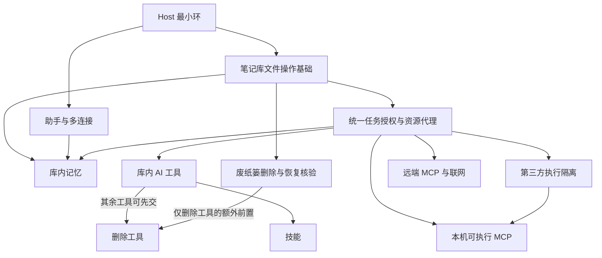

# 施工图

本文不是围栏。过期只改这里，不改产品性格。合同见 [已拍板决定](decisions.md)。强制点见 [架构](architecture.md)。工程题见 [施工对象](topics.md)。编码 Agent 从 [AGENTS.md](../AGENTS.md) 进。

单元格只有三种：

- **已交** — 一行指针。细节在代码和测试里。
- **当前** — 只展开下方那一节。
- **未开** — 禁止写代码。不要把实现写进围栏篇。

换阶段：改「当前阶段」标题、改矩阵里那一格、改 `AGENTS.md` 硬停。不要一次展开下一阶段。

**怎么读这篇**：顶部「当前阶段／依赖顺序／对象 × 阶段／跨能力交接」、与当前阶段同名的专节、以及标题含「写类」「结构工具」或「本轮」的包表，是**当下有效**的部分；其余按阶段与日期分节，是**冻结的历史记录**——其中的数字、提交与 `/tmp` 证据路径只描述当时，不再复现，也不因后来的改动重写（修订只加注记）。

**状态准据（2026-10-24）**：S1 已推送并全绿；I2 的 `7341819`／`9ad24a7`／`0fa7353`／`4ac5cbe`／`e34b7ca`／`3e1af68` 是**本机提交、未推送、零 CI**。当前 tip 以 `git rev-parse`／Actions 列表为准；旧 run 只描述当时。

## 当前阶段

**远端 MCP 与联网。** **本阶段 2026-10-22 收口**：联网只读 P1–P5（内置抓页／搜索、按场授权、低信任结果、账本外发记录、停止联网、窗口专项 25 条）、A 轮（人发起抓页／搜索、设备级外发日志与统计、readability 提取质量）、B 轮（远端只读 MCP：配置与人工白名单、每场一次授权、逐条账本、MCP 结果预览与抓取复用）与质量轮（端到端旅程专项 12 条）**全部交付并推送**；代码 CI [run 39620961014](https://github.com/skahanium/Rgent/actions/runs/39620961014) 与质量轮 CI [run 39784893786](https://github.com/skahanium/Rgent/actions/runs/39784893786) 全绿。 **2026-10-22 收口后修订**：路径保留放行——人原地重建同名对象时旧记录移入有界 `retired[]`（不再拦人），AI 的「建」因预览含确切路径＋人点确认而同样放行；门：单元 **154 文件 2559 通过／4 跳过**、完整窗口 **382／0**、恢复专项 **13／0**、旅程 **12／0**、其余专项不变。真实外网实测：抓页 `example.com`／`iana.org`、Tavily 搜索、公共只读 MCP `mcp.deepwiki.com`（3 个工具，`read_wiki_structure` 1.25s／1403B）。**下一阶段未开**：等所有者命名与授权（候选：附件／非 Markdown 只读、本机可执行 MCP 预研、专项模型分工）。不下载服务器、不挂库、不接本机可执行；旅程专项是**本地门**（CI 不跑该 scope）。

**交互减负结果（2026-10-23）**：U0–U6 **已交（已推送）**；CI [run 39875286692](https://github.com/skahanium/Rgent/actions/runs/39875286692) 全绿（macOS／Windows／docs／CI gate）。门：单元 **157 文件 2761 通过／4 跳过**、完整窗口 **382／0**、人删除 **14／0**、写工具 **41／0**、恢复 **13／0**、联网 **25／0**、人发起 **24／0**、MCP **33／0**、旅程 **12／0**、**UX 8／0**、文档 14 篇、构建通过。


### 提问块（P 轮，2026-10-23 批准）

| # | 包 | 内容 | 依赖 | 验收 |
|---|---|---|---|---|
| P0 | 围栏 | 一等提问块、⌘⇧↵、/ 退役、旧内容边界 | 所有者批准 | **本机已交**（`fea86c4`） |
| P1 | 数据 | draft marker、Host 绑定、旧 / 夹具迁移 | P0 | **本机已交**（`f39434c`）：只换 marker |
| P2 | 编辑器 | 待发送块、createPromptBlock/promptBlockAtCaret、删 slash | P1 | **本机已交**（`f39434c`）：样式连续 |
| P3 | 交互 | 快捷键、应用菜单、shell 发送与暂停重发 | P2 | **本机已交**（`f39434c`）：无双发 |
| P4 | 证据 | 窗口脚本全量迁移、空块/非空段/旧 / 回归 | P3 | **本机已交**（`f39434c`）：完整窗口 386／0 |
| P5 | 收口 | 历史、AGENTS、全量门 | P4 | **本机已交**（`f39434c`）：本表与历史回填 |
| F1 | 修复 | 空草稿不落盘：pending → 首字才 marker，删空回退 | P5 | **本机已交**（`9a40e86`）：关闭/重开无空块 |

### S1 安全/完整性修复（2026-10-24 批准）

| # | 内容 | 验收 |
|---|---|---|
| S1.1 | H2 词片顺序、网页粘贴/抓页 marker 中和、动态 fence | **本机已交**（`a2668ce`）：读后外发/编码 marker 用例 |
| S1.2 | H1 AI 引用修复权限：follow/forbidden/origin 整次失败，人路径不变 | **本机已交**（`a2668ce`）：真实库 wiring |
| S1.3 | H3 native 搜索按步撤网与在途 abort | **本机已交**（`a2668ce`）：步前/在途测试 |
| S1.4 | 删除半截、权限精确还原、damaged 出口、外部变化、错误码 | **本机已交**（`a2668ce`）：376 条相关测试 |
| S1.5 | 文档/CI 对账、视觉搜索浮层位置 | **本机已交**：视觉 111／0，文档随本轮提交 |

**S1 结果**：单元 **169 文件 3034 通过／4 跳过**、完整窗口 **386／0**、视觉 **111／0**、构建/文档通过；已推送，CI run `40070044886` 全绿。

### I2 地址与账本身份分离（2026-10-24 本机提交）

| # | 内容 | 验收 |
|---|---|---|
| I2.1 | active owner 与 ledger-history 两层；旧 owner 归档不占路径 | **本机已交**（`7341819`／`9ad24a7`／`0fa7353`／`4ac5cbe`／`e34b7ca`／`3e1af68`）：删除/同名重建、外部替换 |
| I2.2 | 删除/还原/清除接历史；还原副本跟旧历史 | **本机已交**（`7341819`／`9ad24a7`／`0fa7353`／`4ac5cbe`／`e34b7ca`／`3e1af68`）：真实 VaultSession 用例 |
| I2.3 | 已删除页只读旧账本；新笔记账本空态隐藏修复 | **本机已交**（`7341819`／`9ad24a7`／`0fa7353`／`4ac5cbe`／`e34b7ca`／`3e1af68`）：renderer 用例 |
| I2.4 | 热路径不扫历史；归档时不保留活跃 material 单元 | **本机已交**（`7341819`／`9ad24a7`／`0fa7353`／`4ac5cbe`／`e34b7ca`／`3e1af68`）：lookup 不调用 list |

**I2 结果**：单元 **169 文件 3045 通过／4 跳过**、完整窗口 **386／0**；构建、文档通过。资源 manifest、历史归档清理与 5k owner 热路径夹具已交；**未推送、未跑 CI**。路径资源仍保持可读、不会自动归属新对象，媒体 URL 带 image epoch，响应仍为 `no-store`。

### D 轮：AI 对话诊断与失败重试（2026-10-24 批准）

| # | 包 | 内容 | 依赖 | 状态 |
|---|---|---|---|---|
| D0 | 文档 | family/动作/重试/失败指针/隐私/支持包；D 表与入口 | 所有者批准 | **已交**（`edc3766`） |
| D1 | 目录 | `TaskFailure`、family/action/retryable、脱敏 detail | D0 | **本机已交**（`f69e0f1`／`bc10019`／`d38eca8`／`fd930fe`） |
| D2 | 采集 | provider 分类、TaskResult/HostEvent、`chapter.failure`、失败指针 | D1 | **本机已交**（`f69e0f1`／`bc10019`／`d38eca8`／`fd930fe`） |
| D3 | 呈现 | failed 任务浮层、详情、preflight 环、重启恢复 | D2 | **本机已交**（`f69e0f1`／`bc10019`／`d38eca8`／`fd930fe`） |
| D4 | 恢复 | 新 taskId 重试、失败 marker 替换、清除 marker | D3 | **本机已交**（`f69e0f1`／`bc10019`／`d38eca8`／`fd930fe`） |
| D5 | 收口 | 支持包、排障手册、全量门、history 回填 | D4 | **本机已交**（`f69e0f1`／`bc10019`／`d38eca8`／`fd930fe`） |

**D0 验收**：`pnpm docs:check` 通过；D1–D5 未写代码；文档只保留 family 合同与排障方法，不复制完整错误码表。

**D 结果（2026-10-24 本机）**：单元 **171 文件 3057 通过／4 跳过**、完整窗口 **386／0**；构建、文档通过。**未推送、未跑 CI。** 任务失败有 `chapter.failure`/失败指针/结构化事件；failed 浮层可详情、复制、重试、清除；preflight 环与应用数据写入已接；旧账本无 failure 仍可读。


**联网整合结果（2026-10-23）**：N0–N8 **已交、已推送**。门：单元 **167 文件 2908 通过／4 跳过**、完整窗口 **403／0**、联网 **32／0**、人发起 **25／0**、MCP **44／0**、写工具 **46／0**、UX **16／0**、旅程 **14／0**、人删除 **14／0**、恢复 **13／0**、文档 14 篇、构建通过。**真实外发烟测未跑**（需所有者密钥/付费调用；DeepSeek 与 MiniMax native 仅单测/探测代码，见历史边界）。

**三档工作范围结果（2026-10-23）**：R0–R6 **已交、已推送**。门：单元 **166 文件 2988 通过／4 跳过**、完整窗口 **386／0**、写工具 **56／0**、已删除 **22／0**、联网 **35／0**、人发起 **25／0**、MCP **46／0**、UX **14／0**、旅程 **13／0**、恢复 **13／0**、文档 14 篇、构建通过。`已删除` 为真实窗口删除→还原→明确删除路径；旧系统废纸篓删除不迁移。

**窗口稳定与说了算数（2026-10-23 批准）**：收口后质量轮，不换阶段名。合同见[口径](decisions.md#2026-10-23-窗口稳定与说了算数)；包表见[窗口稳定与说了算数（本轮）](#窗口稳定与说了算数本轮)。**已推送**：单元 **158 文件 2759 通过／17 跳过**、文档 14 篇、构建通过、完整窗口 **381／1**（仅围栏登记的账本来源顺序）、写工具 **34／0**（Windows 不走送篓）、恢复 **13／0**。

**阅读字体随包装（2026-10-23 批准）**：收口后呈现轮，不换阶段名。合同见[口径](decisions.md#2026-10-23-阅读字体随包装)；包表见[阅读字体随包装（本轮）](#阅读字体随包装本轮)。**已推送**：单元 **159 文件 2766 通过／17 跳过**、文档 14 篇、构建通过、完整窗口 **383／1**（仅围栏登记的账本来源顺序）。默认正文／标题用安装包内开源阅读字体，界面控件仍用系统字。

**Windows 平台债务本机收口（2026-10-23 批准）**：收口后证据轮，不换阶段名。合同见[口径](decisions.md#2026-10-23-Windows-平台债务本机收口)；包表见[Windows 平台债务本机收口（本轮）](#windows-平台债务本机收口本轮)。**已推送**：单元 **161 文件 2773 通过／17 跳过**、文档 14 篇、构建通过；V4／MULTI 专项消掉四处「未记通过」；默认完整窗口 **385／1**（仅围栏登记的账本来源顺序，191 秒）；废纸篓探针 14 场复测、门仍关；**输入法第 3 条所有者 2026-10-23 自测接受**（清单 ①–⑦；CDP 不能代证）。

**底栏减负与任务浮层（2026-10-23 批准）**：收口后呈现轮，不换阶段名。合同见[口径](decisions.md#2026-10-23-底栏减负与任务浮层)；包表见[底栏减负与任务浮层（本轮）](#底栏减负与任务浮层本轮)。**已推送**：启动后本篇下拉仍显示刚用的模型；底栏不放任务／联网摘要与库名；生成态改到栏上浮层；小球即设备总闸。真断点接续未开。门：单元 **162 文件 2772 通过／17 跳过**、文档 14 篇、构建通过、默认完整窗口 **386／1**（仅围栏登记的账本来源顺序）、联网专项 **25／0**；MULTI 认库通过。

**网页粘贴转 Markdown（2026-10-23 批准）**：收口后编辑边界轮，不换阶段名。合同见[口径](decisions.md#2026-10-23-网页粘贴转-markdown)；包表见[网页粘贴转 Markdown（本轮）](#网页粘贴转-markdown本轮)。**已推送**：只在粘贴时把网页 HTML 转成 Markdown（GFM 链接／表／图、中文夹缝），不扩大 HTML 渲染、不回写旧稿。门：单元 **164 文件 2792 通过／17 跳过**、文档 14 篇、构建通过、默认完整窗口 **386／1**（仅围栏登记的账本来源顺序）。

前一阶段「技能」已交付：设备级技能库（结构校验与语义校验分离、字节哈希乐观并发、损坏＝诊断不覆盖）、本场冻结（系统提示块＋账本 `{id,name,hash}`＋预览签名比对）、第七页与三个 IPC 通道、边界反例与窗口专项 15 条、**真机取证 2／4 次调用**证明技能正文确实进入模型；技能页视觉用户暂接受现状；Windows 窗口证据并入记忆阶段同一笔债务。完整门见[技能](#技能)。

## 依赖顺序

无日期。下面列出施工路标；真正不可跳过的前置关系见分支图和交接表，不能把所有能力误读成逐项串行，也不能据此同时开放多个阶段。

```text
笔记壳能启动
  → 管线与画布
  → 账本缝与人搜
  → 门禁
  → 身份标记（含账本只读回顾）
  → 界面改造（前端协议落地）
  → Host 最小环（最小模型配置 + 密钥存储 + 运行上限设置入口 + 流式未采纳 + 取消，无工具）
  → 笔记库文件操作基础（人先用，保存、结构操作与中断恢复）
  → 统一任务授权与资源代理（读写范围、发送确认、撤销、文件与数据出口）
  → 库内 AI 工具（逐件开放，清单见 decisions.md §工具）
  → 助手与多连接（设备习惯、连接隔离、默认模型与单场覆盖）
  → 账本与上下文基础（独立账本、迁移、预算及摘要）
  → 库内记忆（材料来源核验、自动整理与召回、撤销及遗忘）
  → 技能
  → 远端 MCP 与联网（受控 HTTPS，先只读查询和资料获取）
  → 第三方执行隔离（可执行组件的双平台资源边界）
  → 本机可执行 MCP（逐候选验证，不提供通用命令执行）
  → 废纸篓删除与恢复核验（独立安全门，不阻塞无删除的能力）
  → 专项模型分工（只随摘要、视觉理解、联网搜索等真实能力开放）
  → 最终视觉与压测校准
```

后续关键交接存在分支，以下仅画前置关系，不代表运行时已经接线：



施工路标不作为连续施工命令。Host 已兑现 [Agent 上下文与历史](topics.md#v0-上下文与历史) 的预算和临时摘要；供应商凭据、多模型与助手习惯已有实现，库内记忆合同与前置本机门已通过，接口按当前分包施工；[沙箱授权](decisions.md#沙箱与单场任务授权合同与开放边界) 已先落实 Host 的单场范围和模型接收方，其他出口与第三方隔离仍未开。废纸篓是独立分支，只阻止删除能力；远端只读 MCP 优先于本机可执行 MCP，前者须过本地出口与数据授权门，后者另过执行隔离门。第三方隔离研究可以提前，不据此启动服务器。自动整理记忆已于 2026-10-02 批准；多轮、子代理与多代理仍未拍板。

### 跨能力交接

下表的「阶段」须在上方施工路标列出；分支图展示关键强制前置，具体开放门以本表和硬约束共同核对，不能把删除分支读成所有工具的前置。合同在 [已拍板决定](decisions.md)，未决工程题在 [施工对象](topics.md)；交付物经代码与验收证明后才可供下游使用。未来设置页随所属能力开放，最后的视觉校准独立进行，不把所有设置功能推迟到最后。

| 阶段 | 前置能力 | 交付给下游 | 开放门与验收证据 |
|------|----------|------------|------------------|
| Host 最小环 | 身份标记、门禁、模型密钥 | 无工具任务、配置与运行上限快照、账本任务章 | 已交：受控流服务、冲突与取消定向测试；厂商现场调用不能由假服务代证。 |
| 笔记库文件操作基础 | Host 取消和保存、固定库根 IO | 人的结构操作、对象身份、权限迁移与中断恢复 | 已交：对应 `a05648f` 双平台测试、构建窗口及本次定向复核；残余竞态如实保留，删除不在本格完成定义。 |
| 统一任务授权与资源代理 | 人的文件操作基础验收、Host 任务及库会话、权限与凭据边界 | 可撤销的单场读写范围、选定模型接收方核对、逐用途发送确认及资源核验 | 已交现有 Host 授权：默认读取发起篇／本篇账本，扩展须人确认；范围、来源、模型接收方、撤销、并行及在途收尾，详见 [门一](topics.md#两道开放门与定向验收)。 |
| 库内 AI 工具 | 对应人的文件操作验收、统一任务授权与资源代理 | 逐件开放的受控读写及可核对结果 | **已交**：读库／搜库、补／建、改名／挪、人删除（macOS）、AI 删除（macOS，`delete_note`）。Windows 入口仍关。见[写类 AI 工具](#写类-ai-工具补发起篇--建)、[结构工具](#结构工具改名--挪)、[人删除（macOS 入口）](#人删除macos-入口本轮)与[AI 删除（macOS）](#ai-删除macos本轮)。 |
| 助手与多连接 | Host 配置与任务快照、设备密钥存储 | 每供应商一份凭据与多模型、手动读取模型、助手系统提示快照；助手页设备默认、底栏本篇单场临时选择 | 本机已交：默认／临时选择及交互收口见本轮对照表。密钥不串用、预览最终接收方、启动固定、失败不回退；当前设置错误反馈债务见本轮质量包，对应平台证据另列。 |
| 库内记忆 | 前置窗口功能门、文件身份与权限迁移、Host 上下文预算、受控数据出口及模型快照 | 库隔离存储、材料来源核验、独立使用／整理授权、自动整理与召回及遗忘 | **质量门已闭合**：v2 包 0–5 与 v4 本机工程已交；v5 新格式、受限整理、召回和管理接线；v6 生产管线 `continuity` 经 revision 12 冻结单两轮认证通过（`deepseek-flash` 89.67／90.20）并发布；共同管线启用、旧提议解析路径退出生产；MiniMax-M3 仍未达门。**债务移交（2026-10-17）**：Windows 代码腿已绿；macOS 中文输入与当前画面由所有者接受；61 行整卷已做过（现行成绩仍 `humanReviewed:false`）。逐条见[记忆阶段收口与债务移交](#记忆阶段收口与债务移交2026-10-12)。POSIX 专属夹具、Windows 原生输入法、贴现行成绩的人审标记仍未销。新库默认关闭，记忆许可不扩大工具读取范围，后台权限不复用已结束的前台授权。 |
| 技能 | Host 工具环、库内受控文件 | **应用管理的技能条目**（`id`／`name`／`description`／`triggers`／`body`）：设备一套技能库、**按库启用**、**按场冻结**；人对技能的唯一入口（设置页第七页），账本记该场 `name` 与内容哈希 | **已交**：合同[同日修订](decisions.md#2026-10-12-技能局部授权)；包 1–5 交付（存储与校验、本场冻结与账本、第七页与三个 IPC 通道、边界反例、窗口专项 15/0）；**真机取证 2／4 次调用**证明技能正文确实进入模型并改变回答、账本证据成立、范围未扩大；[技能真机取证结果](#2026-10-12-技能真机取证结果真实模型调用-24)。仍硬停：附件目录、可执行、远端拉取、参数化脚本、技能市场，以及模型写技能／自行加载。Windows 证据并入记忆阶段债务。 |
| 第三方执行隔离 | 统一资源代理、任务撤销／预算、平台机制与签名方案 | 可验证的最小文件／网络／进程权限和资源上限 | 未开：机制依据及两平台构建后恶意组件实测；失效不得普通启动补位。候选 API、限额和适配未锁，详见 [门二](topics.md#两道开放门与定向验收)。 |
| 远端 MCP 与联网 | 统一授权、受控出口、联网总闸与连接凭据 | 经逐项审定的只读外部能力与低信任结果 | **已交并推送（至 `fb033e9`）**：联网只读、DeepSeek／MiniMax native、远端只读 MCP、设备级闸与账本外发；当前范围改为三档、零确认。远端 tip CI 红在视觉探针，S1 修复未推送。2b 本机可执行 MCP 仍另需隔离合同。 |
| 本机可执行 MCP | 统一授权、第三方执行隔离、候选程序审定 | 有最小资源权限的本机能力 | 未开：逐候选核双平台文件／网络／凭据／进程／资源边界；失效不普通启动补位，不开放任意命令。 |
| 废纸篓删除与恢复核验 | 文件操作基础、送篓前对象身份核对（macOS）；Windows 另须原生证明 | 人的逐次删除、系统废纸篓、放回后核验；随后才供删除工具使用 | **macOS 人删除已开**（2026-10-17；`1330329`，本机、待推送）：送篓前核 `expected_id`，对不上就拒；同名进篓改名按此接受；恢复核验入口仍在设置「笔记库」。**AI 删除在 macOS 本机已交**（`2b4a85b`，待推送；同一条送篓路、预览＋一次点击）。**Windows 入口未开**（`PLATFORM_UNPROVEN`）。探针结论（2026-10-15）仍成立：单凭路径的 `trashItem`／`recycleURLs` 绑不住 inode，篓内同名会改名；**产品缩小窗口并核验落点、失败如实报告；窗口未消除（合同 2026-10-18 披露）**。契约见[人删除与废纸篓安全门](decisions.md#2026-10-15-人删除与废纸篓安全门)、[AI 删除授权](decisions.md#2026-10-17-ai-删除落地授权macos)与[删除链路加固](decisions.md#2026-10-18-删除链路加固)。`src/` 里没有 `TRASH_GATE_OPEN`。Windows 项见[Windows 上暂测不了的项](#windows-上暂测不了的项2026-10-17)。 |
| 专项模型分工 | 对应摘要、视觉理解或联网搜索能力已开放 | 仅对应能力的模型选择和可信用量数据 | 未开：逐项验证协议及来源统计，不预设小／大／视觉模型控件。 |
| 最终视觉与压测校准 | 各已开页面和长文固定样例 | 统一外观、可访问性与性能证据 | 未开：最终统一外观、长文延迟与压测证据。当前界面的用户确认已在「界面改造」登记，不等于本阶段的校准。 |

硬约束：

- 门禁早于 AgentHost。
- 身份标记早于 Host 最小环。
- 界面改造早于 Host 最小环：底栏任务位、联网状态位、冲突双预览与浮层焦点是 Host 要往里填的前置。
- Host 最小环早于笔记库文件操作基础；已验收的基础早于统一任务授权与资源代理，后者早于对应 AI 文件工具。删除独立验收，不阻塞无删除的工具或其他已过各自门禁的能力。macOS 人删除与 `delete_note` 已按授权注册；整夹／永久删除／Windows 入口仍硬停。对象身份与权限迁移早于库内记忆，受控记忆读取早于把记忆加入任务上下文。
- 多连接先证明凭据隔离和任务快照，再逐种开放新协议。专项模型分工只随真实的摘要、视觉理解或联网能力开放。
- 搜库工具晚于最小环；方法不与人搜子串绑定。
- `partition.body` 早于一切索引（已满足）。
- 可执行第三方无论性能如何，接线前都必须通过执行隔离；远端 MCP 优先接只读服务，仍逐候选证明双平台本地出口。只迁进程、列白名单或 CI 成功不能代证，无法证明则不接；远端内部不在本机隔离承诺内。
- 任务范围授予后仍逐次核验；`本篇/同册/整库` 决定读的范围，结构操作只在整库开放；删除零确认进库内「已删除」，系统废纸篓是最终出口。配置快照不冻结权限，记忆、技能或 MCP 结果不能扩大授权；联网/MCP 仍由小球与设备级配置控制，不由档位放大。
- 沙箱门不替代 renderer 隔离、文件身份／修订与恢复门；当前原生废纸篓失败结论、残余竞态和各画面的确认范围保持原记录。
- 账本缝已经先于身份标记落地。不要写成「块模型早于账本」。

### 沙箱规划入库与冲突裁定

本轮仅修文档及文档检查器；没有新增产品运行时入口、工具、执行进程或设置页。当前阶段不变，两项沙箱建设均标「未开」。产品结论在 [沙箱合同](decisions.md#沙箱与单场任务授权合同与开放边界)，工程职责、候选和验收在 [施工对象](topics.md#沙箱与任务授权)，[架构](architecture.md#沙箱边界的现状) 仅校准实际状态。

| 旧表述或缺口 | 本轮裁定及理由 |
|--------------|----------------|
| 其他可参考笔记可改名／移动，未写本场授权 | 加上人的单场来源／目标范围。范围内可连续执行，但不放宽三档权限、其他篇正文边界或删除确认；库级可参考不足以表达任务意图。 |
| MCP 靠白名单和应用代转；子进程 socket 被描述为应用无法约束 | 白名单是审定步骤，还须资源代理及双平台出口证明。可执行组件直接出口受 OS 隔离约束；无法证明就关闭，避免把已知绕行出口视为允许的残余。 |
| 原生代码唯一例外限库 IO | 扩为最小原生安全边界例外，允许未来隔离在 TS 无法提供 OS 强制点时使用平台适配；机制与双平台验证先行，业务仍用 TS，不授权通用执行或新业务运行时。 |
| Host／索引迁出主进程只由性能决定 | 可信 Host 与索引的性能迁移仍是工程选型；可执行第三方隔离成为独立的安全前置，即使性能正常也不能省掉。 |
| 联网关闸时“只查本地”“最小环无联网”容易包含模型 API 和图片 | 明确关闸限制 Agent 搜索／抓页及 MCP；模型文本、图片展示分别授权。当前最小环确有模型请求，不能被记录为完全离线。 |
| 工具接线直接排在人的生命周期之后；安全说明存在旧实现用语 | 当时插入统一任务授权与资源代理、第三方执行前置，并保留整阶段删除门。后续经用户讨论确认，删除改为独立未开能力，详见下节；既有媒体／取消等证据记录不改变。 |

控件布局、授权令牌格式、平台 API／依赖、签名方案与数值限额仍未锁，不因裁定写成已实现。没有新增独立专题或 ADR。

自查补充：依赖关系改用分支图与交接表表达，内置联网不被误绑到第三方执行隔离；合法保存／移动可核验地续接身份但不能扩权。补齐调用主体校验、第三方工具参数映射、重试与子孙进程共享预算，以及撤销后的在途请求和安全收尾边界；已发送数据不能承诺追回。这些是既定安全原则的工程细化，不开放新能力或更改当前阶段。

文档验证中发现既有检查器把行内代码中的三反引号误认成围栏，导致新章节锚点被吞；本轮仅修围栏识别，并补 CRLF 行内示例／真实代码块的两条回归用例及夹具所需的现有链接文件。文档检查与八条检查器定向用例通过，不运行无关的产品全量测试；这不提供沙箱运行时或双平台安全验收证据。

### 三项讨论后的规划调整

经用户逐项确认，本次只同步文档、阶段名称与检查器用例，不开新功能，不补记运行时通过证据：

| 原规则 | 确认后的规则及影响 |
|--------|--------------------|
| 删除门未过，整个文件生命周期不能结束 | 当前改为「笔记库文件操作基础」，仍须收口自己的安全与恢复缺口；废纸篓删除／恢复核验独立未开，原安全标准和失败反例保留。删除不是其他能力的统一前置，完整生命周期也不能提前报交付。 |
| 可参考笔记均可检索，相关片段默认可联网 | 默认只读发起篇与本篇账本，跨篇读取由人授权；核对选定模型接收方。受本地上下文影响的搜索／MCP 请求须另展示内容、目的地、用途并确认；派生文本和记忆不豁免。 |
| 主要以 stdio 服务器描述 MCP，库内与外部工具混为总数七件 | 首批远端 HTTPS 只读 MCP，执行隔离成立后再逐项接本机服务器。七件是库内文件工具的规划清单，外部能力另审定，删除不与其余工具捆绑交付。 |

当时已发现但该次文档修订未修的代码问题仍须定向复核，尤其是原文／换行保真、机器标记与账本分区、权限预览一致性、IPC 调用主体、图片 DNS 与 AI 输出触发请求的边界。现有 CI 绿灯不使这些反例自动销账；当时基础阶段仍是「当前」，后续修复与独立证据见「笔记库文件操作基础（已交）」；不把本段历史待办当成今日未施工状态。

本次本机 `pnpm docs:check` 与文档检查器八条定向用例通过，阶段名称、当前矩阵行、路标交接及相对链接已核对。仅更新文档和对应阶段用例，未运行产品全量测试，也不新增运行时、双平台或远端 CI 通过记录。

## 对象 × 阶段

对象按代码地盘切。

| 对象 | 代码地盘 | 阶段状态 | 已有能力与待核门禁 |
|------|----------|----------|--------------------|
| 壳与信任 | `src/main/index.ts`、`src/preload`、`src/shared/ipc.ts`、`src/shared/flush.ts` | **已交** | `test/shared/flush.test.ts`；preload 为 `index.cjs`。 |
| 库与文件 | `src/main/vault.ts`、`secure-fs.ts`、`notes-fs.ts`、`vault-lifecycle.ts`、`native/**` | **已交** | 保存、新建／改名／移动／引用修复／中断恢复及消失另存基础已验；macOS 人删除见下格。残余竞态保留。 |
| 废纸篓删除与恢复核验 | `native/vault_trash_mac.mm`、`VaultSession.previewTrash`／`commitTrash`、树右键 | **已交** | **macOS 人删除已开**（`1330329`，本机、待推送；送篓前核身份＋系统废纸篓＋确认卡）；恢复核验界面已交（`b9fde20`、`57f9b7a`）。**AI 删除在 macOS 本机已交**（`2b4a85b`，待推送；复用同一条送篓路）。**最后核验到 `trashItemAtURL` 之间的窗口未消除**（合同 2026-10-18 披露）。Windows 入口未开；整夹／永久删除仍硬停。探针 `test/native/trash_*` 仍非产品接口。 |
| 正文与画布 | `src/markdown/**`、`src/renderer/src/view/**` | **已交** | 一条管线 + viewport widget；`test/markdown/pipeline.test.ts`。 |
| 账本缝 | `src/markdown/partition.ts`、主进程独立账本服务、`src/renderer/src/tabs.ts` | **已交** | 画布与保存只走正文；独立账本由 `LedgerStore` 写入，旧尾部由 `partitionSource`／`composeSource` 保真迁移，不作为生产追加路径。 |
| 检索 | `src/main/vault-index.ts`、`src/renderer/src/search.ts`、`backlinks.ts` | **已交** | 人搜惰性全量 + 子串保持；模型读库／搜库已使用固定授权集合，不使用人的全库搜索后过滤。 |
| 门禁 | `src/main/permissions.ts`、IPC、树 | **已交** | 三档名单、树徽章与右键改档；`test/main/permissions.test.ts`。 |
| 身份标记 | `src/markdown/identity*.ts`、`src/markdown/syntax/identity.ts`、`src/renderer/src/view/*` | **已交** | 标记进管线、未采纳块受锁、账本只读；`test/renderer/identity-guard.test.ts`。 |
| 界面改造 | `src/renderer/**`、`src/renderer/src/styles.css` | **已交** | 功能已交；用户已于 2026-09-30 核对两平台样张并确认可接受，前端冻结解除。未逐张复核的画面按未复核记录；图片与外链细节留待按需回访，不据本次确认声称全量视觉验收通过。 |
| 一场提问 | `src/main/**` 的 `AgentHost`、模型配置、IPC 与画布 | **已交** | 无工具最小环及读库／搜库已交；补／建／改名／挪／macOS 删除见[库内 AI 工具](#库内-ai-工具)。提问块入口见[提问块](decisions.md#2026-10-23-提问块与快捷键)。 |
| 任务授权与资源代理 | Host、库会话、IPC 与安全 IO | **已交** | 现有 Host 固定范围、一次性预览、模型接收方及撤销已验；通用网络与第三方执行仍未开。 |
| 库内 AI 工具 | 单场授权与对应人用文件基础 | **已交** | 读工具已交付并留证；**写工具已交付：补任务发起篇＋建**（限额见合同）；**改名／挪已交付**；**人删除在 macOS 已开放**；**AI 删除在 macOS 已交**（写工具专项 **41／0**，完整窗口 **380／0**）；Windows 入口仍关。 |
| 第三方执行隔离 | 尚未；平台机制与最小适配待验证 | **未开** | 双平台机制及恶意组件实测是接入门；普通子进程不是完成证据。 |
| 技能 | Host 工具环、库内受控文件 | **已交** | 前置已交。合同已登记（同日修订）；**包 1–5 已交付**、对照自查已做、**真机取证已证（2／4 次调用）**；技能页视觉用户暂接受现状；Windows 窗口证据并入记忆阶段同一笔债务。 |
| 远端 MCP 与联网 | 统一授权、受控出口、联网总闸与连接凭据 | **当前** | **已收口并推送（至 `fb033e9`）**：内置抓页／搜索、DeepSeek、MiniMax native、MCP、人发起与外发统计已交；远端 tip CI 红在视觉探针，见顶部状态。S1 的 H1/H2/H3/粘贴/删除修复仍在本机、未推送。 |
| 本机可执行 MCP | 尚未 | **未开** | 另须第三方执行隔离及候选验收，不以普通子进程补位。 |
| 设置 | `src/renderer/src/settings.ts`、本机偏好与 IPC | **已交** | 既有设置及阅读偏好已有功能；库内记忆增加第五页，2026-10-04 追加第六页「笔记库」整合授权，2026-10-12 追加第七页「技能」（承[技能局部授权](decisions.md#2026-10-12-技能局部授权)），本轮证据见文末局部施工。各画面视觉证据分别记录，其它未来页面未开。 |
| 助手与多连接 | `src/main/model-config.ts`、Host 凭据与 IPC、`src/renderer/src/settings.ts`、授权浮层 | **已交** | 每供应商一份凭据、多模型、手动读取与助手习惯已有实现；本轮助手页默认／底栏临时选择及质量收口按对照表验收。 |
| 账本与上下文基础 | 主进程账本服务、原文迁移、Host 与窗口 | **已交** | v2 `d7fffb4`、`c0bde8f` 本机功能门；包 5 `d0e6796` 已完成本机窗口集成，对应 Windows 与人工证据仍待核，不以历史绿灯证明新实现。 |

| 库内记忆 | 主进程单文件存储、独立许可与管理 | **已交** | v2 包 5 集成收口；v6 生产管线 `continuity` 经 revision 12 两轮认证通过并发布；旧体系退役。平台与人工证据按[债务移交](#记忆阶段收口与债务移交2026-10-12)另列，不因换阶段销账。 |

矩阵里的“已交”指功能与安全边界，不表示外观已经跟上 [前端协议](frontend.md)。前端冻结已按用户 2026-09-30 的样张确认解除，但那只覆盖其核对过的画面；逐张未复核的差距仍按未复核记录，不能由本轮自动销账。

## 账本与上下文基础

2026-10-03 包 1、2 本机功能门已通过（`d7fffb4`、`c0bde8f`），后由包 5 `d0e6796` 完成本机窗口集成；对应平台证据仍待核。正文不加 noteId；原始历史由主进程独立服务保存；迁移先持久保真副本，再核验移除尾部，不能因重构丢稿。包 2 的摘要和维护以账本保存门为前置。

## 技能

**合同已登记（同日修订）**：[2026-10-12 技能局部授权](decisions.md#2026-10-12-技能局部授权)。技能＝**应用管理的技能条目**（`id`／`name`／`description`／`triggers`／`body`），设备一套技能库 ＋ 按库启用 ＋ 按场生效，**不进笔记文件树**；只有人能创建、编辑、启用、卸载；模型不能写、不能上架、不能自行加载。**外发确认只显示技能名称**（不显示正文、字数与展开），账本记该场冻结的 `name` 与内容哈希是唯一可审证据。设计与实现零模型调用。

| 包 | 内容 | 门 |
|----|------|----|
| 0 | 合同与包表 | 零调用；本文与 [产品合同](decisions.md#2026-10-12-技能局部授权) |
| 1 | 技能库存储与字段校验：设备级技能库的读取与原子写、`id` 稳定性、五个字段的长度／非空／UTF-8 规则、损坏库与非法条目一律不可用并给原因 | **已交**：`src/main/skills-store.ts`（设备级 `skills.json`，结构校验 vs 语义校验分离、字节哈希乐观并发、原子写、损坏＝诊断不覆盖）、`src/main/skills.ts`（`resolveSkills`／`enabledSnapshot`＋签名）、`src/shared/skills.ts`（限额、字段守卫、人话原因）；`test/main/skills-store.test.ts` 9 项 ＋ `test/main/skills.test.ts` 9 项。零 IPC、零界面、零模型调用 |
| 2 | 按库启用与本场快照：启用关系属该库配置；启用集合冻结进任务快照（`id`／`name`／内容哈希）；**不可用明细列出并继续** | **已交**：`agent-host.ts` 启动时经 `deps.skills` 冻结一次并拼进系统提示（无可用条目时连空行都不加）、`assertSkillsAuthorization` 与记忆同一处纪律；`ledger-provenance.ts` 加**可选** `skills` 字段（不升版本、不改 `ledger-task`／`ledger-sources` 标记语法）；`index.ts` 预览附加**只有 `{id,name}`** 的技能名单＋不可用原因、预览与启动之间比对签名、不符即 `STALE_PREVIEW`；`authorization-popover.ts` 加技能行（名称与原因，无正文、无展开）。定向测试 9 项：系统提示含块、scope／sources／tools 不因技能变化、每场只冻结一次、没有可加载项时如实为空且会话继续、签名不符拒绝启动且未写盘、账本可选字段校验与旧记录兼容、预览只有名称 |
| 3 | 设置页第七页「技能」：技能列表与每技能子页面（名称／说明／触发／正文纯文本＋预览）、启用与停用；IPC 仅限列出、读取、写入、启停四个用途 | **已交**：新增 `settings-skills.ts`（列表＋子页面，字段即时校验走共享 `skillFieldsReason`，错误一律显示人话，损坏库显示原因而非「还没有技能」）；`settings.ts` 加第七页与导航、`shell.ts` 装配 handlers、`preload` ＋ `shared/ipc.ts` 加**三个**通道（`skills:get` 覆盖列出＋读取，`skills:save` 覆盖写入，`skills:set-enabled` 覆盖启停；合同四个用途由此覆盖，未新增第四通道）、`main/index.ts` 三个受信处理（写盘走字节哈希乐观并发，冲突返回 `SKILLS_STORE_CONFLICT`；保存与启停在切库忙时被拒）、`icons.ts` 与 `styles.css` 最小补充。定向测试 6 项（列表与启用态、空库与损坏库、启停带修订、编辑子页面校验与裁剪后保存、新建含空触发列表、机读码不裸奔）＋ 设置面板导航项按 handlers 出现。**真机窗口检查 377 条、失败 0** |
| 4 | 边界反例：模型不能写／自行加载、技能不得扩权、停用只对下一场生效、技能不进记忆存储、发送确认只显示名称且账本留哈希 | **已交**：新增 `test/main/skills-boundaries.test.ts` 4 条结构性判据（每条先对**违反样例**返回真、再对真实源码返回假，判据本身不会写成永远为真）：技能写入路径不在宿主与工具层、技能类型不进记忆管线任一文件、发送确认映射只取 `id`／`name`（含 `body`／`bytes` 的写法会被同一断言拒掉）、账本记录只取 `id`／`name`／`hash`。运行期反例 3 条（`agent-host.test.ts`）：正文要求「放开权限、加工具、读整库」时 scope／sources／tools 与基线逐项相同而文本确实进了系统提示；两场之间编辑只影响下一场（已完成那场的系统提示不被改写、每场各取一次快照）；停用后既有账本记录仍可核（`ledgerProvenance` 仍 valid 且技能条目仍在） |
| 5 | 窗口验证与文档收口 | **已交**：`scripts/verify-ui.mjs` 新增 `RGENT_UI_SKILLS_ONLY=1` 专项（15 条、失败 0、**模型调用 0**）：第七页空库提示与「只有人能创建启用」文案、经真实 IPC 新建并回读设备级技能库（字段与字节数）、启用写入本库启用集合（库键 64 位十六进制、只有一个库）、窄窗无横向溢出、**发送确认只列技能名称且不含正文／体量／展开控件**、技能库损坏时如实报原因且原文件未被改写、不显示成「还没有技能」。整轮完整门：**112 文件 1907 通过／2 跳过**、文档 14 篇、构建通过、完整窗口 **377 条失败 0**。窗口专项另抓到并修掉两个只在真实渲染层暴露的缺陷：共享字段校验用了 `Buffer`（渲染层未定义）→ 改为环境无关的 `TextEncoder`＋孤立代理项扫描；窗口脚本注入的 `\n` 被模板字面量吃掉导致注入表达式语法错误 |

**修订处置已落地**：包 1 旧实现（提交 `33b6543`，按库内 Markdown 文件路径校验）已按修订**整体替换**——库内路径／符号链接／隐藏段四个拒绝原因随之删除；保留下来的是限额模型、UTF-8 往返校验、「不可用给原因、不静默降级」与逐项独立的思路。

**继承的债务**：技能若需要平台证据（Windows 构建窗口），与记忆阶段移交的同一批债务合并验收，不重复销账。

**技能阶段待核（不因包表已交而销账）**：

| # | 待核 | 状态 | 不可代证 |
|---|------|------|----------|
| 1 | 技能页视觉 | **用户 2026-10-12 暂接受**；**2026-10-17 所有者确认当前画面可接受**，精细化等到项目基本完成后再做（归[最终视觉与压测校准](#跨能力交接)）。样张留在 `artifacts/skills-ui/` | 接受现状 ≠ 最终视觉校准通过；日后改画面不得声称本次已验收 |
| 2 | Windows 上的构建窗口证据（技能页与发送确认） | **不单列**：并入[记忆阶段移交](build.md#记忆阶段收口与债务移交2026-10-12)的同一笔「Windows 平台证据」（见该表第 1 行） | macOS 窗口检查不能代证 |
| 3 | 真机证明「技能确实进入模型」 | **已证（2026-10-12，2／4 次调用）**：见下节「技能真机取证结果」 | — |

### 2026-10-12 技能真机取证结果（真实模型调用 2／4）

按[预注册判据](decisions.md#2026-10-12-技能真机取证局部授权)先冻结判据、后花调用；写在一次性**临时 profile ＋ 临时库**里跑真实设备模型（默认模型 `MiniMax-M3`），凭据只从设备 profile 读一次复制进临时目录，跑完连副本一起删除——**用户真实笔记库、技能库与偏好全程未被写入**（`~/Library/Application Support/rgent` 下本轮没有产生 `skills.json`）。

| 预注册判据 | 结果 |
|---|---|
| 1 基线场（技能未启用）回答不含标记 | **通过**：`备忘录是一种用于记录、提示或传达关键信息，以便事后查阅或提醒相关事项的简短书面材料。`（无标记） |
| 2 启用场回答以技能要求的标记开头 | **通过**：`SKILL-OK-7F3\n备忘录是一种用于记录、保存或传达重要信息以便日后查阅或提醒的简短书面材料。` —— 同一句提问，唯一差异是技能启用 |
| 3 账本记下名称与内容哈希且哈希与正文一致 | **通过**：`{"id":"73308e7d-…","name":"验收标记","hash":"859cfd68…"}`，与技能正文 SHA-256 逐字相符 |
| 4 技能没有扩大范围、来源或工具 | **通过**：两场 `tools` 均为空、`sources` 均为空、`scope` 都只有发起篇本身 |
| 5 技能正文不出现在发送确认 | **通过**：确认里只有 `本场技能：验收标记。技能内容不在此处展开，账本记有名称与内容哈希。`，不含正文与标记 |

**过程纪律**：先做了一次**零成本干跑**（受控假模型，`RGENT_UI_SKILLS_LIVE=dry`，13 条全过）——它抓出夹具三处缺陷（完成判定读错字段、范围比较把两篇不同笔记名当成扩权、缺一个导入），修好后 `RGENT_UI_SKILLS_LIVE=1` 才花真实调用。**开关一览**：`RGENT_UI_SKILLS_LIVE=dry`（受控假模型干跑，零成本）／`=1`（真实模型，付费）；`RGENT_UI_LIVE_PROFILE` 指定只读的真实设备 profile（默认 `~/Library/Application Support/rgent`）；`RGENT_UI_LIVE_EVIDENCE` 指定证据输出目录（默认 `.cache/skills-live-proof`）；样张用 `RGENT_UI_SCREENSHOTS`。；真实轮第一次因缺导入在启动前失败，**未消耗任何调用**。最终用 **2 次**（信封 4，余量未用，不做多余重跑）。原始证据：`.cache/skills-live-proof/2026-10-12T15-33-27-040Z.json`（另存 `artifacts/skills-live-proof/`）。**账目**：技能真机取证专账 **2／4**，不写共享 journal、不动探针专账，冻结指纹未受影响。真机取证后的全量门：**113 文件 1910 通过／2 跳过**（同一次运行里记忆侧 `working-memory-service.test.ts` 的 `ledger-forget` 参数失败过一次、未能复现，已按观察项记入上方债务表）。

### 2026-10-12 技能阶段自查（逐项对照检查与完善）

包 1–5 交付后按批准方案与[技能局部授权](decisions.md#2026-10-12-技能局部授权)逐条对照，抓到并修掉 7 处（含 1 处计划项漏做）：

| # | 发现 | 处置 |
|---|------|------|
| 1 | **账本视图没有渲染技能证据行**（计划里明确要求、合同说账本的名称与哈希是唯一可审证据，实现只写进了 provenance 数据） | `shell.ts` 账本元数据行追加技能证据；抽出纯函数 `src/renderer/src/ledger-evidence.ts`（名称＋哈希前 8 位／「本场技能：无」）＋ 3 项单测；窗口套件在同一处断言真机渲染出「本场技能：无」 |
| 2 | 发送确认里不可用条目仍带原因文本（“正文合计超过 64 KiB”），与「只显示技能名称」有解释空间 | 收紧为**只有名称＋指向设置页**；单测断言原因文本不出现；窗口断言补 `!KiB` |
| 3 | 追加的全局 `.settings-section-title` 规则会覆盖既有定义，**连带改变模型页**同名标题的字号与颜色 | 限定为 `.skill-editor .settings-section-title`，不碰全局 |
| 4 | 无活动库时 `currentSkills()` 直接抛裸 `TypeError`，预览只报未知错误 | 改为按「本场无技能」fail-closed 冻结（`{state:'ready',skills:[],ignored:0}`＋空修订） |
| 5 | `isSkillRecord` 零引用、若干内部判据被导出成公共面 | 删除死导出，收窄 `cleanSkillText`／`skillBody`／`skillTriggers`／`isUtf8Text` 为模块内部 |
| 6 | 文档清单未同步：`AGENTS.md` 硬停页面清单、`docs/frontend.md` 导航顺序与「尚未锁定」清单、缺技能页前端协议节；架构强制点无技能一行 | 四处分别补齐（frontend.md 新增「技能页（2026-10-12 局部授权）」节） |
| 7 | 合同有三处需要澄清（确认里不可用条目的呈现、四个用途由三通道覆盖、账本必须显示证据） | 按「先改围栏再改代码」在同日第二处登记澄清，再据此收紧实现 |

同时确认无问题的地方（不因“看着像”就算过）：渲染层共享校验已与主进程同源；设置页预览里的远程图片**不会**发起请求（无 loader 时只显示「图片未加载」占位）；损坏库与非法条目路径均不改写原文件。

**门禁**（对照自查修复后的冻结修订上重跑一遍）：`pnpm test` **113 文件 1910 通过／2 跳过**、`docs:check` 13 篇、`build` 通过、完整窗口 **377 条失败 0**、技能专项 15 条失败 0（**模型调用 0**）。受验提交 `f9675e6`（本机提交、未推送）。样张 `artifacts/skills-ui/skills-1200.png`／`skills-800.png`／`skills-authorization-1200.png` 已重出并目检。

**仍未销账**：技能页用户视觉确认、技能专项 Windows 腿、真机证明技能进入模型（另批 ≤4 次调用；账本技能证据的真机端到端也一并放在这次窗口里核）。

## 人删除与废纸篓安全门（本轮）

契约：[人删除与废纸篓安全门](decisions.md#2026-10-15-人删除与废纸篓安全门)。2026-10-15 当时门关、只交安全半边。**2026-10-17 起 macOS 人删除按合同修订开放**（见下节）；AI 删除见[AI 删除（macOS）](#ai-删除macos本轮)。

| 包 | 内容 | 依赖 | 验收 |
| --- | --- | --- | --- |
| A | 证据与围栏（零产品改动） | 既有探针与矩阵判据 | **已交**：合同与包表落地（`83d5370`）；探针 API／失败模式读清；三项假设核对（消失另存位置、技能快照发送点、依赖连坐粒度） |
| B1 | 记忆近期容器完整性 | 既有 `recent-regeneration`／`protocol-repair` 通道 | **已交**（`059e6c9`）：r18 真实夹具（进展无落点、四段全空被拒）修复后产出完整近期容器；仍保留拒绝码；**每例至多 1 次额外调用** |
| B2 | 债务清零（6 项） | 见各条 | **已交**（`b9fde20`）：每项一条红绿测试或明确记录为接受 |
| B3 | 文档收口 | `docs:check` | **已交**（`6bc17ae`）：历史入 build-history；提交号存在性、包表状态格（**本轮包表末列必须开头即写状态，缺失即报错**）、锚点与阶段一致性四条机械规则 |
| C1 | 原生候选证明 | 同一探针加分支（不另造判定） | **已交**（`b4bfa4f`；结论：不通过，门保持关闭）：`file-manager` 与已失败候选逐场景一致；判定逻辑未放宽（负面对照＝换成永久删除即失败）；本机证据在 `artifacts/trash/`。推送后 CI（原 run 已删除；结论与复现做法见本节）两平台 `evidence-collected`（macOS `workspace`＋`file-manager` 14 场、Windows `file-operation` 14 场，`productionGateOpen=false`）；判据② macOS `same-name` 第 2 项 `namePreserved=false`，门继续关 |
| C2 | 库层删除与恢复核验 | `structureGate`、生命周期记录、`verifySource` | **已交**：身份不符／竞态／内部路径／换库／附件跟随／恢复三分支各有先红后绿；**安全半边已随 `b9fde20` 交付**（只对无删除入口时保护人的那半边负责）：外部消失**有记录**、消失对象**不被静默重建**（同路径新建当时拒 `PATH_RESERVED`；**2026-10-22 修订放行**）、来源**标失效但不自动遗忘**、**单篇**恢复核验（原全库核验是全有全无）＋恢复降级如实上报 |
| C3 | 界面 | 树右键菜单、确认卡、设置页 | **已交**（`b9fde20`；仅**恢复核验界面**那半）：核验入口、逐分支文案与“通过才可核验”已随 C2 交付（`test/renderer/recovery-ui.test.ts`），且窗口断言里**不出现任何删除入口**；树右键菜单、删除确认卡、设置页那三件**等门开**才做，本轮不做 |
| C4 | 窗口证据 | 恢复界面的窗口专项＋完整窗口回归 | **已交**（`57f9b7a`）：开关是 `RGENT_UI_RECOVERY_ONLY=1`（`scripts/verify-ui.mjs` 的 `verifyExternalRecovery`，独占、不进默认完整窗口）。专项 **11 条失败 0**（2026-10-22 扩到 13 条，见施工历史）（识别／`PATH_RESERVED`／核验通过／内容已变／附件缺失／门关无删除入口，加初始化与受控主机两道收口）；完整窗口回归 **379／0**。`probe:check` 是付费协议剥离对照探针，本轮不跑 |

**认证批次规则**：B 与 C 都在认证前落地 → 合并成一次复认证；C 被证伪（只交付安全半边）→ 只认证 B 的改动；C 晚于认证落地 → 另跑一次，并记为"因产品改动而复认证"。

### 本轮实测的范围与边界（2026-10-15）

**证据的所在地与覆盖范围**：本轮 14 场（7 场景 × 2 候选：`workspace` 与 `file-manager`）先是**本机 macOS 证据**，产物在 `artifacts/trash/`；**`artifacts/` 被 `.gitignore` 整目录忽略（`git ls-files artifacts/` 为空）**，所以仓库内无法复核原始件，只留结论与本节的复现做法。推送后 CI（原 run 已删除；提交 `7ae86aae…`）已跑两候选：macOS `workspace`＋`file-manager` 各 7 场、Windows `file-operation` 14 场，作业均为 `evidence-collected`／`productionGateOpen=false`。**已删除 run 的摘要**：时间 2026-10-15 推送后当天；job 名 `evidence-collected`；结论 `productionGateOpen=false`（门不动）；场景数 macOS 两候选各 7 场（合计 14 场）＋Windows `file-operation` 14 场；复现做法见下两段。macOS `same-name` 第 2 项两候选 `namePreserved=false`（落点加时间戳后缀）。9 月 30 日那节的“七场”是当时的记录，已恢复原文、不回填。

**负面对照可复现**：探针的判定逻辑没有放宽，凭据是“把候选换成永久删除即失败”。复现做法：在**临时副本**上把候选实现换成永久删除（`unlink`／`Remove-Item`），夹具与场景不变，期望的失败三件套是 `experimentComplete=false`、`fixtureReclaimed=false`、进程退出码 1——即“删掉了、但没有可核验的废纸篓收据”，判定必须在此情形下失败。原始件 `artifacts/trash/run/report.json` 与对照表在本机，不入库。

**探针的测试边界（如实记录）**：探针默认把测试夹具送进**真实** `~/.Trash`，随后按**精确收据**取回自己的对象；它**不清空用户废纸篓**（符合纪律），但“在真实废纸篓里读写自建夹具”这件事本身就属于测试边界，本该写明——本轮补记。

**两项已披露残余**（据实写，不沿用与代码不符的旧说法）：

1. **权限档只能与“消失当时记录”的档比较**：库层没有档位历史快照，所以核验只能对消失那一刻记下的档，不能证明“系统放回后权限档与更早的某次状态一致”。
2. **发起篇身份缺口已收口**：`TaskGrant.originProof` 现对授权层与工具层共用。`snapshot(origin)` 按与 `validateSources` 相同的三条核——`objectVersion`（含 `acceptsObject`）／`revision`／内容指纹；基准只由 `acknowledgeOrigin` 推进。同字节换对象拒 `SOURCE_REPLACED`，本场 `append` 后仍可读。权限档那条残余仍在。

## 人删除（macOS 入口，本轮）

契约：[人删除与废纸篓安全门](decisions.md#2026-10-15-人删除与废纸篓安全门) 2026-10-17 修订。macOS 笔记可删；Windows 入口不开。AI 删除见[下节](#ai-删除macos本轮)。探针仍是测试专用。

| 包 | 内容 | 依赖 | 验收 |
| --- | --- | --- | --- |
| 0 | 围栏与债务 | 既有安全半边 | **已交**（`1330329`）：macOS 可开入口；Windows 测不了的项记入[债务](#windows-上暂测不了的项2026-10-17) |
| 1 | 原生送篓 | `expected_id` 与 `NSFileManager trashItemAtURL:resultingItemURL:` | **已交**（`1330329`）：macOS 返回落点；身份不符拒 `PATH_CHANGED`；Windows 报 `PLATFORM_UNPROVEN` |
| 2 | 库层 preview／commit | 一次性令牌、先笔记后附件夹、消失记录、账本 | **已交**（`1330329`）：取消零动作；第二步失败留孤儿附件夹；同路径新建当时拒 `PATH_RESERVED`（2026-10-22 修订：人创建会退休记录并放行） |
| 3 | 人用入口 | 树右键、确认卡、关标签、两个 IPC | **已交**（`1330329`）：只在 macOS 且对象是笔记时出现「删除」；文件夹／Windows 无入口 |
| 4 | 边界反例与窗口 | 单元＋`RGENT_UI_TRASH_ONLY`＋完整回归 | **已交**（`1330329`）：单元 **129 文件 2105 通过／2 跳过**；`RGENT_UI_TRASH_ONLY=1` 专项 **13／0**（右键有删除／不删则不动／确认后进废纸篓且关标签／文件夹无入口）；完整窗口 **380／0**（87 秒）；文档 14 篇、构建通过。Windows 入口仍关，未在本机跑 Windows 腿 |

**受验提交**：`1330329`（本机提交，未推送；本轮零 CI）。门数字见包 4。

## AI 删除（macOS，本轮）

契约：[2026-10-17 AI 删除落地授权](decisions.md#2026-10-17-ai-删除落地授权macos)。复用人删除送篓路；预览＋一次点击；Windows 不宣告。整夹／永久删除仍硬停。

| # | 包 | 内容 | 验收 |
|---|----|------|------|
| 0 | 合同与债务 | 可删对象、送篓复用、确认粒度、结构额度、账本与失败语义；Windows 同一道原生门 | **本机已交** |
| 1 | 写入门 | `previewDelete`／`commitDelete`：范围＋非发起篇＋额度＋一次性令牌；不走迁移修引用 | **本机已交** |
| 2 | 工具与宿主 | `delete_note`＋确认入口＋`previewTrash`／`commitTrash`；成功 `vault-change` | **本机已交** |
| 3 | 确认卡与账本 | `kind: 'delete'` 联合；人删／AI 删账本可区分；同意后关标签 | **本机已交** |
| 4 | 边界反例与窗口 | 单元反例＋`RGENT_UI_WRITE_ONLY` 两条删路＋完整回归 | **已交**（`2b4a85b`）：单元 **129 文件 2122 通过／2 跳过**；`RGENT_UI_WRITE_ONLY=1` 专项 **41／0**（删·同意／不删；账本 `delete_note ok:写作删参考.md`＋`vault-change`）；完整窗口 **380／0**（87 秒）；文档 14 篇、构建通过。Windows 不宣告 |

**受验提交**：`2b4a85b`（本机提交，未推送；本轮零 CI）。门数字见包 4。

## 删除链路加固（本轮）

合同：[2026-10-18 删除链路加固](decisions.md#2026-10-18-删除链路加固)。本轮只补披露与加固，**不新开删除面**（macOS 单平台、一次一篇、逐次确认；Windows 与整夹／永久删除仍硬停）。评审报告在 `artifacts/review/2026-10-18-grok-batch.md`（本地产物、不入库）。包 1–4 按合同由代码写者落地，包 5 是本轮文档门与证据链；**下列状态是施工图状态，不是交付声明**。

| 包 | 内容 | 依赖 | 验收 |
| --- | --- | --- | --- |
| 1 | 落点核验与披露 | 既有送篓收据 | **已交**（`d9c8dec`）：收据返回后按 `expected_id` 核 `landing` 身份，不符报独立失败并交出落点路径；合同披露「窗口缩小、未消除」；补可注入窗口的红绿测试 |
| 2 | 恢复证据源 | `missing` 删除时证据 | **已交**（`88ac57f`）：恢复以删除时抓取的 identity／`bodyRevision`／`attachments`／`permissionTier` 为准；未登记笔记同样可恢复（只有生命周期记录、没有账本） |
| 3 | 恢复出口与降级 | 生命周期记录、账本 | **已交**（`88ac57f`／`d9c8dec`）：`permissionTier='unknown'`；卷重挂载（设备号变、inode 不变、内容／附件一致）视为同一对象；逐条「放弃恢复」；删除成功但记录／账本未落盘时 `degraded`；孤儿附件夹文案不再承诺重试 |
| 4 | 任务范围与语义 | `scopePaths`、`OTHER_TASK_RUNNING` | **已交**（`a6f8281`）：停任务按任务授权范围（不是仅目标路径）；AI 确认提交时复查 `OTHER_TASK_RUNNING`；同名 companion 是普通文件时视为无附件夹、不阻塞删除 |
| 5 | 文档门与证据链 | `docs:check`、`delivery:check`、施工历史 | **已交**（`b218264`／`701fe39`／`8d491bf`）：状态词扩为五个（`已交｜本机已交｜未开｜进行中｜待核`）；`已交` 行须带提交号或 run 链接；本机专用 `pnpm delivery:check`；两笔未推送提交标「本机已交」；施工历史补三小节；死链改述 |

**本轮结果（2026-10-18）**：包 0–5 **已交付并推送**（推送提交 `574d859`，CI [run 39092990110](https://github.com/skahanium/Rgent/actions/runs/39092990110) 全绿：macOS／Windows／docs／CI gate；trash job 按 scope 跳过）。首跑 Windows 红在身份格式（已修），macOS 一次窗口抖动复跑即绿、未改断言（详见施工历史）。门：单元 **132 文件 2157 通过／2 跳过**、完整窗口 **380／0**、人删除专项 **14／0**、写工具专项 **41／0**、恢复专项 **12／0**、文档 14 篇、构建通过；`pnpm delivery:check` 如实报未推送提交（预期）。已知边界见[施工历史](build-history.md#2026-10-18-删除链路加固已推送)。

## Windows 上暂测不了的项（2026-10-17）

触发条件一律是**有 Windows 电脑之后**。不因 macOS 人删除已开而销。

| # | 项 | 现状 | 不可代证 |
| --- | --- | --- | --- |
| 1 | 删除在 Windows 上的原生废纸篓与入口 | **本机已复测、门仍关**（2026-10-23）：`node scripts/probe-trash.mjs` 默认 `file-operation` 14 场 `evidence-collected`，`productionGateOpen:false`，`systemPutBackVerified:false`；与 2026-10-15 CI 同向。菜单仍无删除；原生 `Trash` 仍报 `PLATFORM_UNPROVEN`。不宣告 `delete_note` | macOS 送篓成功与本机复测都不代称入口已开 |
| 2 | POSIX 专属夹具、两处 Windows 跳过点 | **销**（2026-10-23）：本机窗口夹具改走 `denyDirectoryWrites`（Windows ACL Deny `(WD,DC)`／POSIX chmod）。V4／MULTI 专项里权限拒写、Host 发布中断、退休拒写与 sibling／preparing／held-root 均记通过，不再打印「未记通过」。默认 `pnpm ui:check`／CI 代码腿不含这四段。单元里 `it.skipIf(win32)` 的符号链接／冒号 POSIX 例仍跳过（能力不存在，不是缺机器） | 本机绿灯不把符号链接／冒号 POSIX 例伪装成已过；默认完整窗口绿灯不代称 V4／MULTI 专项已跑 |
| 3 | Windows 原生输入法 | **所有者 2026-10-23 自测接受**（清单 ①–⑦） | CDP 组合事件与 macOS 拼音不能代证 |

## 远端 MCP 与联网

**阶段 0 已交（2026-10-18，零产品代码）**：清账、预研与开工授权。**合同已落地（2026-10-20）**：所有者批准的[联网只读合同](decisions.md#2026-10-20-联网只读合同)定下范围、出口规则、确认粒度、低信任与证据边界；**P1–P5 已交（已推送）**。不下载服务器、不挂库、不接本机可执行。

| # | 包 | 内容 | 依赖 | 验收 |
|---|---|---|---|---|
| 0 | 清账与预研 | 本轮 CI 证据入档、抖动观察项、出口先例核查 | — | **已交**（[run 39092990110](https://github.com/skahanium/Rgent/actions/runs/39092990110) 全绿）：施工历史有 CI 逐 job 摘要；预研确认可复用既有出口硬化（`remote-image`：DNS 钉住、重定向复核、限额、取消、无 cookies/auth/referrer）与双平台回环先例 |
| 1 | 合同落盘 | C1–C23 合同、G1–G3 判据、本包表 | 所有者批准 | **已交**（`4314e0d`）：合同入合同篇；包表在 P5 收口 |
| 2 | 出口核心抽取 | 从 `remote-image` 抽 `egress.ts`（钉地址、重定向复核、限额、取消、确认回调）；硬化 `Accept-Encoding: identity` 并拒绝非 identity 编码；图片 11 条测试不改全绿 | 包 1 | **已交**（`d7757c3`）：出口核心抽出＋`TIMEOUT` 独立码；图片测试一条未改全绿 |
| 3 | 抓页工具 | `text-fetch`（MIME、字符集回退、文本卫生、1 MiB）、偷渡检测、`fetch_url`、授权勾选与摘要绑定、账本 `network[]`、停止、预览 | 包 2 | **已交**（`5bdf052`）：抓页、偷渡检测、授权绑定、账本、停止、预览 |
| 4 | 搜索与配置 | `network-config`（safeStorage）、Tavily／Brave 预设、`search_web`、模型页设置卡（不发测试请求） | 包 3 | **已交**（`e0077ce`）：搜索、配置、设置卡；可用性快照与配置变更撤网 |
| 5 | 界面与证据 | 状态行／停止／预览浮层、错误文案、窗口专项 `RGENT_UI_NETWORK_ONLY`、手工烟测、文档收口 | 包 3、4 | **已交**（`ff5a6ea`／`6a0a9e5`）：状态行/停止/预览、账本证据、窗口专项 25／0、烟测 |
| 6 | 远端只读 MCP | 单独立项（目标认证、凭据、只读工具映射、取消／部分失败） | 包 5 完成 | **已交**（`80e6efd`）：B 轮已落地（HTTPS、Bearer 可选、人工白名单、每场一次授权、逐条账本） |

**本轮结果（2026-10-20）**：P1–P5 **本机已交、未推送**。门：单元 **142 文件 2324 通过／1 跳过**、完整窗口 **380／0**、人删除 **14／0**、写工具 **41／0**、恢复 **12／0**、**联网专项 25／0**、文档 14 篇、构建通过；CI [run 39620961014](https://github.com/skahanium/Rgent/actions/runs/39620961014) 全绿。手工烟测（2 次真实抓页）：`example.com` 577 字节、`iana.org` 6774 字节，均无截断。证据边界、已知取舍与"人自己发起抓页（v1.5）未做"见[施工历史](build-history.md#2026-10-20-联网只读p1p5已推送)。

### 联网只读扩展（2026-10-21 批准：A 轮人发起与质量、B 轮远端只读 MCP）

| # | 包 | 内容 | 依赖 | 验收 |
|---|---|---|---|---|
| A0 | 合同增补 | 人发起/外发日志/统计/提取依赖；MCP 合同 | 所有者批准 | **已交**（`1caf405`）：两份合同与包表落盘 |
| A1 | 提取质量 | `readable.ts`（readability＋jsdom 懒加载）、回退、fixture | A0 | **已交**（`486a8b6`／`ecee8da`）：readability＋回退＋标题补行；`html-text.ts` 断环 |
| A2 | 人发起 | 菜单/对话框、`network-egress.jsonl`、插入、IPC | A1 | **已交**（`cb28913`）：对话框、设备级外发日志、取消、4 KiB 插入 |
| A3 | 可观测 | `network-stats.json`、设置卡统计区、清空 | A2 | **已交**（`3a9c35f`）：四类计数、设置卡统计区、退出 flush |
| A4 | 窗口与收口 | `RGENT_UI_NETWORK_HUMAN_ONLY`、全量门、文档、检查点 | A2、A3 | **已交**（`766e57e`）：快捷键、窗口专项 24／0、烟测复跑 |


**质量轮结果（2026-10-22）**：Q0–Q3 **已交（已推送）**。门：单元 **154 文件 2541 通过／4 跳过**、完整窗口 **380／0**、人删除 **14／0**、写工具 **41／0**、恢复 **12／0**、联网 **25／0**、人发起 **24／0**、MCP **33／0**、**旅程 12／0**、文档 14 篇、构建通过。旅程一次走完建→写→补→改名→挪→人删除→账本（删除样张另建，旅程笔记留给账本）。 CI [run 39784893786](https://github.com/skahanium/Rgent/actions/runs/39784893786) 全绿（旅程专项为本地门）。

**A 轮结果（2026-10-21）**：A0–A4 **已交（已推送）**。门：单元 **148 文件 2405 通过／4 跳过**、完整窗口 **380／0**、人删除 **14／0**、写工具 **41／0**、恢复 **12／0**、联网 **25／0**、**人发起 24／0**、文档 14 篇、构建通过；CI [run 39620961014](https://github.com/skahanium/Rgent/actions/runs/39620961014) 全绿。真机烟测：`example.com` 577 字节（回退）、`iana.org` 6774 字节（Readability，标题补行）。**B 轮未开**，等 A 轮检查点确认。

| B0 | MCP 围栏 | 合同与包表（见合同篇） | A4 检查点 | **已交**（`1caf405`）：合同与 IPC 清单落盘 |
| B1 | 传输 | `mcp-transport.ts`（钉地址 POST/SSE、早停、会话） | B0 | **已交**（`a9d78ba`）：钉地址 POST/SSE、按 id 早停、会话与协议头 |
| B2 | 客户端 | `mcp-client.ts`（握手、tools/list、tools/call） | B1 | **已交**（`a9d78ba`／`38740d8`）：握手与工具调用；真机烟测发现并修信封解包 |
| B3 | 配置 | `mcp-config.ts`＋设置卡＋白名单 | B2 | **已交**（`bb33885`）：加密 token、人工白名单、设置卡 |
| B4 | 工具与授权 | `mcp_call`、预览快照、撤销 | B3 | **已交**（`80e6efd`）：工具、授权快照、系统提示清单、撤销 |
| B5 | 账本/停止 | `network[]` 扩 `mcp`、事件、停止 | B4 | **已交**（`80e6efd`）：账本 `mcp` 条目、事件、停止与会话关闭 |
| B6 | 证据与收口 | MCP 专项、公共只读服务器烟测、文档 | B5 | **已交**（`94257ac`／`c0a4482`）：token 可选、状态行、窗口专项 33／0 |


**B 轮结果（2026-10-21）**：B0–B6 **已交（已推送）**。门：单元 **154 文件 2527 通过／4 跳过**、完整窗口 **380／0**、人删除 **14／0**、写工具 **41／0**、恢复 **12／0**、联网 **25／0**、人发起 **24／0**、**MCP 33／0**、文档 14 篇、构建通过；CI [run 39620961014](https://github.com/skahanium/Rgent/actions/runs/39620961014) 全绿。**真实公共只读 MCP 烟测**：`https://mcp.deepwiki.com/mcp` 连接 5.98 秒、协议 `2025-06-18`、列出 3 个只读工具；调用 `read_wiki_structure(facebook/react)` 1.25 秒、1403 字节、无错误、无截断。
内置搜索／抓页独立验收，不声称约束远端内部。本机可执行 MCP 另须第三方执行隔离，不在本阶段自动开放。

### 质量与体验小轮（2026-10-22 批准）

| # | 包 | 内容 | 依赖 | 验收 |
|---|---|---|---|---|
| Q0 | 围栏 | 本轮范围、MCP 预览与抓取复用的口径 | 所有者批准 | **已交**（`4d25950`）：合同增补已落盘，包表同步 |
| Q1 | MCP 预览与抓取复用 | 宿主按任务缓存 MCP 结果并给事件带 id；同任务同 URL 成功抓取复用、不再外发 | Q0 | **已交**（`793bae5`） |
| Q2 | 旅程专项 | `RGENT_UI_JOURNEY_ONLY`：建→补→改名→挪→删→账本 | Q1 | **已交**（`bda6df6`／`207891c`）：12 条 |
| Q3 | 文档与收口 | 门、数字、施工历史、边界 | Q1、Q2 | **已交**（`8c76372`）：如实性小修 |

### 窗口稳定与说了算数（本轮）

**合同**：[2026-10-23 窗口稳定与说了算数](decisions.md#2026-10-23-窗口稳定与说了算数)。收口后质量轮：只修已开放面的稳定、语义与呈现，不新开口子，不改授权语义，不换阶段名。围栏两项（删除影响进详情、账本来源顺序断言）只登记。

| # | 包 | 内容 | 依赖 | 验收 |
|---|---|---|---|---|
| S0 | 围栏与口径 | 合同、包表、frontend 呈现句；围栏两项只登记 | 所有者批准 | **本机已交**：合同节、包表、frontend 呈现句；围栏两项只登记，阶段名未改 |
| S1 | Windows 能编 | `binding.gyp` `/utf-8`；POSIX 夹具 skip 记债 | S0 | **本机已交**：MSVC `/utf-8` 后本机原生重建通过；Windows POSIX／符号链接夹具 skip 17 条，不伪装已过 |
| S2 | 说了算数 | 写确认 await decide／超时拒／requestId；假脏；`deleteEnabled`；错误词典；密钥可恢复 | S1 | **本机已交**：await decide／超时拒／按 requestId 记账；主题即时保存不挡切库；预览带 `deleteEnabled`；重叠码以 host-errors 为权威并保留恢复／废纸篓专句；密钥失败不先清空 |
| S3 | 重绘与焦点 | overlay 第一帧类名；tab／大纲补丁；视口值变才写；UX 补焦点与 resize | S2 | **本机已交**：`className` 在 show 前写入；tab／大纲身份未变只补丁；视口滚动不重绘状态行；UX 补关闭钮焦点与授权卡 resize |
| S4 | 壳几何 | 写确认 bottom≥48；去 700／820 硬折；夜间 `prefers-color-scheme`；授权卡跟随 | S3 | **本机已交**：写确认底边 48px；废纸篓确认同走 `.write-confirm`；去掉 700／820 硬折；夜间 `html:not([data-theme])`；授权卡跟随 resize／scroll |
| S5 | 样式与文案 | 按钮微型例外、表溢出、记忆加载三态、技能图标、本地时间戳 | S4 | **本机已交**：微型钮例外、表溢出、记忆加载三态、技能图标收进 16×16、设置／预览时间用本地 locale |
| S6 | 门与记录 | test／docs:check／build+ui:check 与对口专项；包表与施工历史 | S5 | **本机已交**：单元 **158 文件 2759／17 跳过**；`docs:check` 14 篇；构建通过；完整窗口 **381／1**（围栏账本顺序）；写工具 **34／0**；恢复 **13／0**；未推送 |

### 阅读字体随包装（本轮）

**合同**：[2026-10-23 阅读字体随包装](decisions.md#2026-10-23-阅读字体随包装)。收口后呈现轮：默认画布用安装包内开源阅读字体，换机一致；界面字仍用系统；不新开口子，不改授权语义，不换阶段名。

| # | 包 | 内容 | 依赖 | 验收 |
|---|---|---|---|---|
| F0 | 围栏与口径 | 合同、包表、frontend 字体条、AGENTS 一句 | 所有者批准 | **本机已交**：合同节、包表、frontend 与 AGENTS 已写；阶段名未改 |
| F1 | 字体入包 | OFL 阅读字体、`@font-face`、`FONT_STACKS` | F0 | **本机已交**：latin／简体 400＋600 共 5.17MB woff2；内部名 `Rgent Serif`／`Rgent Sans` |
| F2 | 默认与说明 | 默认标题 `humanist`；设置样张说明；测试断言 | F1 | **本机已交**：未存盘设备标题改 `humanist`；样张写明随软件／跟本机 |
| F3 | 画布排版 | 标题尺度、中文齐行、链接收敛、strong 600 | F2 | **本机已交**：h1 1.55em／600；账本同尺度；只读链接走 `.md-link`；`text-justify: inter-character` |
| F4 | 门 | test／docs:check／build+ui:check | F3 | **本机已交**：单元 **159 文件 2766／17 跳过**；文档 14 篇；构建通过；完整窗口 **383／1**（围栏账本顺序）；计算字体 `Rgent Serif`／`Rgent Sans`，h1 26.35px／600 |
| F5 | 记录 | 包表与施工历史留证；不自行 push | F4 | **本机已交**：施工历史已记；未推送 |

### Windows 平台债务本机收口（本轮）

**合同**：[2026-10-23 Windows 平台债务本机收口](decisions.md#2026-10-23-Windows-平台债务本机收口)。收口后证据轮：Windows 窗口拒写夹具替换「未记通过」；本机复测废纸篓探针但入口继续关；输入法须人按键。不新开口子，不改授权语义，不换阶段名。

| # | 包 | 内容 | 依赖 | 验收 |
|---|---|---|---|---|
| W0 | 围栏与口径 | 合同、包表、AGENTS 一句 | 所有者批准 | **本机已交**：合同节、包表与 AGENTS 已写；阶段名未改 |
| W1 | 拒写助手 | `denyDirectoryWrites`；POSIX chmod／Windows ACL | W0 | **本机已交**：`scripts/fs-deny-write.mjs`；单元 4／0（Windows ACL 与 POSIX chmod 都跑；恢复后须再探测可写） |
| W2 | 接线夹具 | 四段跳过 + MULTI 两处 sibling | W1 | **本机已交**：V4／MULTI 专项日志无「未记通过」；权限拒写／Host 发布／退休／sibling／preparing／held-root 通过 |
| W3 | 废纸篓探针 | 本机 `probe-trash`，只留证 | W0 | **本机已交**：14 场 `file-operation` `evidence-collected`，`productionGateOpen:false`；产物不入库 |
| W4 | 原生输入法 | 清单 ①–⑦ 由人按键 | W0 | **本机已交**：所有者 2026-10-23 自测接受；CDP 不能代证 |
| W5 | 门与记录 | test／docs:check／build+ui:check；债务表与施工历史 | W2 | **本机已交**：单元 **161 文件 2773 通过／17 跳过**；文档 14 篇；构建通过；默认完整窗口 **385／1**（仅围栏登记的账本来源顺序，191 秒）；四处拒写在 V4／MULTI 专项记通过 |

### 底栏减负与任务浮层（本轮）

**合同**：[2026-10-23 底栏减负与任务浮层](decisions.md#2026-10-23-底栏减负与任务浮层)。收口后呈现轮：底栏只留设置、行列字数、模型、记忆与总闸小球；生成态改到栏上浮层；启动后本篇仍显示刚用的模型。不新开口子，不改授权语义，不换阶段名，不实现真断点接续。

| # | 包 | 内容 | 依赖 | 验收 |
|---|---|---|---|---|
| D0 | 围栏与口径 | 合同、包表、frontend 底栏清单、topics 留缝、AGENTS 一句；输入法第 3 条销为自测接受 | 所有者批准 | **本机已交**：合同节与包表已写；阶段名未改；输入法第 3 条自测接受 |
| D1 | 模型留下 | 启动成功后不清除本篇临时选择；窗口仪器改认刚用的模型 | D0 | **本机已交**：启动成功后本篇仍显示刚用的临时模型 |
| D2 | 底栏瘦身 | 去掉库名与任务／联网摘要；小球接 `networkConfig` 总闸；`#app[data-vault]` 给仪器 | D0 | **本机已交**：底栏无库名；小球关闸联网专项 25／0 |
| D3 | 栏上浮层 | 生成中＋圆点、暂停中＋三角＋叉；三角插口令＋授权卡；别篇跑时「另有 N 项」 | D1、D2 | **本机已交**：生成中＋中止、另有两项；三角仍走授权卡 |
| D4 | 门与记录 | 改窗口／单元选择器；docs:check、build+ui:check；施工历史；不自行 push | D3 | **本机已交**：单元 **162 文件 2772 通过／17 跳过**；文档 14 篇；构建通过；默认完整窗口 **386／1**；联网专项 **25／0** |

### 网页粘贴转 Markdown（本轮）

**合同**：[2026-10-23 网页粘贴转 Markdown](decisions.md#2026-10-23-网页粘贴转-markdown)。收口后编辑边界轮：粘贴时把网页 HTML 转成 Markdown，落盘仍是 Markdown 字符串。不新开文件格式、不扩大 HTML 渲染、不改授权语义、不换阶段名。

| # | 包 | 内容 | 依赖 | 验收 |
|---|---|---|---|---|
| H0 | 围栏与口径 | 合同、包表、frontend 画布一句、AGENTS 一句 | 所有者批准 | **本机已交**：合同节、包表、frontend 与 AGENTS 已写；阶段名未改 |
| H1 | 转换器 | 抽出共享 `htmlToMarkdown`：GFM 链接／表／图／CJK 空白／剪贴板头；抓页共用 | H0 | **本机已交**：`src/shared/html-markdown.ts`；抓页链接改 GFM |
| H2 | 粘贴接线 | 编辑器 `paste`：网页转 Markdown；代码块与身份锁例外 | H1 | **本机已交**：网页转 Markdown；围栏代码贴原文；未采纳 AI 块仍拦 |
| H3 | 门与记录 | 转换器与粘贴专项、抓页链接断言、test／docs:check／build+ui:check；施工历史；不自行 push | H2 | **本机已交**：单元 **164 文件 2792／17 跳过**；文档 14 篇；构建通过；默认完整窗口 **386／1**（围栏账本顺序） |

## 库内 AI 工具

**已交。** 读库／搜库、补任务发起篇、建、改名／挪、人删除（macOS）、AI 删除（macOS）均已交付。Windows 入口仍关。见[人删除（macOS 入口）](#人删除macos-入口本轮)与[AI 删除（macOS）](#ai-删除macos本轮)。

现行包表在[写类 AI 工具](#写类-ai-工具补发起篇--建)、[结构工具](#结构工具改名--挪)、[人删除（macOS 入口）](#人删除macos-入口本轮)与[AI 删除（macOS）](#ai-删除macos本轮)。合同见[写类局部授权](decisions.md#2026-10-12-写类-ai-工具局部授权补任务发起篇--建)、[结构落地授权](decisions.md#2026-10-13-结构工具落地授权改名--挪)、[人删除与废纸篓安全门](decisions.md#2026-10-15-人删除与废纸篓安全门)与[AI 删除授权](decisions.md#2026-10-17-ai-删除落地授权macos)。

- 补／建：默认只授权发起篇时模型也必须能看到；读／搜仍要求范围内另有对象。
- 改名／挪／删：只动授权范围内、档位为可参考、且不是发起篇的笔记。
- 人删除（macOS）：一次一篇笔记、预览＋一次点击、进系统废纸篓；不注册给模型。文件夹没有删除。
- AI 删除（macOS）：工具 `delete_note`，同一条送篓路、预览＋一次点击；Windows 不宣告。

9 月 30 日两项只读工具的当时收口见[库内只读工具收口（2026-09-30）](#库内只读工具收口2026-09-30)，不回填、不代称当前状态。

## 结构工具（改名 ／ 挪）

**合同**：[2026-10-13 结构工具落地授权](decisions.md#2026-10-13-结构工具落地授权改名--挪)。产品围栏早就允许（授权范围内改名、移动，且不得放宽三档权限），本轮只做实现；当时**删除仍硬停**，人删除后由 2026-10-17 轮在 macOS 开放。

**范围**：只动本场授权范围内、档位为**可参考**的笔记，**不含发起篇**；必须遵循不可改名／挪。目标必须是既有普通目录；走库自己的 `previewRelocation`／`commitRelocation`，不另造迁移；引用修复只允许落在授权范围内。

**限额**：结构操作 ≤3 次／场（并入现有 `RunLimits`）。

| # | 包 | 内容 | 验收 |
|---|----|------|------|
| 0 | 合同与包表 | 登记可动对象、落点规则、保护不放宽、引用修复边界、确认粒度、限额与失败语义；收窄硬停 | **已交**（`4c8cd56`）：用户批准；`docs:check` 通过 |
| 1 | 写入门结构性动作 | `rename`／`move` 的预览与提交：范围＋非发起篇＋目标校验＋权限不放宽＋引用修复边界＋一次性令牌＋结构额度 | **已交**（`4c8cd56`）：`previewStruct`／`commitStruct`／`discardStruct`；**权限判据不复刻**——库层 `previewRelocation` 自己按 `tierFor` 前后比对并抛 `PERMISSION_DOWNGRADE`，门只透出。`test/main/agent-write.test.ts` **11 条**结构反例（越权／发起篇／另有任务／隐藏段／附件夹／重名／非法名／库层降级／范围外引用／令牌重放／额度耗尽） |
| 2 | 工具与宿主接线 | 工具 `rename_note`／`move_note`＋宿主能力（复用库迁移与既有确认入口）＋账本记新身份 | **已交**（`4c8cd56`）：工具层 `test/main/scoped-agent-tools.test.ts` **5 条**；宿主 `test/main/agent-host.test.ts` **3 条**端到端（同意→库层提交被调用＋账本记 `ok:<新路径>·引用N·权限M (1)`；拒绝→零迁移＋`refused:DECLINED`；无迁移能力→不宣告）。**本场来源被搬走后本场按 `vault-change` 收尾**（已写内容与账本保留），不继续读旧路径造假失败 |
| 3 | 确认卡与主进程 | 确认载荷扩成「旧路径 → 新路径 ＋ 引用 N 处 ＋ 权限 M 处」；主进程抽出人与 AI 共用的迁移路径 | **已交**（`4c8cd56`）：确认载荷联合（建／改名／挪）；`relocationPreviewShared`／`relocationCommitShared` 由 IPC 与 AI 共用，两处错误码一致；**请求者自己不进"停任务"名单**（否则工具调用被半路掐断，实测抓到）；界面卡 `test/renderer/write-confirm.test.ts` **2 条**（旧→新＋影响面＋按钮分别是「改名」「移动」） |
| 4 | 边界反例与窗口收口 | 越权／发起篇／重名／隐藏段／附件夹／权限放宽／范围外引用／额度耗尽＋`RGENT_UI_WRITE_ONLY` 扩项＋样张＋文档同步 | **已交**（`4c8cd56`）：`RGENT_UI_WRITE_ONLY=1` 专项 **33 条失败 0**（新增三场景：发起篇被拒 `ORIGIN_LOCKED` 且**不出卡片**、改名卡片 → 点「改名」→ 文件真的换名、挪动卡片 → 点「移动」→ 文件真的进 `归档/`）；样张 `write-rename-1200.png`／`write-structural-origin-refused-1200.png`；完整窗口 **379／0（89 秒）**——人与 AI 共用迁移路径的重构无回归 |

## 写类 AI 工具（补发起篇 ＋ 建）

**合同**：[2026-10-12 写类 AI 工具局部授权](decisions.md#2026-10-12-写类-ai-工具局部授权补任务发起篇--建)。本轮为**局部授权**，阶段名不变。改名／挪已由后续结构轮交付；人删除后由 2026-10-17 轮在 macOS 开放，不在写类工具包内。

**范围**：只开两件——**补任务发起篇**（唯一正文写入，只能追加新块；标出 AI 块、可撤销、不额外弹窗）与**建**（落点固定为发起篇所在目录；预览＋一次点击）。除发起篇外，`reference` 档的笔记正文一律不可写（发起篇本身也是 `reference` 档，但它是这一场的写入目标）；必须遵循不能改字；禁止触碰碰不到。

**限额（标准档，硬上限，计入现有 `RunLimits`）**：每场新建 ≤4 篇／每篇追加 ≤2 次／单次 ≤8 KiB／单场累计 ≤32 KiB／结构操作 ≤3 次／场（已由结构轮启用）。超限即拒并如实说明，不静默截断。

| # | 包 | 内容 | 验收 |
|---|----|------|------|
| 0 | 合同与包表 | 登记范围、确认粒度、限额、账本字段与失败语义；改硬停行与交接表 | **已交**（`3894faa`）：用户批准；`docs:check` 通过 |
| 1 | 写入门（受信写服务） | `create`／`append` 两个动作统一走一个受信接口：范围＋权限档＋对象身份＋修订＋目标（存在性／隐藏段／附件子树／禁区）＋预览令牌消费＋账本记账；**先补失败反例再实现** | **已交**（`3f6ab06`）：`src/main/agent-write.ts`＋`test/main/agent-write.test.ts` **15 项**（先红后绿；两处按合同纠正了我自己的假设：名字消毒应为恒等、8 KiB 只管追加不管新建） |
| 2 | 补任务发起篇 | 只能追加新块：人写文本逐字不变、账本分区不变、机器标记不变；`revision` 变化即冲突失败并保留 | **已交**（`eae1c89`）：工具 `append_to_note`＋宿主侧写入门接线；追加块带 `part="append"`（否则最终回答保存会把它覆盖）；门拒绝纳入宿主的"可继续"清单；`test/main/scoped-agent-tools.test.ts` 4 项＋`test/main/agent-host.test.ts` 2 项端到端 |
| 3 | 建 | 名称与路径校验（非法字符／重名／隐藏段／附件夹子树禁入）；预览＋一次点击后经 `noteCreate` 同路落盘；账本记新对象身份 | **已交**（`4449825`）：工具 `create_note`＋宿主编排（人确认／真落盘／附件夹判定三者缺一就不宣告）＋两个 IPC（`agent:write-request`／`agent:write-confirm`）＋preload＋确认浮层 `src/renderer/src/write-confirm.ts`；`test/renderer/write-confirm.test.ts` 5 项＋宿主 3 项。**Esc／点外面／程序关闭一律按不建结清**（写测试时抓到我原实现的挂起缺陷） |
| 4 | 边界反例与窗口收口 | 红绿反例（必须遵循／禁止触碰／越权／重名／并发编辑／取消换库／令牌重放／超限／账本改写）＋`ui:check` 新专项（受控假模型，零调用）＋样张＋文档同步 | **已交**（`183996f`）：`RGENT_UI_WRITE_ONLY=1` 专项 **25 条失败 0**，四条路走完真窗口——建·同意（卡片摆落点与正文 → 点「建」→ 落盘到发起篇所在目录）、建·不建（不落盘）、补·安静（**不弹窗**，正文出现 `part="append"` 的新块且人写文本与已有块不动）、补·超限（12 KB 汉字撞 8 KiB 字节线被拒、正文完好）；账本面板三份证据：`create_note ok (1)`／`append_to_note ok (1)`／`append_to_note refused:OVER_LIMIT_BYTES (1)` 与「建笔记／补发起篇：已执行／未执行（超限）」。反例另见 `test/main/agent-write.test.ts` 15 项、`test/main/scoped-agent-tools.test.ts` 4 项、`test/main/agent-host.test.ts` 5 项、`test/renderer/write-confirm.test.ts` 5 项。**完整窗口 379 条失败 0**（写工具专项并入默认范围之外单跑）；样张 `artifacts/write-tools/`（确认卡、建后、账本三张）。**有工具档的场里模型同时看到读／搜／补／建四个工具**：补不额外授权、建才多一次点击。**仪器观察（已处置，2026-10-13）**：本轮完整窗口跑动中三处各失败一次；随后重跑 **20 次零复现**（恢复专项 12＋8）＋完整窗口 **379／0 两次**。其中「成功重试后焦点转到浮层关闭按钮」查明是**构造性竞态**——紧跟异步焦点直接断言、完全没有等待；同类的四处（失败重试焦点、取消遗忘回焦、取消选库回焦、切库冲突回焦）一并改为等待，改后 379／0。其余两处仍是"负载下偶发、未复现"，按有界观察记录 |

## 文档体系校正（2026-10-12，零代码改动）

按用户要求"对照代码实际情况核对文档体系"做了一轮审计，逐类机械核对后修掉**内容过期**与**体系债务**；未改产品代码，未跑窗口检查。

**审计怎么做的**：全库链接与锚点复检（含 GitHub 的"每个空格换一个连字符"规则）、代码路径引用存在性、`file.ts:NNN` 行号与当前内容对照、计数（测试文件数／文档篇数／设置页清单）、`scripts/check-docs.mjs` 门禁覆盖范围通读、清单类断言（阶段名、页面、IPC、开关、命令）。结论：**链接与锚点 0 处失效**（门禁已把这两项纳入），差异集中在**语义过期**与**结构重复**上——门禁管不到这两类。

**修掉的内容过期**：设置合同原句「技能不单独再做一个面板」与 2026-10-12 技能合同冲突且页面清单停在六页（已加同日修订注记并定义"第N页＝建成顺序、非导航位次"）；前端协议开头自称"当前阶段为库内记忆"（改为指向施工图，不重复声明阶段）；矩阵·设置行漏第七页技能；施工守则仍写"技能文件"（修订前形态）且窗口专项清单缺 `RGENT_UI_SKILLS_ONLY`；历史段里的定向命令引用了已更名的 `test/main/memory-store.test.ts`；真机取证的两个开关（`RGENT_UI_LIVE_PROFILE`／`RGENT_UI_LIVE_EVIDENCE`）未登记；一处行号引用已漂到 1077 行（改为写用例名）。

**修掉的体系债务**：`AGENTS.md` 从 20,439 压到 9,997 字符——「当前阶段」段原占 73%、含 13 段带日期的历史且与施工图重复，现改为**一行一条**（日期＋结论数字＋受验提交＋去处），尾部三个"本轮局部授权"节同样收敛为摘要，**未丢任何数字或提交**；`build.md` 9 组重名标题（`完成定义`×4、`证据`×5 等）与 `topics.md` 3 组（每个专题的 `功能愿景／技术选型／实现路线`）全部加所属前缀，锚点不再互撞（改名前后均无链接指向它们）；文首加"怎么读这篇"，分开当下有效部分与冻结历史（历史的数字与 `/tmp` 证据路径只描述当时，不回填、不重写）；文档地图补技能阅读路径并更新技能词条（不再是"prompt 说明文"）；架构篇声明**不维护源码文件清单**（文档按能力组织，模块位置以代码为准）。

**新增纪律（`docs/handbook.md`）**：付费入口只在显式标志下运行、CI 从不设置；证据落 `artifacts/` 或检查输出目录、**不写 `/tmp`**；引用代码位置**先写符号名**、需要时再附行号。

**同轮追加（用户批准后已做）**：把 `build.md` 的整轮历史拆成[施工历史](build-history.md)——2026-10-04 起的 `## 2026-*` 记录移出，`## 当前阶段` 里残留的历史段与四个 `###` 侧栏／输入法小节一并移出；历史篇按「早期授权与侧栏记录（10-02 ~ 10-10）」＋「10-04 起逐轮记录」组织，开头写明只描述当时、不回填。`build.md` **2386 → 1080 行**、`build-history.md` **1319 行**；**74 处跨篇与篇内链接**按"锚点不在施工图、就在历史篇"的规则自动改指向；门禁文件清单 13 → **14 篇**，并补上**同文件锚点校验**（`](#锚点)` 以前被直接跳过，本轮就是靠它才发现两条漏改链接）。`/tmp` 旧证据仍无法回填，保持原样只作当时记录。

**门禁**：`pnpm test` **113 文件 1910 通过／2 跳过**、`docs:check` 13 篇、`build` 通过（本轮零代码改动，未跑 `ui:check`）。受验提交见 `bd88429`。

## 记忆阶段收口与债务移交（2026-10-12）

**受验提交**：**`71aa384`**（本次收口与换阶段；本机提交，未推送）。技能阶段受验提交：**`cb20abe`**（合同修订）、**`8f11532`**（硬停同步）、**`749874b`／`e8be7b3`／**（包 1／包 2）、**`56ac4a0`**（包 3）、**`f6a6f35`**（包 4）、**`b4d934e`**（包 5）；均为本机提交，未推送。**收口依据**：revision 12 冻结单 `df4ed275…`（执行提交 `4a928bd`）下 `deepseek-flash` 两轮 `passed`：round 0 **89.67／89.67**、round 1 **90.20／90.20**；四维全过地板（standing 20/20、fact 16/20 与 12/20、recent 23.67/30 与 28.2/30、update 30/30）；可靠性两轮 30/30；可判定 30/30；零否决；双标门各 16/16、一致率 1.00。成绩已按合同发布到设备级 `memory-quality-status.json`。决策依据：按维度逐行复算，**第 2 轮 `fact` 维 12/20 恰在地板 60.0%，只由 `attribution-02` 一行是否计分决定成败**。

**目标化人工复核（3 例，2026-10-12，用户本人）**：只给真实终态、不给期望；首版把英文口令直接摆给用户导致无法评估，改中文重问后完成。

| 例 | 用户判定 | Agent 标注 | 结论 |
|----|----------|-----------|------|
| `attribution-02`（第 2 轮，决定成败） | 记的是 Cobalt 团队的承诺，**对**；"而非记录者的承诺"**必要** | 满分、三项检查真 | **一致** → 该轮 fact 12/20 成立、通过成立 |
| `fact-01`（两轮） | 内容是**项目事实**，不是长期约定 | 模型归成 `standing`，两轮各失 4 分 | **一致** → 类型标签错误属实 |
| `malicious-07`（第 2 轮） | 两种收尾**都可接受** | 判遗漏、4 分全丢 | **用户更宽** → 标注偏严（保守方向），按用户口径该轮 fact 应为 16/20 |

原始判定与协议（含首版失败与中文重问）归档在 `test/fixtures/v6-outcome-review.json`。**范围声明**：这 3 行是 2026-10-12 决定结论的抽查，**当时不是全卷**。其后 2026-10-14 已整卷作答（见[施工历史](build-history.md#2026-10-14-所有者全卷人工复核零调用)）。整卷人审针对的是 revision 12 产物，**不会**把后出的发布成绩改成 `humanReviewed:true`。

**债务移交（逐条带触发条件与不可代证性；2026-10-17 更新现状）**：

| # | 债务 | 现状（2026-10-17） | 触发条件 | 不可代证 |
|---|------|--------------------|----------|----------|
| 1 | Windows 平台证据（构建窗口＋双平台 CI 腿；技能专项一并算这一笔） | **代码腿已绿**（2026-10-16）：`82d602c` 的 [run 38916112341](https://github.com/skahanium/Rgent/actions/runs/38916112341) 上 macOS 与 Windows 的 `pnpm test`、两端 `ui:check` 与 `CI gate` 均通过。此前 PR #11 合并的那次 run（原 run 已删除）Windows 红在夹具，夹具已修。废纸篓独立 job 的那次 run（原 run 已删除；结论与场景数见[本轮实测的范围与边界](#本轮实测的范围与边界2026-10-15)）两平台 `evidence-collected`，**不**等于删除门开。**2026-10-23**：窗口拒写四处跳过已用本机真夹具销；废纸篓本机复测门仍关 | — | Windows 绿灯**不覆盖**删除入口与原生输入法；废纸篓探针不代称删除入口 |
| 2 | 原生输入法人工操作（macOS 拼音候选窗、Windows 原生输入法） | **macOS 所有者 2026-10-17 自测接受**（原话：「中文输入我自己测了一下没什么问题」）。清单 ①–⑥ 未逐条填表，按所有者结论销「等人操作」。**Windows 所有者 2026-10-23 自测接受**（清单 ①–⑦） | — | CDP 组合事件不能代证 |
| 2b | 测试稳定性观察：`ledger-forget` 参数在 2026-10-12 一次全量门里失败过一次 | **仍未复现，但边界量清了**：隔离重跑 **50／50 通过**（各约 1.0s）、加载重跑 **30 次里 27 过／3 失败**；3 次失败经原文查明**不是断言失败**，而是 `Cannot find module 'build/Release/rgent_fs.node'`——`pnpm test`／`pnpm build` 都会重建该原生模块，与并行的测试抢文件（详见下节与守则新规）。**原断言失败本身在两轮共 80 次里 0 次出现** | 再复现即按真实缺陷查；已加"禁止并发重建与测试"的守则 | 一次通过不代表已修；`--repeat` 结果不能代称全量门 |
| 2c | 窗口门三处各失败一次（2026-10-13 记录） | **已定位并修掉其中构造性竞态**：「成功重试后焦点转到浮层关闭按钮」原本紧跟异步焦点**直接断言、毫无等待**（同类的还有 4 处：失败重试焦点、取消遗忘回焦、取消选库回焦、切库冲突回焦），现全部改为等待。修完重跑：恢复专项 **12＋8 次零失败**、完整窗口 **379／0（两次）** | — | 本次未复现原失败；这是"构造上就该等"的修正，按修正记录，不按"已复现并修好"记录 |
| 3 | 用户视觉确认（记忆页在新成绩下的实际显示） | **所有者 2026-10-17 接受当前画面**（原话：「画面什么的我觉得可以接受，进一步精细化、风格化可以等到项目基本完成后再做」）。记忆页／技能页／写工具卡按此销「等人看」；精细化归[最终视觉与压测校准](#跨能力交接)那一格，不在本阶段重开 | — | 接受现状 ≠ 最终视觉校准通过；机器窗口检查仍不能冒充这次确认 |
| 4 | 全卷人工语义复核 | **整卷已做过（2026-10-14）**，不是「等人过卷」。61 行全部作答（可以接受 49／不可以 7／看不懂 5）；55／61 转换成功。详见[施工历史](build-history.md#2026-10-14-所有者全卷人工复核零调用)。复核包按 **61 行**出题（「92 份标注」是文件数：60 主标＋32 双标）。那套卷是 **revision 12 产物**，**不会**把现行发布成绩改成 `humanReviewed:true`。债务表此前仍写「3 行已复核、等人过卷」是漏账，不是题丢了 | 若要把现行成绩标「人看过」，需对现行 revision 另出复核包并由人过一遍 | 机器内第二遍标注不能替代；r12 人审不能贴到后出的冻结成绩上 |
| 5 | 仪器两处待查：四段全空被记 `MEMORY_OUTPUT_INVALID`；`goal` 写口令原句不计价 | **已处置（判据＋红绿，新 revision 待批）**：第一处判为"规则没写进提示词"，补进续写提示词并加三条测试；第二处新增机读判据 `metaGoalShaped`、可选检查项 `workingStateSubstance` 与 `recentGoalHaircut`（只在 recent 维度打折、不进否决）。**未发起认证复跑**；两处都动冻结语义，设备上旧成绩会被如实标为适用范围已变 | 用户批准新 revision 的认证信封时 | **不因"分数更好看"而改**；旧冻结 `df4ed275…` 原样保留 |

**平台与人工验收清单（2026-10-13 备好；2026-10-17 所有者已确认其中 macOS 中文输入、当前画面，以及 61 行整卷已做过）**：

**Windows 读法**（拿到 CI 日志后逐条对）：代码腿跑的是 build → 原生装载 `scripts/check-native.mjs` → `pnpm test` → `pnpm ui:check`（CI 里超时 5 分钟）。**废纸篓探针不在这条腿里**：它是 `.github/workflows/verify.yml:138` 的**独立 job**（`node scripts/probe-trash.mjs`，macOS／Windows 两平台矩阵，超时 8 分钟，不依赖产品构建或测试结果），`pnpm ui:check` **不含**它——按分类 `trash` 决定跑不跑，要看 CI 日志就分别看这两个 job，别把代码腿的绿灯读成探针也跑了。附件没有独立探针，走的是 `pnpm test` 里的单元门。**2026-10-23 本机**：`verifyV4ReadOnly` 权限拒写、`verifyV4Retirement` 退休拒写、`verifyV4NativeRestoreProducer` preparing 拒写、`verifyLedgerRecoveryHostPending` Host 发布中断，以及 MULTI 两处 sibling／held-root，都走 `denyDirectoryWrites` 真拒写（Windows 对当前用户 SID 加 Deny `(WD,DC)`，POSIX 仍 chmod）；V4／MULTI 专项日志不再打印「未记通过」。不要再把那四处当未验。默认 `pnpm ui:check` 与 CI 代码腿**不含** `RGENT_UI_V4_ONLY`／`RGENT_UI_MULTI_VAULT_ONLY`，完整窗口绿灯不代称这四段已跑。单元里 `it.skipIf(win32)` 的符号链接／冒号 POSIX 例仍跳过（能力不存在）。超时口径：CI 给默认 `ui:check` **5 分钟**；本机 Windows 上 V4 专项约 196 秒、MULTI 专项约 156 秒（含两次 30 秒 watchdog），默认完整窗口 **385／1**、墙钟 **191 秒**（低于 CI 5 分钟，未改超时）。专项未纳入 CI，不把超时改到能串跑 V4＋MULTI。

**macOS 拼音候选窗人工清单**（原生输入法，机器不能代证）：① 在正文里开始拼音组字，确认候选窗贴着光标出现且不遮挡该行；② 组字过程中按回车，确认**不会**启动任务（组合中的回车不属于提交）；③ 用数字键或空格选词，确认落的是汉字而不是拼音串；④ 选词后立刻按回车，确认这次按普通换行处理，不误发任务；⑤ 组字中途按 Esc，确认只取消组字、不关窗、不提交；⑥ 中文与英文混排一次（如「以后用中文」后紧跟 `API`），确认光标与提交行为正常。记录格式：一条 JSON 或直接在债务行后追加一行「时间／版本／结果／异常现象」。

**Windows 原生输入法人工清单**：同①—⑥ 在 Windows 原生输入法下重做一遍（尤其①候选窗位置与③选词），另加一项：⑦ 任务运行中继续用输入法打字，确认不会把未提交的组字送进模型。

**视觉确认步骤**（2026-10-17 所有者已接受当前画面，下列只作当时核对范围，不重开「等人看」）：① 记忆页——打开设置「记忆」，看学习质量提示与实际成绩是否一致（新成绩发布后应为已通过、且**现行成绩的人工复核仍显示未完成**——人审过的是 r12 卷）；② 技能页——第七页的列表、开关、不可用说明；③ 写工具卡——在一场里让模型提议新建笔记，看卡片是否只摆落点与正文、有没有不该有的入口。样张来源：`RGENT_UI_MEMORY_ONLY=1 RGENT_UI_SCREENSHOTS=artifacts/memory-page pnpm ui:check`（本轮已产出，共 77 条窗口检查失败 0），技能页样张在 `artifacts/skills-ui/`，写工具卡在 `artifacts/write-tools/`。精细化、风格化等到项目基本完成后再做。

**全卷复核怎么走**（2026-10-14 已按此做过一遍，答案在本机 `artifacts/memory-review/`，目录不入库）：`node scripts/memory-review-pack.mjs`（生成 `artifacts/memory-review/index.html`，61 行，含英文材料行的中文重述）→ 人在页面里作答并导出 `answers.json` → `node scripts/memory-review-pack.mjs --answers answers.json`（产出标注，人工身份与 `humanReviewed:true`）→ 逐份用评测 CLI 导入校验。发布门只有在**被发布那一轮**的行全部人工覆盖时才写 `humanReviewed:true`，否则 `--require-human-review` 直接拒。r12 那次整卷**不**把后出成绩标成已人工复核。

**未销账的部分不因换阶段消失**：Windows 原生输入法（清单 ①–⑦ 人未按键）、现行成绩的 `humanReviewed` 标记、仪器改判据后的新 revision 信封，仍按上表各行。Windows 删除入口仍关（本机已复测、门仍关），见[Windows 上暂测不了的项](#windows-上暂测不了的项2026-10-17)。技能阶段的验收不得把未销项当作已清。

## 库内记忆

以下表格保留 **2026-10-02 的旧版施工授权**，不是当前运行合同或交付证据。用户当时批准替代人工记忆方案，以 `9a3c165` 为基线；前置本机功能门通过后切入库内记忆。该旧体系已被下方 [2026-10-03 v2 重构](#2026-10-03-账本上下文与记忆重构)退役。现行规则见 [产品合同](decisions.md#库内记忆)，当前工程及证据见 [施工对象](topics.md#库内记忆工程边界)和 v2 对照表；Windows、原生输入法与用户视觉确认分别待核，不通过阶段切换销账。

| 施工包 | 前置 | 本包交付 | 验收与交接 |
|--------|------|----------|------------|
| 前置失败与合同替换 | 保留现有失败和断言 | 定位侧栏拖动、设置关闭／滚动独立首因；替换人工唯一／逐场选择规划 | 具体红绿反例和完整功能窗口；偶尔通过不代称根因已修 |
| 存储、配置与来源 | 前置门通过并切阶段 | 固定隐藏记录、设备模型角色和库许可、材料身份、生命周期日志清除前迁移 | 坏记录不覆盖、来源无关编辑不失效、迁移中断幂等、跨库与附件隔离 |
| 召回、撤销与历史依赖 | 可核验存储和来源 | 核心／按需预算、独立使用授权、发送前复核、账本新依赖版本 | 不扩大读库范围，权限变更／遗忘后历史副本不能流出 |
| 后台整理与遗忘 | 已保存任务材料包及独立整理授权 | 有限队列、结构化建议、版本冲突拒绝、幂等回执、无正文遗忘记录 | 不阻塞下一场，不复活旧授权，迟到结果不覆盖人的更正 |
| 管理与集成 | 上述受控服务可用 | 第五页、符号开关、来源与编辑、补充记住、失败与重试 | 日夜宽窄窗口、受控服务完整链路、自查及本地提交；厂商质量、Windows、用户视觉分别留证 |

所有模型设置在设置面板；`/` 不加入记忆模型选择、逐条记忆选择或设置步骤。主进程与 preload 接线后按计划串行跑 docs:check、test、build、构建窗口。只提交不推送，不新增依赖、分支、工作树或专题文档。其它未开能力保持硬停。

### 2026-10-03 账本上下文与记忆重构

合同见[四层账本](decisions.md#账本)、[上下文](decisions.md#喂给模型)与[新记忆](decisions.md#库内记忆)。本轮不回滚旧提交整体，不迁移旧记忆数据；既有来源保护、材料分类、队列、保稿、取消和凭据隔离经验证后留用。下面状态只指 v2，不覆盖后面的历史证据。

| 包 | 进入门 | 运行路径与退役债务 | 2026-10-03 证据状态 |
|---|---|---|---|
| 0 退役 | 当前获准 | 停旧整理／召回，独立配置，移除 pin／旧格式／裸码／记忆阻断普通任务 | `27fd3d1`；2026-10-03 定向 7 文件／173 项通过，完整 987 通过／2 跳过，类型／文档／构建通过；窗口尚未运行 |
| 1 账本 | 包 0 定向门 | 生产账本服务、归属、检查点、保真迁移、对账、另存、生命周期；原尾部运行分支已在包 5 删除；旧原文解析只用于迁移 | `d7fffb4`；2026-10-03 定向 142 项、类型／构建通过；窗口待核 |
| 2 上下文 | 账本保存门 | 分页／统计／同路径压缩清理、两级摘要、生成方、预算；生产路径使用 token | `c0bde8f`；2026-10-03 完整 1010 通过／2 跳过、构建通过；对应窗口／平台待核 |
| 3 存储授权 | 基础本机门／平台缺口登记 | 单 Markdown、来源迁移、按项读核验；退役永久 pin／全文件读侧撤销 | `6966ef3`；2026-10-03 定向 71 项、类型／构建通过 |
| 4 自动运行 | 存储及撤销反例 | 有限整理、逐提议与更正组、容量暂缓重核、水位、遗忘、固定快照查询；无旧重试正文副本 | `0de396e`；2026-10-03 最终定向 10 文件／72 项、类型／文档／构建通过；模型质量及窗口待核 |
| 5 集成 | 服务定向门 | 五页、轻反馈、诊断恢复、窗口链路；清旧 IPC／类型／断言／并存路径 | `d0e6796`；2026-10-03 最终完整 81 文件／1010 通过／2 平台跳过、文档／构建通过；功能窗口 306／0、固定视觉 110／0；初始和失败记录保留如下 |

包 5 首轮窗口失败原记录：`/tmp/rgent-v2-package5-ui.log`，270 项／7 失败。独立首因之一为服务持有库消失前的关闭句柄，定向 `vault` 用例复现 `VAULT_CLOSED` 后改为核验后的当前句柄；另一个为独立账本移除尾部后，末尾回答没有可写空段，`host-source` 反例复现后补分隔。后续创建及恢复超时为同轮连锁失败，保留原记录，不以负载假设或多次重跑择绿。

包 5 初始管理／故障／Host 定向 11 文件 89 项、完整 1002 通过／2 跳过及构建曾通过，只适用于首轮窗口前的实现。之后完整检查出现连接 ID 的旧精确断言及修正时的内部／公开类型混用，失败日志保留；最终新断言核对主进程连接字段，1009 通过／2 跳过。该结果仍未覆盖后面的清理回顾与预算自查修复，最终适用结果见下方 1010 项收口。

2026-10-03 包 5 自查记录（修复受验提交 `d0e6796`）：第二轮窗口 305 项／1 失败（`/tmp/rgent-v2-package5-final-ui.log`），独立账本取消状态仍被旧正文尾部断言漏判；改为核对结构化任务状态、口令及正文标记。新增清理回顾反例的窗口 306 项／2 失败（`/tmp/rgent-v2-package5-review-red-ui.log`）：一项为取消检查仍期待已被口令转换移除的 `/`，另一项实际复现历史已清理但展开节点仍显示原文。明确正文标记并在维护成功后刷新分页、拒绝迟到旧页；额外上下文反例复现摘要预留挤掉完整近期任务，修复后相关 3 文件 34 项通过。原失败记录保留，最终收口另记。

2026-10-03 包 5 最终收口（受验提交 `d0e6796`）：串行文档、完整测试、构建、功能窗口通过；完整 **1010 通过／2 跳过**，功能 **306／0**，固定同内容视觉 **110／0**。两项跳过仍为 Windows 路径／数据流用例。1000 条固定记忆、100 个词面查询达到首八条覆盖率至少 85%、无关返回不高于 5% 的基准；这是词面检索证据，不证明困难语义查询或模型学习质量。受控回环服务证实“保存 → 整理 → 下一场使用 → 遗忘 → 派生历史不再流出”，不冒充真实供应商质量。

最终及失败日志、15 张实际截图保存于`本轮证据目录`（本机路径：`/Users/skahanium/.codex/visualizations/2026/09/25/01a0d62c-72ef-7e91-8196-679d57407688/rgent-v2-2026-10-03`）。`完整窗口日志`（本机路径：`/Users/skahanium/.codex/visualizations/2026/09/25/01a0d62c-72ef-7e91-8196-679d57407688/rgent-v2-2026-10-03/rgent-v2-package5-close-ui.log`）、`视觉日志`（本机路径：`/Users/skahanium/.codex/visualizations/2026/09/25/01a0d62c-72ef-7e91-8196-679d57407688/rgent-v2-2026-10-03/rgent-v2-package5-close-visual.log`）。记忆设置及展开来源的日夜 1200×800、800×560、1600×900 十二张样张已本机逐张查看，分页／账本和遗忘反馈另留三张。用户视觉确认仍未取得。

本轮工程债务清理与对照自查完成；Windows 维护竞态、对应双平台 CI、macOS／Windows 原生输入法人工操作、每个真实记忆模型 120 个虚构案例 × 三次的学习质量门继续待核。未推送、不触发 CI，不将合成输入或受控响应替代这些证据，不宣称整个阶段验收完成。

2026-10-03 追加对照自查（基于 `0b79a03`，受验日期 2026-10-03）：

- 递归依赖核验反例复现：等待来源核验期间，上游条目修改后，下游仍被返回为有效。现在核对实际依赖闭包的最终版本；无关条目修改的对照仍有效，不恢复整文件读侧撤销。另一个反例复现条目在等待期间到复核期仍返回有效，现返回待复核。
- 发送材料反例复现：自动召回只带正文及来源路径，丢失已保存的适用范围与归属。自动召回、工具查询和整理使用的旧记忆现在带范围、类别、归属与更新时间，并计入原有序列化预算；没有扩大材料范围或模型权限。
- 施工图与工程篇区分 2026-10-02 旧授权、各包当时结果和 v2 最新本机交付，保留原数字、失败及平台待核项。
- 修复后定向 5 文件／58 项通过；串行文档、完整类型及测试 **81 文件／1014 通过／2 平台跳过**、构建通过，构建后功能窗口 **305／0**。本次未设置截图目录；与上次 306 项相比，只少截图分支中的“800×560 设置面板完整留在窗口内”，没有删改断言。本轮未改窗口布局，既有 `d0e6796` 同内容视觉 110／0 的适用提交保持不变，不冒充本次新视觉采证。

追加红例、定向、完整、构建和窗口日志保存在同一`证据目录`（本机路径：`/Users/skahanium/.codex/visualizations/2026/09/25/01a0d62c-72ef-7e91-8196-679d57407688/rgent-v2-2026-10-03`），文件前缀 `rgent-v2-extra-review-`。真实模型、Windows／CI、原生输入法与用户视觉确认仍待核；本次只提交本地。

阶段按包推进，不借改名销账。架构仅登记已接线强制点，topics／frontend 登记规划和必要界面协议；正文原文、撤销、身份锁、IME、历史来源与任务材料均纳入回归。收口串行 docs:check、test、build、ui:check；真实模型与人工证据未取得明示待核。单篇拷出不带历史、推理短期化及设备摘要含改写内容的代价按合同登记。

### 2026-10-04 记忆页排布与易读文案

受验实现提交 **`9a7b043`**；本轮只优化记忆页呈现、文案及编辑体验，主进程仅修改既有预览说明字符串，不改变授权、IPC、preload、存储格式或自动学习规则。局部授权和窗口协议见 [前端协议](frontend.md#2026-10-04-记忆页排布与易读文案局部授权)。当前阶段仍为库内记忆。

- 单页按本库状态、已记住内容、模型设置、最近整理记录、高级维护排列；后三区按需展开。内容提供三类筛选、两行摘要、展开查看、明确编辑与取消。模型两个区域分别保存，600px 内容宽度下并排；刷新为可访问图标。危险操作保留既有一次性预览，确认按钮明确动作及后果。
- 对照自查修复：切页保留草稿与展开状态；模型选项刷新先保留原选择，避免移动选项后丢失草稿；旧刷新结果不能覆盖较新的状态事件；遗忘可取消；保存后焦点留在对应记忆；本库模型旁提供共同保存入口，重复点击不重复提交，失败保留输入。对应反例先失败、修复后通过。
- 最终定向 **5 文件／60 项通过**，类型检查、文档检查、构建通过，构建后真实窗口 **327 项／0 失败**，整轮无未捕获异常。窗口覆盖日夜 1200×800、800×560、1600×900，空状态、多条虚构记忆、长名称与范围、模型设置、来源展开、维护确认、滚动、键盘和中性焦点。本轮严格限定上述呈现与文案范围，按获准门禁未额外运行全量单元测试。
- 失败证据分别保留：首轮 **304／5** 的首因是新增夹具误用提交接口，导致后续设置未关闭的连锁失败；修正接口但保留原断言。后续 **327／1** 先纠正草稿反馈节点选择器，继而真实复现模型选项刷新丢失选择，定向反例复现后修复。中途 **326／0**、**327／0** 仅证明各自当时实现；最终证据独立对应 `9a7b043`，没有放宽断言或选取重跑绿灯。

最终与红例／中途日志、同内容日夜样张保存在`本轮证据目录`（本机路径：`/Users/skahanium/.codex/visualizations/2026/09/25/01a0d62c-72ef-7e91-8196-679d57407688/memory-page-2026-10-04`）。`最终窗口日志`（本机路径：`/Users/skahanium/.codex/visualizations/2026/09/25/01a0d62c-72ef-7e91-8196-679d57407688/memory-page-2026-10-04/rgent-memory-page-window.log`）、`定向日志`（本机路径：`/Users/skahanium/.codex/visualizations/2026/09/25/01a0d62c-72ef-7e91-8196-679d57407688/memory-page-2026-10-04/rgent-memory-page-final-target.log`）、`日间列表`（本机路径：`/Users/skahanium/.codex/visualizations/2026/09/25/01a0d62c-72ef-7e91-8196-679d57407688/memory-page-2026-10-04/memory-list-day-1200.png`）、`夜间列表`（本机路径：`/Users/skahanium/.codex/visualizations/2026/09/25/01a0d62c-72ef-7e91-8196-679d57407688/memory-page-2026-10-04/memory-list-night-1200.png`）。本机逐图核对了空状态、列表、模型及维护样张；自动截图不代表用户确认。

仅本地提交，未推送、不触发 CI。本轮 Windows 与用户视觉确认仍待核；此前原生输入法人工操作、真实模型学习质量、双平台维护与 CI 的缺口继续保留，不因本页窗口通过而销账，不宣称整个记忆阶段验收完成。

### 2026-10-02 记忆前置检查（尚未放行）

基线 `9a3c165`，本次只增加测试诊断并更新已批准合同，没有修改生产运行时。原失败不销账；本机通过结果不代称独立首因已修。

| 问题 | 当前处理 | 定向／窗口证据 | 平台与放行结论 |
|------|----------|----------------|----------------|
| 侧栏第一次拖动仍为 224px | 增加释放捕获调用栈，覆盖 shell 显式刷新这一原观测遗漏 | 本次实际拖至 264px，Esc 回 224px；未重现旧失败，无红绿修复证据 | 本机观察通过，首因待核，不单独放行 |
| 设置外部关闭、滚动及超时 | 保留原断言与失败日志，核对固定展示库流程 | 固定日夜宽窄窗口 110／0；日志 `/tmp/rgent-prerequisite-visual.log` | 不代称旧失败原因已解决；Windows 与用户确认待核 |
| 混合换行拼音组合提前结束 | 首轮完整流程 283／6；`niha` 时 composing=false，后续重复拼音。新增组合、输入、焦点及事务轨迹，失败输出 | `/tmp/rgent-prerequisite-observe.log` 保留失败；独立 IME 81／0，带观测完整流程 283／0（`/tmp/rgent-prerequisite-full-trace.log`） | 尚无复现首因及生产修复；人工系统拼音与 Windows 均待核，前置门不通过 |

`RGENT_UI_IME_TRACE=1` 仅控制测试日志，不改变生产行为或原断言。本次文档检查通过，检查器 15 条定向用例通过；阶段改名使旧反例夹具不再命中，已更新其行名匹配而保留拒绝断言。`node --check scripts/verify-ui.mjs` 与 `git diff --check` 通过；没有修改主进程、preload 或生产界面，不重复运行产品全量单元测试。诊断没有调整等待时间、减弱断言或替换输入步骤；观察使本次未复现不作为根因结论。下一刀先捕获具体失败的组合事件／编辑事务／焦点轨迹，确认独立首因后补反例并修复，再核原功能门；不靠反复运行选择绿灯提前切阶段。

### 2026-10-02 记忆前置收口

前置代码相对 `f873992` 仅调整 `scripts/verify-ui.mjs`，产品窗口选项、原文编辑及全部原断言不变。一次性验收子进程隔离桌面原生键鼠，CDP 明确网页焦点并保持后台帧；补齐拖动鼠标移入／按下序列及 CodeMirror 布局后归顶，协议错误、诊断就绪与握手均显式有限失败。

| 机制／检查 | 证据 | 结论边界 |
|------------|------|----------|
| 原生抢焦提前提交拼音 | `rgent-focus-window-red.log` 81／6 → `rgent-focus-window-isolated.log` 81／0；轨迹有 blur／compositionend，无外部 setText | 合成输入协议缺陷已复现修正；人工候选窗仍待核 |
| 隐藏窗口关闭事件与帧暂停 | `rgent-native-visual-red.log` 110／2 → `rgent-native-visual-green.log` 110／0 | 设置已关闭但节点滞留的机制成立；不是产品透明顶栏问题 |
| 指针与样张滚动 | 外来鼠标序列导致 capture 丢失；完整 pointer 序列及布局后归顶保留原捕获／留白断言 | 强行另窗遮挡时合法取消不算产品缺陷；历史缺轨迹不能逐次断言同因 |
| 最终可见构建窗口 | `/tmp/rgent-prerequisite-complete-full.log` 283／0；`/tmp/rgent-prerequisite-complete-visual.log` 110／0，均退出 0 | 本机功能门通过；非人工输入法／Windows／用户视觉确认 |

失败及诊断日志保留，不以受控切片代称完整门。仅验收脚本变化运行 `node --check`、文档检查及相关文档检查器用例；不重复无关产品全量单元测试。后续记忆主进程／preload 接线收口仍须计划要求的完整门。尚未推送，没有本轮远端 CI。

### 2026-10-02 记忆存储、配置与来源分包

本包提交 `e06108c`，独立 spec／quality 复审通过；仅本地提交，未推送。下一包为 Host 召回、撤销与历史依赖，不重做已通过的存储基础。

固定隐藏记录、设备模型配置 v3、来源凭证和生命周期迁移钩子已实现。定向命令（`memory-store.test.ts` 后来更名为 `working-memory-store.test.ts`）`pnpm exec vitest run test/main/memory-store.test.ts test/main/model-config.test.ts test/main/vault-lifecycle-service.test.ts test/main/vault.test.ts`：4 文件 123 条通过；类型检查及 diff 检查通过。覆盖多行／多块人工来源、无关账本存在、失效后原文恢复、权限核验竞态、同字节替换、保存身份续接、迁移中断及遗忘旧依据。

独立审查另发现同段 AI 原句混入可漏继承、后续块身份改变未暂停两项缺口，已分别补红例并让创建、验证及成功保存续接共用分类核验；复审修复后同一 4 文件 130 条、类型检查及 diff 检查通过。只精确核对可证明原句／原段，不用相似度猜出处。

此包只交内部存储原语，尚无记忆 Host 发送、后台整理、生产 IPC 或管理页。完整集成门留到后包；Windows、真实模型质量、人工输入法及用户视觉继续待核。存储 pin 提交失败、无可信 pin 的外部记忆文件明确关闭使用，不自动认领；恢复身份不能证明时，人可遗忘受影响记忆后安全重试，不设强制完成。

### 2026-10-02 记忆召回与历史依赖分包

本包提交 `4480953`，独立 spec／quality 复审通过；仅本地提交，未推送。下一包为独立后台整理、提案核验、幂等回执及遗忘清理。

主进程已将独立记忆使用许可、核心／按需召回、开关版本与来源持续核验接入 Host。严格来源 v2、历史摘要及本篇可证明的采纳原答继承记忆依赖；遗忘、停用及失效不能借这些副本继续入模。实际发送材料有界跟踪，回答与账本成功复读后独立交接；后台消费者及管理页面留后包。

定向验收覆盖 memory-use、host-material、ledger-provenance、上下文／来源、只读工具、Host／授权／对象和存储／生命周期：13 文件 219 条通过；类型与 diff 检查通过。独立审查复现两项缺口：普通回答标题被误作账本字段边界，造成采纳副本漏继承；并发补存造成同任务重复材料交接。已改用三条消费链共用的严格字段解析、歧义历史显式省略及按任务合并补存；修复定向 229 条通过。根自查另复现流片守卫全量核验无关来源的性能缺口，按实际条目 ID 批核并保留记录 CAS 后，相同 13 文件最终 231 条、类型及 diff 检查通过；复审另复现按 ID 批核时未持久暂停递归失败的上游；同次 CAS 暂停实际观察失效项后，存储／使用两文件 47 条通过，原字节恢复仍拒绝旧版本。独立 spec／quality 最终复审通过，三项缺口已闭合。最终集成门留后包，不用定向结果代称完整记忆链路或跨平台已验。

### 2026-10-02 独立后台整理分包

本包本地提交 `8778b49`，独立 spec／quality 最终复审通过；未推送。

主进程内部接线已有实现，独立审查复现捕获后入队前身份续接及遗忘结果副本两个缺口；已补真实边界反例；受控身份续接已闭合，遗忘的 capture→enqueue 在途窗口另补主进程材料凭证和入队屏障，独立最终复审通过。第五页及生产 IPC 留下一包。`MemoryConsolidationService` 在任务启动固定独立许可、模型及上限，实际 Host 回答与账本均核验保存后才触发。缺少记忆模型不影响回答保存；交接、排队、运行与提交状态分别报告。

本机受影响范围 8 文件 181 条通过；最后重复要求最近性及来源回声收口，整理／存储 2 文件 82 条通过，类型与 diff 检查通过。覆盖后台未完仍能启动下一场、实际 Host 补存、重启后的显式单项重试、队列／期限、晚到人工修改与遗忘、权限收紧、无关保存续接，以及口令被回答复述时的严格字段来源核验。模型分类仅为保守工程准入，不把假流测试写成真实供应商整理质量已验。独立审查两项缺口的反例先红后绿：受控保存继承链与唯一材料在入队持锁续接，外部同字节替换仍拒；无结果来源关联的待重试材料遗忘时保守整份清除，回执为 `MEMORY_MATERIAL_FORGOTTEN`，原笔记账本不改。此轮整理／存储 86 条、类型与 diff 检查通过；独立复审另以单条探针复现捕获后遗忘、入队重新带回结果的问题，该轮通过不覆盖此缺口，捕获在首个等待点前读取受 pin 核验的遗忘指纹，主进程 WeakMap 凭证绑定会话及材料哈希；入队在原队列内比较遗忘指纹，不把来源或布尔证明交给渲染层。捕获内／后的遗忘反例先红后绿，最终两文件 88 条、类型与 diff 检查通过；有效旧磁盘回执不改 schema，原样重验。独立 spec／quality 最终复审通过，原两项 Important 及在途子窗口均已闭合。

### 2026-10-03 管理与完整链路（本机门通过）

第五页及类型化管理接口已有接线，初次必要定向 7 文件 109 条、类型检查和构建通过；独立复审及最终整轮本机门见下方收口记录。受控兼容流服务的定向构建窗口 18 项无失败：配置与开启、回答／账本落盘后后台提交、下一场实际核心入模及记忆依赖、无关编辑续接、遗忘后旧历史不再流出。该服务只证明工程链路，不作为真实整理质量、用户视觉或 Windows 证据。

完整测试首次受沙箱回环监听限制失败，允许本地服务后复现一条旧会话回执断言未更新；保持严格会话断言修正后，73 文件 981 条通过、2 条平台用例跳过。独立管理审查另复现重试预算披露与执行竞态、旧库恢复迟到状态串库；这次测试通过不覆盖两项缺口，统一修复反例先红后绿，3 文件最终 69 条、类型及脚本检查通过，独立 spec／quality 复审通过；预览失败保稿及后台刷新保留未变预览一并闭合。修复后的完整 docs:check、73 文件 990 条通过（2 条平台用例跳过）及构建通过，完整构建窗口首次 301 项／1 失败；首因是旧恢复夹具只识别来源 v1，合法 v2 任务章被漏计。严格补齐旧章／v1／v2 支持，未知版本及多余字段仍拒，任务、正文、状态和幂等断言不变；同一完整门最终 301／0。同内容日夜视觉 110／0，记忆页 1200×800、800×560、1600×900 六张实际截图已本机检查。条目文本框的主题一致性另交整轮自查，用户视觉确认未取得。

整轮独立审查以 `9a3c165 → 9eac08e` 为范围，另复现初次整理连接签名仅含公开标签、同版本暂停／迁移后界面元数据不更新两个接缝；账本记住入口按普通 h2 顺序定位及 textarea 主题一并纳入自查。此前完整门不覆盖这些反例，统一修复与补充独立复审记录如下，不标记整个阶段已完成。

统一修复首轮定向 5 文件 64 条通过，完整测试 73 文件 1003 条通过／2 条平台跳过、构建通过；完整窗口 304／1（`/tmp/rgent-memory-close-ui.log`）。唯一新失败为夜间文本框样张仍处日间：前序功能夹具留下 CDP 日间媒体覆盖，原生主题修改未改变被覆盖的媒体查询；不能以这张图证明夜间已验。独立复审另用正式写章探针复现 v1／v2 来源记录插在任务标记与标题间，使新按钮定位漏挂；原无来源定位用例不足以覆盖正式账本。该次失败保留，两项已在同一修复包补齐，不重审整分支或放松旧断言。

最终修复本地提交 `49032c7`：初次授权绑定完整实际记忆模型配置且秘密仍只在主进程；同版本状态／来源原位刷新，保留草稿、焦点和展开；两类记忆文本框复用设置主题；账本按钮绑定实际语法树标题的原文偏移，并严格兼容来源行。正式写章 legacy／v1／v2 × LF／CRLF 六组合反例先红后绿，补修两文件 29 条通过；独立复审重跑实际写章探针六组合均为 ranges 2／buttons 2，点击 task ID 正确，四项发现全部闭合，无剩余 Critical／Important／Minor。主题夹具清理媒体覆盖后核实际 `matchMedia` 与渲染主题，不通过改根属性模拟切换。

最终版本按顺序执行 `pnpm docs:check`、`pnpm test`、`pnpm build`、构建后的 `pnpm ui:check`：文档通过；73 文件 **1007 通过／2 平台跳过**；构建通过；完整窗口 **304／0**。随后固定同内容视觉 **110／0**，1200×800、800×560、1600×900 日夜六张设置图及两张已展开条目／来源图已逐张本机查看，边界、内部滚动、主题与控件一致性成立。日志分别为 `/tmp/rgent-memory-close-docs.log`、`/tmp/rgent-memory-close-test-final.log`、`/tmp/rgent-memory-close-build-final.log`、`/tmp/rgent-memory-close-ui-final.log`、`/tmp/rgent-memory-close-visual-final.log`；日间／夜间来源样张与窄窗记忆页的样张路径为 `/tmp/rgent-memory-close-window-shots-final/memory-entry-and-source-day.png`、`/tmp/rgent-memory-close-window-shots-final/memory-entry-and-source-night.png`、`/tmp/rgent-memory-close-visual-shots-final/reference-night-settings-memory-narrow.png`（临时目录已由宿主清理，路径仅作记录）。本机两条跳过为 Windows 短路径别名及冒号数据流用例，不代称 Windows 已验证。

本轮只提交本地，未推送、未触发 CI。对应提交的 Windows／双平台 CI、真实模型整理质量、macOS 系统拼音与 Windows 原生输入法人工操作、用户视觉确认继续分别待核；受控响应和 CDP 窗口不替代这些证据，当前阶段仍为库内记忆。

### 记忆交付对照（本机已核，其它门待核）

| 决定与强制点 | 实现／提交 | 反例与证据 | 状态 |
|----------------|------------|------------|------|
| 库隔离、坏记录不覆盖、材料身份续接 | 存储／来源 `e06108c` | 原生读取与 CAS、外部替换、权限、无关编辑及日志迁移定向 | 本机分包通过；跨平台待核 |
| 自动召回不扩工具范围、历史依赖不洗掉 | Host／来源 `4480953` | 核心预算、递归暂停、歧义账本、幂等补存 | 本机分包及完整门通过；跨平台待核 |
| 双保存后独立整理、有限预算、遗忘防复活 | 后台 `8778b49` | 捕获前后遗忘、入队屏障、结果副本清除与人工改动竞态 | 本机分包通过；真实模型质量待核 |
| 五页管理、独立保存、符号开关及人工补充 | typed IPC／窗口 `9eac08e` | 当前会话与一次性预览、受控链路 18／0、管理定向 109 条 | 独立复审通过；本机完整门通过 |
| 确认的预算与实际许可一致、恢复结果不串库 | 管理审查修复 `9eac08e` | 已复现旧预算／新许可与旧恢复迟到反例 | 反例及独立复审通过 |
| 完整记忆模型绑定、同版本刷新、账本按钮及主题 | 整轮自查修复 `49032c7` | 同主机路径／密钥／容量、暂停迁移保稿、正式来源章六组合与实际日夜控件 | 反例、独立复审及最终本机门通过 |
| 日夜宽窄窗口与输入法 | 最终截图及人工记录 | 自动窗口不代称用户视觉或原生输入法 | 六张设置及两张来源截图本机已核；人工／Windows 待核 |

### 记忆规划替换裁定

| 旧口径 | 2026-10-02 新合同与原因 |
|--------|-------------------------|
| 人工确认唯一入库，每场逐条选择 | 自动整理获准且开启记忆的任务，自动召回有效核心／相关项；人工记住为补充 |
| 来源必须在本场参考范围 | 独立用途的记忆使用许可允许发送已核验记忆，源全文和工具范围不随之开放 |
| 前台结束撤销一切后续工作 | 前台权限结束；已保存材料另获有限、可撤销的后台整理授权 |
| 自动提取、专项模型未开 | 仅本轮记忆整理及独立记忆模型角色批准，不开放其它模型分工 |
| 删除只是移除一个条目 | 删除移除正文并阻止旧依据及派生副本复活，原笔记和账本不改 |

## 统一任务授权与资源代理（已交）

先交现有无工具 Host 的单场授权，再开放两项只读工具。预览绑定调用方、库会话、发起对象、参考对象、命令与模型配置；提交重验且一次性消费。默认发起篇正文及本篇账本，目录固定展开为 Markdown 对象集合，禁止触碰不可授权，必须遵循只读。

开放范围仅为授权预览、口令旁浮层和 Host 读取／模型发送／发起篇独立写回的共同校验。取消与结束撤销后续调用，可信保稿收尾仍受最新权限、对象与修订门禁；图片许可不扩大为任务网络许可。

完成门：伪造／过期／串场／重放拒绝，接收方或来源改变须重新确认，输入法不误发送，取消后不再调用，既有保稿成立。下方记录对应验收，随后已另改围栏开放读库／搜库。

本包本机验收：`pnpm test`（58 文件、588 通过／2 平台条件跳过）、`docs:check`、`pnpm build` 与构建后窗口（127 项）通过。独立复审先复现单篇库第二次 Enter 落到取消、来源失效未主动中止请求两项问题，修后焦点／provider signal／迭代器关闭及原失败原因、已有文本保留的反例通过，复审无重要未解决项。授权包当时已补纯来源记录及历史筛选测试，尚未接模型工具；实际工具接线与验收另列下节。修复提交 `caba23e` 的 [CI 36696307589](https://github.com/skahanium/Rgent/actions/runs/36696307589) macOS、Windows 两腿成功，含完整测试、构建及功能窗口；文档安装和 CRLF 夹具首次失败已修复后重验。本机最后小修另以定向 33 项、重新构建及标准窗口 126 项核对。授权包独立验收后开放下方两项只读工具；Windows 原生控件人工点击、厂商现场密钥调用及用户视觉确认继续独立待核。

## 助手与多连接（已交）

供应商与模型、助手习惯按先后已有实现。2026-10-02 新决定：模型页只配置供应商及清单，助手页独立保存设备默认，底栏临时选择本篇下一场模型；「读取模型」仍是人的手动只读动作，不是任务授权。本节区分当前规则与各日期历史证据。

### 本轮交付对照

2026-10-02 收口以 `83c700b` 为施工基线；本轮未获推送许可，CI 列保持待核，不借旧 CI 代证。状态只用「通过／失败／待核／未运行／不适用」。提交列只写实际提交 ID 或「待提交」，尚未发生的验收不写通过。模型错误文案不在本轮修复范围，见[待修登记](topics.md#模型设置错误文案待修登记)。窗口失败不得归因为已确定的宿主负载。

| 施工包 | 提交 | 定向验证 | 本机集成 | Windows／CI | 人工确认 |
|--------|------|----------|----------|-------------|----------|
| 最近三天基线（当前尺寸、侧栏与 IME） | `83c700b`、`314ebef`、`f1dd700` | 通过 | 失败 | 待核 | 待核 |
| 文档校准及检查规则 | `ccd0e35` | 通过 | 不适用 | 待核 | 不适用 |
| 附件授权与多行说明 | `5468a1b` | 通过 | 通过 | 待核 | 待核 |
| 助手默认与单场临时模型 | `a3d9514` | 通过 | 通过 | 待核 | 待核 |
| 新建落点、中性焦点与有限字号 | `6958a71` | 通过 | 通过 | 待核 | 待核 |
| 窗口失败诊断与集成收口 | `51ac399` | 通过 | 通过 | 待核 | 待核 |
| 补充自查：助手初读与窗口观测 | `194a4b5` | 通过 | 失败 | 待核 | 待核 |

每项提交后补核验日期、命令／用例和结果；失败先记录独立原因及连锁范围，平台人工输入法不以 CDP 代验。默认模型与助手习惯分别保存；界面字号复用外观文件并与主题、正文偏好合并原子保存。

#### 2026-10-02 本机验证与自查

- **分包可构建：** `5468a1b` 对应暂存源码导出副本的类型检查、6 文件 109 条定向用例及构建通过；`a3d9514` 对应副本的类型检查、4 文件 45 条定向用例及构建通过。副本是临时源码目录，不含 `.git`，没有创建分支或 worktree。文档检查器 15 条覆盖当前阶段／矩阵、交接引用与证据字段。
- **完整产品门禁：** `6958a71` 的产品源码经过串行 `pnpm docs:check`、`pnpm test`、`pnpm build`、构建后 `pnpm ui:check`：67 文件、834 通过／2 平台条件跳过，功能窗口 280 项／0 失败。记录分别为 `/tmp/rgent-alignment-test-verified.log`、`/tmp/rgent-alignment-build-verified.log`、`/tmp/rgent-alignment-ui-verified.log`。本机受控模型响应不代称厂商现场通过。
- **样张与字号：** 窗口脚本 `51ac399` 随后补小字号工作区与默认模型区域的采证；产品源码没有再改。`RGENT_UI_VISUAL_ONLY=1 pnpm ui:check` 最终 110 项／0 失败，包含九种字号预览组合、保存后大／小字号、取消恢复、日夜主题及 1200×800、800×560、1840×1000。日志 `/tmp/rgent-alignment-visual-final.log`；`日间助手默认区域`（本机路径：`/Users/skahanium/.codex/visualizations/2026/09/25/01a0d62c-72ef-7e91-8196-679d57407688/rgent-alignment/reference-day-settings-assistant-default.png`）、`夜间界面文字样张`（本机路径：`/Users/skahanium/.codex/visualizations/2026/09/25/01a0d62c-72ef-7e91-8196-679d57407688/rgent-alignment/reference-night-settings-text-small.png`）。自动采证及本机查看不等于用户视觉确认。
- **自查修正：** 模型配置在异步来源复核后再次核验，避免沿旧预览消费新接收方；新建及迟到回执核对库会话；助手多行输入保留原稿，迟到保存结果不能覆盖保存后新输入；附件 live 核验只检查获准对象的祖先及同级归属，不在每个增量递归扫描整库。原生核验前后检查不是外部文件系统的原子隔离证明。
- **本轮反例：** 首次完整测试的授权调用次数断言及原样说明计数字段断言已按实际语义修正，保留 `/tmp/rgent-alignment-test.log`、`/tmp/rgent-alignment-test-green.log`。首次功能窗口 275 项／4 失败的独立首因是授权浮层忽略 `keyCode 229`，随后取消与运行／全文断言发生连锁失败；单独反例 `/tmp/rgent-ime-confirm-red.log` 复现误发送，修复后独立组合事件用例及完整门禁通过，原 `/tmp/rgent-alignment-ui.log` 保留。
- **旧失败未销账：** 旧 `/tmp/rgent-compact-chrome.log` 的首个底栏候选失败，在 `83c700b` 的一次受控切片中未重现（原断言不变，只加配置、焦点、浮层与异常观测，163 项／0 失败；`/tmp/rgent-baseline83c700b-observed.log`）。这仅证明该切片本次通过，不能证明旧整轮通过或认定宿主负载是根因；旧失败原因仍待核。
- **剩余证据：** 本轮没有推送或触发 CI；Windows 双平台门禁、原生控件人工操作、macOS 系统拼音及 Windows 原生输入法人工证据均待核。用户视觉确认仍待核，A6 五类文案仍只登记。当前「助手与多连接」阶段不自动结束，其余未开能力不变。

#### 2026-10-02 用户要求的补充复审

- **修复 `194a4b5`：** 助手页初次读取习惯的迟到回执，会覆盖已输入的多行草稿或「恢复默认」选择。先用延迟读取反例复现，再按字段保存编辑意图：初读只填未编辑字段；加载期间及初读失败后拒绝保存，避免以未经核验的默认值覆盖旧偏好。保存回执、关闭和切页的既有保护继续有效。
- **验证范围：** 新增编辑、恢复默认、读取失败三条回归；类型检查、5 文件 64 条定向用例、`docs:check`、`pnpm build` 通过（`/tmp/rgent-selfcheck-targeted.log`、`/tmp/rgent-selfcheck-build.log`）。独立只读复审另核附件／授权及库会话两份测试，79 条通过；没有新增主进程或 preload 改动，不重复产品全量测试。
- **当前功能窗口未通过：** 构建后 `pnpm ui:check` 共 283 项／1 失败；助手、模型、字号等检查通过，唯一失败是侧栏首次拖动时即时宽度仍为 224px，而断言要求 264px（`/tmp/rgent-selfcheck-ui.log`）。保留原断言，为指针命中、捕获、移动、窗口 resize 与根样式变更增加观测；只跑侧栏原流程的一次受控切片 22 项／0 失败（`/tmp/rgent-selfcheck-sidebar-observed.log`），未重现失败，不认定根因已解决。
- **额外采证失败也保留：** 一次视觉观测运行在设置外部点击关闭处先失败，其后设置滚动与保存出现失败，最后因 `Runtime.evaluate` 超时中断（95 项／10 失败；`/tmp/rgent-selfcheck-drag-observed.log`）。该次未指定截图目录，没有产出新样张；不能以之前 110 项通过替代此次结果，也不能据此将助手初读修复判断为原因。窗口焦点、布局与异步阶段仍需带观测定位，不靠重复整轮挑选绿灯。
- **交付状态：** 本次额外修复已提交本地；完整窗口验收仍有未核失败，因此不声称最新整轮通过或结束阶段。先前各提交的通过证据保持其原范围；Windows、原生输入法人工操作、用户视觉确认及推送许可状态不变。

### 用户已定的决定（10 月 1 日及 10 月 2 日校准）

| 决定 | 内容 |
| --- | --- |
| 顺序 | 当时先供应商与模型后助手习惯，两块均已有实现；本轮按对照表收口 |
| 版式 | 两级子页：模型根页列供应商 → 供应商子页（端点／密钥／模型清单／读取模型）；页面放不下就往子页放 |
| 模型与连接 | 一条连接挂多个模型；**同一供应商只允许一份凭据**（首版做成同厂商多连接，经用户否掉后收紧） |
| 模型选择位置 | 助手页保存设备默认；底栏原生下拉按供应商分组，仅为当前篇下一场临时选择，不增加提示文字 |
| 授权浮层 | 不变：仍呈现发起篇、参考范围与本场实际接收方；模型选择不在浮层里 |
| 读取模型 | 本阶段做；人在设置页手动触发，主进程发一次只读请求，不缓存、不写账本 |
| 上下文容量 | 端点没给就要求人填并写明原因；不设默认值、不猜 |

### 对象模型与迁移

```ts
连接{id, provider, baseURL, encryptedKey?}
模型{id, connectionId, modelId, contextTokens}
配置{version: 2, connections[], models[], defaultModelId: string | null, limits}
```

`model-config.json` v1（`selected` + `profiles[provider]`）在首读时于内存迁移：有密钥或填过地址的 provider 折成一条配置（密文原样搬运），其 profile 折成一个模型，`selected` 映射为 `defaultModelId`，`limits` 原样；下一次写操作才落盘。新设备默认 null，后续配置供应商／添加模型不隐式设默认；已有 v2 默认和 v1 迁移选择保留。**每个供应商至多一条配置**：存储层拒绝同厂商第二条，`saveProvider` 只做 upsert。上限：每供应商模型 ≤ 100、同一供应商内 `modelId` 不得重复。损坏仍报 `BAD_MODEL_CONFIG` 且不覆盖原文件。删配置或删模型会把指向它们的 `defaultModelId` 置空——**不静默换模型**。

### 设置页「模型」（两级子页）

```text
模型 / 配置供应商与模型。密钥只保存在此设备；助手页保存设备默认，底栏临时选择下一场。
供应商
  DeepSeek            密钥已保存 · 2 个模型
  api.deepseek.com
  MiniMax             密钥已保存 · 1 个模型
  api.minimaxi.com
  自定义兼容接口        未配置
  尚未填写接口地址
每个供应商只保留一份配置。密钥只保存在此设备，界面只显示保存状态。

（点进某一行 → 供应商子页）
← 供应商
MiniMax
接口主机 api.minimaxi.com；密钥已保存。
  接口地址 [https://api.minimaxi.com/v1 ▾]   密钥／替换密钥 [        ]
                          [保存配置] [删除密钥] [清除该供应商配置（两段确认）]
  [读取模型] 只读取该端点的模型清单；不会发送笔记内容
模型 · 1
  MiniMax-M2.7   上下文 [  204800 ] [移除]
  模型 ID [        ] 上下文 [       ] [添加模型]
```

视觉只用现有 token：供应商行两行信息（名字与状态在首行、端点在次行，`--font-mono`）、卡片用 `--surface-overlay` + `--border-subtle` + `--radius-md`、子页返回是页内小控件、主操作用实心按钮、破坏性操作用两段确认而不是新浮层。日间与夜间样张都随 `ui:check` 生成。

### 「读取模型」规格

人点按钮才发一次请求（HTTPS 或本机回环、不跟随重定向、超时 10 秒、响应体上限 256KB），只对当前供应商、用该供应商自己的密钥，由**主进程**发出；只取模型 ID 与端点自报的上下文容量；结果在页内展开为候选，勾选并补齐容量后才写入。没有密钥时按钮禁用并说明原因。不写账本、不进单场授权、不缓存、不后台轮询。已核对端点：[DeepSeek `/models`](https://api-docs.deepseek.com/api/list-models/) 返回 `context_window`，[MiniMax `/v1/models`](https://platform.minimax.io/docs/api-reference/models/openai/list-models.md) 只返回 `id`／`created`／`owned_by`，因此必须覆盖"端点未给容量 → 要求人填"。

### 助手习惯（第 2 块，已交）

按[合同](decisions.md#助手与连接)开**一个**可自定义助手：称呼、语气与补充说明按设备保存、所有笔记库共用，只拼进系统提示，不赋予越过笔记权限或后台扫库的能力。多助手与身份切换仍不开。

**用户已定**（10 月 1 日）：三项字段（称呼 + 语气三选 + 补充说明）；账本只记一行摘要；称呼只影响模型回答、界面文案不变；新增独立「助手」页（导航四项）。

**存储**：`assistant.json`（设备级），与 `theme.json` 同一纪律——缺失或损坏用默认、读取不覆盖原文件、显式保存才落盘；类型与校验在 `src/shared/assistant.ts`，主进程与渲染层共用。上限：称呼 ≤ 40 字、补充说明 ≤ 500 字，称呼单行，补充说明允许正常换行；拒绝其余禁止控制字符，输入保留原样、保存时处理首尾空白。

**注入**：任务启动时取一次快照，拼在系统提示末尾（与模型、运行上限同样在启动时固定）：

```text
…既有规则不变…
助手习惯（人设定的称呼与语气；不改变本场范围、工具与权限）：
- 称呼用户为「写作者」。
- 语气：简洁。
- 补充说明：先给结论，再补不超过三句的理由。
```

全默认时不生成任何段落，未设置习惯的任务逐字不变；习惯不进工具、不进范围、不进账本正文。

**设置页「助手」**：称呼输入、语气下拉（平实／简洁／详尽）、补充说明多行（带"已用 N / 500 字"），加「保存」与「恢复默认」；保存前不生效，恢复默认只改草稿、仍需保存；页面写明"所有笔记库共用、不改变笔记权限与工具范围"。

**账本**：任务章记一行 `助手习惯：已应用（称呼=写作者；语气=简洁）`，只记摘要不铺全文；该行不依赖 provenance，没有授权记录的最小环也能核对。

**验收证据**：`test/shared/assistant.test.ts` 4 条（校验、默认即无习惯、摘要、提示段落）；`test/main/assistant-preference.test.ts` 3 条（默认不建文件、往返、损坏不改原文件、非法拒写）；`test/main/agent-host.test.ts` 新增 2 条（系统提示确实带上习惯、账本出现摘要；未设置时逐字不变）；`test/renderer/settings.test.ts` 新增 1 条（三控件、上限属性、显式保存、恢复默认仍需保存）。本机 `pnpm test` 64 文件／745 通过／2 跳过，`docs:check`、`build` 通过；`ui:check` 功能 **150/0**（含"助手页三控件""保存后只改设备级偏好""Host 环路的账本含习惯摘要"），样张 **28/0** 并新增 `reference-{day,night}-settings-assistant{,-narrow}.png`。

### 底栏模型模块

底栏高度 38px，设置入口固定在最左，命中槽位保持 36×36；当前齿轮为 20px（此前 23px 的记录为历史样张）。中间模块复用原生下拉，按供应商列已存密钥的模型，保留节点和焦点。当前合同按 [模型](decisions.md#模型) 区分助手页设备默认和底栏本篇临时选择；设置变更不追溯在途任务，临时选择变化使授权预览失效后重新确认。所有底栏和客户端控件按中性焦点规则，不使用紫色包围线。

### 交付与验收

1. 围栏同步：合同「一个供应商一份凭据」、前端协议两级子页与底栏模块、施工图阶段节。
2. 数据模型 v2 + v1→v2 迁移 + 单元测试。
3. IPC 与凭据链路（按 `defaultModelId` 解析）+「读取模型」模块 + 单元测试。
4. 设置页两级子页；构建后实拍日间／夜间、子页与空态。
5. 底栏模型模块 + `renderStatusbar` 稳定性重构 + 单元与窗口检查。
6. 全量验收：见下方证据。

**过程记录**：首版把模型页做成"连接卡片 + 添加连接"，并允许同一供应商多条连接；用户否掉（同厂商两份配置不可接受、页面放不下就用子页）后收紧为一个供应商一份凭据，并改成两级子页。当时围栏与代码回收为该规则；2026-10-02 审查发现入口、矩阵与工程篇仍有旧叙述，本轮集中校准，不把当时的回收声明当作全篇一致性证据。

### 本阶段不做

OAuth、Coding Plan、本机模型（Ollama 等）、角色模型位（小工具／大工具／视觉辅助）、搜索引擎与抓页、用量统计、协议选择（Anthropic 兼容需另接适配）、多助手与记忆、技能、MCP、联网。以上均不因参考产品截图开放。

### 历史验收证据（2026-10-01，对应当时提交）

- 存储与迁移：`test/main/model-config.test.ts` 8 条——三家固定顺序与预置、**同厂商第二条配置被拒绝**（存储文件与 API 两条路径）、密钥隔离与密文不外泄、加密不可用／解密失败失败关闭、非法地址与上限失败不改配置、v1→v2 迁移（含首读不写盘、`selected`→默认模型）、默认模型缺失或被删后**不静默回退**、每供应商模型上限。
- 读取模型：`test/main/model-list.test.ts` 8 条——只取 id 与端点自报容量、去重与截断、401→`KEY_REJECTED`、404→`MODEL_LIST_UNSUPPORTED`、超时、超 256KB、拒绝重定向、非 HTTPS 拒绝、本机回环放行。
- 界面：`test/renderer/settings.test.ts` 15 条（含供应商根页与子页、保存一份凭据、两段确认、容量就地编辑、读取模型候选两态、无「设为当前模型」、损坏配置文案）；`test/renderer/statusbar.test.ts` 7 条（分组、缺密钥标注、未配置态引导、切换回调、**重绘保持同一个下拉节点与焦点**）。
- 窗口与样张：`pnpm ui:check` 功能 **148/0**（含"底栏模型模块列出已配置模型""切换即写为新任务所用模型""状态重绘后仍是同一个控件"）；`RGENT_UI_VISUAL_ONLY=1` **28/0**，模型页出根页与供应商子页两张样张（日／夜、含窄窗）。
- 真机链路（本机受控端点）：读取模型的请求确实发出并带着**该供应商自己的密钥**（`GET /v1/models` + `Bearer`），3 条返回去重成 2 个候选，缺容量的那条让「添加所选」保持禁用。
- 底栏本轮调整（用户 10 月 1 日现场反馈）：高度 30px → 38px；设置入口从侧栏底部移到**底栏最左**、只留图标并把图标从 16px 放大到 18px；模型下拉与底栏控件聚焦时只把描边**中性加深一档**（`--text-muted`，不用强调色），实拍确认**不再出现紫色光环**（`:focus` 与 `:focus-visible` 都要压：程序化聚焦不触发后者）；候选**只列已存密钥的供应商及其模型**，未配置或缺密钥的一律不出现（`modelModuleGroups` 抽成纯函数并有单测：只剩无密钥供应商时返回空分组）。
- 底栏图标修复的验收：窗口检查「底栏最左的设置入口在边栏收起与展开时都在位」实测 `size 36x36 / glyph 23 / glyphs 1 / moved 0 / barHeight 38 / label 空 / first true`；2 倍实拍确认齿轮可辨（4–6 倍放大核对齿与中心孔）；两次连续 `ui:check` **154/0**。
- 命名浮层修复的验收：`test/renderer/dialogs.test.ts` 4 条（空名称取消直接退出、空名称确认留在浮层并给自家消息、回车等于确认、名称去空白）；功能 `pnpm ui:check` **154/0**，新增四条窗口检查覆盖同一路径（取消可退出、空确认给提示、提示后仍可取消、回车确认新建）。
- 本机门禁：`pnpm test` 65 文件／750 通过／2 跳过；`docs:check`、`build` 通过；功能 `pnpm ui:check` **154/0**，样张 **28/0**。
- 抖动观察（如实记录）：本轮连续跑了七次功能窗口检查，结果依次为 150/0、失败 4、失败 29、150/0、失败 3、失败 28、150/0。失败集合每次都不同，跨度从不相关的多个小节（光标恢复、Markdown 编辑、另存、生命周期恢复、Host 授权准备），并包含"五篇长文……响应"这类时间预算项（某一轮里出现过 17 秒的滚动耗时）。同一台机器上同时有 6 个 VS Code、5 个 Cursor 与 DSH 在运行，宿主负载仅为当时假设，未确定根因；不同失败也可能涉及夹具、焦点和异步隔离。上表保留三次全绿运行事实，同时保留四次失败；本轮需定位首个独立失败，不能靠择取绿灯结束诊断。CI run `36807183722`：plan／docs／verify（macos-latest）／verify（windows-latest）／CI gate 全部 success。

## 库内只读工具收口（2026-09-30）

本轮仅交读库与搜库，默认仅发起篇仍使用无工具档；选择额外参考对象时采用设备本地档快照。目录固定展开，其他篇账本、附件、隐藏文件和非 Markdown 不可读取。人的全库搜索与索引保持原行为。

Host 接管单步模型事件、工具名与参数校验、顺序执行、模型步骤／工具次数／时长预算和取消。SDK 不配置自动工具执行；错误不切供应商、不静默扩大上下文。工具结果只进入受控模型消息，回答仍以未采纳块写回发起篇。

返回与发送前重核来源；已使用参考改变、替换或权限收紧，停止后续调用并保留文本和原因。新任务章在 v1 格式内记录带版本来源依赖，旧章不改；历史章及其派生未采纳回答不能绕过外篇权限，损坏新记录不得视为无依赖。

完成门：范围外零返回、范围内结果不被范围外挤掉、分页与省略明确、分片与非法工具协议、共享预算、来源变化及取消、保稿与另存、三篇笔记真实窗口链路；对应提交双平台结果另登记。两项只读工具现已交，其余工具未开，不宣称七件工具或完整 Agent 沙箱已交。

### 问题、修复与验收证据

| 问题或交付项 | 强制点及修复 | 定向证据 | 平台与交付门 |
| --- | --- | --- | --- |
| 范围外读取、人搜结果挤占 | 主进程只载入固定获准对象，再用共享纯匹配器；不调用人的全库索引 | scoped 工具：范围、隐藏／账本排除、分页、Unicode 与输出预算 | 本机及下方对应提交双平台 CI 通过 |
| 历史章及未采纳正文绕过外篇权限 | 带版本来源记录、历史筛选与派生正文筛选；缺失／损坏的新记录拒入模 | 历史来源及摘要；未授权历史、片段依赖与发送子集 | 本机通过；旧章原字节兼容 |
| 模型自行执行、隐式多步或参数滥用 | 无 execute 的单步适配；Host 顺序执行与共享限额 | 受控真实 SSE 分片搜索→读取→回答；非法／未知调用、推理隐藏和限额 | 本机受控响应通过；MiniMax 现场调用范围见下方记录，其他厂商未现场验收 |
| 挂起调用、取消与自身保存通知竞态 | 任务 signal 穿过每个等待；watcher／checkpoint 双向串行，保存回执后复核；保稿收尾不恢复模型许可 | 挂起 provider／工具／watcher、库失效、取消排队 checkpoint、补存状态及拒绝摘要 | 本机及下方对应提交双平台 CI 通过 |
| 授权窗口焦点与再次确认 | 初始聚焦不滚走接收方，提交禁用控件前保留内部焦点；CDP 真实点击逐次更新清单 | 浮层定向 6 项；实际窄窗先发现并修复问题，不以 DOM 存在代证 | 修复后构建窗口 144 项通过；首次失败保留记录 |

本轮最终本机验收（9 月 30 日）：`pnpm docs:check`、文档检查器定向 9 项、`pnpm test`（60 文件，627 通过／2 平台条件跳过）、`pnpm build`、构建后 `pnpm ui:check`（144 项，零失败）通过。受控兼容流服务走通三篇固定范围的“搜索→读取→回答”，在 `1200×800`／`800×560` 核对授权清单、主机、焦点、陈旧范围再次确认、实际工具状态和同篇账本来源；原文字节、并行、停止、消失另存和中断恢复回归也通过。实际截图已检查但仍待用户视觉确认；厂商现场调用没有密钥，不能以假服务代称通过。

代码按 `a648003`（固定范围工具及来源）与 `232f167`（Host 单步环、取消及窗口接线）分别提交并推送。`232f1676f7a225c78046a97f05d1868fa57eb363` 的 [CI 36706626945](https://github.com/skahanium/Rgent/actions/runs/36706626945) 已核为成功：macOS 60 文件、627 通过／2 条件跳过；Windows 60 文件、625 通过／4 条件跳过；两腿构建、原生装载及功能窗口各 144 项通过，固定视觉采证分别 28／32 项通过。废纸篓探针在此轮按分类跳过，不作删除门通过证据。构建后实际窗口与自动截图证明本轮链路，不替代 Windows 原生控件人工操作、真实厂商调用或用户视觉确认。

窗口首轮暴露程序点击未建立焦点；真实点击复验再发现禁用复选框使陈旧确认焦点移出浮层，已按反例修复并重新构建。旧并行脚本文案等待和恢复仅接受取消的断言也已校准为实际任务归属及明确门禁原因；没有放宽任意失败。最终完整窗口重验通过，首次失败不记作产品验收证据。

独立审查已覆盖工具包及本轮基础→授权→工具的合同与接线，必要定向验证共 9 文件、85 项，未发现未解决的重要问题；最终证据已分别登记本机与对应提交 CI。前端冻结、Windows 原生控制件人工操作、用户视觉确认及废纸篓失败门仍单独保留。

### 收口修复与验收证据（9 月 30 日晚）

授权与只读工具收官后，复审发现的缺陷单独修复并另列证据；不沿用上面 `232f167` 的窗口结论。

| 问题或交付项 | 强制点及修复 | 定向证据 | 平台与交付门 |
| --- | --- | --- | --- |
| 模型回答以未闭合或未分隔的 HTML 块结尾时，账本锚点被并进同一块，写盘被拒、生成内容卡在待保存 | `renderedAnswer` 给尾部 HTML 块补分隔空行，`locatedPrompt` 同步扩展答案范围，流式 checkpoint 保持逐字节稳定；人写盘仍由 `assertLedgerPreserved` 拒绝 | `host-source` 有账本／无账本／CRLF 三种形状；`agent-host` 端到端（改造前报 `LEDGER_BOUNDARY_INVALID`） | 本机通过；双平台 CI 见下 |
| 未落盘生成内容只能靠关窗流程处理，且一篇失败挡住其他篇 | `retryPending` 逐项失败隔离并按篇过滤；人在该篇成功保存后自动补存一次 | `agent-host` 两篇 pending 隔离 | 本机通过 |
| 失败只显示内部错误码：状态栏缺文案，授权浮层更是直接回显原始码 | 文案集中到 `host-errors.ts`（54 个码逐条给出中文说明，清单按源码机械核对，并在文件里写明哪些码不该登记）；状态栏、授权浮层的准备／发送失败与换库提示共用同一翻译，结构操作失败复用生命周期翻译器 | `host-errors` 逐码断言＋不重复断言；浮层新增“机器码必须被翻译”用例 | 本机通过 |
| 库失效时 `reset()` 清掉在飞重建的注册，新重建被注销后查询可能读到未装好的索引（静默空结果） | `VaultIndex` 同一时刻只保留一个在飞重建，注册位只有仍持有它的那次重建能清；`reset()` 只置脏位、不清注册位 | `vault-index` 竞态用例（改造前第三个查询返回空索引） | 本机通过 |
| 授权与工具的 fail-closed 分支缺证据 | 预览过期、`ownerValid` 失效、`safePath` 五种路径、附件引用、257 篇范围上限、`SOURCE_BUSY`、legacy 记录 tripwire、人搜含禁区、真授权＋真工具的 Host 环各自补定向用例 | `task-authorization` 19 项、`vault-index`、`ledger-provenance`、`host-context`、`agent-tool-loop` | 本机通过 |
| 界面验收脚本一次失败会吞掉后半场与总账；Windows 上临时目录句柄未释放会把整轮判成失败 | 各阶段包裹失败隔离、长文采样按篇拆分、浮层判空、Electron 关渲染节流；启动或收尾异常也打印总账；临时目录删除重试后仍失败只告警（它不是验收项） | `pnpm ui:check` 连续三次 144 项零失败、`RGENT_UI_VISUAL_ONLY=1` 28 项零失败；此前一次失败只输出到 95 条且无汇总；Windows 腿出现过 `rmSync` EPERM 把 32 项全绿的结果改成失败 | 本机通过；双平台 CI 见下 |

本机验收（9 月 30 日晚）：`pnpm docs:check`、文档检查器 10 项、`pnpm test`（61 文件，711 通过／2 平台条件跳过）、`pnpm build`、构建后 `pnpm ui:check`（144 项）连续两次零失败。该脚本在构建后的**第一次**运行出现过假失败（长文响应、点击类、授权准备），紧接着连续三次运行均 144 项零失败；基线与本分支都出现过。机制未证明（首次加载新产物或机器负载均可能），阶段隔离后至少不再吞掉总账；结论以连续通过的那几次和双平台 CI 为准。

分支 `fix/tool-stage-hardening` 的 PR [CI 36727088963](https://github.com/skahanium/Rgent/actions/runs/36727088963)（提交 `7c2c93b`）已核：macOS 61 文件、690 通过／2 条件跳过，功能窗口 144 项与固定样张 28 项零失败；Windows 首次尝试在 `test/main/path-race.test.ts` 两个原生换链用例上各 5 秒超时（该文件当次 27.4s，上一轮 Windows 腿同一文件为 2.3s），重跑该腿通过（2.5s、61 文件、688 通过／4 条件跳过），`CI gate` 最终 success。首次失败如实保留，未改动那两个用例。同分支 push 命中「同一提交已有开放 PR」的去重路径：只跑分类与汇总，`docs`／`verify`／`trash` 全 skipped 且 `CI gate` success——该路径首次现场运行，此前只记录为未运行场景。

自查补漏后的提交 `0390a9f` 的 PR [CI 36731908663](https://github.com/skahanium/Rgent/actions/runs/36731908663)：`docs`、macOS 与 Windows 两腿、`CI gate` 全 success，废纸篓按分类 skipped。其后的 `01247f0…` 一轮 Windows 腿在**功能窗口 144 项零失败**之后，因验收脚本删临时目录报 EPERM 把 `VISUAL_ONLY` 的 32 项全绿改判成失败——已改为重试后仅告警，见上表。

最终提交 `2bc900d` 的 PR [CI 36734156052](https://github.com/skahanium/Rgent/actions/runs/36734156052) 已核：`docs`、macOS（711 通过／2 条件跳过、功能窗口 144 项、固定样张 28 项零失败）、Windows（709 通过／4 条件跳过、功能窗口 144 项、固定样张 32 项零失败）、`CI gate` 全 success，废纸篓按分类 skipped。中间提交 `c7d00a5` 的运行被同分支新推送按并发规则取消（`verify` 两腿 cancelled、`CI gate` failure）：汇总门没有把取消当通过，这条 fail-closed 行为也因此现场验到；该次不作为验收证据。

### 真实厂商现场调用（9 月 30 日）

用用户自己的 MiniMax Token Plan 密钥（`sk-cp-…`，只存应用设置页，未进仓库、未进本记录）在本机跑通三条用例。走的是构建后的真实应用与真实 IPC 通道，不是受控假服务；公开配置：`provider=minimax`、`modelId=MiniMax-M3`、`contextTokens=204800`。

| 用例 | 结果 |
| --- | --- |
| 单篇、无额外参考 | `completed`；账本「工具摘要：无工具」「授权范围：单篇.md」「实际读取来源：仅发起篇」 |
| 三篇范围、工具环 | `completed`；「工具摘要：读库：ok (2)」、授权范围三篇、「实际读取来源」与「模型消息引用来源」均为 参考甲／参考乙；回答准确引用两篇参考的细节，而这些内容只能经工具取得；范围外 `外界.md` 未被读取、未进任何模型消息 |
| 中途停止 | `cancelled`；中止原因 `user`；已产生文本保留；此前两次读库调用已记账 |

调用中发现两点，都未擅自改代码：

1. **MiniMax 预置基址只覆盖国际站点**。本 key 在预置的 `https://api.minimax.io/v1` 得到 `HTTP 401 invalid api key (2049)`；改指国内 `https://api.minimaxi.com/v1` 后 `HTTP 200`。密钥本身完整（长度 125、前缀 `sk-cp-`；核对方式为回环代理只记录长度与哈希前缀，未记录内容）。**最终交互**：已知端点只作**接口地址字段的候选**（`datalist`），同一控件对所有供应商生效，字段是唯一真源；[合同](decisions.md) §模型只记数据事实（两个已知端点、密钥与端点绑定），[前端协议](frontend.md) 记规则而不记控件。
    过程如实记录：第一版做成了 MiniMax 专属的两个站点按钮，并把该控件写进了前端协议。用户指出三处问题——为单一厂商开特例、与接口地址栏重复表达同一件事（且手改地址后按钮状态会骗人）、无法推广到下一家厂商——随后改为候选式并撤回围栏里的控件描述。
    验证：`test/renderer/settings.test.ts` 的回归用例断言候选值、密钥与端点绑定的说明挂在候选上、手填候选之外的地址也原样保存、切供应商后候选跟着换，并断言界面里不存在这些厂商特例类名；构建后实拍 DeepSeek 与 MiniMax 两态（`接口地址` 聚焦时显示原生下拉箭头，无第二个控件）。
    验收证据（10 月 1 日）：本机 `pnpm test` 61 文件／716 通过／2 跳过、`pnpm docs:check`、`pnpm build`、功能 `pnpm ui:check` 144 项零失败、固定样张 28 项零失败；实拍覆盖 DeepSeek 与 MiniMax 两态，`接口地址` 聚焦时显示原生下拉箭头（datalist 弹层不在 CDP 截图内，属预期），因此未触发备用方案。CI run `36800158977`：plan／docs／verify（macos-latest）／verify（windows-latest）／CI gate 全部 success；纯文档提交 run `36800199117` success。
2. **M3 把思维链以内联 `<think>…</think>` 放进 `content`**。**已按用户裁定实现**：思维链不进正文；账本可呈现思维链，以及工具调用、失败、检索／抓取、重试的过程（[合同](decisions.md) §记录即正文与 §单场授权、[前端协议](frontend.md) 已同步）。实现见下方「推理与过程只进账本」。

### 推理与过程只进账本

`model-stream.ts` 把内联 `<think>…</think>` 与供应商单独的 `reasoning` 通道都拆成独立事件（跨分片的半个标签留在缓冲里等下一片），正文通道只收 `text`；`agent-host.ts` 分开累积「推理」并按发生顺序记「过程」（模型步、工具调用与结果、检索词、收尾），`host-source.ts` 只把它们写进账本新增的「过程」「推理」两节，推理超过 8000 字符截断。工具返回的正文仍不入账本。

- 定向用例：`model-stream` 断言内联思考跨分片切开、公开文本通道拿不到推理、推理仍计入输出上限；`host-source` 断言账本两节成文且正文不含推理、超长截断；`agent-host` 端到端断言正文无推理、账本有「过程」「推理」。
- 真机复验（MiniMax-M3，国内端点，构建后应用真实 IPC）：正文不再出现 `<think>`；账本出现 `第 1 步：请求工具`、`工具 搜库「青柠计划」：已执行`、`工具 读库：已执行`、`第 2 步：文本`、`收尾：completed` 与「### 推理」原文。
- 现场观察：首轮单篇用例出现过一次 `MODEL_REQUEST_FAILED`（厂商侧偶发，重跑通过）；账本与「过程」都如实记下中止原因，模型请求按设计不自动重试。

已知未测：授权范围上限（256 篇）下，每次工具调用与模型步都要重核全部来源，尚无延迟预算或实测；提升上限前先测。

本节 14 个提交经 PR [#6](https://github.com/skahanium/Rgent/pull/6) 合入 `branch-v0.1.0`。合并用的是 rebase 方式，主线提交号被重写、内容逐字节相同（tree 同为 `d2c769c`）；上文改为主线号，删除分支上的旧号对照：4ec51e3→7c2c93b、a4774e8→c7d00a5、7b5cf3e→0390a9f、c2fa091→2bc900d（旧号只在 PR head 侧，普通 clone 不可见，故不按可核提交号登记），主线 tip 为 `ef06d6f`；旧号只存在于 PR head 侧（普通 clone 可能取不到，`docs:check` 在浅克隆里按提示处理）。CI run 链接按 run id 打开，不受重写影响；这些 PR head 侧提交在 PR [#6](https://github.com/skahanium/Rgent/pull/6) 的提交列表里仍可查看（本次合并后已删除该临时分支）。

合入后的 `branch-v0.1.0` 自身证据：push [CI 36740163198](https://github.com/skahanium/Rgent/actions/runs/36740163198)（提交 `ef06d6f`）已核，macOS 711 通过／2 条件跳过＋功能窗口 144 项＋固定样张 28 项，Windows 709 通过／4 条件跳过＋功能窗口 144 项＋固定样张 32 项，`docs` 与 `CI gate` 均 success，废纸篓按分类 skipped。

Windows 原生控制件人工操作、真实厂商密钥调用及废纸篓失败门状态不变，不因本节销账；用户视觉确认已另在「界面改造」登记。

## 笔记库文件操作基础（已交）

本阶段把人的保存、Host 已有写回与库内结构操作接到同一条可复核的路径。入口是文件树的人用新建、改名和移动；删除／系统恢复核验不在本阶段交付，独立门见上方交接表。改阶段名明确了交付范围，基础随后按上方对应提交证据独立验收；不宣称完整文件生命周期已交。

### 碰这些

- 本轮安全收口另开放：原文与编辑坐标适配、账本锚点与模型保留标记、权限一致快照、读取与写回对象版本、消失／替换状态及明确另存、统一 IPC 调用方和现有图片出口校验。先补定向反例，再修实现；不借此建设通用授权代理或重开视觉。
- 消失笔记另存保留窗口正文、最后核验的账本，并把 Host 未落盘的完整回答追加到新笔记账本。新目标须未占用，发布后复读核验才解除相应未保存状态；不复制附件或改写相对引用，预览明确提示。
- 自查补口：正文编辑吞入账本锚点时拒绝保存／另存；Host 首次追加也须证明账本仍独立。整库消失或根对象变化保留干净及脏 tab、账本快照和会话，关闭旧句柄，提供「重新核验」；恢复原库后逐篇复核，不能因选库状态直接清稿。图片 IPv6 除 `ipaddr` 分类外仅接受普通 `2000::/3` 全球单播并排除 `2001::/23` 特殊用途及 `3fff::/20` 文档地址；本地翻译、旧 site-local、未分配及非普通特殊地址不支持。分类依据为 [IANA IPv6 特殊用途表](https://www.iana.org/assignments/iana-ipv6-special-registry)。本轮新增证据待下方验收记录核实，不沿用前一提交绿灯。
- 未采纳 AI 正文与全部账本的外链图片逐张点击加载；人的／已采纳正文 HTTPS 图片保留自动加载，HTTP 始终点击。主进程核来源与真正连接的公网地址，不能只查表面 URL 或信任渲染层自报身份。

- 人写盘、Host 写回与结构变更共用主进程库内队列。结构提交开始先阻止新任务，允许既有写回与人的草稿保存排空；随后封住受影响路径的新写入并重核预览。失败时恢复写入入口。
- 文件树可以在已有目录新建笔记／文件夹，改名和移动笔记／文件夹。笔记与同名附件目录一起预览和移动；显式权限规则随对象迁移。引用修复仅在人工预览确认后逐篇按修订值提交，失败列出未修复项。
- 库根隐藏 `.rgent-lifecycle` 只记录对象身份、路径、修订和操作状态，不存笔记正文；中断后按对象身份恢复。每次原生移动返回后重新核对目标身份、类型与内容哈希，复核通过前不能迁权限或清恢复记录。无法核验时 AI 失败关闭，不能把记录清空装作成功。
- 恢复状态在工作区可查看，浮层列出已移动、待移动及无法核验对象；重试核对当前会话、记录修订、完整目录成员、内容和权限。迟到结果不能污染换库后的工作区，合法旧记录保持兼容，损坏记录显错并保留。
- 核对人在 Finder／资源管理器删除或移走文件后的状态：旧 tab 和 Host 不得自动保存重建消失对象，相关来源与权限不能继续按旧身份供 AI 使用。同名重建或外部恢复只有核验成立才可重新获得对应访问；本阶段不提供应用删除或系统恢复核验入口，不推断自动恢复原权限。

### 不碰这些

- 不开放 AI 文件工具、Host 联网、技能、MCP 或其他设置页；前端冻结清单不借文件树操作销账。
- 不以路径预检、一次移动返回或单平台测试宣称系统废纸篓安全；不提供永久删除替代。
- 不实现生产删除 IPC 或把探针接到文件树；未通过的废纸篓安全标准仍在独立能力上强制执行。

### 完成定义与剩余门禁

- 草稿、Host、外部修改与结构操作的交错在定向测试和真实窗口中不丢稿；失败时保持可核对的恢复记录。原生移动的目标身份和字节复核必须成立。
- 原文／换行保真、权限预览与提交一致性及外部消失后的防重建、来源失效有定向证据；不能仅凭既有全量测试通过断言新发现的问题已修。中断恢复不清除含糊状态或借同名替身恢复权限。
- `pnpm docs:check`、`pnpm test`、`pnpm build`、构建后的 `pnpm ui:check` 通过；macOS、Windows CI 及两平台真实窗口均需核对。
- 基础完成定义已经对应提交验收，本次按用户批准切入下游授权阶段；不是完整文件生命周期交付。废纸篓删除与恢复核验保持独立「未开」，两平台候选失败不作通过，不阻塞其他已独立验收的能力。

### 历史基础、恢复与 CI 记录（2026-09-29 至 09-30）

以下「本轮」「当前」指各记录发生时的阶段；不代表今天的施工许可或最新提交验收。

### 9 月 29 日进度校准（历史状态）

- **Host 最小环已交功能**：`0e0ca28`、`666f1b0` 已实现配置、密钥加密、无工具流式写回、停止与账本回顾；其后阶段不因此开放工具或联网。
- **设置已交三页功能**：「界面／模型／运行」和阅读偏好可用；视觉当时仍冻结，待用户对实际画面确认（9 月 30 日部分工作区与授权画面已确认，设置样张未逐张复核，见下方「界面改造」）。对应设置的本机验证、既有双平台 CI 与原生窗口记录见下方「界面改造」交付记录，不算本阶段的验收。
- **人的文件生命周期在施工**：`50822fa`、`cfdecb4`、`36a6168` 已包含新建、改名、移动、引用修复与中断恢复路径；人的操作和 Host 写回有协调。系统废纸篓删除入口仍关闭，本阶段不得标「已交」。
- **证据边界**：本机检查、双平台 CI、构建后真实窗口、用户视觉确认是四种不同证据。本次校准的起点上，`36a6168` 与 `439c925` 只在本地分支、比 `origin/branch-v0.1.0` 多两个提交；推送和对应 CI 成功前，不把它们记为远端已验。Windows 原生移动、废纸篓原位恢复及并发换路径安全门尚未取得完成证据。

### 9 月 30 日安全与恢复收口

- 先前的本地提交已推送；提交 `0367ad7` 的 [CI 36648239921](https://github.com/skahanium/Rgent/actions/runs/36648239921) macOS、Windows 两腿成功，包含原生模块装载／路径测试、全量测试及构建后的两种自动化窗口检查。这是既有移动操作的自动化证据；本轮结果另列下方，不混用。
- 本轮补库会话绑定、完整子树复核、可查看的中断状态及绑定记录修订值的安全重试；错误或成员变化保留记录和 AI 失败关闭，不能强制销账。
- 新结构提交与本库无关运行任务互斥；已有恢复记录只允许未相关的 Host 待保存内容留在内存，恢复后按原门禁补存，受影响内容未保存仍阻止。失败／成功重试的焦点、状态入口隐藏后的返回位置和迟到读盘响应均须定向核对。
- [原生废纸篓探针](../scripts/probe-trash.mjs)只处理专用临时库，不编入生产模块。macOS 本机与 CI 七场均完成采证；[NSWorkspace.recycle](https://developer.apple.com/documentation/appkit/nsworkspace/recycle%28_%3Acompletionhandler%3A%29?language=objc) 的路径 URL 在预检后替换文件／父目录／链接时回收替身，文件引用 URL 能追随移到库外的原对象。两种候选均未证明「核验对象、实际对象及固定库根一致」。
- Windows 的 [IFileOperation](https://learn.microsoft.com/en-us/windows/win32/api/shobjidl_core/nn-shobjidl_core-ifileoperation)十四场已在 CI 执行；文件／父目录／junction 在排队后或 `PreDeleteItem` 成功核验后被替换，实际回收对象仍可成为替身。父目录的拒绝删除共享句柄不阻止子文件替换；文件自身拒绝删除共享则使回收失败，不能把锁住对象等同可用安全回收。普通、同名及逐项失败的回执均已核对；只按精确回执取回自己的对象，所有自建文件的身份和哈希均核对后才清理夹具。**两平台候选安全门均未通过**；取回夹具不代表系统“放回原处”或原名、原目录元数据已验收。
- 恢复兼容使用原 v1 记录；ASCII 大小写别名须有唯一记录对象、目标身份和字节、原父路径与完整权限映射证据。歧义、非 ASCII 别名缺乏证据或损坏记录均保留，不自动推断迁移。
- 本机本轮 `docs:check`、`pnpm test`（47 文件，387 通过／2 条件跳过）、`pnpm build`、构建后 `ui:check`（98 项）通过；另跑固定展示笔记及原生 macOS 截图检查（32 项），未重复改视觉。
- 本轮提交 `12f2e1e` 的 [CI 36658675837](https://github.com/skahanium/Rgent/actions/runs/36658675837) macOS、Windows 两腿成功，含构建、原生模块装载／路径测试、全量测试、两种构建窗口检查及独立探针。早先 Windows 探针的编译脚本引号和短路径比较错误已修正；最终报告核对了全部七／十四场及夹具回收，不把先前未执行的场景记为已验。
- 人工已核对两平台的恢复进度窄窗和损坏记录画面、macOS 日夜原生窗口截图及 Windows CI 的日夜原生控制区截图；焦点和键盘行为另由真实窗口断言覆盖。Windows 原生控制件点击、两平台系统“放回原处”及原权限回放尚无人工完成证据。前端冻结与用户视觉确认状态不变。
- 当时删除生产入口和 IPC 保持关闭，整个生命周期阶段按旧边界保持「当前」。下方三项讨论已调整阶段拆分，候选失败结论仍成立。跨卷、网络盘、文件提供者等未证明场景不支持；不以绿灯或探针清理成功替代对象身份、库根约束和原位恢复证明。


### 文件基础与既有出口收口（本轮）

此轮实现上述必要基础接口，不切入任务授权代理，不解除前端冻结，不开放废纸篓或第三方能力。以下证据对应代码提交 `9ce6ab1`；不沿用旧 CI 代证。

| 问题 | 修复强制点 | 定向证据 | 平台与窗口证据 |
|------|------------|----------|----------------|
| 混合换行、编辑与原文位置错位；机器分区伪标记 | 原文 StateField／历史 effect、原文范围映射、单树分区和流式标记转义 | `editor-source`、`pipeline`、`identity-edit`、`host-source`；含 BOM／CRLF／CR／未闭合标记 | 本机与对应双平台 CI 原文／构建窗口链路通过 |
| 权限预览跨两次读取、附件归属与修复范围失真 | 一次权限快照、有效规则投影、完整计划比较、AST 目标子范围 | `vault-lifecycle-service`、`vault-lifecycle`、`path-race` | macOS 与 Windows 对应提交原生／权限定向通过；已知最终改名窗口保留 |
| 同路径替身接走草稿或 Host；消失内容无明确出口 | 同读对象版本、会话和成功保存回执后继；缺失状态／另存预览、独占发布与复读、逐任务确认 | `vault`、`save-copy`、`agent-host-binding`、`host-object` | 两平台固定库完整链路通过，含消失不重建及另存原文字节 |
| 仅部分 IPC 检查 sender | 当前窗口＋当前主 frame＋精确应用入口统一包装 | `ipc-sender`、`ipc-guard` | 错误调用方定向及两平台实际 preload 调用通过 |
| AI／账本自动外发、DNS 检查后另行解析 | 主进程源码证明、逐图点击、来源绑定续接、所有候选公网／固定连接地址、逐跳核验 | `image-source`、`remote-image`、`remote-image-transport`、`remote-image-widget`、`read-only-markdown` | 受控响应已过；不依赖公网，不代称第三方沙箱已交 |

本轮本机 `pnpm docs:check`、`pnpm test`（54 文件、540 通过／2 条件跳过）、`pnpm build` 和构建后 `pnpm ui:check`（113 项）通过。窗口初次回归发现旧文件树刷新会关闭消失的干净 tab，已修为保留并复核；另修恢复期间仅允许日志范围内干净 tab 通过草稿排空，脏稿及无关缺失稿仍阻止提交。固定展示笔记及原生 macOS 日夜窗口截图检查另有 32 项通过；窗口控制区与设置已人工查看。新增来源查看导致行内图片占位换成两行的回归已收紧至 24px，完整地址仍可展开查看。代码提交 `9ce6ab1` 的 [CI 36676587998](https://github.com/skahanium/Rgent/actions/runs/36676587998) macOS、Windows 两腿 success，包含构建、原生装载／测试、完整功能窗口及固定展示窗口。此前 `7b8d28f` 两腿均只在图片提示高度的展示检查失败，已修后重验，不抹去首次失败证据。Windows 构建后窗口由实际 Electron／CDP 流程验证；原生控制件人工点击仍未核实。已人工对照最终两平台的保稿／另存预览／恢复窄窗截图，以及本机 macOS、CI Windows 日夜原生控制区截图。Windows runner 桌面为 `1024×768`，宽布局和控件行为另由 CDP 量测；截图不能代称原生控件人工点击。前端用户视觉确认保持冻结。

明确保留的边界：原生最后身份复核到系统改名仍有外部并发窗口；**删除送篓的最后核验到 `trashItemAtURL` 之间同样有路径窗口**（缩小并核验落点，但未消除；见[删除链路加固](decisions.md#2026-10-18-删除链路加固)），不要读成删除窗口已消；另存的父目录核验不是原子预览对象 CAS，若发布后父身份变化则明确失败、保留已创建文件及原稿，不解除待保存内容。Host 的最后来源／权限复核至模型 socket 发出也不是 OS 原子授权；发现失效停止后续读写及请求，不能追回已合法发送的字节。定向反例与事后复核用于避免错误续接及静默报成功，不写成已证明所有竞态已阻断。

另存保持原正文、最后核验的账本，并以原任务 ID 保存未落盘完整回答／状态／中止原因；不复制附件、不修相对引用、不重启任务。新建后的 readback 失败时保留原窗口稿和 Host 未保存状态。坏记录仍保留，不提供强制完成或删除回退。

#### 交付后自查修复

| 实际反例 | 修复 | 新证据 |
|----------|------|--------|
| 未闭合围栏／注释、未分隔 HTML 块吞入已有或首次新增账本 | 保存、另存与 Host 追加核对独立账本及原账本前缀；拒写不清稿、不补改原文，给出修正提示 | `save-copy`、`host-source`；真实窗口拒写后撤销恢复、磁盘账本未变 |
| 整库移走清快照／干净 tab；同名替身入口污染目录缓存；恢复早于轮询使监听失效 | 库根存活检查覆盖树、索引、权限、读写、结构、附件及 Host；统一停监听和关缓存，保留会话／稿件，原库恢复后逐篇核验并重建监听 | `vault`、`watch`；真实窗口保稿、旧句柄拒读、恢复重核验，已查看 `vault-missing-retained` 截图 |
| `ipaddr` 将本地翻译及旧 site-local 等 IPv6 判为 unicast | 图片只接受普通全球单播 IPv6，补特殊前缀过滤，所有 DNS 候选均须成立 | `remote-image` 受控混合候选零请求；无真实 NAT64 网络现场验证 |

本机最终 `pnpm test` 为 54 文件、563 通过／2 平台条件跳过；`docs:check`、构建和构建后真实窗口 117 项通过。先复现反例，再修复；独立只读复审发现的库根入口和监听恢复遗漏均补齐并再次复核。修复提交 `a05648f` 的 [CI 36681293949](https://github.com/skahanium/Rgent/actions/runs/36681293949) macOS、Windows 两腿成功，包含构建、原生装载／测试、完整功能窗口与固定展示窗口；不沿用 `9ce6ab1` 的通过证据。阶段仍为当前，Windows 原生控制件人工点击和用户视觉确认状态未变。

### CI 按变更分层

`Verify` 改为文档轻检查、代码双平台门禁、按需视觉采证及独立探针；具体触发、去重、取消与阶段完整验收规则统一见[施工守则](handbook.md#ci-分层)。工作流与分类器自身变更仍触发双平台代码和视觉门，后续纯进度记录不重复编译产品；不改变当前阶段或任何产品安全门。

本机分类与汇总 17 条定向用例、文档检查器 8 条用例、`docs:check`、actionlint 及差异空白检查通过。本次未改产品代码，不在本机重复全量产品测试。工作流提交 `a804321` 的 [CI 36684477502](https://github.com/skahanium/Rgent/actions/runs/36684477502) 已实际运行：文档、macOS／Windows 代码及视觉门、`CI gate` 均成功；无关废纸篓探针跳过。此前代码提交 `a05648f` 的基础验收证据保持独立。当时默认分支 `master` 尚未合入本次工作流；该缺口已在 9 月 30 日收口：`master` 纯快进到与本工作流同一提交后，手动 `full` 现场运行 [CI 36742424920](https://github.com/skahanium/Rgent/actions/runs/36742424920)（文档、双平台代码与功能窗口、双平台废纸篓探针采证、`CI gate` 全 success），「同一提交已有开放 PR」的去重路径也随本次合并现场验到。分类／汇总规则另有 17 条定向用例。

本轮授权包首次 CI 的 Linux 文档作业在依赖安装时触发 `binding.gyp` 隐式原生构建，尚未执行检查器用例即失败；已将该作业安装改为 `--ignore-scripts`，macOS／Windows 产品门仍按原构建路径执行。此项不是新增 Linux 产品支持，后续对应 CI 结果单独核实。

Windows 首轮产品测试仅因阶段检查器夹具使用 LF 字面替换而未构造缺节反例失败；已改为保留原行尾的逐行替换，并同时用 LF／CRLF 检验。另补自身受控写回回执在来源读盘期间更新的反例，复核从新回执重试，不把合法写回误判为外部替换。两次初始失败记录保留，修复提交的双平台门另核。

### 本轮进入条件核验

基线 `921cd6f` 无未提交代码。基础代码仍为 `a05648f`，其后仅文档及 CI 分层变更；对应双平台 CI 和构建窗口记录见上表。已通过 GitHub API 复核 `a05648f` 对应 CI `36681293949` 两平台均 success。本次另跑原文、账本、安全另存、Host 对象绑定、IPC 调用方、图片固定连接及生命周期七个定向文件，84 项通过；`docs:check` 通过。不重复整轮基础建设。Windows 原生控制件人工点击、用户视觉确认及废纸篓失败门分别保留，不借阶段切换销账。


## 已落地现状

代码事实，不是合同。人搜当前是惰性全量 + 子串；最多 100 条、排序与片段规则未写成合同数字。

- **人搜：** 惰性全量重建，下一次查询才重扫。标题与正文子串匹配（小写）。测试：`test/main/vault-index.test.ts`、`test/renderer/search.test.ts`。
- **反链：** 同源索引，吃编译结果里的 `[[全路径]]`。只在打开/切换笔记时刷新，不挂按键，也不挂每次自动写盘。
- **索引脏标记：** `ready()` 同时看 `dirty` 与在建的重建：重建开始时清 `dirty`，期间再脏就再扫一轮，同一 tick 的第二个查询会等在建那次而不是读上一代。
- **换库：** `attach` 时 `index.reset()`，避免新库看到旧库反链。
- **目录变化：** 固定库根句柄的元数据轮询（1 秒）。这是 v0 选择，大库压测后可调整频率与执行位置，不改变不跟随链接的边界。一次扫描看到超过 20 处变化时只发一个「树变了」信号，不逐篇通知外部改动；这类批量改动（git checkout、网盘同步）下的冲突仍会在保存时以 `CONFLICT` 弹窗让人选磁盘或窗口稿，不会静默盖掉。
- **存储元数据：** 存盘是「同目录临时文件 + 原子改名」，因此会显式保住原权限位（`fchmod`，不受 umask 影响）；扩展属性、ACL 与属主不保留。Host 已用同一安全写盘路径更新正文和账本；附件插入仍未开放。

## Host 最小环（已交）

已交发起笔记内一场无工具的模型文本任务。用户先在既有悬浮设置中配模型和有限运行上限，再于空段用 `/` 提交；人的草稿先保存，主进程复核权限、组有预算的上下文，以 `streamText` 把回答流式送回发起篇并以独立模型写入路径保存，结束时同文件账本追加一章。口令与未采纳回答保留在正文，切／关 tab 不改任务归属。本阶段只复用其取消、保存与账本收尾能力，不开放工具。

### 边界与顺序

1. 先完成「模型」「运行」设置页及类型化 IPC：预置 DeepSeek、MiniMax 和自定义兼容接口；非秘密配置与有限上限原子保存在应用数据目录，供应商密钥由主进程 `safeStorage` 加密，读取只返回保存状态。不可加密、解密失败或保存失败均显错且不退明文。预置地址与模型初值在施工时核对厂商官方文档；自定义地址仅 HTTPS 或回环 HTTP，带密钥请求不跟随重定向。
2. 在主进程建立 Host：任务绑定库、笔记、落点和启动时的配置快照；每篇最多一场，不同篇可并行。每次模型请求前重新读发起篇与有效权限；`invalid`、禁止触碰、必须遵循均拒绝本篇 `/`。按 [上下文规则](topics.md#v0-上下文与历史) 保留口令和落点、预算压缩旧账本，摘要有来源且只供本任务使用；摘要调用计入总时长和模型步骤。
3. 在同篇串行写入队列中使用独立于人的 `noteWrite` 的模型入口；按修订值合并可证明互不重叠的人机改动，重叠或无法确认时交现有双预览。模型输出转义机器锚点与身份标记；流式文字定期持久化，每个顶层 AI 块按既有身份格式标记。账本按任务 ID 去重，记录口令、回答、状态、时间和中止原因。任务运行时只锁本场口令与 AI 块，其余正文可编辑。
4. 底栏给出来源篇、状态及停止入口；多任务时可逐项查看和停止。Esc 只取消当前篇任务，切／关 tab 不取消，关窗或换库先取消相关任务并保存已产生内容，再走原有退出流程。重开原篇可查看任务结果，设置改动不追溯已运行任务。

### Host 最小环 · 完成定义

- 本地受控兼容流服务走通配置、请求、增量显示、停止、账本回顾；无真实密钥进入测试。错误样例覆盖密钥不可用、坏配置、远端 HTTP、重定向、无密钥、模型错误、超时。
- 固定笔记覆盖长正文与长账本、临时摘要遗漏、恶意历史文字和权限中途变化；原文来源可核对，不能继续泄出禁区或补造旧话。
- 覆盖异篇并行、同篇第二场拒绝、切／关 tab、继续编辑、自动保存及外部修改竞态、关窗取消和保存失败；任何路径都不静默覆盖稿件，不追加重复账本章。
- 定向测试后运行 `pnpm docs:check`、`pnpm test`、`pnpm build`、构建后的 `pnpm ui:check`；核对 macOS、Windows CI 与真实窗口。无现场密钥时只证明受控兼容端点链路，不宣称 DeepSeek 或 MiniMax 现场调用已通过。

### 不碰

写工具、搜库工具、技能、MCP、Agent 联网总闸与搜索抓页、其它设置页、图谱、额外主题；不复用人的 `noteWrite` 给模型，不改变人搜全量语料、门禁失败关闭或 Markdown 原文合同。前端冻结清单留待用户恢复视觉验收时处理。

## 界面改造（已交，部分画面用户确认）

以下保留界面阶段的施工与验收记录，里面的「本阶段」均指当时的界面阶段，**不是当前阶段的施工授权**。用户已核对两平台样张并解除前端冻结；已交功能与测试仍不代表逐张视觉复核。

**用户视觉确认（2026-09-30）**：用户核对两平台样张后判定可接受，前端冻结据此解除。范围是当次交其过目的画面：macOS 工作区日夜基准样张、`/` 口令旁授权浮层（`800×560` 窄窗）、Windows 日间原生桌面截图（含系统标题栏控制区）。产物出自默认分支上的手动 `full` 运行 [CI 36742424920](https://github.com/skahanium/Rgent/actions/runs/36742424920)：`ui-shots-macos-latest` 47 张、`ui-shots-windows-latest` 51 张（Windows 另有 4 张 `native-windows-*` 拍到原生控制区）。**其余画面（设置三页、搜索、窄窗与长文、失败与恢复态）未逐张复核**，因此不声称全量视觉验收通过；若日后出现具体画面异议，按 [前端协议](frontend.md) 单独修，不重开整体视觉。Windows 原生控制件**点击**仍待核；真实 MiniMax 调用已在前文工具阶段记录，其余厂商没有据此现场通过。待回访时需以真实长文核对排版质感、边界、字体、符号及控件，并再次核对外链图片大小、图片与后文分段和紧接标题的层级。本轮不能把这些项目记作已验收，也不借机重做视觉。

设置收口的本机 `docs:check`、`pnpm test`、`pnpm build`、构建后 `ui:check` 与同内容日夜视觉样例已有通过记录；此前 macOS、Windows CI 两腿也通过，两平台构建后的日夜原生窗口截图已核对。Windows CI 桌面为 `1024×768`，完整宽窄布局另由窗口测试核对。**用户尚未确认实际画面**，不写「设置视觉验收完成」；2026-09-29 校准时尚未推送的两个后续提交不在当时这些 CI 结果内；该历史数量不是当前本地领先数。

按 [前端协议](frontend.md) 落地呈现：语义 token 与日夜两套值、字体分工、顶栏 tab、左树、画布呈现、右侧标题索引、底栏、悬浮搜索、浮层原语、冲突双预览、可访问性。协议约束**呈现方式**；笔记、AI、权限、搜索、保存的行为仍以 [已拍板决定](decisions.md) 为准。

历史开放记录（当前规则见前端协议）：**设置「界面」页**的日间／夜间／跟随系统选择及本机持久化。当时入口在侧栏底部，已于 2026-10-01 改为底栏最左图标；账本入口移至画布右上角，同 tab 只读显示。当前收口允许笔记中 HTTP/HTTPS 图片的受控展示请求：专用主进程图片通道与 preload 接口，不开放 Agent 联网或通用抓页。

### 界面改造 · 入口

上一格已交齐：身份标记的读写与画布区分、账本只读回顾都在；`pnpm test`、两平台 CI 绿。本阶段从 token 层开始，其余都吃它。

### 界面改造 · 碰这些 / 禁止碰这些

碰：`src/renderer/src/**`、`src/markdown/presentation.ts`、窗口外观与受控图片展示所需的 `src/main/**`、本机主题偏好文件，以及主题／图片 IPC 的 `src/preload/**` 与 `src/shared/ipc.ts`，对应定向测试。图片通道只返回经验证的图片资源，不向渲染进程开放通用网络请求。

禁止碰：除「界面」页主题选择以外的设置子页、图谱、额外主题、篇内查找的界面（⌘F 只保留键位）、一场 `/`、`AgentHost`、模型与密钥、技能、MCP、Agent 联网搜索／抓页、笔记与权限 IPC、`native/**`。门禁与身份标记已经交付，本阶段不得放宽它们。

### 界面改造 · 完成定义

- `pnpm test`、`pnpm docs:check`、`pnpm build` 全过，两平台 CI 绿。
- 界面验收（`pnpm ui:check`）在 CI 的 macOS 与 Windows 两腿都跑通；窗口尺寸与 `1200×800` 布局分开验（runner 的虚拟显示器会夹窗口）。
- **对比度自动检查**：正文、标题、次要文字、强调底上的字 ≥ 4.5:1；控件边界与焦点指示 ≥ 3:1；日间与夜间两套都过（测试直接解析 `styles.css` 的 token，不靠肉眼）。
- 在 `800×560` 与 `1200×800`、日间与夜间、长文、多 tab、长文件名下，右反链与正文都不无声消失；标题索引、tab、搜索、冲突决策都能只用键盘走完。
- 冲突决策给出**并排两份可读预览**（同样的前后文，各自强调变化处），写明各自会舍弃什么，破坏性选项不是默认。
- **显示层不改内容**：提问 `>` 前缀与回答缩进只由装饰产生，`composeSource` 往返逐字节不变，落盘文件与开这一刀之前一致。
- 浮层同时最多一个；焦点进入浮层、关闭回到触发点；模态期间焦点不落到底层。
- 减少动态效果生效：媒体查询下所有过渡为零，布局不因切主题、切 tab、输入而跳动。
- 设置入口固定在底栏最左（图标，无文字，32×32 命中区）且边栏收起与展开都在位；
- 底栏设置入口的图标（用户 10 月 1 日追问「怎么会有两个图标」「小到看不出是齿轮」）：① 图标被放了两次——模板时代遗留的 `settingsOpen.prepend(icon('settings'))` 与创建处的 `append` 叠加，DOM 里真的有两个 `<svg>`；② 只剩一个后，16–18px 的十齿齿轮在底栏尺寸下糊成一个点。修法：删掉重复的 prepend；按钮 32→36×36、图标 18→23px；并把 `settings` 那颗十齿细齿轮**重画成与设置面板「界面」同一套八齿大孔画法**（描边 1.3），因为十齿齿轮在 20px 上下无论怎么调都会糊成一团——这一条是首版没改对、被用户第二次指出后才修好的。窗口检查钉住「只有一个 svg、图标 ≥ 23px、按钮 36×36」，免得再退回小图标。
- 命名浮层（新建笔记／新建文件夹／改名）：**取消不再触发原生校验**。此前 `form.noValidate` 未设、输入框带 `required`，且两个按钮都是 `submit`，于是空名称点「取消」会被浏览器拦下并弹「请填写此字段」，浮层关不掉；顺带修掉同一结构造成的第二个问题——回车会落到树序第一个 `submit`（取消）上，等于"回车=取消"。现在只有一个 `submit`（确认），取消是 `button type="button"`，空值由浮层自己给 `role="alert"` 的消息，回车即确认。三档主题在本机持久化，跟随系统可响应变化，首帧窗口外观与内容一致；账本在画布右上角且不新增 tab，关闭后恢复正文位置。
- `1200×800` 保留画布左右留白，宽窗口正文可增至 `48rem` 左右；普通段落在阅读与编辑时同样两端对齐，标题、代码、表格与结构性列表不被误归类。目录短线组位于画布可视区纵向中段，各条独立提示，不出现整组背景矩形。
- HTTPS 图片可自动通过受控通道显示，HTTP 图片点击前不请求；查询参数与无扩展名地址可用。重定向降级、非图片、超限、离线均有紧凑可读的失败状态；图片资源不扩大渲染进程的通用网络出口，正文与只读账本共用呈现。

### 界面改造 · 交付记录（已交）

- **语义 token 与主题（此前交付）**：角色先命名、组件只引用角色，值只写在 `src/renderer/src/styles.css` 的 `:root` 与 `[data-theme='night']` 两段；旧名（`--bg`/`--paper`/`--ink`…）留了一层 `var()` 别名。此前只跟随系统；本轮新增三档偏好，切主题仍不得产生编辑器事务。CM6 主题走 token，`darkTheme` 与装饰用的 `themeFacet` 装在 Compartment 里，切主题只重配置，Mermaid SVG 随之重渲染。
- **对比度门**：`test/renderer/tokens.test.ts` 直接解析 `styles.css` 的 token 段算 WCAG 比值，正文/标题/次要文字/强调底上的字 ≥ 4.5:1、控件边界与焦点指示 ≥ 3:1，日夜两套都过。这门在实现时抓出两处真实取值错误：日间离线灰点在侧栏上只有 2.43:1；夜间把 accent 调亮当文字色之后，同一个变量又被当按钮底色，白字只有 2.71:1——拆出 `--accent-solid`（实底按钮）与 `--accent-primary`（文字/指示）才成立。
- **壳**：顶栏就是 tab 条（去掉 `Rgent` 文字标识），tab 带文件图标、标题、未保存点、关闭按钮与新建按钮，一组 tab 只留一个焦点站、左右方向键切换；左树用行内的 `aria-expanded` 按钮替代 `details/summary`，文件夹展开和收起时平时都显示文件夹图标、悬停或聚焦时同一位置换成折叠箭头，笔记／PDF／图片／其它文件各有类型图标，当前项用「页边索引」细线；底栏显示行列、字数与库名。搜索入口按协议挪到左栏，保留圆角轮廓、显示平台快捷键、不放放大镜。
- **标题索引**：只取 h1–h3，短横线右对齐、一级最长三级最短，间距按早期过疏稿的 40%；平时只留短横线，悬停或键盘聚焦出完整标题；点一下滚过去并把光标也放过去。「当前阅读位置」的判据是**光标在可视范围内时以光标为准，否则以视口起点为准**——只看视口会指错（点完一节，视口顶部常停在这一节的末尾）。
- **浮层**：新增 `src/renderer/src/overlay.ts`（原生 `<dialog>` + 模块级栈 + Esc + 关闭后焦点回触发点），搜索、冲突决策、选库共用；选库不可 Esc 关闭。
- **画布呈现**：多行提问只在首行由 CSS `::before` 产生一枚 `>`，回答缩进一个字宽（当前 `calc(1em + 6px)` 抵消 CM6 的 6px padding），两者都不写进文件；正文衬线、标题无衬线；chip 收成「状态标签 + 采纳/丢弃直露 + 更多」，口令块只留删标记。
- **冲突双预览**：`diff.ts` 行级对齐、变化行字符细化，长段折叠；`conflict.ts` 在 800×560 仍保持左右两栏，两个动作在对应预览下方，继续编辑单独放在下方并作为默认焦点。外部通知只触发复核，不直接采用负载快照；`note-reconcile.ts` 串行处理并在展示和选择后重新核对磁盘修订值，写盘冲突重新展示，不预先改 tab 修订值或账本。只读预览，仍只有 `noteWrite` 一条写盘通道。
- **验收脚本**：`scripts/verify-ui.mjs` + `pnpm ui:check`，**已进 CI**——在 macOS 与 Windows 两腿都跑（run `36325455121` 两腿各 44 项全过）。跨平台 Electron 路径、临时 CDP 端口、启动错误输出和一次性库清理已接；检查含日夜、800×560 正文与反链、文件夹图标、标题字体、搜索焦点往返与真实结果、账本隔离、多行提问首行前缀、CRLF 编辑保存不改其他字节、Markdown 扩展实际渲染、恶意 HTML、冲突左右双栏与默认焦点。CI runner 的虚拟显示器较小，系统会把窗口夹到 1024 上下，所以验收把「窗口尺寸」与「1200×800 布局」拆开验：尺寸只卡下限 800×560，布局用设备度量模拟（反链宽、正文宽、顶栏单层、索引在场），与 runner 屏幕无关。六张截图（日/夜工作区、窄窗、搜索、搜索结果、阅读态）作为 artifact 上传，供对照四张参考图。五篇约 19 KB 的固定长文实测打开约 26–32 ms、输入约 15–23 ms、滚动约 2–20 ms（本机结果，不外推到其他设备）。
- **Markdown 阅读呈现收口**：`src/markdown/presentation.ts` 从已有 mdast 管线导出原文位置与显示计划，编辑器用 CM6 装饰呈现标题、强调、列表、引用、代码、前置属性、安全 HTML 与既有表格、图片、公式、callout、wikilink、Mermaid；光标进入块后露出原文，解析失败显示当前源码。账本复用同一解析和只读呈现，锚点之后仍不进正文、标题索引或搜索。HTML 经 DOMPurify 限定为基础排版标签，Mermaid SVG 渲染后再净化。块级 widget 不用会破坏 CM6 坐标映射的垂直 margin；属性摘要等 widget 点入时显式回到对应源码。按笔记保留 CRLF 换行，切新笔记回到篇首，切旧 tab 恢复光标并使其可见。
- **顺带修的既有缺陷**：切笔记时上一篇的行列被映射进新篇（停在「第 7 行」），现在整篇替换把光标带回篇首；冲突原来用全局 `conflictOpen` 标志直接丢弃后来的通知，改成串行队列（一次只问一个、后来的排队），退出期间也不会再叠弹窗。

### 历史视觉冻结清单及当前剩余项

- **图片块与后文分段回归**：真实笔记含两种此前漏验的写法：图片独占源码行但不留空行，以及行首图片标记后同一行接正文或 `##` 标题。阅读投影现在用原 mdast 解析器拆出图片与后文，保留原文位置和文件字节；图片按块级部件呈现，后文段落和标题各得自己的样式与索引。本机固定样例和实际 HTTPS 大图的窗口验收已通过；真实画面仍待用户核对。
- **本轮长文与外链图片收口**：本机定向、`pnpm test`、`pnpm docs:check`、`pnpm build` 已通过；构建后的 macOS 窗口功能验收 53 项、同内容视觉样例 15 项通过，另以公开 HTTPS SVG 图片实际解码显示跑通 16 项现场样例。`1200×800` 留白与 `1600×900` 的 `48rem` 上限、普通段落两端对齐、目录独立短线、HTTP 点击前占位均已量测。CI run `36441963568` 的 macOS、Windows 两腿已通过构建、测试及两种真实窗口验收，截图 artifact 已核对；Windows runner 的 `1024×768` 原生桌面截图会裁掉右缘与底栏，完整宽布局另由 CDP 截图与位置断言核对。**实际画面仍须交用户对照确认**，冻结不代表通过。
- **视觉与窗口验收**：本轮已补「界面」页主题选项及工作区入口；固定演示库的日夜工作区、搜索和设置截图已接入 `ui:check` 的视觉样例模式，本机功能验收 53 项、视觉样例 12 项已通过。run `36422815656` 的 macOS、Windows 两腿均通过；两平台 CDP 截图及 Windows 日夜原生桌面截图已核对，macOS 构建后的原生交通灯与 tab 中线也已在完整窗口核对。Windows CI 桌面仅 `1024×768`，原生截图右侧与底部被屏幕边界裁掉；宽窄布局另由 CDP 检查覆盖。首帧无闪色尚无逐帧证据，实际画面还须交用户对照确认；其余未开放的设置子页保持未开。
- **联网状态点仍未接线，任务状态已交**：联网属未开 MCP／联网阶段，底栏右侧如实显示离线；Host 的来源、状态、停止与多任务浮层已经接入。协议里那条「可点击、联网时蓝色光晕」等接线那一刀再落实。
- **篇内查找只保留了 ⌘F 键位**：界面未锁，`@codemirror/search` 也没引；按协议不抢这个键，但这一刀不做界面。
- **额外主题**未做；本轮只交付日间／夜间／跟随系统。
- **多 tab 的溢出已补压缩**：2026-10-01／10-02 收口为常态最大 176px、最小 112px，随后栏内滚动；「更窄窗口」的新布局按协议另行讨论。
- 冲突预览的折叠是**固定上限**（默认 6 个变化簇、上下各 2 行上下文），不是按窗口高度自适应；值在 `diff.ts` 里可调。
- **DOM 测试引的是 `jsdom` 而不是原计划的 `happy-dom`**：`jsdom@30` 与 `dompurify@3.4` 已进依赖，callout / table / wikilink / safe-html / read-only 五个测试用文件级 `// @vitest-environment jsdom`，因此**已经受 `pnpm test` 覆盖**；窗口级的规则（焦点往返、Esc、浮层栈）仍由 `pnpm ui:check` 在真实窗口里验。要再加静态 DOM 覆盖面时从这个环境起步。
- **窗口底色**：本轮把主进程启动底色和 Windows 窗口控制覆盖层改为跟随系统日夜主题；macOS 用隐藏标题栏保留原生交通灯。改动只涉及窗口外观，没有新增 IPC 或改保存退出流程。主进程读不到 CSS token，所以那两个色值是**第二份拷贝**，与 `--surface-nav` 同值；见 [架构强制点](architecture.md) 的「颜色只有一个来源」。
- **阶段门**：本轮改动（`9d440d8`）的 macOS 与 Windows CI 已核实——run `36324513226` 两腿 success；界面验收进 CI 后又核实了一次（run `36325455121`，两腿各 44 项全过），**Windows 构建后的真实窗口由此由机器看住**，不再靠人。剩下只有对比参考图的视觉确认等你过目：两平台的截图在 CI artifact（`ui-shots-macos-latest`、`ui-shots-windows-latest`）。

## 身份标记（已交）

身份标记的落盘写法已在 [已拍板决定](decisions.md) §记录即正文 拍板：被标记块**前一行**一枚整行 HTML 注释，无闭合，`<!-- rgent:ai:v1 -->` / `<!-- rgent:prompt:v1 -->`，可带属性。本阶段按它实现。

标记只在**顶层块之间**认。容器内部的注释不认，照旧留在正文里看得见——索引只收顶层块，认了就会变成「管线标了、锁定与画布却管不着」的半实现。

不碰：`AgentHost`、一场 `/`、模型、工具、技能、MCP、联网、设置像素。门禁已经交付，本阶段不得放宽它。

### 身份标记 · 完成定义

- 带标记的正文经 `compile` 后：标记不进块清单，被标块身份正确，多枚标记各标各自下面那块，标记在段落中间时按「劈成两段」的既有事实处理（写入侧靠一个断言挡住自己生成这种文件）。
- 口令块与 AI 块在画布上是两种样子；机器语法看不见，只留一枚 chip，而那枚 chip 能删掉标记。
- 未采纳块内无法通过键盘或粘贴改字；采纳后立即可改。最容易做偏的一处：**不许**用整篇只读冒充它。
- 搬家只落在段落之间，不改身份，标记跟着块走。
- `pnpm test` 全过，两平台 CI 全绿。窗口真起一次，用带标记的手写笔记核对以上交互。

### 身份标记 · 交付记录（已交）

- 读标记：整行注释在管线里被消费、不进块清单，被标块带身份进 `DocIndex`；标记自己的范围进 `index.markers`。测试 `test/markdown/identity.test.ts`。
- 画布区分：机器语法看不见，留一枚 chip；未采纳的 AI 块与口令各一种行样式。删标记 / 丢弃 / 上移 / 下移四个动作都在 chip 上，动作的文本变更在计划层一次算完（`test/markdown/view-plan.test.ts`、`test/markdown/identity-edit.test.ts`）。
- 这枚已交 chip 是身份标记阶段的功能入口；最终操作层级已按 [前端协议](frontend.md) 在「界面改造」那一格收成“采纳、丢弃直露，其余进更多”。不要把本阶段的临时控件形态反写成产品合同。
- 未采纳块不能改字：纯判定 + `transactionFilter`，只拦用户输入与删除（`test/markdown/identity-lock.test.ts`）。
- 搬家：v0 用 chip 上的上移 / 下移，标记跟着它标的块走；指针拖拽手感留给交互像素那一刀。
- 写盘不变形：标记跟正文落在同一个文件，`composeSource` 往返逐字节不变。
- 账本只读回顾：入口在笔记标题旁，只读面板，关掉就走，不占右侧反链。

窗口里用 CDP 派发真实鼠标与键盘逐条走过：未采纳块里敲字被挡住、采纳后同一处立刻能改、丢弃删掉整块、上移把 chip 与正文一起搬走；含表格 / callout / 块级公式的笔记能正常打开。

顺带修掉一个既有严重缺陷：装饰原先由 `ViewPlugin` 提供，而 CM6 禁止插件产生块装饰，含表格 / callout / mermaid / 块级公式的笔记一打开就抛异常、又被 `openNote` 的 `catch` 吞掉——表现成「点不开且毫无提示」。装饰改由 `StateField` 提供（见 [架构强制点](architecture.md)）。

当时的已知残余：账本回顾先只能显示手写原文；当前 Host 最小环已接按任务写入。四五个动作仍只有 chip 这一条入口，没有键盘快捷键。`planWidgets` 按整篇规划（StateField 拿不到视口），当时实测 57 KB / 1000 个标记时每次约 0.4 ms，大库压测时要重新看这一处。

评审复核后又补的四条（都在同一阶段内收口）：

- **Windows 提交锚回库根**：原先改名用裸文件名 + `RootDirectory = nullptr`，在全共享模式下父目录被外部搬出库外时提交会落到库外。现在提交前从库根重走父目录并比对身份，目标名解析在核验过的父句柄上；搬出即失败。回归测试改成**两平台同一条**。
- **锁定改成默认拦下**：只认 `input` / `delete` 会被 Alt-上下移行、拖动搬字、Ctrl-T 换位绕过（实测 Ctrl-T 能改掉 AI 块里的字）。现在默认拦下所有改文档的事务，只放行带 `rgent` 前缀的自家动作。
- **删块带走标记**：手删整个未采纳块时标记行一起删，否则它会就近标到下一段人写的字上、把那段锁住。
- **撤销历史按笔记隔离**：`setText` 换了 `history` 并标 `addToHistory: false`；原本切 tab 后按撤销会把上一篇的文本填进当前篇（实测）。

再评一轮又补的一条，是同一个根因的另一面：

- **在锁定块下方打字不再锁住自己的字**。Markdown 里相邻两行同段，所以「AI 回答」下面直接换行写感想，重编译后那一段身份仍是 ai——用户刚打的字被并进锁定块，继续打字被拦，还多一个会删掉它的「丢弃」。实测：块范围 `[21,29)`，在偏移 30 插入「我写的。」，同一段变成 `[21,42)` 且身份 ai。现在在那个位置（正好是「块所在行的行尾 + 1」）插入前先补一个断段符并同步右移光标；光标那一步曾经算错（把「补了几个断段符」当成「位移后的位置」），是状态级测试抓出来的。窗口里逐字敲 6 个字验证：字序正确、AI 块原文未变、落盘正确。

执法层（事务过滤器 + CM6 状态）现在有了状态级测试 `test/renderer/identity-guard.test.ts`，不需要 DOM——绕过与光标错位原本都藏在这条零覆盖的缝里。

## 门禁（已交）

门禁把三档权限做成库内可执行的名单，并让人在树上改档；同时收口阻塞门禁安全性的笔记 IO、冲突写盘、退出失败路径与两平台一致的原生文件边界。不为模型开工具，不改人搜语料。

### 门禁 · 入口

上一阶段已交齐：

- `pnpm test` 绿。
- 能选库、开笔记、自动写盘、退出 flush。
- 编译管线、人搜、反链。
- 画布只有正文；写盘 `composeSource`。
- 隐藏路径经 `noteWrite` 会被拒绝（`src/main/notes-fs.ts`）。

### 门禁 · 碰这些 / 禁止碰这些

碰：

- 新建 `src/main/permissions.ts`：读写真名单、`tierFor`。隐藏文件走自己的 IO，**不要**走 `writeNote`。
- 新建 `test/main/permissions.test.ts`。
- `src/shared/ipc.ts`：加人用的读写通道；`TreeEntry` 可带徽章档。
- `src/preload/index.ts`、`src/main/index.ts`：登记通道，载荷做类型检查（与现有 `asString` 同一纪律）。
- `src/main/vault.ts`：打开库时加载名单；改档后刷新树。
- `src/renderer/src/tree.ts`、`src/renderer/src/shell.ts`：禁止 / 必须遵循打标；**只对文件夹**右键设档。默认可参考不挂徽章。接线走 `permissions:set`，不要让渲染进程写盘。
- `notes-fs.ts`、`watch.ts`、`vault.ts`、编辑器保存：拒绝跟随笔记文件及父目录符号链接；树可把链接显示为普通文件。临时文件写满后在同一库文件系统内原子替换，失败保留原文并清理临时文件。两平台都在**目标父目录**内建临时文件，来源与目标都从固定库根相对解析且全路径不跟链，改名后同步父目录。`noteRead` 返回全文与内容修订值；人的 `noteWrite` 带预期修订值，主进程串行提交同篇，冲突返回明确结果，沿用选磁盘或窗口稿的交互。
- `native/**`、`src/main/secure-fs.ts`：库根固定为目录句柄，逐级相对打开并拒绝符号链接 / Windows 重解析点；所有句柄用最宽松共享模式（边界靠句柄相对解析成立，不靠拒绝别人的改名）。树、笔记、名单、索引、媒体和目录变化扫描统一走此边界。缺模块或安全状态不明时失败，不回退路径式读取。原生模块仅在主进程加载；构建后必须在 Electron 中实测装载。
- `scripts/check-docs.mjs` 与 GitHub CI：检查相对链接和当前阶段一致性；macOS、Windows 用锁文件安装，**先构建再做测试**，保证构建与原生装载检查在两腿都会执行。
- 退出保存失败：提供继续编辑、重试和明确放弃未保存修改并退出的路径；`Cmd+Q` 与关窗都走同一决策，不得靠强制退出。构建后增加跨平台的 preload CommonJS 语法检查；实际窗口启动仍需单独验证。

禁止：

- `AgentHost`、一场 `/`、技能、MCP、抓页、设置像素。
- 身份标记、账本只读回顾。
- 改 `VaultIndex` 建索引时按权限删笔记。
- 复用 `noteWrite` 写名单。
- 复用人的 `noteWrite` 给未来模型；模型只能用单独授权入口，可共用底层安全写入原语。
- 把条目格式写进 `decisions.md` 装成已定。

必须对上的围栏：[已拍板决定](decisions.md) §权限（含笔记→同名附件夹跟档）、原则门「只锁 AI」、§检索「人搜含禁止触碰」。强制点见 [架构](architecture.md)「隐藏路径人写盘写不了」。

### 当时选定（不是围栏）

以下是当前阶段的工程选型。换格式等于一次迁移，先改本节再改代码。

- 文件：库根 `.rgent-permissions`（路径已是架构选定值）。
- 编码 UTF-8。正文是一份 JSON 对象：键为库内 POSIX 相对路径，值为 `reference` | `follow` | `forbidden`。未出现的键不当条目存。
- `follow` = 必须遵循，`forbidden` = 禁止触碰，`reference` = 可参考。界面文案用中文三档。
- `tierFor`：精确匹配文件路径；目录条目匹配「等于该路径」或「以 `路径/` 开头」。目录 `工作/秘密` 覆盖 `工作/秘密/…`，不覆盖同级笔记 `工作/秘密.md`。笔记 `X.md` 上的档视为覆盖同名夹 `X/` 及其子路径（围栏）。多条命中时，匹配路径更长的赢；长度相同时，直接写出的目录条目胜过从 `X.md` 推导的同名夹档。都没有则 `reference`。
- 徽章：`TreeEntry` 可选 `tier?: 'follow' | 'forbidden'`。可参考不写这个字段。样子能区分两档即可，不要在本阶段发明主题。
- IPC 选定名：`permissions:get`、`permissions:set`。`set` 只服务人的右键。`get` 返回给渲染进程画徽章和菜单，不把全文塞进以后的模型上下文。
- 名单文件不存在才视为空名单。已有名单若损坏、条目无效或无法读取，`get` 返回 `invalid(error)`；人读、写、搜继续，未来所有 AI 出口拒绝。树界面提示修复，不自动清空或覆盖。`set` 只在 `ready` 时接受主进程核验的真实文件夹路径与三档值，并原子写盘。
- `tierFor` 保持纯函数。未来 Host 在每次组模型上下文和执行工具之前重新读取有效名单；名单外部改动立刻影响下一次出口判定，不依赖启动缓存。模型检索在查询期过滤，人搜语料保持全量。
- Windows 路径大小写、Unicode 规范形式和并发换链不能把同一实际路径判成较低保护档。无法确认路径与名单条目对应时，未来 AI 出口失败关闭；本阶段仍须补相应验收，不能靠简单转小写代替文件系统核验。
- 权限加载以目录句柄解析条目，记录实际路径组成并复核身份；同一对象的大小写、Unicode 或短文件名别名落到同一规则。条目失效、别名冲突或检查间身份变化时，`invalid` / AI 失败关闭。目录变化目前以固定根句柄做元数据扫描；这是 v0 实现，后续大库压测可调整频率与执行位置，不改变不跟随链接的边界。
- 库内边界以用户选定并固定的库目录对象为根；外部进程整体搬走此根、控制文件系统驱动或内核不属于本阶段承诺。普通路径替换、符号链接、Windows 重解析点必须拒绝。
- macOS 不可把“父目录句柄仍指向原对象”当作“仍在库内”：子目录可被外部进程搬走。从固定库根打开时使用 `O_NOFOLLOW_ANY | O_RESOLVE_BENEATH`；最终写入从固定库根使用 `RENAME_NOFOLLOW_ANY | RENAME_RESOLVE_BENEATH` 解析完整相对目标，库根临时文件使来源也固定。受控搬出子目录的回归测试必须证明库外原文未被改写。
- 树上本阶段只对文件夹设档（围栏原文）。名单允许出现文件路径（更长覆盖更短），单篇界面等到设置总表。

为什么现在这样：树右键已够人改档，设置总表可以等收口。JSON 对象不用新解析器。英文枚举给代码，中文给画面。

### 门禁 · 完成定义

`pnpm test` 绿，并且至少覆盖：

- 空名单或文件不存在 → 一律可参考。
- 对文件夹设禁止触碰 → 其子路径跟档；更长路径覆盖。
- 对笔记设档 → 同名附件夹跟档；夹上更长条目优先。笔记不因夹被设档而自动改档。
- 人搜仍能命中禁止触碰笔记的标题或正文句子。
- `noteWrite('.rgent-permissions', …)` 失败。
- 主进程 API 能创建、改写该文件。
- 损坏、无效或不可读的已有名单返回 `invalid`，保留原文件、提示修复；不妨碍人读、写、搜，未来 AI 出口一律关闭。
- 名单外部改动后的重新加载；路径覆盖和同名附件夹。
- 符号链接越库、写入失败保留原文、并发写与外部修改冲突。
- 并发换链时笔记、名单、索引、媒体不得从库外读，替换不得改写库外文件；Windows 真实存在的大小写、Unicode、短文件名别名不得绕过禁区。无法安全判定则 AI 失败关闭。
- 两平台同一口径：替换已存在文件成功且内容正确；经符号链接 / Windows junction 的笔记读写报 `UNSAFE_PATH`（Windows 建文件符号链接需特权，所以用目录 junction 覆盖同一条映射）。
- 保存失败时关窗与 `Cmd+Q` 均能让人继续编辑、重试，或明确放弃修改并退出；渲染进程不应答或计时器触发后才崩时同样有出路，不得停在无法退出的状态。
- 相对文档链接和当前阶段检查；macOS、Windows CI 测试、构建，以及构建后 `out/main/index.js` 存在、`node --check out/preload/index.cjs` 通过、原生模块能被 Electron 装载。CI 必须先构建再做测试，保证构建与原生装载检查在两腿都会执行；语法检查与装载探针不能代替窗口启动。
- 树上禁止 / 必须遵循打标，可参考不打。
- 文件夹右键改档后能再读回来。
- 干净工作树上 `pnpm dev` 能起窗口并读到笔记。

改壳或 preload 时：`pnpm build` 后窗口能起来。

### 收尾记录（已交）

权限名单、IPC、树徽章、原生文件边界与两平台共享模式已接线；`modelTierFor` 仍只在测试中调用，没有实际模型出口。`X/` 与 `X.md`、平局规则、隐藏路径、IPC 通道结构与载荷校验都有断言；保存失败弹窗的三条路径（重试 / 继续编辑 / 放弃）与关窗、`Cmd+Q` 都在本机实际走过，渲染进程不应答或计时器触发后才崩时也有出路。受控链接换入及搬出子目录时不改写库外原文的 macOS 定向测试通过；`pnpm test`、`pnpm build`、`pnpm dev` 都能起窗口并读到笔记。

Windows 侧已交付：共享模式、重解析点错误映射与原子替换都过 CI，两腿都跑到构建、`out/main/index.js` 存在性、`out/preload/index.cjs` 语法检查、原生模块在 Electron 中装载与全部测试。并发替换的保证口径已按实际可达强度写进围栏（见 [已拍板决定](decisions.md) §库、文件、窗口）：不写出库外，且到修订值核对点为止的外部改动能被发现并报冲突；核对点之后的替换属已知残余，交给人选磁盘或窗口稿。

当时的已知残余：崩溃或强杀会留下 `.rgent-*.tmp`，要等「删」那一刀给原生层加 unlink 入口再清理；目录变化仍是 1 秒一次的同步元数据扫描，大库压测后可调整频率或执行位置。`modelTierFor` 的模型出口已在当前 Host 最小环接线。

后续界面阶段已收口的评审点：冲突通知统一排队并重新读盘，应用快照前复核 revision；`scripts/check-docs.mjs` 已检查相对链接、锚点和阶段串。门禁阶段的其它已知残余见上文，不据此开放 Host。

### 交给下一阶段

身份标记和日后的 AgentHost 只应依赖：

```ts
export type PermissionTier = 'reference' | 'follow' | 'forbidden'

export type PermissionEntry = {
  relPath: string
  tier: PermissionTier
}

export function tierFor(relPath: string, entries: readonly PermissionEntry[]): PermissionTier
```

`VaultSession` 的 `permissions()` 每次重新读名单；未来模型出口取得 `ready` 才调用 `tierFor`，`invalid` 必须拒绝。模型检索做查询期过滤，不要另建一份抹掉禁区的索引。身份标记格式见 [已拍板决定](decisions.md) §记录即正文。

工具阶段补一条：`modelTierFor` 对**尚不存在的路径**会失败（它按句柄解析，解析不到就抛）。所以要判定「新建 / 改名 / 挪的目标是否落在禁区」时，按**规范化后的父目录**查档，且父目录必须存在、必须是目录、必须不是链接。

Host 的运行上限、任务跨 tab 路由、固定验收样例和工具边界见 [施工对象](topics.md#agent-核心框架)；无工具最小环已交，当前只接读库／搜库；其余工具仍未开工。

相关：[文档地图](README.md) · [已拍板决定](decisions.md) · [架构](architecture.md) · [施工对象](topics.md) · [施工守则](handbook.md)

2026-10-03 包 1 接线记录（受验提交 `d7fffb4`）：独立账本、对象归属、精确尾部迁移、长记录分页、另存恢复关系、图片记录核验已接线。定向 10 文件 142 用例通过；窗口完整验收随集成收口，未取得 Windows、原生输入法或视觉确认。

2026-10-03 包 2 接线记录（当时受验日期；现对应提交 `c0bde8f`）：生产独立账本路径采用近期完整后缀和统一 token 分配；两级设备摘要缓存带程序生成依赖及生成方，四次增量后重建。压缩采用同路径 codec 包装并核验净节省；清理预览绑定版本，保留部分失败。新推理仅进设备有界临时区。Windows 维护竞态证据及完整窗口收口仍待核，不宣称双平台维护已交。

2026-10-03 v2 基础进入门：受验提交 `c0bde8f`，本机完整测试 1010 通过／2 既有跳过与构建通过；窗口收口待包 5。包 3 只开放单文件存储及来源授权，不恢复旧 JSON 入口或旧 pin。

2026-10-03 包 3 接线（当时受验日期；现对应提交 `6966ef3`）：新版单文件存储、独立配置、来源与使用授权、库内队列和结构回执迁移已接线。定向 6 文件 70 用例及新版服务／存储反例通过；窗口、Windows、真实模型质量仍待核。该门允许进入包 4 有限后台，不等于记忆完成。

2026-10-03 包 4 进入门：受验提交 `6966ef3`，类型、定向 7 文件 71 用例和构建通过。现局部开放有限自动整理、召回、遗忘与学习水位；不开其它模型角色、AI 文件工具或网络出口。

2026-10-03 包 4 接线（当时受验日期；现对应提交 `0de396e`）：获准任务启动固定整理模型与许可，回答和结构化账本复读成功后入队；每库串行、应用并发 2、待处理 16，输出及修复有界，模型无工具。独立提议与相关更正组分别核验，人的新版本阻止晚到内容。任务回执变化不冒充材料更改，写入仍用整文件 CAS。遗忘清除已知正文与派生链，并保守清空设备摘要缓存；学习水位与条目共同原子替换。查询只在同接收方已经完成只读工具往返、既有本场工具档及一次性预览披露后开放，最多 4 次且共享原工具额度。定向 36 项、类型／文档／构建通过；模型语义质量、管理窗口、Windows 维护证据仍待核。

## 单窗口多库管理

2026-10-04 用户批准本轮局部授权，基线 `2ef9a32`；当前阶段仍为库内记忆，既有平台及人工待核不销账。产品规则见[合同](decisions.md#单窗口多库管理)，呈现见[前端协议](frontend.md#单窗口多库管理)。

| 包 | 范围 | 当前证据 |
|---|---|---|
| 1 | 文档授权、设备库目录、只读根预检与坏目录诊断 | 提交 `8b754b6` 目录基础与独立复核通过；当时定向 21 项、类型与文档检查通过；受验日期 2026-10-04 |
| 2 | 单实例、串行切换、保稿与会话隔离 | 提交 `18c9cf5` 已接线；迟到回执、初始化归属、启动中任务及异步调用边界的反例闭合，独立规格／质量复核通过；受验日期 2026-10-04 |
| 3 | 工作区持久恢复、底栏入口与管理浮层 | 提交 `18c9cf5` 已接线；管理浮层 30 项定向及独立规格／质量复核通过，当时专项构建窗口 35 项通过；受验日期 2026-10-04 |
| 4 | 反例、自查、构建窗口与交付证据 | 提交 `6c5b3c8` 最终本机完整测试 91 文件、1121 通过／2 既有跳过，文档／构建通过，专项窗口 49 项、完整窗口 327 项通过；全分支规格与代码质量复审通过，本机实现及自查已交；受验日期 2026-10-04 |

按包定向测试，主进程／preload／壳收口执行完整测试、文档、构建及构建窗口检查。Windows、对应双平台 CI、原生输入法与用户视觉确认分别记录。只本地提交、不推送。

本轮专项窗口命令为 `RGENT_UI_MULTI_VAULT_ONLY=1 pnpm ui:check`，使用临时 A／B 库验证取消选择、切换前保存、失败保稿、同名正文与图片隔离、库目录管理、实际进程重启和根替换不回退。日夜 `1200×800`、`800×560`、`1840×1000` 样张已生成并目检；原生选择器在临时测试进程中受控，不代称人的实际操作或 Windows 证据。

完整窗口首轮为 326 项、1 失败：旧断言要求重载后默认收起，与本轮恢复已保存工作区的合同冲突。保留原失败记录；新断言先核对已保存的展开状态和活动篇，再检查重载后宽度、展开状态及活动篇，原字节与正文保护检查仍保留。修订后完整窗口 327 项、0 失败；没有通过重复重跑挑选绿灯。异步边界反例均检查后续读写或取消是否发生，不能仅以最终回传 `VAULT_CHANGED` 证明隔离。

2026-10-04 初次收口提交 `18c9cf5` 的证据为完整测试 91 文件、1118 通过／2 跳过，专项窗口 35 项、完整窗口 327 项通过。其后独立全分支审查通过慢回执复现两项重要问题：恢复中的部分工作区覆盖原记录、暂失根取消选择清掉原会话。首次修复后的复审又复现切库释放事件先于新库回执时短暂解冻并丢失输入；不能用早先绿灯代称这些问题已关闭。

最终修复提交 `6c5b3c8` 将启动、目录初始化、全部 tab 恢复及释放事件到新库回执的交接统一保护；定时、关闭和 pagehide 保存不能写回空或部分工作区，旧恢复不能释放新门。暂失根管理回执保留真实会话，原根恢复后既有重新核验入口可用；真正切库仍拒绝旧请求。真实鼠标、原生菜单事件和编辑器输入反例先失败后通过，独立复审确认两项问题及交接缺口关闭。最终串行文档／完整测试／构建／专项窗口／完整窗口结果见上表；同内容日夜三个尺寸的六张样张已更新并目检。原生选择器与输入由临时测试进程和 CDP 控制，Windows、对应 CI、原生输入法人工操作及用户视觉确认继续待核。

### 2026-10-04 笔记库管理纳入设置

基线 `766241f`，用户批准设置第六页与旧浮层退役；当前阶段仍为库内记忆。规则见[产品合同](decisions.md#单窗口多库管理)与[前端协议](frontend.md#2026-10-04-笔记库设置页局部授权)。普通设置默认界面，菜单与启动管理入口统一库页，底栏库名只读。

2026-10-04 本机实现、方案对照自查及独立整轮规格／质量复审已交，受验代码提交 `9a5ee40`：库页嵌入既有设置，当前卡与其它库单一列表、行内命名、固定／定位／移除登记及诊断复用原接口。忙时禁止导航和用户关闭；准备阶段保留面板，新库已提交并进入完整恢复门后才关闭。原独立浮层、管理模式及专属样式已退役，没有新增 IPC、依赖或存储格式。

2026-10-06 **本机实测事故：重启后已登记库全部打不开**。现象：开机后启动停在选库，文案说"上次使用的笔记库无法打开，可能已移动、无法访问或被同路径的其他目录替换"；设置「笔记库」里已登记的 `Iris-test` 点「切换」无反应，只显示"库的位置或身份发生变化，请重新定位后再打开"，而唯一能修的「重新定位」对正在使用的库被拒（`ACTIVE_VAULT_RELOCATE`）——界面给了动词再拒绝执行，形成死路。根因：根身份是 `设备号:inode`，目录 inode 未变（`154521101`）但卷设备号被重启改了（`16777232` → `16777229`），身份比较因此把同一个库判成"被替换"；库本身、账本、记忆、工作区都完整（mtime 均为 10-04，profile 里只有当天发布的成绩文件被写过）。**先做数据恢复**：把 `vault-catalog.json` 与 `vault-workspaces.json` 里记的设备号改成当前值（各留 `.bak-16777232` 备份），改后两处身份与磁盘一致，应用可正常打开原库。**再做代码修复**：①"设备号变、inode 不变"改判为卷重新挂载，人在库列表点「切换」即确认，改记新设备号并把工作区登记一并换绑，保住 tab 与阅读位置；inode 也变仍是 `VAULT_REPLACED` 硬拒。②启动与库页文案按"被替换／换了位置／目录不可访问"分开说，不再共用一句。③选择库页两个按钮补动作行与间隔（原先直接 append 进卡片、彼此贴着）。④V4／MEMORY 两处评测夹具的整理回执改到共同管线契约（旧式 `{proposals:[…]}` 已不是合法回执），V4 的"整理失败可重试"夹具改成按产品规则让自动重试也失败，才能形成真正可重试的失败态。
证据：`pnpm test` **1637 通过／2 平台跳过**、`docs:check` 12 文件、`build` 通过；窗口专项 `ui:check` **354／0**、`RGENT_UI_MULTI_VAULT_ONLY=1` **94／0**（新增 4 条：卷重挂载停在选库并说明、两个按钮有间隔、确认切换后打开并恢复工作区、确认后身份改记新设备号且工作区一并换绑；原有"上次库被替换时停在选库、不回退其他库"仍通过）、`RGENT_UI_V4_ONLY=1` **112／0**、`RGENT_UI_MEMORY_ONLY=1` **54／0**。目录层新增 2 条反例：同 inode 换设备号可确认且工作区不丢、inode 也变仍拒绝。身份语义见[产品合同](decisions.md#单窗口多库管理)，仍待 Windows 与用户视觉确认。

| 验证 | 本轮最终证据（2026-10-04） |
|---|---|
| 定向与类型 | 呈现及设置 3 文件 81 项通过；冲突修复后相关 3 文件 80 项通过；类型检查通过 |
| 串行收口 | 文档 12 文件检查通过；完整测试 91 文件、1134 通过／2 既有跳过；构建通过 |
| 构建窗口 | 多库专项 62 项、完整窗口 327 项，均 0 失败 |
| 实际画面 | 日夜 `1200×800`、`800×560`、`1840×1000` 多库页及单库、名称编辑、移除确认、保存失败、正文冲突共 16 张截图，已目检；用户确认待核 |

独立复审发现切库 flush 遇正文冲突会通过共享浮层替换销毁设置。保留实际反例：同一旧构建多库 62 项、2 失败；修复后 62 项全过。现库页忙时返回既有继续编辑分支，保留窗口稿、磁盘稿、名称草稿、位置展开和焦点，页内说明先关闭设置处理冲突；普通保存仍提供双预览。初次新夹具的转义语法错误另留原日志，不作为产品缺口证据。首次呈现门的 1133 项测试、59 项专项及 327 项完整窗口只证明冲突反例补齐前的代码，不能替代本轮最终证据。

本轮窗口入口更新保留原保稿、同名正文与图片隔离、慢恢复、释放事件到新库回执交接、暂失根及根替换反例。新增六页路由、只读库名、忙中原生入口／Esc、取消焦点、真实正文冲突等检查；没有降低原断言。样张与原始日志在本机 `/tmp/rgent-vault-settings/`；原生选择器在临时测试进程受控，输入由 CDP 操作，不代称原生输入法人工实测。旧管理浮层交付数字与记录仅证明历史提交，保留原日期与范围。Windows、对应 CI、原生输入法人工操作与用户视觉确认继续待核，仅本地提交、不推送；当前阶段不变。

## 历史轮次在哪

自 2026-10-04 起的整轮施工、实测与失败记录已移入[施工历史](build-history.md)：那里的数字、提交与 `/tmp` 证据路径只描述当时，不回填、不重写。本篇保留当下有效的部分——当前阶段、依赖顺序、对象 × 阶段、跨能力对接、按能力的规则与债务移交。

### 交互减负与文案（2026-10-23 批准）

| # | 包 | 内容 | 依赖 | 验收 |
|---|---|---|---|---|
| U0 | 围栏 | 非模态规则、零原生 alert、文案上限 | 所有者批准 | **已交**（`b7bb76e`） |
| U1 | 浮层原语 | `modal?: boolean`、`modalOpen()`、非模态样式 | U0 | **已交**（`17a7449`／`5a8de9a`）：含 `show()` 后归还焦点 |
| U2 | 授权卡 | 非模态、预设、Enter、会话内记忆 | U1 | **已交**（`c032d0b`）：27 条 |
| U3 | 写确认卡 | 非模态右下角、不抢焦点、预览折叠 | U1 | **已交**（`95193bc`）：12 条 |
| U4 | 冲突与通知 | 冲突横幅、`notice` 队列、alert 收口、切库单次确认 | U1 | **已交**（`8f7c506`／`8934991`） |
| U5 | 文案 | 首行≤40 字、详情折叠、copy 检查测试 | U2、U3、U4 | **已交**（`52de5f4`）：copy 测试 178 条 |
| U6 | 证据与收口 | `RGENT_UI_UX_ONLY` 专项、全量门、文档 | U5 | **已交**（`0431db6`）：UX 8／0、完整窗口 382／0 |

### 联网搜索与抓取整合（N 轮，2026-10-23 批准）

| # | 包 | 内容 | 依赖 | 验收 |
|---|---|---|---|---|
| N0 | 围栏 | 闸边界、MCP 用途、四档、DeepSeek/native 口径 | 所有者批准 | **本机已交**（`2afee12`） |
| N1 | 配置 | shared 类型、联网 v3、MCP v2 迁移 | N0 | **本机已交**（`70fadfa`）：v3 三家密钥、MCP 用途迁移 |
| N2 | 主进程 | 闸范围、MCP 分组、四档 grant、自动新建事件 | N1 | **本机已交**（`70fadfa`）：设备级 grant、搜索类 MCP 拆分 |
| N3 | 设置 | 「联网」页、模型页移除卡、小球披露 | N2 | **本机已交**（`70fadfa`）：八页导航、native 探测交互 |
| N4 | 授权卡 | 四档、调整折叠、自动新建通知 | N2 | **本机已交**（`70fadfa`）：默认本目录、自动不记忆 |
| N5 | DeepSeek | 搜索与可选抓取服务 | N1 | **本机已交**（`70fadfa`）：search＋fetch，缺 key 不回退 |
| N6 | 模型自带联网 | 允许列表、探测、SSE 适配器 | N2、N5 | **本机已交**（`92705dd`）：MiniMax M3 系列，探测后启用 |
| N7 | 日志/文案 | service 字段、文案与提示 | N3–N6 | **本机已交**（`92705dd`）：账本/日志带 service，错误页改「联网」 |
| N8 | 证据 | 窗口专项更新、全量门 | N7 | **本机已交**（`92705dd`）：完整窗口 403／0 |
| N9 | 收口 | 历史、AGENTS、CI | N8 | **未开** |

### 三档工作范围与库内已删除（R 轮，2026-10-23 批准）

| # | 包 | 内容 | 依赖 | 验收 |
|---|---|---|---|---|
| R0 | 围栏 | 三档、零确认、惰性范围、已删除、合同改造 | 所有者批准 | **本机已交**（`36158cc`） |
| R1 | 数据 | scope/trash 类型、trash-store、journal trashed | R0 | **本机已交**（`3959c10`）：30 天＋1 GiB、还原/副本 |
| R2 | 授权 | 惰性 ScopeResolver、工具矩阵、去确认 | R1 | **本机已交**（`3959c10`）：无 256 上限、实际来源进账本 |
| R3 | 交互 | 底栏模式、静默提交、移除授权/写确认/删除确认 | R2 | **本机已交**（`3959c10`）：本篇/同册/整库 |
| R4 | 已删除 | 设置页、还原/清空、tab 与事件 | R1 | **本机已交**（`3959c10`）：22 条窗口检查 |
| R5 | 证据 | 单测/窗口专项、大库、删除实测 | R3、R4 | **本机已交**（`3959c10`）：完整窗口 386／0 |
| R6 | 收口 | 历史、AGENTS、全量门 | R5 | **本机已交**（`3959c10`）：历史与 AGENTS 回填 |
